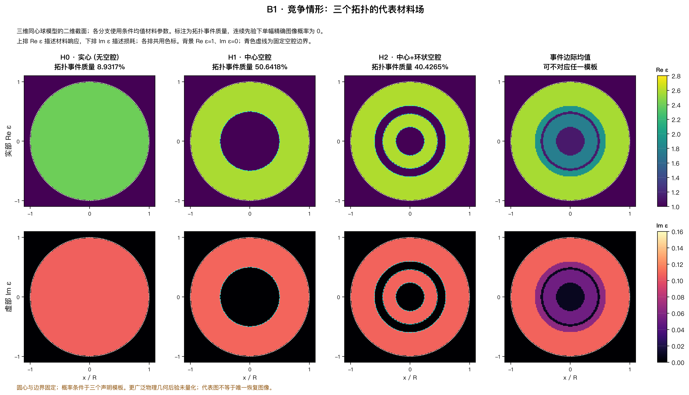
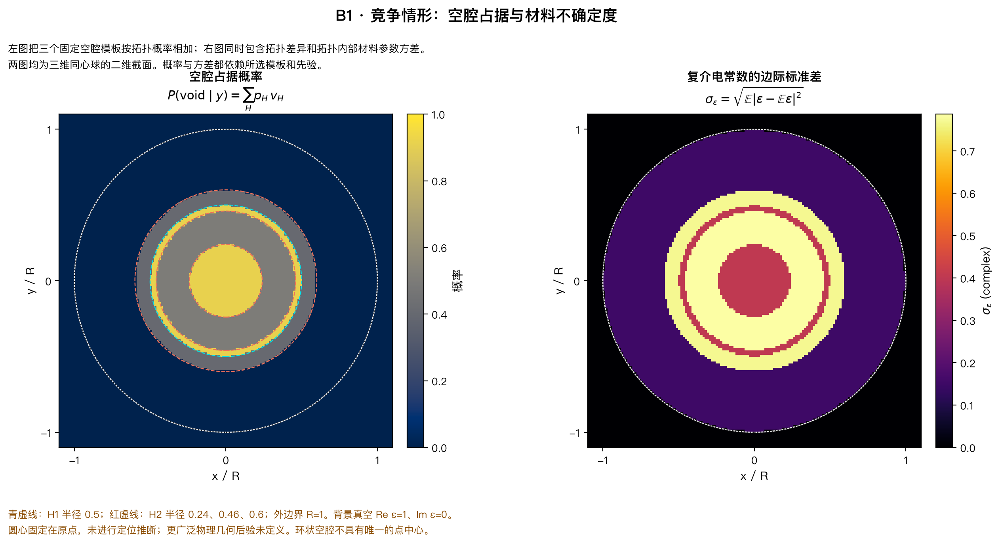
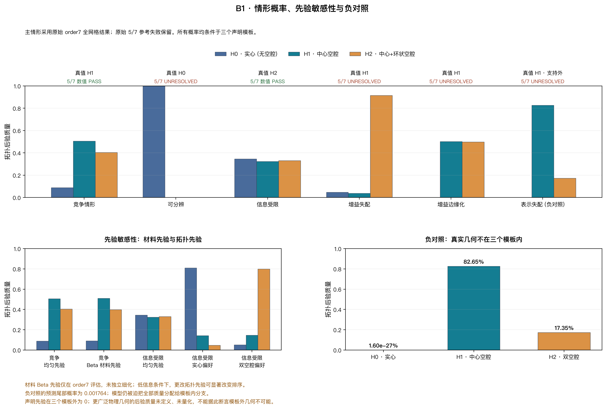
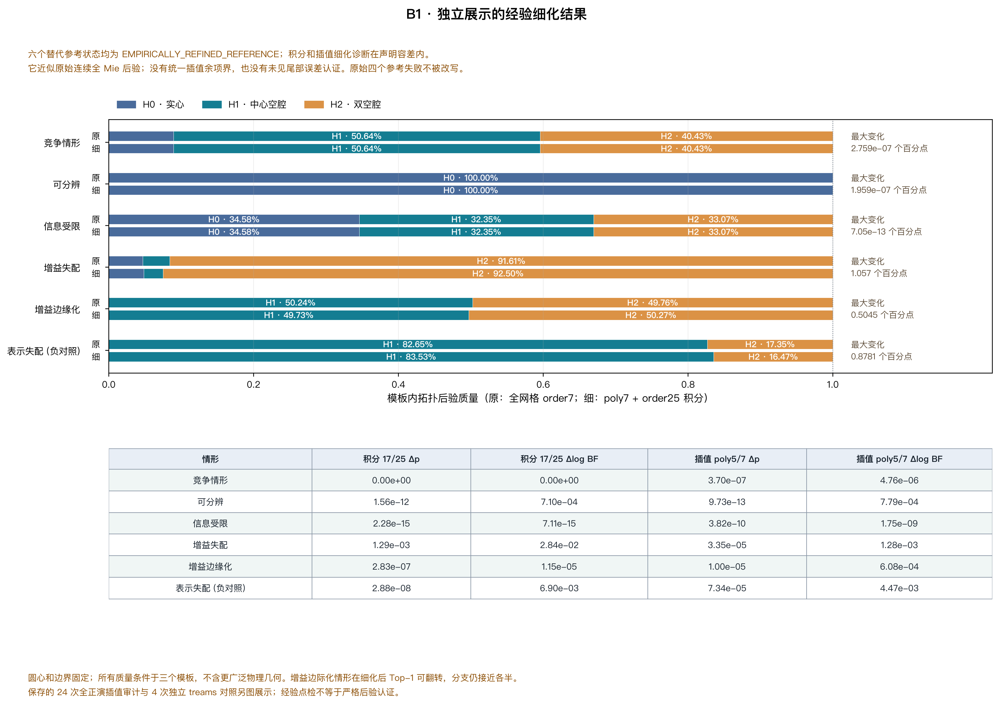
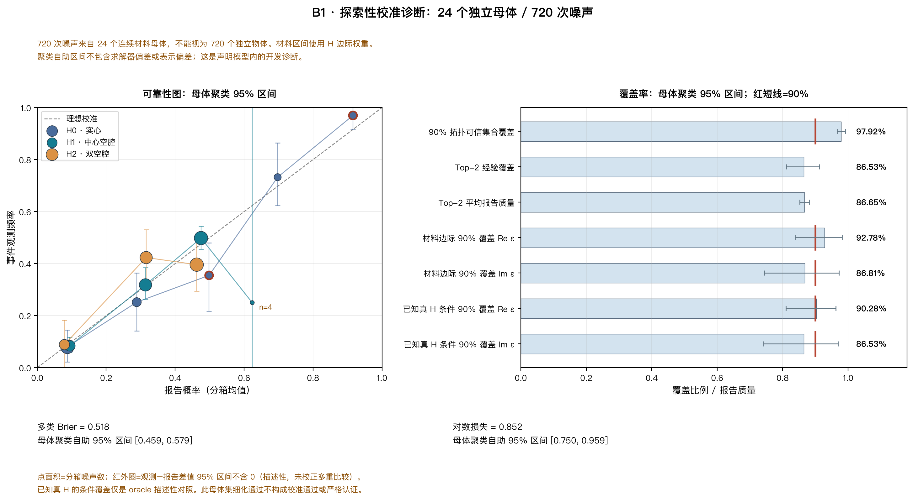

> 最新 Joint P2 的研究结果见 [独立中文报告](research/joint_p2/RESEARCH_REPORT_ZH.md) 和 [新阶段入口](research/joint_p2/START_HERE.md)。以下历史正文保留。

# B1：从一张材料图，到几个有概率意义的 Maxwell 材料解释

2026-10-13。完整代码、配置、图、概率数据和账本在本目录。交互入口是[dashboard.html](dashboard.html)，数学细节见[THEORY.md](THEORY.md)，机器结果见[results](results/PRIMARY_SUMMARY.json)。

## 1. 问题从何而来

传统逆散射通常寻找一个能解释测量的材料场。问题在于，最低残差的一张图未必代表唯一物体，也不一定是有最大概率质量的结构：很窄的高峰与很宽的次高峰，积分质量可以完全不同。对实心与有孔物体，单图还隐藏了测量是否真的能区分它们。

Bayesian scattering、结构先验和模型选择已有成熟来源。[Carpio–Iakunin–Stadler](https://arxiv.org/abs/2003.09318)研究拓扑先验及二维散射；[Zahm等](https://arxiv.org/abs/1807.03712)与[Spantini等](https://jmlr.org/papers/v19/17-747.html)研究安全降维/低维运输。因此B1不能以“Bayes+拓扑+多个图”作为新颖性。多层球Mie也是已有三维电磁方法，[Peña–Pal](https://doi.org/10.1016/j.cpc.2009.07.010)提供相应算法来源。

已有项目提供了更具体的约束。A30的hull/Sparse/PCA结果是offline truth-fit容量，未证明测量可以选出那些材料；A30补偿和uniform证书路线未通过。已执行的另一份A32连续MAP使复杂材料MSE增加39.46%，后续反馈未运行。A17能严格解释某个冻结Galerkin current改动怎样改变材料切向与局部步，但不能直接赋予候选图后验概率。B1保留这些负结果，并以用户上传的A32理论包作为新的概率研究来源，而不是把两个同名任务合并。

这次研究先回答一个可支付的问题：**给定相同数据、proper prior与真实矢量Maxwell模型，能否输出几个完整材料事件的概率，并知道数字何时不可靠？**

## 2. 真正运行的成像问题

原型采用外半径1、kR=1.6的三维非磁同心分层球，全波包含电/磁多极与两种偏振响应。8个散射角产生16复通道，实化为32维。主实现匹配切向E/H，不使用Born近似来生成主数据。它复用A13的角向函数与约定，并以独立递推、均匀球解析极限和已有A15/treams核验分层系数。与二维TM证据清楚分开：原包74次二维圆柱调用仅是历史来源，B1新增的是384次三维vector-Mie评估。

材料世界被明确限制为三个模板：H0实心；H1半径.50的中心空腔；H2半径.24的中心空腔，加半径.46至.60的封闭球壳空隙。后者有两个三维连通真空区；不是任意位置的两个洞。所有介质区共享连续ε′∈[2.2,2.8]、ε″∈[.04,.16]，proper独立均匀prior，各模板初始mass为1/3。中心、外边界和空腔边界已知，尚未推断位置/几何。

概率目标是π(H,θ|y)∝πH L_H(θ;y)μ_H(dθ)。主方法先在每个H内积分likelihood，再归一化三个evidence；σ为实验固定噪声，不按候选signal重新缩放。单张连续材料图质量为零，图旁百分比属于整个模板与其全部连续ε区域。可运行CLI出口采用该分支的近似条件最大likelihood材料；主图与面板采用条件均值ε作为合法代表材料，并单列整体后验均值。两种选择都不改变分支mass，代表图不被宣称为额外已验证的物理样本。covariance与可信区间另有保存。

默认只突出Top2，保留第三分支mass。三个模板合计1只是这个prior的完整性；模板外质量在此prior中为0，在更大物理世界中的概率尚未定义。没有把未知外部世界伪装成已估计的“Other 5%”。

## 3. 最直接的成像结果

竞争性案例得到：

| 材料事件 | 原生7阶概率 | 经验细化概率 | 含义 |
|---|---:|---:|---|
| 单中心空腔H1 | 50.6418% | 50.6418% | 最大质量分支，但远非确定 |
| 中心+球壳空隙H2 | 40.4265% | 40.4265% | 第二个有显著质量的解释 |
| 实心H0 | 8.9317% | 8.9317% | Top2未展示的真实剩余mass |

Top2合计91.0683%，没有重新归一化到100%。原生5/7阶最大概率差2.72×10⁻⁶、最大logBF差1.10×10⁻⁵，通过冻结研究容差.02/.1。第三个事件亦有非忽略质量，可在dashboard中检查其代表图。

空腔occupancy表示某个空间点在这些模板下处于空腔的概率。中心固定，所以它不是未知位置定位成果。材料SD合并分支内连续ε不确定性与分支差异；它不是独立像素误差条，也不是simultaneous credible band。

实心强信号案例只存在一个有实质mass的主分支，经验细化p(H0)>99.999999%。其余模板概率极小；没有为了凑K制造几个高概率世界。但其原生5/7阶logBF误差.366，原reference仍失败。后面的细化处理解决了数值分辨率问题，没有抹去首轮失败。

## 4. 为什么有的结构由数据支持，有的由prior决定

信息不足案例的概率约(34.582%,32.352%,33.065%)，接近等prior，属于观测歧义。把模板prior改成(.8,.15,.05)，同样数据给(.80961,.14201,.04838)；换成(.05,.15,.8)，则给(.05234,.14690,.80075)。这不是概率计算自相矛盾，而是likelihood无法主导odds。

竞争性案例则确实压低实心mass，同时保留两种空腔解释。full有限割线与prior尺度材料metric提供响应差异的解释，但固定ε的两点误判率不能代替复合拓扑evidence。分支内ε和nuisance必须积分。

两个负控制更重要。数据真值有g=1.30的未建模校准增益时，固定g模型在经验参考下把92.496%质量给了错误的双空腔模板；posterior predictive tail约.00156，提示模型不合适。使用proper g~N(1,.15²)、保留candidate-dependent logdet之后，结果变成H1≈49.732%、H2≈50.268%，predictive一致性改善，但仍没有唯一识别真拓扑。未知gain真实消耗了可辨识信息，不能靠“full Maxwell correction”凭空恢复。

表示负控制把真实中心空腔半径设为.68，而prior只有.50/.24等模板。模型仍可给H1≈83.532%质量，predictive tail约.00176；真实材料不在support里，后验从定义上不可能恢复它。PPC在这个例子发现了异常，不代表所有遗漏都会被检测。

## 5. 两轮自主迭代怎样改变了结论

第一轮完成19项forward审计、连续3/5/7阶积分、密度修正importance、单点/多起点/残差对照、近似模型机制和24个新连续材料parent的生成检查。累计356/384。竞争与信息不足案例通过原生reference，强信号、gain及表示错配未全部通过。

失败归因是likelihood积分分辨率：光滑且核验良好的F，在较小σ下也可产生狭窄likelihood峰。扩大训练网络并不针对这个问题。第二轮先把已支付的5/7阶场网格构造成明确的tensor-Legendre近似，再用17/25阶廉价积分细化。最后28次全波预算用于24个新corner/均匀点及4次已有treams独立参考，包含所有重复与检查。

24点最大相对场误差6.00×10⁻⁷；已有独立treams最大差1.85×10⁻¹⁵。17/25积分和5/7 forward近似之间的P/logBF比较均过研究容差，最难gain错配例的17/25最大概率差.00129、logBF差.02838。tested likelihood误差最大约.000501。

这些证据支持**经验细化reference**。它没有全prior-support的uniform插值余项，也没有区间算术认证。原生full-grid失败仍标REFERENCE_UNRESOLVED；第二轮单列EMPIRICALLY_REFINED_REFERENCE。条件ε quantile的细化并未沿用topology gate：在一个强信号分支17/25变化可达ε′约.01515，区间也不能称认证。

## 6. 哪个算法值得继续，哪个应该停止

主算法是无NN的branch-wise数值积分。另一个候选是已知[防御importance方法](https://doi.org/10.1080/00401706.1995.10484303)：每H16样本，proposal保留50%proper prior，全likelihood权重包含L/q，随后乘分支prior。三个注册事件都保持支持。

48次importance全波调用另有27次coarse proposal准备。在竞争例，最大概率误差.02565，未达到.02；ESS均约14–16仍然不能保证概率准确。输出bootstrap区间很宽，而且不能发现从未采到的窄峰。目前没有理由在这个二维连续变量问题上用它替代可靠积分。此失败属于有限采样质量，不能推成SMC/MCMC/RJ在复杂高维问题中都无用。

独立review还对同一720个已保存数据作了完全确定性的零物理重分析：原生Gauss5的冷setup名义75状态与固定importance的27+48=75状态匹配。Gauss5相对Gauss7的平均/最大P差3.43e−5/2.90e−4；固定importance为.03877/.23223，仅28.47%数据达到.02。其Brier/log为.53018/.87110，相对Gauss7的parent配对区间均指向恶化。proposal固定来自竞争y0，没有为720个新数据重新拟合/抽样，因此结论只针对这一冻结bank，不是所有importance或高维sampler的失败。Gauss3只需27名义状态，719/720的P差不超过.02，但完整P+logBF门槛另外记录。原生Gauss5在这个低维panel是更稳妥的成本选择。

single MAP只给一个点；四起点优化在冻结cubic场近似内找分支最优，选中endpoint再全波核验；它不是全球full optimizer。残差peak softmax没有积分体积，明确标HEURISTIC_NOT_POSTERIOR。独立比较及同名原始结果保存于POINT_ESTIMATOR_COMPARISONS；这些数值不能被包装成Bayes mass。

这里暂时不启动大型NN、Transformer、flow或diffusion。材料token在数学上可用prior树和后续evidence定义条件概率，但这不意味着必须用Transformer；本原型只有一层离散拓扑，连续ε直接积分。还没有遇到需要大型生成架构才能解决的明确计算瓶颈。

## 7. 概率和材料不确定性检验支持了什么

在24个新连续材料parent中，每个生成30次独立噪声，共720个数据。它们来自声明的prior/model；没有打开历史locked ID/OOD，没有将开发reuse称blind validation。原生5/7参考对全部720数据过P/logBF容差。

| 指标 | 结果 | 95% parent分层bootstrap |
|---|---:|---:|
| multiclass Brier | .51820 | [.45935,.57915] |
| log score | .85161 | [.75028,.95928] |
| Top2真实H覆盖 | .86528 | [.81108,.91250] |
| Top2平均报告mass | .86652 | [.85235,.88099] |
| 覆盖−报告mass | −.001244 | [−.04583,.03644] |
| 给真实H条件的ε′ 90%区间覆盖 | .90278 | [.80972,.96250] |
| 给真实H条件的ε″ 90%区间覆盖 | .86528 | [.74167,.96944] |

原生review精确重建已保存种子与noise，720个概率向量最大差1.11×10⁻¹⁵，未求新的物理。H-marginal材料覆盖另为ε′ .92778、ε″ .86806，不能混称条件覆盖。离散90%拓扑credible set的平均报告mass为.97562，真实覆盖.97917；离散性使集合可能超过90%。

这仍是探索性检查。部分分箱的“观察频率−平均概率”cluster区间不含0，样本分箱/多重比较及只有24个parent的限制不能忽略。Top2整体匹配不等于全面校准通过。没有执行[Talts等的posterior-rank SBC](https://arxiv.org/abs/1804.06788)，没有真实仪器数据校准，也没有把这些区间当包含solver/插值/漏支持误差的联合证书。

## 8. A17/A30/A32是否带来实际新增价值

A32明确要求先计算事件evidence、保留tail/other质量、分开信息不足与数值未决，这在原型中实际避免了“多个图=posterior”与“概率集中=模型正确”两种错误。它提供研究目标和检验方式，价值已经可见。

A30材料可观测metric帮助检查弱方向及prior尺度，但没有把局部JᵀJ逆当完整材料后验。A17/A32双侧签名在两个同anchor affine模型中给出精确势能差，最大代数误差约9.06×10⁻¹⁴；然而这里的两个Mie Jacobian只是central FD/SVD因素，**没有运行A17 native Galerkin交换**。defect rank2而材料仅2维，签名不降维；非线性剩余在错配场景并不小。

竞争例full对calibrated-L最大P变化.01232，信息不足例.000232，说明更准确物理不一定改变材料任务。gain错配可达.09020，又说明不能普遍宣称cal-L够用。当前只获得解释诊断，没有native feedback、全域证书或同概率精度部署加速的新增证据。

## 9. 最终科研裁决

**GO：继续把本原型作为低维、受限三维材料事件概率成像reference与演示工具。** 它真正从散射数据给出多个物理材料解释、事件质量、剩余mass、条件材料不确定性与predictive诊断。

**HOLD：一般几何、真实材料后验校准与严格概率认证。** 未知位置/边界、任意多孔/多组件、宽材料与色散prior、真实仪器噪声、支持外概率模型均未建立。下一阶段应先扩一个几何自由度或一个有proper分布的其他分支，并重新给定预算与可信reference；不能直接把这个封闭模板posterior当全世界答案。

**NO-GO：当前48点importance替代积分的精度主张；A17-native posterior加速主张；大型NN启动。** 不以高ESS、低residual或精美图像替代概率质量改进。

**IEEE TAP强理论/算法稿：尚不成立。** 现有实现组合Mie、Bayes evidence、防御importance与场插值，都是已知工具。树条件概率推导和tilt恒等式是必要正确性依据，而非新定理。需要真正Maxwell-specific的非空余项/事件误差理论、复杂几何/多个nuisance的可靠reference，以及匹配概率精度的全成本优势，才有强论文依据。

新增物理384/384，含16项audit调用、243网格、4个观测真值、48importance、9选中优化核验、12导数、24生成parent和28最终核验；逐条BEGIN/END完整，物理失败0。实现错误与错误重放保存，历史74二维调用也保留，合计458个解析材料–频率评估，A31历史微型物理另列。主机job、物理kernel、绘图/重分析与模型服务工作分别记账，不将这些秒数说成一般三维网格成像的成本。

24项最终测试通过，两个review发现的问题已修复并回归：条件/边际coverage标签，以及增益NPZ元数据丢失。HTML浏览器现场验收被工具的本地file访问策略拒绝，标NOT_RUN；8张科学PNG视觉核对完成。本项目未公开发布。

证据保留缺口：4次独立treams核对保留了输入、误差与环境回执，但未保留其原始参考系数/数据数组；因此这些差异不能仅凭已存oracle数组独立重算。后续代码已增加原始数组保存，本研究在384次上限后没有重跑物理。

公开发布更新（2026-10-13）：用户授权公开本研究的代码、概率结果、报告和失败/资源记录。仓库：[https://github.com/migodam/b1-probabilistic-maxwell-imaging](https://github.com/migodam/b1-probabilistic-maxwell-imaging)；[重建图网页](https://migodam.github.io/b1-probabilistic-maxwell-imaging/)。发布过程未新增科研gate、SHA-256核验、smoke或代码小测试，未运行新物理。文中的历史未发布状态仅描述当时记录。
