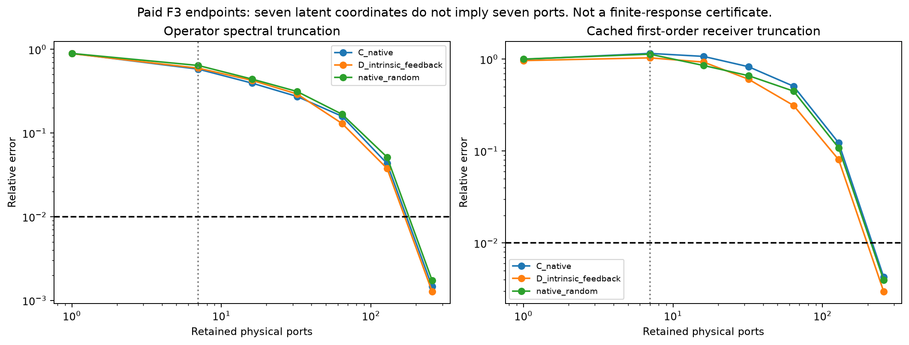
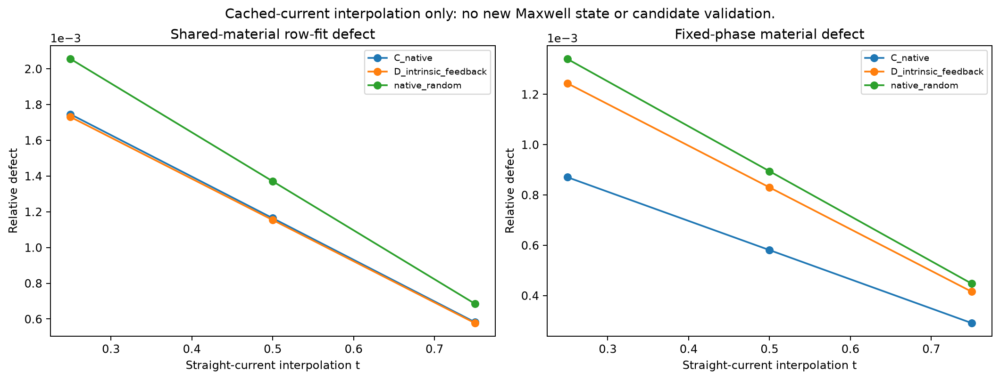

# A17-X在F3之后：有限反馈可保留，小端口与共享材料不能假定

2026-10-17。**本轮已实际完成零新增物理审计；没有启动P1或重跑P0。** 科学baseline固定B1 a323ef2，最新版Pro包完整读取，原A17正文与最新公开入口核对，原代数程序重放并增加独立反例和缓存诊断。

最重要的新结果不是又生成了材料图，而是找到了一个会使成本预期错误的具体假设：F3虽然只有七个商参数，其材料增量算子仍接近全秩。A17-X的有限物理公式没有因此失效，但不能无条件以“小端口”进入这个平台；多源共享和固定相位也不因source chart而自动保持。

## 1. 最终结论

| 问题 | 本轮证据与决定 |
|---|---|
| F3是否已经检验A17 exchange？ | 没有。D是full方向Hessian；其负结果保留，不归罪于A17 |
| A17-X有限公式是否成立？ | 条件代数重放通过；不是实物/真实网格成功 |
| 七维材料是否给七端口？ | 否。17个存储DeltaX均有575个非零对角项 |
| 当前straight-current是否保原P0？ | 所测三个候选的直线current插值不精确满足共享材料及固定相位 |
| 新P1准备好了吗？ | 已查资产中没有完整P1 target/law/anchors；全局状态UNKNOWN |
| 有没有新增物理预算？ | 没有；旧128/4096仅建议，本轮实际0/0 |
| 是否开始真实竞争或NN？ | NOT_RUN；交付已冻结的条件比较设计 |
| A17是否已有增量？ | 未建立；允许最终NO_A17_INCREMENT |

## 2. F3不被改写，也不被忽略

原F3取得两个新的边界likelihood/KKT anchor，旧F1 Gate2仍失败；两个背景来自同一parent。weak在任务RMS .00527555存在三个数值不同竞争端点，彼此更近、没有新拓扑。普通native同距离DeltaPhi1.140604，高阶D1.632730；56RHS cold等价下native前缀2个合格端点，D1个。原F3 55states/712RHS、17.6407s已封账。

这些都是历史已付费证据，不是本轮新求解。本轮不再重复四臂、prior MC、MH或九个q直线中点。F3只是负/小幅finite-noise控制，不代表具有丰富结构的新P1，更不是一般三维成像。

## 3. 条件数学核验真正做了什么

包内18维合成矩阵检查重放：完整finite-port响应与直接solve相对差2.11e−14；有限双侧exchange误差8.64e−16；端口残差分解3.58e−16；source chart的实Jacobian差分误差约1.08e−12。公式实现通过，不自动获得物理prior或加速证据。

尾界样例theta=.00751848、实际误差.01884035、上界.10659713，约松5.66倍；其常数源于浮点SVD，不是deterministic认证。独立theta=2反例中完整feedback仍稳定，说明充分界失效不等于解不存在。

单源dark chart把该源变化压到约3.57e−16，但其他源变化.0280645；人工对齐两源例通过，一般独立两源例receiver-dark复维数3、附加feedback行相容后的joint维数0，三个数值阈值一致。三维各向同性块反例的共同材料残差.38125；逐分量零残差并不合法。

这些是合成正负控制，不是新Maxwell网格、P1、多解、posterior或成本优越性实验。原报告的related-work访问边界保留，本轮不作新文献优先权主张。

## 4. 七维latent与575秩材料变化

对标量X=diag(chi)，DeltaX的奇异值为网格|delta chi|。17份历史端点的实际存储非零项均575；三个合格weak端点在1e−10相对阈值下均rank571。

最优算子rank-7截断仍遗漏58.01%、59.57%、64.15%的谱范数；按同一截断计算的缓存一阶接收误差为115.39%、103.23%、113.22%。要把算子误差压到1%，分别需要188、178、193端口。

这直接否定当前“七维所以s=7”的成本捷径。575端口精确setup需575个传播RHS，而Full-J可共享32个receiver-adjoint；并非不能求，而是必须诚实计价和考虑摊销。RHS比值不是速度比，也不否定current-space goal-ROM可能很小。

图中的receiver误差仅是缓存一阶代数。没有对截断后新材料做forward，也没有finite truncation证书。本轮没有补求完整R0 U/H；它们仍MISSING。不能把一阶图当可靠likelihood加速。

## 5. 更直接的材料可实现性检查

本轮还利用两端已保存j/field，计算k=j1−j0、T=L0k与Gk，核对完整差分关系。最大相对状态关系误差4.82e−13，接收关系误差7.83e−13，未调用旧LU或新增RHS。

如果直接按k(t)=t k插值，同一个复材料必须在每个像素同时解释8个source。对三个合格weak端点，在固定t=.25/.5/.75上，最优共同标量row-fit仍有5.77e−4–2.06e−3相对残差，读出增量还违反固定相位约2.91e−4–1.34e−3。

这只否定这些具体current直线的精确可实现性。它不否定其他弯曲current路径、其他有理chart或新的P1，也不是新候选endpoint验证。旧F3 q直线中点属于另一项已付费物理实验，不能混报。

## 6. A17与ordinary goal-ROM相同空间时会发生什么

独立合成比较显示：exact T-matrix与full差1.10e−15；A17增量更新与直接ordinary Galerkin在同[V,C]下的finite预测差2.75e−16。两者对full的误差均约.000174069。

这是可预期的恒等式，却对下一轮设计非常关键：A17不能仅因写成双侧feedback形式而在同空间拥有更高精度。它应通过**同预算更好的空间选择、更便宜的更新或更有效tail**取胜；ordinary ROM也应允许Schur和factorization复用。Exact T-matrix必须保留，否则无法分清有限物理机制与A17的独立贡献。

因此冻结两个竞争轴：proposal用F3-native / X-rational / ordinary Full-J；同一批材料的求值用full / exact-port / goal-ROM / A17。具体进度、失败、独立parents、付费和信息隔离规则见COMPETITION_PROTOCOL_FROZEN。

依据575秩障碍，本轮还实际修改了计算表示：保留原生合法材料，只对其有限状态方程L_D k=DeltaX E0做current exchange，不先建全端口H。12个独立合成dense增量中，exact-port/full差≤6.33e−16，A17/ordinary同空间差≤4.61e−16。它证明该实现不依赖小端口，但没有证明其更快。保留该版本作为下一轮默认求值臂，普通goal-ROM必须保留；详见MECHANISM_REVISION。

## 7. 为什么本轮不继续支付真实物理

本机B1主仓/worktrees、A30、C1-P1和最新C1入口中没有新丰富材料P1的完整prior/law、观测及合格anchor。F3只留下P1方向建议；C1-P1实际是不同受限二维density target，Joint P2也仍是径向台架。已查本机未见匹配运行任务，但不证明远端或未连接会话没有工作，故全局标UNKNOWN。

用户明确要求目标与新预算均准备好才启动。新版FIRST_GATE为audit_only，旧128/4096是未批准建议。不能以“允许自主优化”覆盖这条边界，也不借旧P2/F3余额。

下一轮建议在P1及两合格已付费anchors交付后，仅做24state、512+s1+s2 RHS、600s CPU的两parent机制pilot；在原标量网格最坏1664RHS。该公式不是授权，也不覆盖建立P1/重建anchors的费用。P1若采集不同，需先重算协议。

## 8. 继续和停止

**保留**有限端口、共享材料条件和有剩余项的exchange接口，作为竞争候选；**停止**当前P0上的小七端口假设、未验证高阶优越性和NN建议。P1的prior和任务应由物理原因独立确定，不能为了让A17高效而事后放松支持。

若P1确实具有合法任务尺度歧义，再按共同协议比较；若普通Full-J、exact-port或goal-ROM更好，删除A17组件。若P1本身只支持很小的连续不确定性，则停止结构多解主张，转概率宽度或主动测量。

目前没有足以支撑强IEEE TAP算法论文的真实机制与成本正结果。本轮的明确新增价值是发现并量化了端口秩和共享材料障碍，避免把正确恒等式包装成已完成生成算法。

[裁决](GO_NO_GO.md) · [来源与目标](SOURCE_AND_TARGET_MANIFEST.md) · [协议](COMPETITION_PROTOCOL_FROZEN.md) · [理论细节](THEORY_AND_SOURCE_COMPATIBILITY.md) · [缺口与成本](EVIDENCE_GAPS_AND_BUDGET.md) · [复现](REPRODUCE.md)
