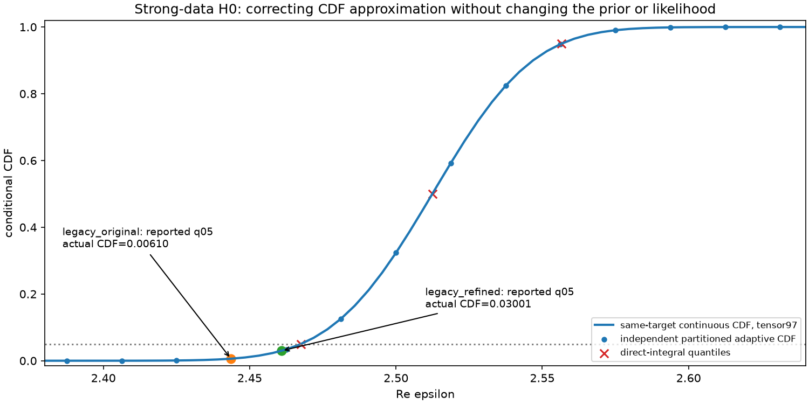
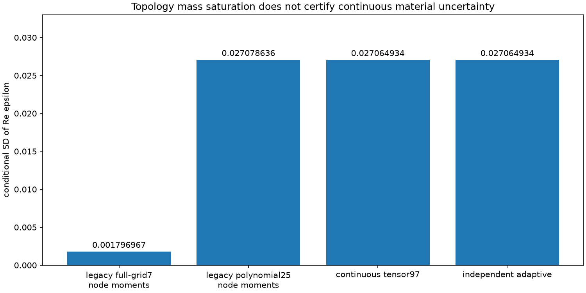
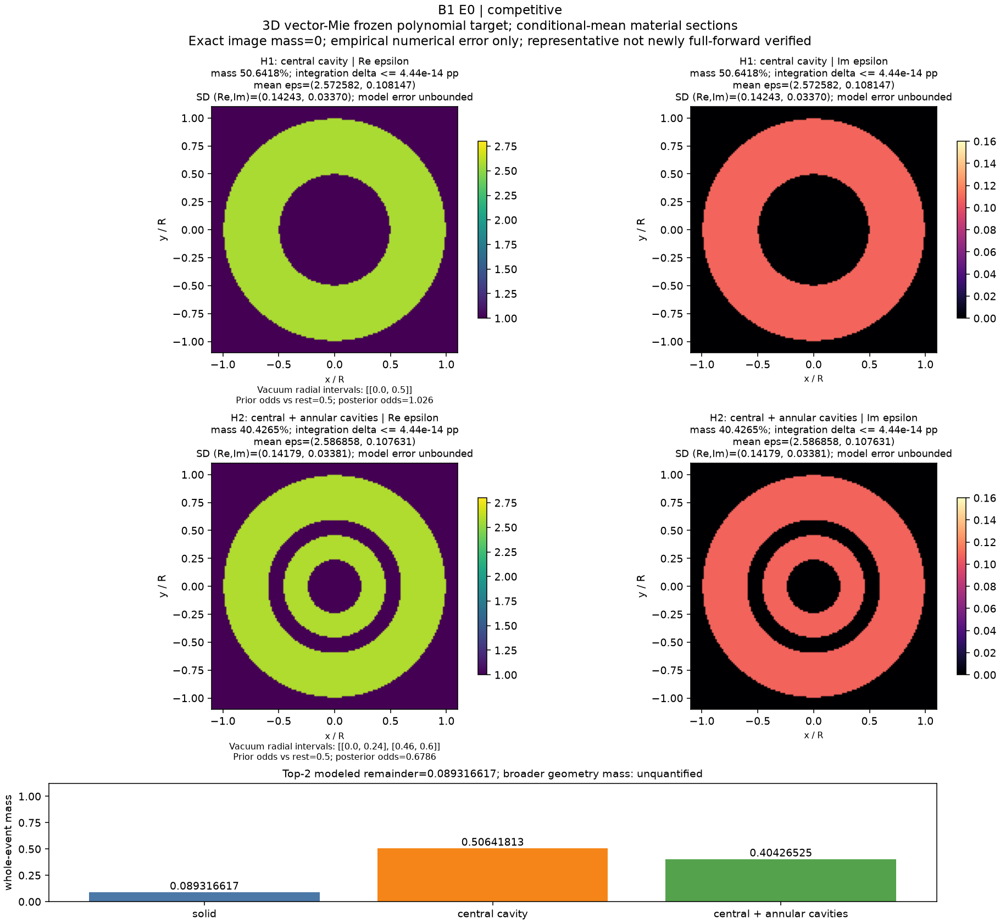

# B1 E0：让材料均值、方差和分位数属于同一个后验

2026-10-13。该阶段新增物理预算与实际调用均为0，工作位于独立分支`research/b1-e0-posterior-audit`。历史384次账本保留，P1的4,000次只是未授权建议。

## 从基础问题到发现

材料事件的概率是likelihood在整个事件及连续材料参数上的积分；一张连续材料图的精确概率质量为0。传统MAP与最低残差不能代替该积分。同样，稳定的拓扑质量不能保证事件内部的材料不确定性正确。

B1历史模型是三个固定同心模板、连续复介电常数和真实3D矢量Mie响应。主prior为Re ε均匀[2.2,2.8]、Im ε均匀[.04,.16]，拓扑prior各1/3。当前阶段是这个已支付benchmark的数值修复；未把三个模板升级为开放材料生成架构，也没有强制下一阶段按孔洞数分设生成专家。

强信号distinguishable/H0的原生节点方差为3.22909059496e-06，但原分箱q05/q95与均值要求至少约3.1851109e-4。约98.64倍的违反来自两套近似摘要混用，不能归因于evidence归一化错误。72个历史条件坐标记录中检测到5项必要条件不相容；没有违反也不是准确性认证。

## 明确的posterior target与修复

本阶段使用已经付费的7×7 response网格对应的tensor-Legendre多项式；每坐标最高degree6。5×5对照最高degree4。它们仍是明确的近似forward，不是新增full-Mie求解。

对每个H，Z_H=∫L(F_poly(H,θ);y)dμ_H，p_H=π_H Z_H/Σπ_G Z_G。所有moments、协方差、CDF和quantiles来自同一个连续density。CDF在截断prior矩形上直接积分，quantile通过反解CDF求得，不再将节点质量铺到prior bins。Gauss权重是连续prior积分权重，不是离散候选prior。

实化采用全部16个复通道Re后接Im；σ是固定的每实分量SD，复RMS为√2σ。g~N(1,s_g²)的边缘协方差为σ²I+s_g²FFᵀ，保留candidate-dependent logdet。保存与重放显式携带gain_sd；新NPZ入口拒绝缺失该字段时静默变为known gain。

## 决定性的连续材料结果

|strong H0 / Re ε|均值|SD|q05|q95|
|---|---:|---:|---:|---:|
|历史原生节点/bin混合|2.500024354572|0.001796967054|2.443575757838|2.556449329157|
|历史经验细化节点/bin混合|2.512259756399|0.027078635773|2.460967528541|2.554300794596|
|同一连续density积分97|2.512266331658|0.027064934288|2.467483321080|2.556513143734|

在修复target下，原生所报q05实际CDF为0.006095769246，细化所报q05实际CDF为0.030011505243，分别不是5%。这些值来自新的直接截断积分，不是绘图插值。细化moments已经接近收敛，但它的bin-CDF仍有可检测偏差。

## 独立数值参考与误差边界

主积分按25/41/65/97阶细化，覆盖六案例、三个条件事件和材料边际。独立算法用二维分区自适应5/9点积分，在不同partition节点上重新计算同一density。主CDF网格129点，独立CDF33点并直接反解quantiles。CDF比较只针对已测网格，不能宣称全域sup误差证书。

预定容差为CDF差≤.01、均值/quantile差≤prior宽度×.001、SD差≤max(参考SD×.01,prior宽度×1e-6)，必要variance下界浮点容差为prior宽度²×1e-12。全部六例通过本阶段连续摘要的经验核对，未修改容差。response插值5×5/7×7的差异与likelihood积分误差分列：

|案例|65/97 CDF最大差|97/自适应CDF最大差|5×5/7×7 response的CDF差|独立事件质量最大差|
|---|---:|---:|---:|---:|
|distinguishable|2.875e-14|1.189e-12|1.992e-04|3.402e-21|
|competitive|2.442e-15|1.776e-15|3.350e-05|4.441e-16|
|information_limited|2.665e-15|8.882e-16|1.001e-06|0.000e+00|
|gain_mismatch|6.706e-14|3.878e-12|2.407e-04|6.573e-14|
|gain_marginalized|3.886e-14|3.009e-14|1.402e-04|3.553e-15|
|representation_mismatch|4.673e-13|4.050e-13|2.546e-04|7.022e-15|

独立积分与相同polynomial target的一致支持数值积分正确性，不证明整个prior上full-Mie插值误差、连续Maxwell极限、漏模式质量或真实仪器模型正确。

## Top-K成像与概率语义

|案例|H0实心%|H1中心空腔%|H2中心＋环形空腔%|连续摘要状态|
|---|---:|---:|---:|---|
|distinguishable|100|7.9858448e-10|4.8364243e-07|EMPIRICALLY_CONVERGED_CONTINUOUS_SUMMARY|
|competitive|8.9316617|50.641813|40.426525|EMPIRICALLY_CONVERGED_CONTINUOUS_SUMMARY|
|information_limited|34.582133|32.352384|33.065482|EMPIRICALLY_CONVERGED_CONTINUOUS_SUMMARY|
|gain_mismatch|4.8388723|2.663974|92.497154|EMPIRICALLY_CONVERGED_CONTINUOUS_SUMMARY|
|gain_marginalized|3.3315013e-07|49.731852|50.268148|EMPIRICALLY_CONVERGED_CONTINUOUS_SUMMARY|
|representation_mismatch|1.2130242e-26|83.532495|16.467505|EMPIRICALLY_CONVERGED_CONTINUOUS_SUMMARY|

图的材料代表为事件内条件均值ε，在固定模板内合法，但未新增full-forward代表核验。图示为3D材料的2D中心切面。每项附prior/posterior odds、条件SD、数值mass误差及事件定义；Top2保留第三事件余量，不重新归一化。prior外质量0只描述这个封闭prior；更大几何世界未定义，质量保持null/未量化。极小质量的第二模板不能称为发现了第二个重要mode。

## prior、nuisance与必要负控制

信息不足数据下，改变拓扑prior显著改变质量；计算不因此矛盾。改变prior的结果拥有独立protocol标识，不能混作原target。相同gain数据分别用known gain与proper marginalized gain处理，likelihood协议不同；前者集中于错误H2，后者H1/H2竞争。补偿profile minimum仍不能替代integrated evidence。

附件零物理代数重放以及Cholesky独立核对通过；保留slogdet的除零/overflow/invalid警告。高ESS漏模式反例、prior-only posterior、同测度坐标变换、radius/volume不同prior、event partition、metadata回放和TopK余量均执行。toy和随机矩阵不作为新增Maxwell物理证据。历史材料coverage使用旧bin-CDF，本阶段没有重算720个data的coverage，不把旧数值沿用为修复后的coverage声明。

## 成本、失败与可复现性

主推断与controls实际body wall=69.517666s，CPU=67.308709s，实际polynomial evaluations=214,121,615。这些不是物理调用。直接CDF probes和public CLI replay另计，绘图另计；网络、模型服务、交互时间不完整测量。没有新GPU/NN/旧locked数据读取，也没有SHA-256或额外smoke。

四个历史treams oracle数组仍缺失：保存了输入、误差和环境，但不能从旧原始oracle数组重算。后续refine源码保存数组不补齐历史。没有重跑来掩盖缺口。三次原生报告worker尝试因模型容量失败，父Codex接手，不切换provider/model，服务成本未测。全部记录见FAILURES及资源文件。

## 科研裁决与明确停止

继续保留并修复概率benchmark。E0证实了一个实用反例：拓扑质量饱和与连续材料摘要失真可并存；这属于数值正确性发现，不是新Maxwell可辨识定理。

E1 raw/full-Mie secant、ε及ε+gain补偿、多频、统一implicit radial field和算法机制比较全部NOT_RUN：没有新增物理授权。nuisance-aware nonlinear secant的新增解释力、物理proposal全成本优势、active sensing收益都尚未测试；本阶段不能选择它们为已验证赢家。4,000预算不自动开启，不能借用C1余额。

当前没有IEEE TAP强理论/算法创新证据。停止用高ESS、低residual、拓扑mass稳定或漂亮图替代连续posterior参考；停止把fixed-template benchmark说成统一开放几何成像。下一步在有真实授权时先验证结构信号与nuisance compensation；机制失败则转active sensing或仅保留benchmark，不能无限调噪声制造成功。

公开更新：用户2026-10-13要求研究默认公开。本E0已并入同一个B1仓库；[网页报告](https://migodam.github.io/b1-probabilistic-maxwell-imaging/research/b1_next/e0/)、[研究总览](https://migodam.github.io/b1-probabilistic-maxwell-imaging/research/)。发布未运行新实验、哈希检查或额外测试。此前未发布的表述保留其历史时间含义，物理授权仍0。
