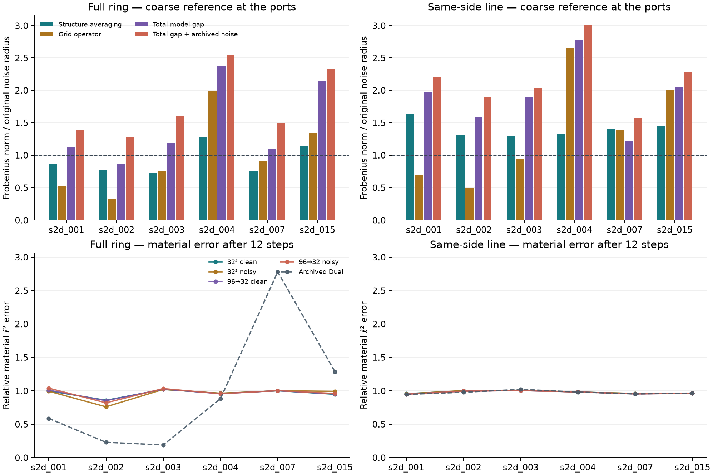
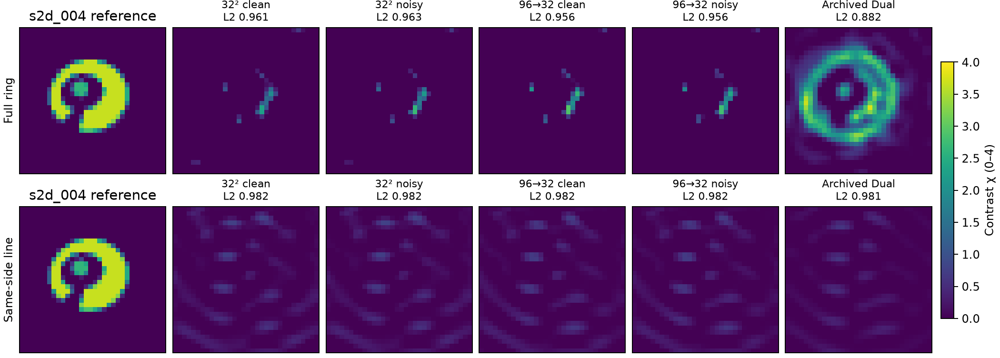

# SRAP 的 96² 到 32² 模型误差有多大

在 6 个原有 SRAP 材料、两套收发布阵上，**把真实材料粗化到 32² 后直接正演，12 份带噪观测都落在该预测的原噪声球之外**。全环的端口差中位数为 1.55 个噪声半径，同侧线阵为 2.12 个。即使移除观测噪声，11/12 的细粗正演差仍超过一个原噪声半径。因此，使用 32² 物理模型并要求只拟合到原噪声半径时，准确恢复原粗化材料与达到数据阈值是不同目标。

## 固定材料重放细、粗正演

从原 `srap_main24` 每一原始生成家族取第一个材料，按原 `family` 排列选出 `s2d_001`, `002`, `003`, `004`, `007`, `015`。每件材料使用已保存的 `PW360_10x20` 和 `LS_LINE_SAME_10x20`，以原布阵各自的观测与噪声半径配对。六个材料各计一次。阵列及四种数据条件是同材料重复。两个阵列的旧噪声方向不同，四条件的同一观测内比较共享同一方向和绝对半径。

96² 细网材料、源和接收选择、全波内部 Green、残差门槛均调用原 `data2d.py` / `fine_solve`。用原 `SeedSequence([20261121023, 物体索引, 原阵列索引, 0])` 重新生成复高斯方向，再按存档绝对半径缩放，从原 `Y` 分离测量噪声。另用细网真值独立重算全部原全波解，并调用原 `complex_noise` 生成规则交叉检查。12 组重放的最大相对差为 $5.27\times10^{-17}$，噪声数组最大相对差为 $2.49\times10^{-16}$。实际材料粗化结果与原存档逐元素相同。生成和真值复核在反演阶段前完成，反演程序仅访问 `public` 中的算子和指定复阵列，预测保存后再做材料评分。[原始重放结果和记录](results/model_gap/gaps.json) · [冻结设计](configs/model_gap.json)

为看清误差来源，令 $m_{96}$ 是原细网材料，$\bar m_{32}$ 是原 3×3 块均值，将均值按原样铺回每个 3×3 细网块得到 $\widetilde m_{96}$。同一发射、接收布局下计算

$$
\begin{aligned}
 e_{\mathrm{structure}}&=Y_{96}(m_{96})-Y_{96}(\widetilde m_{96}),\\
 e_{\mathrm{grid}}&=Y_{96}(\widetilde m_{96})-Y_{32}(\bar m_{32}),\\
 e_{\mathrm{model}}&=e_{\mathrm{structure}}+e_{\mathrm{grid}}.
\end{aligned}
$$

第一项只改变材料的亚像素结构且保留同一细网。第二项保留同一块常数材料，改变盘脉冲离散、内部传播及收发离散。观测相对粗化真值正演的残差恰为 $e_{\mathrm{model}}+\eta$，原噪声半径 $\delta=\|\eta\|_F$。以下全为复端口 Frobenius 范数除以原半径，各栏报六件的中位数和范围。

|布阵|子像素结构项|网格离散项|总模型误差|加上原噪声后的端口差|
|---|---:|---:|---:|---:|
|全环|0.820 [0.729, 1.273]|0.831 [0.320, 1.994]|1.158 [0.865, 2.369]|1.549 [1.271, 2.540]|
|同侧线阵|1.369 [1.296, 1.643]|1.164 [0.493, 2.663]|1.936 [1.219, 2.784]|2.122 [1.570, 3.000]|

误差项需要按复数场向量相加。以 `s2d_007` 同侧线为例，两项分别为 1.408δ 和 1.383δ，合成只有 1.219δ。12 份数据的总模型误差与旧噪声夹角余弦为 −0.144 至 +0.057。`s2d_004` 同侧线的固定粗化真值给出 3.00δ 的复端口差，是该样本最大值。判定限定在原 32² 离散模型及原存档噪声球，其他材料仍可能拟合端口。[逐例数据和误差交叉项](results/model_gap/gaps.csv)

## 相同起点的四条件物理反演

每份观测在原 32² 算子上，从空气 $\chi=0$ 独立起步，以 [0,20] 实盒和 12 步 L-BFGS-B 最小化完整非线性端口平方误差。无材料先验，正演与伴随梯度使用逐步重分解。四条件共享观测内的目标归一化。`32² noisy` 在同网格干净读数上加从存档重放的同一复噪声向量。`96→32 clean` 只移除这份噪声，模型差仍存。`96→32 noisy` 就是原 `Y`。另只在与原研究逐元素相同的 `96→32 noisy` 读取存档 `Dual m_30_light`，用同一完整正演和材料评分重审。历史预算是 30 秒并含轻校正，不能与新诊断的 12 次接受步作同时间算法排名。

各格是六个独立材料的中位数。内部误差以 $\bar m_{32}>0.1\max\bar m_{32}$ 的粗化真值区域定义，分母为该区真值 Frobenius 范数。背景误差分母为全图真值范数。拟合端口残差针对当条件的读数，原存档端口残差一律对 `96→32 noisy` 重算。前两类干净条件的原噪声半径仅作共同单位。

|布阵|数据和方法|全图相对 L2|内部相对 L2|背景误差|拟合端口 / δ|原存档端口 / δ|
|---|---|---:|---:|---:|---:|---:|
|全环|32² clean|0.980|0.957|0.155|8.982|8.722|
|全环|32² noisy|0.992|0.960|0.225|8.737|8.369|
|全环|96→32 clean|0.979|0.953|0.190|8.503|8.544|
|全环|96→32 noisy|0.980|0.952|0.222|8.495|8.495|
|全环|原观测 Dual 30 s light|0.734|0.548|0.486|2.320|2.320|
|同侧线|32² clean|0.972|0.951|0.215|1.322|2.481|
|同侧线|32² noisy|0.972|0.951|0.211|1.627|2.465|
|同侧线|96→32 clean|0.972|0.947|0.217|1.242|1.643|
|同侧线|96→32 noisy|0.972|0.947|0.213|1.569|1.569|
|同侧线|原观测 Dual 30 s light|0.972|0.955|0.152|2.868|2.868|

所有 48 臂触及 12 步上限。全环四条件多数留下接近零起点的材料，包括可精确拟合的同网格干净条件。线阵的端口残差较小，但四条件内部误差均在 0.95 左右。配对跨网格相对同网格的全图误差中位变化，全环干净/带噪为 +0.0024/+0.0073，线阵为 −0.0033/−0.0051，处于该短拟合的失败阶段。这组反演支持固定真值端口误差及拟合可误导的判断，尚不足以量化收敛后模型差对恢复质量的平均影响。

历史 Dual 全环端点更接近原端口，前三个物体的材料误差也明显降低。反例 `s2d_007` 全环的端口从本轮独立拟合的 10.03δ 降至历史 Dual 的 3.76δ，而材料相对 L2 升至 2.78。最大模型差的 `s2d_004` 在全环 Dual 图里重现部分环轮廓，内部对比和背景仍有较大误差。同侧线的低端口差及接近 1 的内部误差同时出现。[完整正演和逐例材料评分](results/model_gap/scores.csv)





## 复现与成本

从 Inv_SLAM 根执行。`prepare` 写具有原始算子的四类输入和独立的离线材料目录。`solve` 只用 `public` 和配置，保存预测及每步回执。`score` 在 48 个预测存在后读取材料并审计历史对照。

```bash
Gaussian/.venv_nn/bin/python -B research/hc_cie_r2/src/model_gap.py all
Gaussian/.venv_nn/bin/python -B research/hc_cie_r2/src/model_gap_figures.py
```

单线程复双精度运行。细网原材料及铺回材料共 372 个原全波 RHS，粗网真值及输入准备另有 120 个 RHS。准备墙钟 13.10 秒、CPU 12.67 秒。48 臂的 692 次目标与梯度，加各臂终点独立正演，共 7,400 个正演 RHS 与 6,920 个伴随 RHS，逐臂墙钟和 55.90 秒、CPU 52.50 秒。原 Dual 可比读数上的再审计为 120 个 RHS、墙钟和 0.71 秒，历史产生费用属于原研究。全部输入、原物理预测、材料分数及每臂迭代过程保留。[迭代及成本回执](results/model_gap/solve_trace.json)
