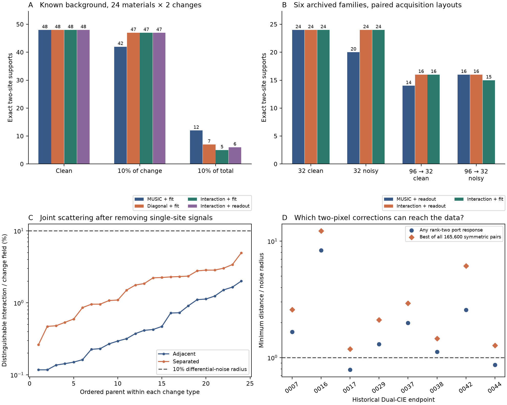
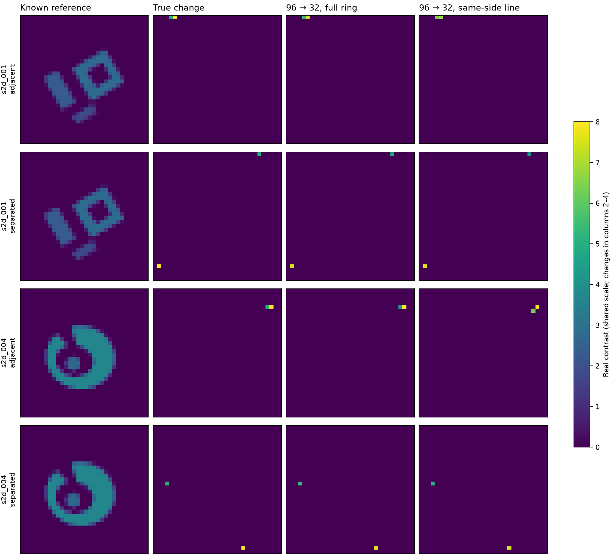

# 两个格子能解释哪些端口变化

同一个相互作用系数可以出现在内部楔积和外部端口。可从端口单独量出的只有交叉原子在两个单格信号之外的部分。下面把这个结论用于三个不同的问题：排除错误端点的小修小补、在已知背景里定位稀疏变化、量化改变阵列与离散后丢失的辨识能力。[证明](THEORY.md) · [预先保存的设计](configs/interaction.json)

## 在既有错误材料上，多少改动也不够

取 R13 的 48 个独立材料，每件从同观测的五种历史材料出发。240 个端点全部用其存档的完整复端口与原球半径。原端点已经合格时，最少改动下界自然为零。材料质量单独评价。对 8 个有区分力的 Dual-CIE 端点，重建背景场与 dressed receiver，在所有 $576\times575/2=165600$ 个像素对上检验同一个必要条件。三个端口原子的系数在求下界时可以是任意复数，即使放宽到这个程度，仍有端点无法解释。数值均为距原观测的 Frobenius 距离除以原噪声半径 $\delta$。

|R13 端点|普通端口秩推得至少改几格|允许任意二阶端口矩阵的下界|物理两格端口跨度下界|
|---|---:|---:|---:|
|0007|5|1.661|2.583|
|0016|7|8.361|12.267|
|0017|1|0.786|**1.186**|
|0029|3|1.305|2.107|
|0037|5|1.985|2.931|
|0038|3|1.120|1.456|
|0042|6|2.571|6.127|
|0044|2|0.868|**1.271**|

对 **0017 和 0044** 又独立逐对使用测量空间向量计算。以归档浮点 $G,S,B,m,Y$ 为输入，在标准浮点复乘加误差模型下，含参考材料正演、逆传输及 QR 等价子空间误差的保守下界分别为 **1.1863278δ 与 1.2705068δ**。这两个例子说明，知道某个改变量的端口秩至多为二还不够，它的左右信号必须来自同一对可能的空间位置。原噪声与粗网格的合计误差若另有上界，须用新的球半径重判。0017 是跨网格案例，结论限定在归档的粗模型球上。该排除针对**最终只改至多两个像素**的修复；三格以上、两个整块或多次两格改变都不受它禁止。[240 个端点](results/support/archived_minimum.csv) · [逐端点完整枚举](results/support/all_pairs.csv) · [保守复算](results/support/all_pairs_verified.json)

复算用 $A=I-XG$ 和近似逆 $L$，从 $\|I-AL\|<1$ 得到 $\|A^{-1}\|\le\|L\|/(1-\|I-AL\|)$。将参考场和接收逆传输的方程残差传播至 $U,O,F_0$。每个框架由三个端口原子组成，逐列缩放后，直接在复端口中计算近似投影残差 $v$。若归一化框架为 $Q$，$\lambda_{\min}(Q^*Q)\ge\mu>0$，则
$$
\operatorname{dist}(r,\operatorname{ran}Q)^2\ge\|v\|^2-\|Q^*v\|^2/\mu .
$$
$\mu$ 由三阶 Gram 近似逆的残差给下界。若输入形成的列误差 $\|\Delta Q\|\le e<\sqrt\mu$，子空间变动至多 $e/(\sqrt\mu-e)$；这来自把真子空间中单位向量写成 $Q_{true}x$ 并界住 $\|x\|$。再扣除原始数据残差误差。八个端点的初算采用三阶内积 Gram 加速，两个边界案例的复算直接组装每对端口列。结果无需假定可行材料的 $T$ 或近共振增益有界。[独立计算程序](src/verify_pair_bounds.py)

## 已知背景上的材料变化

每个参考背景取自不同的历史 CIE 重建，将它作为**已知介质**，独立在其内改变两个未知格。每个父材料有一组相邻变化和一组远距变化，求解器知道至多两个格且有实材料盒，只收到不同状态间的复端口差。原始背景和改变后的数据各自做完整 Maxwell 正演。24 个背景、48 种改变，三个噪声条件是配对测量。两种 10% 噪声分别取改变端口范数、改变后总散射端口范数的 0.1 倍。使用同一复高斯方向缩放到指定范数，已知参考测量取无误差。独立对象是背景，共 24 件。

|方法|无噪声正确定位两格|10% 差场噪声|10% 总场噪声|10% 差场下材料改变量相对 L2 中位数|
|---|---:|---:|---:|---:|
|两侧 MUSIC 前两格，再拟合两个实材料|48/48|42/48|12/48|0.00567|
|单格端口原子筛选四对，再精确拟合|48/48|47/48|7/48|0.00553|
|加交叉原子筛选四对，再精确拟合|48/48|47/48|5/48|0.00553|
|相同交叉筛选，直接条件读出材料|48/48|47/48|6/48|0.00598|

直接读出从左逆重建差分有效源，再按格用全部照明共享的本构关系读出实材料。10% 差场时，它和非线性拟合找回相同数量，实测中位在线时间约 0.039 与 0.110 秒，两者均包括一次完整材料端口验收。每个背景还需共同的算子分解和多右端解，历史材料取得费用不含于这两个单次数字。两批的机器负载不同，时间是实际测量，见[成本边界](COST.md)。只在噪声较小时出现这一低成本用途。普通单格字典也达到 47/48；实验把这一部分进步归于扩大候选支持并校验。

在已种植的支持上离线量出的**可单独区分的交互信号/全部变化信号**，相邻中位 0.395%，分离中位 1.81%，48 例均小于 10%。这解释了为什么数学上可以读出非零 $c$，却很难靠这个分量在有噪观测中排序。它是确定性最坏噪声球的几何界。随机噪声在某个固定方向分量可能更小，故这组比例没有给出随机恢复成功率的上界。10% 总场噪声下另找到了 **7/48** 个不同的单格合法材料，完整正演也在同一个观测球内。此时真实双格和这些单格都是观测允许的解释。[封存预测](results/interaction/predictions.csv) · [逐例可见性](results/interaction/port_visibility.csv) · [单格见证](results/support/monitor_offline.csv)

## 差分观测能抵消多少网格误差

复用 SRAP 中六个形状家族各一件已知背景。每件两个改变位置关系，每种改变由全环平面波和同侧线源分别测量，计 6 个父材料和 24 个配对条件。差分中的参考散射也由原 96² 细网格取得。每个改变粗格对应 9 个细格，完整正演在原细几何中加入它们。每个方法在 32² 已知均值背景上处理同一观测。噪声为差分信号的 10%。已知背景与改变格数的限制不能移用于以前景未知的单次盲成像。

|两格均正确的条件数 / 24|32² 同网格无噪声|32² 同网格带噪|96²→32² 无噪声|96²→32² 带噪|
|---|---:|---:|---:|---:|
|MUSIC + 直接读出|24|20|14|16|
|四对交叉原子 + 直接读出|24|24|16|16|
|四对交叉原子 + 非线性拟合|24|24|16|15|

跨网格带噪闭式读出分别为全环 **11/12**、同侧线阵 **5/12**；改变量相对 L2 中位数为 0.069 与 0.578。该条件下，粗细模型对同一真实改变的干净端口差已经达到所加噪声半径的 1.74 倍、2.03 倍（各自 12 条件中位数）。参考相减消去固定的背景端口偏差，材料变化经过的背景总场和接收解算子仍随离散而变。它们构成此处可测的模型误差来源。全环与线阵的 12 个条件各来自相同的 6 个物体，不能把 24 作为独立样本数。[逐例预测与评分](results/cross_changes/offline.csv) · [原始网格差](results/cross_changes/reference_model_gap.csv)

把 24 个匹配网格背景或 6 个跨网格背景各作为一次抽样单位重采样，保留一个背景下的全部成对条件。匹配网格 10% 差场中，四对交互与四对单格筛选的正确定位率差为零；与普通 MUSIC 前两名相比差 10.4 个百分点，95% 重采样区间为 0–20.8 个百分点。跨网格 10% 差场，闭式四对与普通 MUSIC 的平均差为零，区间 −16.7 至 +16.7 个百分点。置信区间描述这批参考材料的配对变异。[按父材料的差和重采样结果](results/interaction/paired_object_statistics.json)

0017 与 0044 的必要距离也给出模型失配的可用余量。若指定两格材料类上，真实仪器与离散正演在原数据范数下有统一误差上界 $\varepsilon_{\mathrm{model}}$，三角不等式使下界分别缩小至 $1.1863278\delta-\varepsilon_{\mathrm{model}}$ 与 $1.2705068\delta-\varepsilon_{\mathrm{model}}$。因此只有误差分别小于约 $0.1863\delta$ 和 $0.2705\delta$ 时，这两份有限模型排除可用相同仪器噪声半径直接转移。当前跨网格研究量到的是个别材料的模型差，尚不能给出该材料类的统一上界。[独立网格对照](MODEL_GAP.md)

模型选择、直接读出、全部前向/小系统次数以及封存规则均可复算。[实现与费用](ALGORITHM.md)
