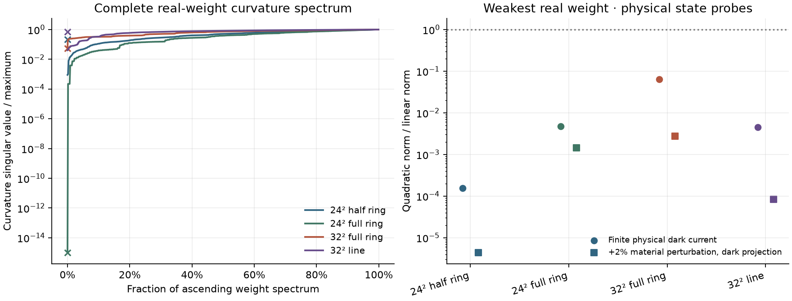

# 实材料的光学等式能否增加线性消元

四份冻结二维 TM 观测上，**没有找到有可分辨信号的新增精确线性方程**。24² 全环有一个数值近零的常数权，曲率范数约 \(6.84\times10^{-17}\)，但在原数据噪声球内的实际材料上，线性算子最大奇异值只有 \(1.61\times10^{-12}\)，约为入射场范数的 \(2.85\times10^{-13}\)。24² 半环的最弱权曲率非零，但对公开数据相容材料的整段暗电流，二次项仅为线性项的 **0.0157%**，线性算子有可分辨幅度。这个例子支持在已审计状态上考虑带误差余量的近似方程。32² 全环与同侧线阵都没有低于峰值 \(1\%\) 的曲率权方向。

## 从共享实材料到空间权重

\(E=B+GJ\)，局部共享实本构 \(J=D_\chi E\) 跨全部 \(s\) 个照明成立。实对角 \(W=D_w\) 与 \(D_\chi\) 可交换，所以有源空间 Hermitian 等式

\[
\Phi_w(J)=\operatorname{Im}_H(J^*WE)=0,\qquad
\operatorname{Im}_H A=\frac{A-A^*}{2i}.
\]

历史 Z-ALG 真实分支盒已使用这一族局部能量恒等式、空间权重、源空间惯性和有损延拓。本轮核算这族已有等式在冻结接收暗空间里留下的线性信息。 [历史理论与权重](https://migodam.github.io/b1-probabilistic-maxwell-imaging/research/z_alg_optical_inertia/ip_guided_v4/theory.tex) · [历史物理结果](https://migodam.github.io/b1-probabilistic-maxwell-imaging/research/z_alg_optical_inertia/ip_guided_v4/)

设 \(N\) 为接收暗空间的正交基，\(J=J_0+NZ\)。二次项恰为 \(Z^*H(w)Z\)，其中

\[
H(w)=N^*\frac{WG-G^*W}{2i}N .
\]

\(H(w)=0\) 是该权对所有暗电流精确消去二次项的充要条件。只令 \(Z\) 的一个源列非零，即可用任意复向量检验 \(H(w)\) 的二次型。单个权重最多产生 \(s^2\) 个实线性方程。允许各 Hermitian 源分量使用独立空间权时，对 \(\operatorname{vec} Z\) 的二次核为 Hermitian 张量积，其系数在正交的源矩阵基下分别消失。若权重核的实维数为 \(k\)，精确消去的行数至多为 \(ks^2\)。这些行的线性幅度和秩还要另外检查。

这族等式与外积可以联合。将整个暗电流乘以 \(e^{i\theta}\)，外积的齐次二次项乘 \(e^{2i\theta}\)，实材料的齐次二次项不变。对任意相位的恒等消去分别要求频率零和频率二的系数消失，包括取外积实线性组合的情况。两族方程互相抵消无法提供额外的精确行。保留少数加权行也不执行逐格实性、材料盒或完整正演资格。

## 四份冻结观测

| 阵列 | 观测 ID | 源 × 接收 | 暗空间维数 | 公开物理锚点 |
|---|---|---:|---:|---|
| 24² 半环 | `r13_fresh_0000` | 12 × 24 | 552 | 原 CIE corrected |
| 24² 全环 | `r13_fresh_0001` | 12 × 48 | 528 | 原 CIE corrected |
| 32² 全环 | `s2d_010__pw360_10x20` | 10 × 20 | 1004 | 本轮封存的可行性复跑锚点 |
| 32² 同侧线阵 | `s2d_010__ls_line_same_10x20` | 10 × 20 | 1004 | 原 Dual-CIE 30 秒 light |

共三件既有合成材料，SRAP 的两个阵列属于同一对象。R13 两例固定读取 `confirmation_core48` 的同一 CIE 校正臂。用完整正演重新检验每份锚点，不读取材料真值。接收数值秩阈值为相对最大奇异值的 \(\max(\operatorname{shape} S)\epsilon_{\mathrm{mach}}\)，四个 \(S\) 均为数值满行秩。\(G\) 保留辐射虚部和离散自项，两档对角虚部约为 0.01003 和 0.06779。 [R13 归档](https://github.com/migodam/b1-probabilistic-maxwell-imaging/releases/tag/research-max-struct-r13-20261112) · [SRAP 归档](https://github.com/migodam/b1-probabilistic-maxwell-imaging/releases/tag/srap-cie-array-study-20261121)

## 完整曲率谱

令 \(U=N,V=GN,P=UU^*,K=VV^*,C=VU^*\)。把第 \(i\) 格行向量写成 \(u_i,v_i\)，则 \(H(e_i)=(u_i^*v_i-v_i^*u_i)/(2i)\)。逐项展开 \(\operatorname{Re}\operatorname{tr}(H(e_i)H(e_j))\)，得到实 Gram

\[
K_w=\tfrac12\operatorname{Re}\!\left[K\circ\overline P-C\circ C^T\right].
\]

用两条单位实随机权直接算矩阵迹，核对的绝对误差最多 \(1.61\times10^{-17}\)。计算形成 \(n\times n\) Gram，避免显式展开 \(d^2\times n\) 的实映射。另直接算 \(N^*\operatorname{Im}_H(G)N\)，并在常数和其正交补上分块求解后重作最弱权的曲率矩阵。24² 全环普通 Gram 的最小特征值为 \(2.00\times10^{-19}\)，直接开方会误读成 \(4.47\times10^{-10}\)。独立归一化的常数块经 Schur 运算给出的最弱权距单位常数约 \(3.3\times10^{-14}\)，直接作用范数为 \(6.84\times10^{-17}\)，处在浮点极限附近，只作为极小奇异值的数值上见证。下一条奇异值为 \(1.52\times10^{-5}\)。另外三例的最小 Gram 正特征值均高过各自形成与谱计算误差尺度。正秩报告针对保存算子和所算暗基的浮点误差模型。

| 阵列 | 最弱权直接范数 | 最小 / 最大 | 未归一化常数曲率 | 低于峰值 1% 的权重数 | 高于误差尺度的正方向 |
|---|---:|---:|---:|---:|---:|
| 24² 半环 | \(6.333\times10^{-5}\) | \(8.93\times10^{-4}\) | 0.3606 | 4 | 576/576 |
| 24² 全环 | \(6.84\times10^{-17}\) 上见证 | 约 \(9.93\times10^{-16}\) | \(1.64\times10^{-15}\) | 13 | 575/576 |
| 32² 全环 | 0.01743 | 0.04631 | 0.6584 | 0 | 1024/1024 |
| 32² 同侧线阵 | 0.02026 | 0.04029 | 11.1859 | 0 | 1024/1024 |

以峰值 \(10^{-4}\) 为阈值，只有 24² 全环的常数方向达标。其是否严格为零仍未认证。即使作零处理，也至多增加 144 个实方程，其线性信号弱至下表量级。以 \(1\%\) 为描述性阈值，半环和全环的行数上界分别为 \(4\times144\) 和 \(13\times144\)，尚未验证联合线性行秩或误差预算。外积投影在四例均有一个由互易性给出的精确常数权，分别保留 66、66、45、45 个复行。R13 全环和 SRAP 同侧线阵的互易线性幅度也很弱。 [外积与互易回执](SPECTRAL_RESULTS.md) · [实权完整谱](results/real_weights/receipt.json)

左图以最大奇异值归一化，叉号标出常数权的直接作用。24² 全环最小点采用独立矩阵作用上见证。右图比较完整暗位移及局部暗投影的二次/线性比。

## 线性信号和有限二次余量

在基态 \(J_0\) 上，沿 \(NZ\) 的导数为

\[
L_w[Z]=\operatorname{Im}_H(Z^* T_w),\qquad
T_w=N^*WE_0-(GN)^*WJ_0,\quad E_0=B+GJ_0.
\]

设 \(T_w\) 的奇异值为 \(\tau_a\)，Hermitian Frobenius 坐标下的实线性行谱是各 \(\tau_a\)，加上每对源的两条 \((\tau_a^2+\tau_b^2)^{1/2}/\sqrt2\)。单位常数权给出 \(T_w=N^*(B+2i\operatorname{Im}_H(G)J_0)/\sqrt n\)。24² 全环该式第一项相对 \(\|B\|_F\) 只有 \(4.22\times10^{-13}\)，第二项中的暗辐射算子范数为 \(3.42\times10^{-15}\)。

先从锚点实际预测的端口构造同数据最小范数电流，再测该代表到锚点的整段暗位移。局部诊断把材料乘 1.02 并夹回原盒，完整正演后把电流差投进原暗空间。投影后电流用于代数分解，物理数据相容性由投影前的完整正演独立判定。

| 阵列 | 锚点 / \(+2\%\) 材料的完整端口残差，单位 \(\delta\) | 最弱权 \(\sigma_{\max}(L)\) | 整段 \(\|L\|\) | 整段 \(\|Q\|/\|L\|\) | \(+2\%\) 暗投影 \(\|Q\|/\|L\|\) |
|---|---:|---:|---:|---:|---:|
| 24² 半环 | 0.8762 / 2.584 | 0.08056 | 0.004449 | \(1.566\times10^{-4}\) | \(4.375\times10^{-6}\) |
| 24² 全环 | 0.9611 / 2.287 | \(1.606\times10^{-12}\) | \(1.040\times10^{-13}\) | \(4.769\times10^{-3}\) | \(1.459\times10^{-3}\) |
| 32² 全环 | 0.8831 / 0.9442 | 0.17843 | 0.15122 | 0.06406 | 0.002766 |
| 32² 同侧线阵 | 2.971 / 3.003 | 1.72659 | 0.47078 | 0.004519 | \(8.330\times10^{-5}\) |

32² 全环的两份材料都进原数据球。24² 的锚点进球，扰动材料在球外。线阵锚点在材料盒内、数据球外。半环最弱权有 44/144 条线性行的奇异值高于自身峰值的 \(1\%\)。换回常数权，整段暗位移二次/线性比从 \(1.566\times10^{-4}\) 变为 0.4128。24² 全环的二次项约 \(5\times10^{-16}\)，与代数重算舍入差同阶，该比值本身不宜解释。任意暗电流的余量可用 \(\|Z^*H(w)Z\|_F\leq\|H(w)\|_2\|Z\|_F^2\) 约束。少数物理锚点上比值小并未给出可达暗电流的全域控制。复数有损材料与真实矢量场也需各自的本构和算子合同。

## 复算和费用

Mac mini M4，复双精度，单 BLAS 线程。四组完整实权谱、物理正演、记录及绘图为 10.10 墙钟秒、8.37 进程 CPU 秒，峰值内存约 510 MB。执行 4 次全接收 SVD、每组一次实权谱分析、8 次完整物理正演共 88 个右端项。历史端点的原求解费用留在原研究。随结果保存完整曲率谱、带符号 Gram 谱、最弱和常数权、公开锚点和扰动材料。没有追加优化或恢复率比较。

从包含历史资产的工作区运行。R13 归档需含公开观测和 `RESULTS/confirmation_core48` 中两份 CIE corrected。SRAP 需含公开数据、预测和原 `legacy_la.py`。本研究的 `results/spectra/feasible_followup.npz` 提供 32² 全环锚点，也可用 `--saved-physical` 指向该档案。环境为 Python 3.13.13、NumPy 2.5.3、SciPy 1.18.1、Matplotlib 3.11.1。

~~~bash
PYTHONDONTWRITEBYTECODE=1 python research/hc_cie_r2/src/real_weights.py --workspace "$PWD"
~~~

[代码](src/real_weights.py) · [全谱和物理回执](results/real_weights/receipt.json)
