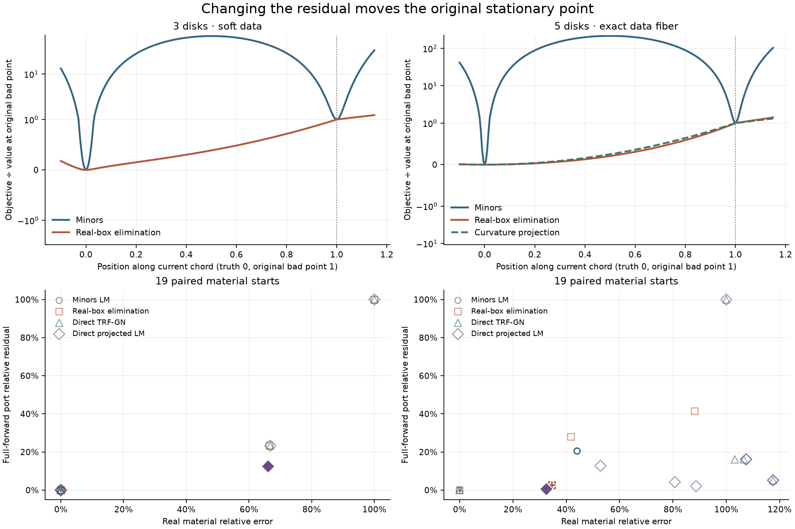
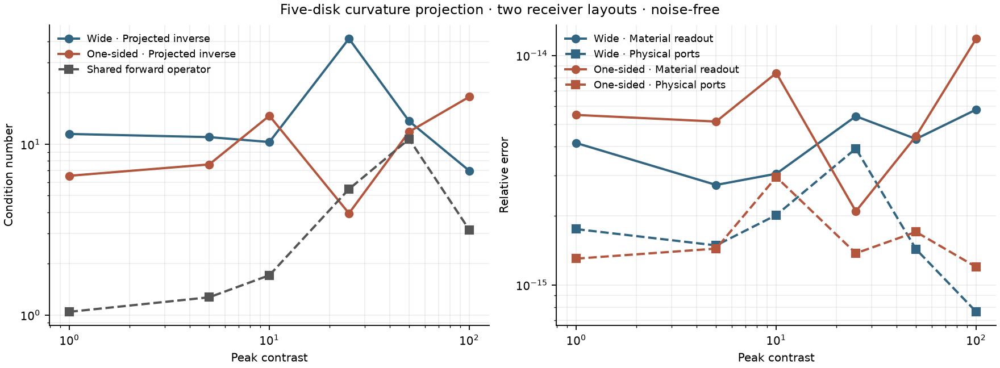
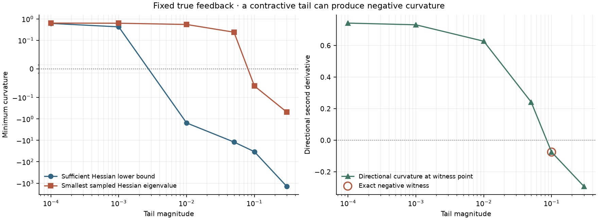

# HC-CIE-R2 小模型复核

五圆盘实例中，固定曲率投影保留了四个独立的复线性方向，并恢复到机器精度。原始子式目标的坏点和加入实材料盒后的坏点分别存在。直接优化真实材料端口残差也有一个盒内坏极小。该点的材料相对误差为 **32.42%**，完整正演端口相对残差只有 **0.6764%**。80 位区间证明覆盖带 Hankel 圆盘积分的离散几何及其无噪观测。结果说明这例的困难同时来自辅助目标和物理逆问题的局部几何。

## 冻结输入和比较方法

冻结输入为 2026-11-27 HC-CIE 附件中的圆盘参数、保存的复场和反例种子。三格使用原始中心求积搜索给出的坏电流初值，独立重建原文最终采用的常数电流圆盘积分。五格使用保存的完整积分矩阵和严格数据纤维，并用几何参数重建算子交叉检查，\(G,S,B\) 的差分别为 \(5.26\times10^{-17},2.42\times10^{-17},1.67\times10^{-16}\)。两例圆盘半径/最小中心间距分别为 \(0.08720/0.19664\) 和 \(0.06414/0.22297\) 个波长。三格有两源两接收，五格有两源三接收。两者采用完整 Hankel 相互作用与自项，测量为同一离散模型合成的无噪声复数据。原搜索已经看过两个对象，起点和布局属于对象内部配对。

原目标用每格的二阶子式 \(R_i=J_{i,1}E_{i,2}-J_{i,2}E_{i,1}\)，其中 \(E=B+GJ\)。实盒比较逐行精确消去 \(\chi_i\in[0,30]\)，使用

\[
\widehat\chi_i(J)=\operatorname{clip}_{[0,30]}\frac{\operatorname{Re}\langle E_i,J_i\rangle}{\|E_i\|_2^2},
\qquad
\min_{\chi\in[0,30]^n}\frac12\|J-D_\chi E\|_F^2
=\frac12\|J-D_{\widehat\chi(J)}E\|_F^2.
\]

零场行的最小值为 \(\|J_i\|^2/2\)，程序在该行设置 \(\widehat\chi_i=0\)。夹紧未激活时对该商求导，活跃区域内该材料坐标的导数为零。报告的两个坏点所在分段与切换阈值有间隔。三格两种电流目标都保留 \(\|SJ-Y\|_F^2/2\) 与原权重 \(w=0.2614421\)，分别乘在子式和闭合残差上。五格两种目标都在严格纤维 \(J=S^\dagger Y+NZ\) 上求解。实盒消元采用解析 Jacobian 的 LM。直接材料比较在同一实盒内优化完整正演端口残差 \(\|S(I-D_\chi G)^{-1}D_\chi B-Y\|_F^2/2\)，分别使用 SciPy 信赖域反射高斯–牛顿（TRF-GN）和带活跃集、阻尼调整与盒投影的 LM（projected LM）。

原坏点本身可作为两个电流目标的共同初始化。直接材料法使用该电流的实盒读出作为合法材料起点 \(\chi_0\)。对统一材料起点实验，先从同一 \(\chi_0\) 完整正演得到 \(J_\mathrm{phys}\)。三格让电流求解器直接用此电流。五格则投回严格纤维，使用 \(J_\mathrm{phys}+S^\dagger(Y-SJ_\mathrm{phys})\)。五格原坏点读出对应的投回改变量为 7.8505 个电流范数单位。两目标的数值及局部极小的集合各有自己的量纲与定义。

## 三种坏点以及它们的物理含义

| 离散观测 | 原子式目标坏点 \(f\), \(\|\nabla f\|\), \(\lambda_\min\) | 原坏点电流误差 | 原坏点辅助端口残差 | 原坏点实盒读出后的完整端口残差 |
|---|---:|---:|---:|---:|
| 三格软数据 | \(4.39060\times10^{-4}\), \(3.22\times10^{-16}\), \(2.39308\times10^{-6}\) | 160.82% | 4.011% | 69.76% |
| 五格严格数据 | \(7.02482\times10^{-4}\), \(2.09\times10^{-15}\), \(4.16425\times10^{-4}\) | 56.61% | \(1.17\times10^{-15}\) | 20.50% |

三格母包的十进制系数另做 80 位区间复核。在半径 \(10^{-7}\) 球中 Hessian 下界为 \(2.315\times10^{-6}\)，球边界外向径向导数下界为 \(2.309\times10^{-13}\)。球内的目标大于 \(4\times10^{-4}\)，近真解处小于 \(10^{-25}\)。验证这个十进制有限问题中的严格局部极小存在且非全局，Hankel 函数输入误差未纳入该区间。五格原子式反例及下表两个实盒消元极小的驻点和 Hessian 结论为浮点数值证据。下表的直接材料极小另有严格区间证书。

两个原坏点都带有非零虚部的复材料读出。改用实盒精确消元后，原坏点的梯度范数分别变为 0.762 和 18.345，因而原驻点消失。从同一坏电流起步，实盒消元分别收敛到新的坏驻点。直接材料从前述合法转换起步，也出现不同的坏极小。

| 模型与目标 | 新坏点材料误差 | 完整端口相对残差 | 驻点和曲率 |
|---|---:|---:|---|
| 三格实盒消元 | 85.43% | 40.05% | 梯度 \(5.64\times10^{-16}\)，最小 Hessian 特征值 0.01103 |
| 五格实盒消元 | 34.59% | 2.506% | 梯度 \(2.04\times10^{-15}\)，最小 Hessian 特征值 0.14576 |
| 三格直接材料 | 66.03% | 12.54% | 第二格活跃下界，梯度分量 +0.002730，两自由坐标的最小 Hessian 特征值 \(8.26\times10^{-5}\) |
| 五格直接材料 | 32.42% | 0.6764% | 全部材料在盒内，梯度 \(2.78\times10^{-18}\)，最小 Hessian 特征值 \(4.70\times10^{-7}\) |

直接材料目标的两个坏极小均有新的严格证书。证书一方面使用附件保存的十进制矩阵，另一方面从精确十进制几何参数、精确 \(k=2\pi\) 和原真材料重新包围 \(G,S,B,Y\)。Hankel 函数用 Bessel 幂级数及其导数，每项使用 80 位区间算术。收敛尾的相邻项比低于 \(1/2\)，将首个省略项的两倍纳入误差。用所有区间枢轴的正下界保证该局部区间盒内的正演矩阵可逆，直接包围目标 Hessian，最后用区间 Gershgorin 下界认证自由方向正曲率。半径 \(10^{-8}\) 球中的五格自由 Hessian 下界为 \(2.08\times10^{-7}\)，边界向外梯度下界为 \(2.07\times10^{-15}\)，坏目标值下界为 \(3.4246\times10^{-5}\)。三格在第二格为零的面上认证，Hessian 下界为 \(8.26\times10^{-5}\)，球边界外向梯度下界为 \(8.26\times10^{-13}\)，活跃方向梯度下界为 \(0.00272999\)，坏目标值下界为 \(0.0042476\)。两例真材料目标严格更低。该证书证明常数电流圆盘离散物理目标的严格非全局局部极小。 [材料区间证书](results/toy/material_interval.json) · [Bessel 级数](https://dlmf.nist.gov/10.8.E2) · [Bessel 导数](https://dlmf.nist.gov/10.6.E3)

两个物理合同独立检验。十进制矩阵合同把附件中保存的 \(G,S,B,Y\) 数字当作精确输入。几何合同把原圆盘位置、角度、面积与真材料的十进制数当作精确参数，以 \(k=2\pi\) 重新生成无噪 \(Y\)，因此该合同真材料在定义上给零目标。代码分别断言两个合同的真材料目标均小于 \(10^{-30}\)，也记录了各自的数值包围。两个合同使用同样的物理目标 \(f(\chi)=\|F(\chi)-Y\|_F^2/2\)，材料范围均为 \([0,30]^n\)。

证明把可行面的球心记为 \(c\)，半径记为 \(r\)。在包含整个自由坐标球的区间盒内认证 Hessian 下界 \(\mu>0\)，并在球心包围自由梯度范数 \(g_0\)。沿任意自由单位方向 \(u\) 积分 Hessian，得到球面上每一点

\[
 u^T\nabla_{\mathrm{free}}f(c+ru)
 \geq -g_0+\int_0^r u^T\nabla_{\mathrm{free}}^2 f(c+tu)u\,dt
 \geq \mu r-g_0>0.
\]

因此闭球上的最小值只能出现在该球的相对内部，其自由梯度为零。球内的正 Hessian 使它唯一且严格。五格没有活跃材料约束。三格第二格受盒下界约束，代码在包含自由坐标球且允许第二格正向移动的整个区间盒上验证 \(\partial f/\partial\chi_2>0.00272999\)。把任意邻近可行点的第二格降回零会严格降低目标，由此把面的严格极小扩展到整个材料盒。自由球内目标至少为 \(f(c)-g_0r\)，与真材料的目标上界比较即可判定非全局。读者可独立重跑冻结中心、区间枢轴、Hessian 下界、球面导数及目标比较的全部断言。 [完整区间程序](src/toy_material_interval.py)

三格与五格实盒消元的新坏电流仍有 0.22893 与 0.97185 的绝对本构闭合误差。直接材料坏点的电流来自真正正演，本构闭合处于舍入误差级，拿它预测观测时才出现上表的正残差。五格内点为 \((7.70081,20.07739,8.23182,7.60131,11.66553)\)，与真材料 \((4.11000,19.40334,7.02112,16.19882,11.80273)\) 差异主要分布在第一、第四格。

各模型用 19 个配对初值，含坏点实盒读出、零值、盒中点、固定种子在盒内均匀抽的 16 个真值无关起点。每臂每次容许至多 180 次残差评估，电流误差、材料误差和完整端口相对残差均低于 \(10^{-5}\) 计为恢复。

| 模型 | 子式 LM | 实盒消元 LM | 直接 TRF-GN | 直接 projected LM |
|---|---:|---:|---:|---:|
| 三格 | 19/19 | 14/19 | 14/19 | 14/19 |
| 五格 | 3/19 | 1/19 | 1/19 | 0/19 |

只留完整端口残差最小项，五格前三臂各能得到真材料，projected LM 的最佳项仍停在 0.6764% 的物理残差。相同候选在真实新测量上的误差没有测定。子式、实盒、TRF-GN、projected LM 的 19 起点残差调用数分别为三格 137、454、254、269，五格 202、195、690、989。每种方法的实际 CPU、总求解时间、雅可比次数、直接求解 LU 和右端项数以及转换和审核费用保存在结果。预算是残差调用上限，单次调用的工作量随方法变化。结果是已暴露两个对象上的局部机制检验。 [三格逐起点结果](results/toy/soft3.json) · [五格逐起点结果](results/toy/hard5.json)



上排的每个目标按各自原坏点的值归一化。下排各点来自同一个材料向量或它的合法电流转换。实心标示使用原坏电流的盒内材料读出初始化。

## 精确曲率投影与等秩对照

在严格数据纤维上，三格的隐藏电流维数 \(d=1\)，所以二次子式全为零，直接用全子式线性解。五格 \(d=s=2\)，二次项正好为 \(\Gamma\det Z\)，其中 \(\Gamma_i=N_{i,1}(GN)_{i,2}-N_{i,2}(GN)_{i,1}\)。取 \(P=I-\Gamma\Gamma^\dagger\) 后，线性部分的秩为 4，最小奇异值为 0.00272881，平方为 \(7.4464\times10^{-6}\)。因此该相容纤维上的投影目标全域强凸。三格和五格的电流绝对误差分别为 \(7.20\times10^{-15}\)、\(1.03\times10^{-12}\)，材料绝对误差分别为 \(1.77\times10^{-13}\)、\(5.85\times10^{-12}\)。五格投影剩余的二次项为 \(1.55\times10^{-17}\)。数值秩阈值为相对最大奇异值 \(10^{-13}\)。五格原坏点距真电流的隐藏坐标距离为 13.69，真点附近由 Jacobian 和二次余项导出的充分半径为 0.1481。

五格另用固定种子生成 32 个复随机投影，各删除一个方向并保留四维。直接解被随机投影的仿射部分，会留下 \(0.0626\) 至 \(0.0940\) 的 \(\|P_\mathrm{rand}\Gamma\|\)，所得电流相对误差为 45.29% 至 81.94%。保留完整余项后，32 个投影的根均可化为一个关于 \(d_2=\det Z\) 的标量二次方程，数值上各有一个与真电流一致的根和一个额外辅助根。在这些额外根上，最小完整正演端口误差为 5.22%，最大为 37.49%，重算未投影子式范数至少 0.04494。随机投影 LM 从原坏电流或盒中点的合法电流起步均为 0/32 回到真电流。由原坏点实盒读出并重投影的起点为 29/32。该对照区分固定曲率消除、任意强制线性化及保留随机投影余项后的多根。

用独立五圆盘几何和两种接收布局，峰值对比度走过 1、5、10、25、50、100。12 个配对条件均通过曲率秩 1、投影线性秩 4，正演条件数 1.04–10.72，投影条件数 3.94–41.51。相对材料误差为 \(2.09\times10^{-15}\) 至 \(1.18\times10^{-14}\)，真实端口残差为 \(7.64\times10^{-16}\) 至 \(3.93\times10^{-15}\)。这检验代数恒等式在高对比度的离散积分模型内成立。 [对比度逐布局结果](results/toy/sweep.json)



## 精确反馈证书与导数审计

反馈模型使用构造的互易三格有限矩阵
\(G=-0.4I+(0.15+0.1i)vv^T+i\varepsilon I\)，
\(v=(1,0.8,0.6)^T\)。令 \(\tau_i=\chi_i/(1+0.4\chi_i)\)，
在 \(\chi\in[0,15]^3\) 有 \(\tau\in[0,15/7]^3\)。
固定 \(q_*\) 时完整保留 \(T=i\varepsilon I\)，计算
\((I-D_\tau T)^{-1}D_\tau(B+Uq_*)\)，并优化端口及反馈闭合的平方和。

\(\varepsilon=10^{-4}\) 时用有理数验证了移位实化 Gram 矩阵的所有顺序主子式为正。把范数上界代入后，全盒强凸下界严格大于
\(1051963261638806543/1989120746542230000\approx0.5288584\)。
\(\varepsilon=0.1\) 时尾部收缩常数 \(3/14\)，但在 \(\tau=(2.1,2.1,0.05)\) 沿 \(h=(-0.5,0.1,0.86)\) 的精确二阶导数为 **\(-0.07493456015\)**。独立方式是沿该直线直接对精确有理解求导。正、负结果与原包的分数完全相同。证书固定于各尾幅度自身的 \(q_*\)。有理反例采用构造矩阵，和五格自由空间圆盘的坏盆地是不同证据。

六档尾再用相同的 17 个反馈起点，幅度取自观测范数，方向与真材料无关。内层从材料盒中点开始做嵌套求解，六档均有 17/17 恢复。小幅度两个条件得到正的充分界，0.01 与 0.05 的充分界为负但 400 点采样最小 Hessian 为正，0.1 与 0.3 的采样出现负曲率。每档有 2–5 次内部 L-BFGS-B 返回非成功状态，外层按保留的候选继续，逐档留存调用量、状态与最终完整端口误差。恢复计数适用于这 17 次局部多起点实验。 [精确证书与反例](results/toy/certificates.json) · [全余项反馈复跑](results/toy/feedback_sweep.json)



三格和五格的解析电流 Jacobian、Hessian 与中心差分相符。步长 \(10^{-4}\) 时，原子式 Hessian 方向误差约 \(1.0\times10^{-11}\) 与 \(3.2\times10^{-11}\)，实盒 Hessian 方向误差约 \(4.9\times10^{-11}\) 与 \(2.2\times10^{-9}\)，完整材料方向二阶导数误差约 \(1.5\times10^{-10}\) 与 \(3.8\times10^{-9}\)。子式中点 Jacobian 割线误差低于 \(4.3\times10^{-15}\)，秩一复电流扰动的二阶中心差低于 \(9.3\times10^{-15}\)。完整模型用有限响应恒等式 \(J_1-J_0=(I-D_{\chi_1}G)^{-1}D_{\chi_1-\chi_0}(B+GJ_0)\) 检查，端口差异低于 \(1.5\times10^{-16}\)。反馈闭合修正恒等式在故意偏离物理闭合的状态上检验，六档误差均小于 \(1.5\times10^{-15}\)。

原包的另一构造接收器给出 \(\chi=10\mathbf1,20\mathbf1\) 两个正实材料的精确同数据反例，两个端口列均为 \(-1/2\)。两端的实 Jacobian Gram 行列式分别是 \(1/409600000000\) 和 \(1/1250000000000000\)，正演条件数为 \(\sqrt{8/5}\) 和 1。辐射能量余量下界为 \(29/320\)。这给出了稳定正演和端点局部满秩与有限距离双解共存的精确例子。

## 固定权重的全域凸化资格

设 \(r(Z)=r_0+AZ+\Gamma c_2(Z)\)，其中 \(c_2\) 是全部二阶**复**子式，每个子式为全纯二次函数。可加入任意仿射最小二乘项。在整个 \(\mathbb C^{d\times s}\) 上用其作为实向量空间的凸性，固定半正定权重的充要条件是权重平方根杀掉全部二次项。对一般实化相关权重，准确写法为 \(W^{1/2}\Gamma_{\mathbb R}=0\)，其中 \(\Gamma_{\mathbb R}\) 是复线性映射 \(\Gamma\) 的实化块矩阵。Hermitian 复权重时可直接写 \(W^{1/2}\Gamma=0\)。

证明取实数缩放 \(t\to+\infty\)，凸函数 \(t^{-4}f(tZ)\) 保持凸性于逐点有限极限，得到非负的四次齐次项。复秩一矩阵 \(uv^T\) 的二阶子式全为零，每个复矩阵均为有限复秩一矩阵的和，也是缩放后的这些矩阵的凸组合。因此该极限处处为零。只留一对行和一对列，可依次产生某个子式坐标的 \(1\) 与 \(i\)，张成全部实化方向。两条实坐标都需要覆盖，才能推出任意实权的核条件。反方向随仿射残差平方成立，严格凸由保留的实化线性算子满列秩判定。若 \(d<2\) 或 \(s<2\)，子式空间为空。对于受限盒、物理状态流形、状态相关权重，这个无界缩放证明不适用。

材料读出要另外检验每格总场。若一行 \(E_i=0\)，子式自动为零，即使 \(J_i\neq0\)。例如取一格 \(G=i\)、\(B\neq0\)、\(J=iB\)，则 \(E=0\) 且子式为零，但本构对每个有限材料都失败。若 \(J_i=E_i=0\)，该行材料在本构式中任意。有非零总场时，子式消去的公共系数在复数上唯一，实性、盒范围和原物理正演仍需审核。

互易性使用普通转置 \(G^T=G\)，给出 \(\mathbf1^T\Gamma_N=0\)，由两两电流交换项反对称得到。若 \(\operatorname{rank}\Gamma_N=n-1\)，投影只保留 \(J^TB\) 的反对称部分。令 \(M=N^TB\)，隐藏变量的增量只通过 \(Z^TM-M^TZ\) 进入。如果 \(M\neq0\)，取非零 \(Z=M\) 即在核中。\(M=0\) 时全部增量在核中。同址互易收发且 \(B=S^TC\) 时，由 \(SN=0\) 得 \(M=0\)。这是投影后线性电流的识别障碍。实际材料是否存在另一个物理解还需独立判定。

## PDF 与复现入口

独立 PDF 为 892,612 字节，ZIP 内 PDF 为 817,607 字节。两份均为 22 页，版面文本、用 Poppler 75 DPI 生成的逐页位图、外链与命名目的地一致。独立版包含标为 Content Credentials 的 C2PA 清单，包内版无嵌入文件。此次识别了文件结构，未验证该凭证签名。 [PDF 复核结果](results/toy/pdf_comparison.json)

Mac mini M4 单线程，Python 3.13.13、NumPy 2.5.3、SciPy 1.18.1、Matplotlib 3.11.1、SymPy 1.14.0、mpmath 1.3.0。一次全部圆盘数值复跑约 0.4–1.3 秒，十进制区间和精确有理证书约 1.4 秒，两个材料区间证书约 0.6 秒，六档完整反馈约 5.3 秒，启动与图形渲染另计。JSON 保留实际计时、求解状态与数据形状。依赖可装在独立 Python 环境。发布内容包括回执和独立复核程序。原附件 ZIP 与独立 PDF 由持包读者自备。解压后将 ATTACHMENT 指向同时含有 research_work/ 和 deliverables/ 的根目录。程序以只读方式打开输入，PDF 对照另需要 Poppler。

```bash
ATTACHMENT=/path/to/HC_CIE_Research_2026-11-27
OUT=research/hc_cie_r2/results/toy
export OPENBLAS_NUM_THREADS=1 OMP_NUM_THREADS=1 VECLIB_MAXIMUM_THREADS=1
export MKL_NUM_THREADS=1 BLIS_NUM_THREADS=1
python research/hc_cie_r2/src/toy_replay.py --source "$ATTACHMENT" --out "$OUT"
python research/hc_cie_r2/src/toy_certificates.py --source "$ATTACHMENT" --out "$OUT"
python research/hc_cie_r2/src/toy_material_interval.py --source "$ATTACHMENT" --out "$OUT"
python research/hc_cie_r2/src/toy_feedback.py --out "$OUT"
python research/hc_cie_r2/src/toy_figures.py --source "$ATTACHMENT" \
  --results "$OUT" --out research/hc_cie_r2/figures
python research/hc_cie_r2/src/toy_pdf_compare.py \
  --standalone /path/to/HC_CIE_Structural_Report_2026-11-27.pdf \
  --packaged-pdf "$ATTACHMENT/deliverables/HC_CIE_Structural_Report_2026-11-27.pdf" \
  --out "$OUT/pdf_comparison.json"
```

[数值复跑](src/toy_replay.py) · [目标和物理导数](src/toy_models.py) · [区间及有理证书](src/toy_certificates.py) · [物理坏极小区间证书](src/toy_material_interval.py) · [反馈复跑](src/toy_feedback.py) · [绘图](src/toy_figures.py) · [PDF 复核](src/toy_pdf_compare.py)
