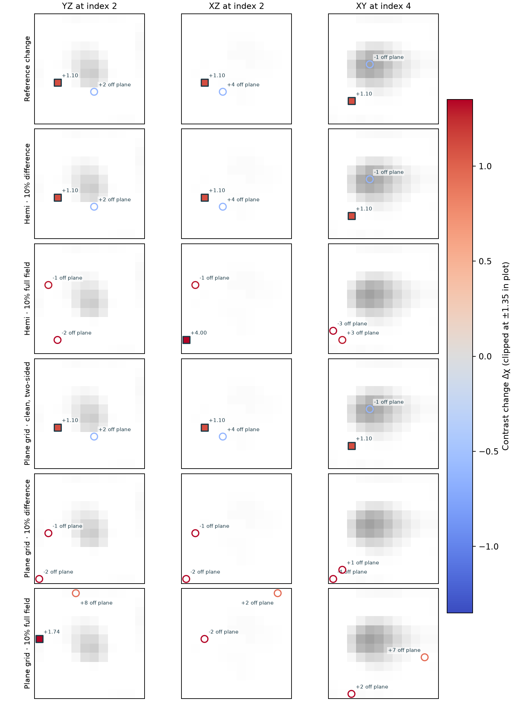

# 三维双极化 Maxwell 下的两体素变化

在原 SRAP 半球阵的四个已知三维背景上，未知位置的稀疏字典从干净读数和 10% 差分噪声读数都找回正确的两个变化体素。带 10% 差分噪声时，四件的变化幅度相对 L2 为 0.07%–0.49%。同一字典在面阵的四件干净及带差分噪声观测里都漏掉正确位置对。把 10% 噪声相对全散射场定义时，两阵的字典臂都选错位置，虽然全部候选在独立原物理正演后仍能通过噪声球。这组结果适用于背景已知和只变两个体素的监测任务。

## 原阵列、配对材料和噪声

用 SRAP 三维四个已登记的材料编号 `00` 偏心壳、`03` 开缝框、`06` 分离多体、`09` 交叉棒。以原存档 `hemi_XX_Dual/materials.npz` 的 `light_180` 作为新监测实验的公开已知参考材料。同一材料的半球、矩形面阵使用同一参考与同一变化。原双极化阵列、Cartesian 三分量、12³ 体素、Clausius–Mossotti 自项及辐射反作用原样保留，调用 `vector/physics.py` 的 dyadic FFT 及 BiCGSTAB。四个父材料和阵列来自原研究，本节两体素变化读数是使用该原模型生成的同网格仿真。

冻结规则从参考材料高对比区选一个中心体素，降低 45%。在至少四个体素外的低对比区选另一个，增加 1.1。两处最终值均在 [0,4]，后续程序搜遍全 1728 个体素，生成时的中心和间隔规则未作为搜索信息。四个独立父材料的噪声方向按父 ID 生成，两阵同父材料共享复方向。三条件共用相同精确参考，只有变化后读数加噪声。

|条件|加到变化后读数上的噪声幅度|
|---|---:|
|clean|0|
|diff10|$0.10\|Y(m_1)-Y(m_0)\|_F$|
|full10|$0.10\|Y(m_1)\|_F$|

每个父材料、阵列、条件均保留完整 32×16 复端口，16 个照明来自 8 个物理发射位置各两个发射极化，32 个接收通道来自 16 个物理位置各两个接收极化。每个体素的扰动只有一个实标量，在三个电流分量及全部照明上共享。[主试验冻结配置](configs/vector_change.json) · [实验输入、预测和正演回执](results/vector_change/report.json)

## 如何从有限局部响应恢复三维变化

写 $D_0=\operatorname{diag}(m_0)\otimes I_3$、$A_0=I-D_0G$，令 $E_I$ 插入两个体素的六个 Cartesian 分量。已知参考解 $J_0$ 后，定义

$$
 U_I=E_I^*(B+GJ_0),\quad O_I=SA_0^{-1}E_I,\quad K_I=E_I^*GA_0^{-1}E_I.
$$

变化电流 $J-J_0=A_0^{-1}E_I V$，所以 $\Delta Y=O_I V$，$V=D_I(U_I+K_IV)$，其中 $D_I=\operatorname{diag}(d_1,d_2)\otimes I_3$。已知支持的闭式臂直接用 $V=O_I^\dagger\Delta Y_{\mathrm{meas}}$。令 $W_i$ 是 $U_I+K_IV$ 的三分量块，则每个体素只读出一个

$$
 d_i=\operatorname{clip}_{[-m_{0i},\,4-m_{0i}]}\frac{\Re\langle W_i,V_i\rangle_F}{\|W_i\|_F^2}.
$$

这条路径使用真位置，报告标为 oracle。未知字典通过 32 个接收伴随 RHS 获得 $SA_0^{-1}$ 的全体素列。每个体素的切线复端口响应是 $O_i U_i$。实盒字典用所有通道，从最佳 16 个单点逐一扫描第二个体素，按盒内最小二乘保留 6 对。每对的闭式读出与线性起点共同提名一个两标量有界拟合。拟合的真实局部差分是

$$
 \widehat{\Delta Y}=O_I(I-D_IK_I)^{-1}D_IU_I.
$$

真正求逆的局部矩阵是 6×6。每对的 $K_I$ 只需被提名体素的单位源响应。短名单用精确局部物理筛到两对，再分别运行原全体素、全分量、全端口矢量正演，按已审计的带噪端口误差选最佳。裁决没有看未知变化的位置、幅度或 clean 读数。真实变化的幅值误差在真与估计支持的并集上离线计算。

所有直接单位源响应和接收伴随得到的 $O_I$ 最大相对差为 $2.07\times10^{-10}$。精确两体素式与原全体素差分最大相对差 $4.35\times10^{-10}$，读出及搜索终点的原方程相对残差低于 $10^{-10}$。原函数以矩阵自由方式作用于 5184 个场坐标，未形成 5184×5184 矩阵。两阵的已知支持六列矩阵均满列秩。半球条件数分别约 2.89–4.62，面阵约 26.9–38.3。[原正演及候选审计](results/vector_change/report.json)

## 位置恢复取决于阵列和噪声定义

字典提名失败后追加两侧子空间检查。在两个变化均非零且相应矩阵满秩时，$\operatorname{col}\Delta Y=\operatorname{col}O_I$，$\operatorname{row}\Delta Y=\operatorname{row}U_I$。用观测矩阵前六个左右奇异向量，分别投影每个体素的三个接收响应方向与三个照明方向。两侧正交基投影损失相加，取前八个体素。保留六对做相同的 6×6 精确局部拟合，选两对做完整独立正演后裁决。该追加在所有配对的 clean 和 diff10 上运行，未根据已知位置调整模式数或阈值。[追加设计](configs/vector_change_subspace.json) · [完整两侧投影分数和候选](results/vector_change/two_sided.json)

|阵列、条件|已知支持闭式，变化幅度相对 L2|未知字典，两位置正确|两侧子空间，两位置正确|
|---|---:|---:|---:|
|半球 clean|最大 $2.93\times10^{-11}$|4/4|4/4|
|半球 diff10|0.23%–0.39%|4/4|3/4|
|半球 full10|101%–111%|0/4|—|
|面阵 clean|最大 $2.79\times10^{-11}$|0/4|4/4|
|面阵 diff10|1.73%–10.03%|0/4|0/4|
|面阵 full10|101%–111%|0/4|—|

面阵无噪声时两侧子空间找回全部变化对，幅度误差不超过 $2.79\times10^{-11}$。同一数据上，切线字典失败的四案都没有把真实位置对送进精确局部短名单。这个配对反例把干净面阵的失败明确定位到字典提名。它也说明原物理核内的非线性效应值得在候选产生阶段考虑。

在 diff10 下，未知字典半球四件都成功，两侧算法仅漏掉 `06` 一处。两侧算法在面阵四件都失败，真实两点均未入选前八体素。干净差分的 $\sigma_6/\sigma_1$ 在半球是 0.120–0.184，面阵降到 $4.45\times10^{-4}$–$3.14\times10^{-3}$。实加噪声的谱范数相对于干净第六奇异值，半球为 0.332–0.500 倍，面阵是 13.0–123 倍。以六维信号子空间分离这些局部方向时，阵列直接决定高阶模式会不会被噪声覆盖。面阵该噪声下的失败仍然是两种已运行搜索的结果，无法据此排除其他先验或算法。

变化信号只占全散射场的 0.59%–1.70%。因此 full10 的噪声是变化信号的 5.89–16.96 倍，即使参考端口矩阵完全精确也难以定位。8 个未知字典终点均未找准支持，却都有已重算的端口残差落在原噪声半径的 0.993–0.998 之间。此处真实材料也在噪声球内，二者直接展示噪声球可容许错误体素。只比较残差或所估差分秩，无法分辨这些候选。



## 独立进程的盲重放

初次主试验在同一进程中先做已知支持的 oracle，再做未知支持字典。两者的局部响应缓存当时独立，字典的搜索参数没有真实位置或幅度，但初次执行仍处于可读真值的同一进程。原两侧方法也从混合数组中读取公开背景和当前观测，之后在同一进程评分。单靠代码的数据依赖不足以证明真值隔离。

现已把八份存档拆成单独的公开／真值输入。每份公开 NPZ 只有案例和阵列 ID、已知背景材料、参考端口、三个条件各自的实际输入和噪声半径，不含原噪声实现、目标材料、变化位置或 oracle 响应。干净读数只作为 clean 条件的输入。三组数据互不参与对方的提名或筛选。线上每臂仅解包该条件的读数，重新解原参考和接收伴随，重新运行冻结字典与秩六两侧法。最后两名仍各用独立原全源正演并按公开端口残差选取。

在线重放使用单独的 Python 进程。由 macOS 文件访问规则拒读本轮离线真值、早先含 oracle/目标的混合结果、原 SRAP 的三维观测/预测/真值，以及带生成种子的原配置。启动前实际尝试打开每个保护目录中的一个 NPZ 和原配置，系统均拒绝。线上程序只收到公开输入、预测目录、原 `physics.py` 和剥去生成种子的搜索配置。所有候选落盘并写完预测清单后，第三个进程才读取离线真值和旧结果对比。[八份公开输入索引](results/vector_change_blind/public_index.json) · [线上搜索配置](configs/vector_change_blind_online.json) · [系统访问验证](results/vector_change_blind/sealed/access_receipt.json) · [线上清单和逐臂成本](results/vector_change_blind/sealed/prediction_seal.json)

封存集包括 24 个字典和 16 个两侧预测。40/40 的位置与初次执行一致，恢复幅度和重新计算的完整预测端口逐元素完全相同。最终线上重放墙钟 55.21 秒、CPU 54.19 秒。线上重放包含 128 个背景正演 RHS、256 个接收伴随 RHS、2072 个局部响应及独立审计正演 RHS。另做了 52.37 墙钟秒的初版文件权限复验。最后一份预测完成封存后 1.154 秒，独立评分进程写出结果。[离线逐例比对](results/vector_change_blind/sealed/offline_scores.json)

~~~bash
Gaussian/.venv_nn/bin/python -B research/hc_cie_r2/src/vector_change_blind.py prepare
Gaussian/.venv_nn/bin/python -B research/hc_cie_r2/src/vector_change_blind.py guarded-online
Gaussian/.venv_nn/bin/python -B research/hc_cie_r2/src/vector_change_blind.py score
~~~

## 复现与成本

```bash
Gaussian/.venv_nn/bin/python -B research/hc_cie_r2/src/vector_change.py
Gaussian/.venv_nn/bin/python -B research/hc_cie_r2/src/vector_change_subspace.py
Gaussian/.venv_nn/bin/python -B research/hc_cie_r2/src/vector_change_figures.py
```

两项均在 CPU 上以复双精度和单线程运行。主试验共墙钟 66.93 秒、CPU 65.41 秒，含背景和变化的生成、接收伴随、所有候选及原正演审计。准备阶段付 256 个完整正演 RHS 和 256 个接收伴随 RHS。已知支持读出及审计付 432 个 RHS，其中 48 是局部单位源响应。未知字典付 1302 个正演 RHS，其中 768 审计最后两名、534 构造短名单局部响应，另有 2605 次 6×6 复局部端口评价。两侧追加墙钟 30.46 秒、CPU 29.87 秒，重新初始化另付 128 个参考和 256 个接收伴随 RHS，搜索付 770 个正演 RHS 与 1496 个局部评价。两套材料和原核一致的独立全正演是所有最终候选的审计标准。

这里使用已知参考材料、已知变化数量、同网格生成与恢复、精确参考读数和固定标量各向同性变化。三维密集反演、未知背景、粗细网格错配或两个 noisy 时刻的实际差分需要单独验证。[主试验逐例分数](results/vector_change/scores.csv) · [两侧投影和端口数组](results/vector_change/two_sided.npz)
