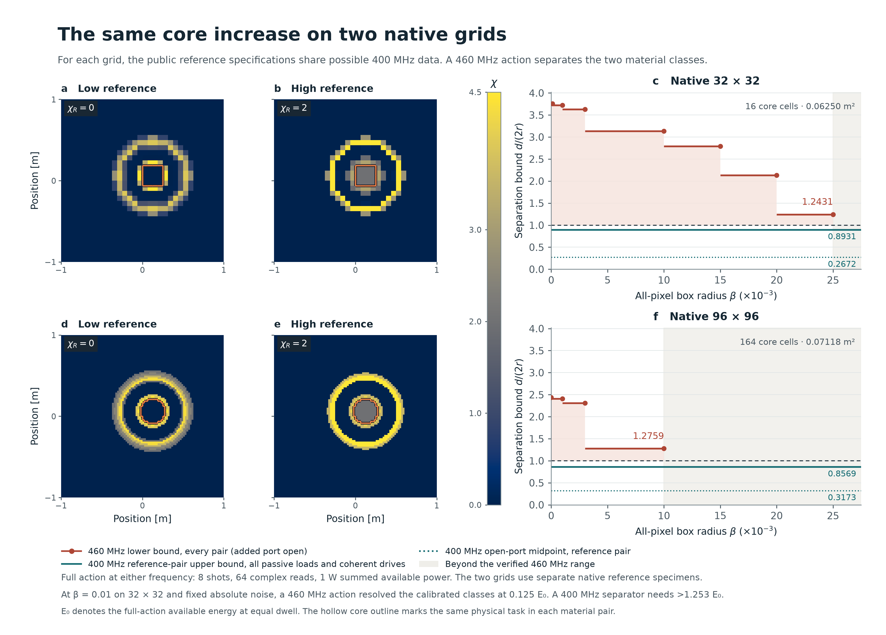
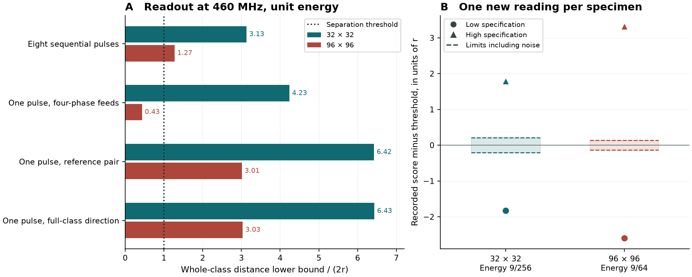
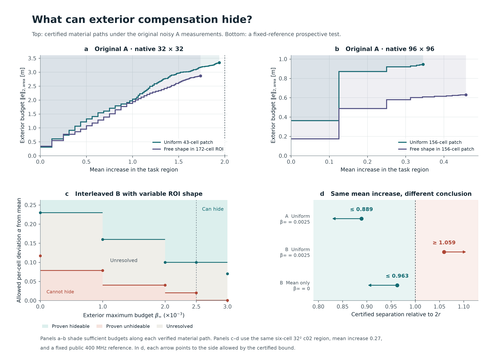
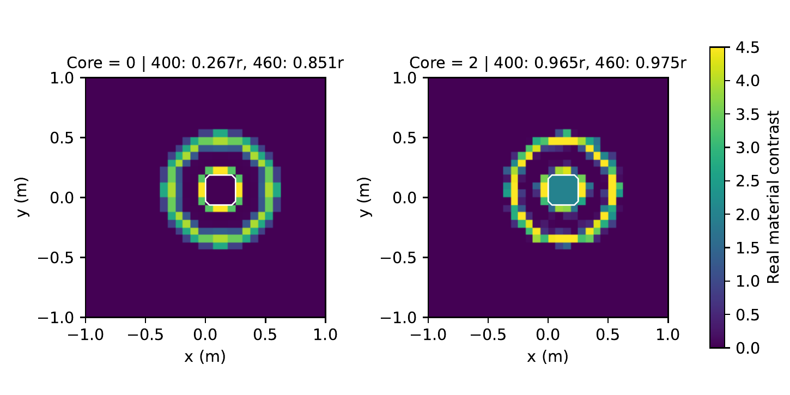
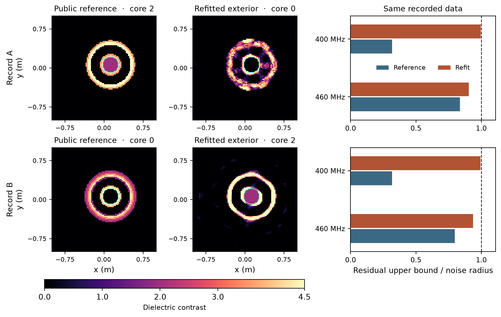

# 当外部材料能隐藏异常，怎样改变一次微波测量？

**在同一套天线上，换收发角色能暴露一份已知假解；外部材料重新调整后，另一份假解仍可能通过。我们找到更强的正例发生在换频。** 在原生 96² 全波模型中，两件材料的连通核心面积为 0.07118 m²，平均介电对比度相差 2。在 400 MHz，即使任意合成 16 端口波束、根据读数继续调节一个额外被动探头，单位总入射能量下仍有一份读数能同时解释为这两件材料。在 460 MHz，同位置的八发八收可以区分这两种规格内的全部材料。进一步将八个发射馈口和八个接收馈口按各自的相位和幅度相干组合，**一次发射、一个复数读数、9/64 单位新增能量**就足够。保证覆盖两个规格内所有像素独立 ±0.01 的制造变化。

这个结果适合回答“这件试样属于哪种允许公差的规格”。若只知道每格对比度在 0 到 4.5 之间，两个频率仍允许共同补偿。在原生 96² 有一对核心均值相差 1 的材料，即使向两个频率任意分配一单位能量，仍可产生同一份带噪记录。更直接的反例来自上面的一发一读：在两件 96² 样品各自已经采下的同一份数据中，均找到一对合法材料，整个核心分别恒为 0 和 2。因此任何覆盖宽盒全部解释的区间，其宽度至少为 2；任何单值估计至少会对其中一份材料错 1。32² 中也在一份双频矩阵读数上得到相同的均值跨度。整个研究使用有负载、有互耦的二维 TM 数值仪器，误差是原生离散正演的一侧界；本轮没有新增暗室测量。[统一数学推导](theory/THEORY_ZH.md) · [材料与观测来源](OBSERVATIONS.md)

## 同一个核心增幅，400 MHz 与 460 MHz 的差距有多大

把所有发射脉冲等长、各列可用源功率总和为 1 W 的一次采集记作一个能量单位。\(r\) 是追加采集的绝对复读数误差半径。表中 400 MHz 列给出**至少一对合法材料**在所有允许动作下的距离上界。460 MHz 列给出**任取两类各一件**在同一个普通 8×8 布局下的距离下界。均以 \(2r\) 为单位。上界小于 1 时两份加噪读数可完全相同；下界大于 1 时两类的噪声球没有交集。

| 原生网格 | 核心面积 m² | 核心参考增幅 | 400 MHz 全波束、全被动负载上界 | 460 MHz 两整类下界 | 两频率所需新增能量之比下界 |
|---|---:|---:|---:|---:|---:|
| 32² | 0.06250 | 2 | ≤0.89310 | ≥3.13306 | ≥12.30 |
| 96² | 0.07118 | 2 | ≤0.85687 | ≥1.27594 | ≥2.217 |
| 96² | 0.07118 | 1 | ≤0.24680 | ≥1.90303 | ≥59.46 |

每一行固定两个公开参考样品、每端所有像素的 ±0.01 制造公差、[0,4.5] 实材料盒、旧数据共同中点和追加误差合同。同增幅的两行分别在原生格心生成核心、拟合外区并重新建网求解。二者共享物理设计，像素化后的面积不同。最后一行采用另一对参考材料，所以 59.46 不能归给增幅 2，更不能作为 MIMO 系统普适节能倍数。对同增幅的两组参考，原 400 MHz 读数的 Born 相对误差分别约 351%–353%、390%–392%。[32² 与 96² 逐公差复核](environment/frequency_classes_REPORT_ZH.md) · [96² 同增幅复核](environment/matched_amplitude_REPORT_ZH.md) · [能量端点原数](environment/decision_limits.json)

图中两件材料的外圈可自由重排以补偿中心。它们在 400 MHz 形成相近的完整端口响应。460 MHz 重新计算波数、出射 Green、馈电和接收系统后，该补偿失效。将外区重新放进每格公差，再验证两边的最坏改动，才得到红色的整类下界。32² 还验证至 ±0.025；96² 增幅 1 验证至 ±0.012。更大的公差保留为未决。[矢量图](figures/matched_core_amplitude.pdf)

## 能否把一次完整矩阵测量缩成一束波

96² 的普通透射需要顺次发出八个脉冲、记录 64 个复数。取两类材料最容易区分的端口矩阵方向，将它分解成真正能够发射和接收的两组波权，再对**实际量化后的波权**重新覆盖两个材料类。在同一绝对噪声半径下，单发单读的单位能量差距下界由 1.27594 提高到 3.03405，单位仍为两个误差球半径。32² 为 6.43304。在两个网格分别冻结提案后，四件新生成样品均判对。32² 用 9/256 单位能量，96² 用 9/64。沿相同的初始八发测量算起，每个样品合计九个脉冲、65 个复数读数。在 96² 的这组规格中，400 MHz 要在任意相干发射及单探头负载下给出保证，新增能量下界是 1.36199；它至少是 460 MHz **实际新增能量**的 9.68 倍。把共同的旧采集也计入，端到端能量比下界为 2.07。

经典对照也能取得接近的结果。用两件参考材料的首奇异波前选收发权，然后做同样的整类复核，96² 下界为 3.01388，32² 为 6.42195。候选权重来自全类对偶方向带来的下界提升不足 0.7%。物理贡献在于可以事前保证这一束波对整类有效，并为首频的所有允许波束给出必要能量。一条相干读数仍需八个发射和八个接收馈路，以及已校准的合路网络。若限定只有四个等幅、四相馈路，32² 单发仍能保证，96² 的本次最好下界只有 0.4349。[全部波权、误差账本与对照](environment/fluence_modes/REPORT_ZH.md)

## 21 倍来自哪些通道

旧研究针对单向透射 A 构造了七对有大面积均值差异的合法材料。复核后，全部 14 个端点都在各自原始 A 读数的噪声球内。每次用相同的 16 个可切换端口、8 发、64 个复读数与同等入射能量。交错 B 保留 32 条跨弧边，换入 32 条同弧反射边。**这 32 条新增边贡献 B 上 96.44%–99.93% 的差分能量**。七对的中位归一化距离由 0.377 增至 8.024，即两个中位数之比约 21.3。由此能确定实际信号来自哪一组收发路径。

每一件都计算了全部 6,435 个互易平衡切分。按材料留一验证，经典 Born 最坏对判别、完整全波已知对的最坏对判别、空间频谱覆盖、考虑外区的 Fisher 分别取得中位分离度 8.604、8.557、8.096、8.389。完整混合总场逐边给出正确差分，但在一些新对象上连拓扑排序方向都不稳定。**尚无能跨对象预测最危险补偿材料的通用阵列分数。** 最优相干波前使用给定材料对的差分矩阵首奇异向量，属于成熟强基线，另列峰值功率、发射数和读数数。[逐边数据、强基线与留一评分](topology/REPORT_ZH.md) · [原理先例](literature/PRECEDENTS_ZH.md)

互易完整采集 C 的无噪平方距离满足 \(D_C^2\ge D_B^2\)。A、B、A+B、C 的独立复数坐标数分别为 64、64、96、136；C 含对角自反射。C 用 16 发、256 读数，原比较给其两倍联合噪声半径，因此出现较低的归一化分离度。在独立同方差复高斯接收噪声下，互易两读数归一相加复现 B 的信号及方差，4,096 次抽样的方差比为 0.995。若仪器有共同标定漂移，必须使用其协方差或可达误差集合。16 口外的八个原物理接口仍在网络中，名义试验均固定 50 Ω 端接；实际读取或切换它们时单独记为不同动作。[端接与功率复核](topology/fixed_pair/port_fairness.json)

## 同一份旧读数容许异常连续变化多远

| 带噪旧观测 | 任务区域 | 面积 m² | 已证明整段可取的平均对比度 | 整段最大残差 / 原半径 |
|---|---|---:|---:|---:|
| 32² 单向 A | 连通 43 格，以同一幅度从真空增亮 | 0.16797 | 0 至 1.94140625 | ≤0.979613 |
| 同一份 32² 观测 | 全部 172 格，允许形状变化 | 0.671875 | 0 至 1.73828125 | ≤0.999973 |
| 另一件原生 96²，单向 A | 连通 156 格，同幅增亮 | 0.06771 | 0 至 0.345703125 | ≤0.952420 |
| 同一份 96² 观测 | 156 格，允许形状变化 | 0.06771 | 0 至 0.4580078125 | ≤0.954571 |

沿可行路径，每一格始终满足实材料盒。证明把每一段的两端材料、电流及接收伴随代回完整积分方程，在整个线段上界定非线性余项。32² 第一行有 77 个连续验证段；只检查有限个材料点会漏掉连接段的可能越界。对零噪声下保持完全相同的原生复读数，已证的固定区或形状自由宽度仅为约 \(1.53\times 10^{-5}\) 至 \(3.05\times10^{-5}\)。这与同一带噪数据球里接近 2 的连续幅度分别作答。[连续路径、各段原始材料与费用](paths/REPORT_ZH.md)

独立的六单元互易耗散代数对照重现了交接报告的 0.01 严格宽度及 1.985 浮点轨迹。在同一模型上，397 个分段校正邻域共享自由坐标与接缝唯一根，144-bit 球算术把**整段精确等读数宽度提高到 1.985**。原长轨迹与窄证明间的大部分差距来自一直在同一参考材料上按统一最坏范数估计高阶项。真实加载阵列需要另行控制正演和材料余量。与阴影相邻的少数材料格先饱和时，余量归一化和移动参考比只压低总变化范数更有用。不同右逆、步长失败与中点复核都随折线保留。[精确校正管](controls/same_data_path.json) · [路径预算条带](paths/phase_bands.json)

## 让每个布局在自己的数据上重新找反例

对原 32² 对象一，B 的同一份旧复读数同时接受全 ROI 为零的材料，以及连通 43 格全部至少为 2 的另一份材料，严格残差分别在 0.771r 和 0.533r 以下。这对材料在额外留出端口的残差超过 19r。旧 B 确实击败了 A 的原始假解，也产生了自己的假解。旧 A+B 支付了两轮采集，实得含高斑块的联合可行材料。对同一 A+B 数据，三个零区起点都未找到相容解，能否排除全体零区材料尚未确定。[原数据重拟合及留出波形](paths/B_independent_held.json) · [联合材料](paths/joint_original_AB.json)

在另外四个按整件材料计数的任务上，先只看 A 的带噪数据，再按十种规则选择追加布局，每个布局只读自己的新增数据。在新生成的连续背景对象 B 上，初轮对 B 和补偿引导布局甚至未找到普通无约束可行解，生成材料的独立回放却都在球内。延长原物理求解，用达到已发表电流停机条件的 Dual-CIE 起步，再做有盒约束的 GN，两臂均找回零区解与高均值解。**在 38 格、0.14844 m² 的区域上，允许外区面积加权 L² 改变不超过 0.35 m，两臂仍各有均值差至少 0.5 的一对材料。** 固定均匀区域的高端点残差在旧/新观测分别为 B 的 0.815r/0.744r 以内、补偿引导的 0.830r/0.757r 以内。这里每一臂的零区参考都是该臂从读数找到的。[严格双球复算](topology/loop/fresh_bg_b/budget_witness_verified.json) · [同色标材料](topology/figures/fresh_bg_b_budget_witnesses.png)

## 怎样在测量空间计算外区的补偿能力

精确散射割线把材料改动写为“旧材料的发射总场 × 改动 × 新材料的接收传播”。先把 ROI 作完整有限编辑，再在外区线性项上优化一个接收方向，对该方向扣去所有合法外区的支撑函数及真正的全波余项。面积加权 L¹、L²、逐像素上下限和区内零和条件会给出不同扣减。**只要有一个接收方向能在最坏补偿后越过噪声，就能排除整类。** 如找到了符合预算的实际全波材料，就取得反方向的可行内界。剩下的范围继续列为未决。

以 n32_c02 的公开双布局数据拟合为参考，将连通六格、面积 0.02344 m² 的每个像素增亮 0.27。在外区逐格最大改动 0.0025 时，A 有 \(D/(2r)\le0.888973\) 的补偿材料，B 对全部允许的外区有 \(D/(2r)\ge1.059519\)。A 在外区不改动时也会分开这次编辑。对 B，直接沿未补偿残差方向，在预算 0.003 时只有 0.977 的下界。选择接收方向后下界超过 1。这是改变测量决策的一次有限幅度改进。

一旦允许区内材料重新分配，B 可以在外区完全不动时隐藏同一平均增幅。把区内逐格偏离均值的容差单独写成 \(\alpha\)，外区预算 0.002 时可以保证 B 排除至 \(\alpha=0.04017\)，到 \(\alpha=0.10\) 已有实际隐藏材料。这两端之间不能凭插值定性。在同一目标已有带噪读数上取较小增幅 0.045，甚至得到相反的 A/B 排序。[有限幅度预算与相图](budgets/REPORT_ZH.md) · [区内非均匀度](budgets/bridge/REPORT_ZH.md)

范围统计覆盖 4,168 个配对预算条件，其中 1,760 项有隐藏见证、976 项被排除、1,432 项未决；同一材料上的预算和振幅不计为新的样品。24 个外区坐标的双端点锥优化提供正确性对照，其经复核的线性对偶端点为 0.352119924339r，扣除完整双端非线性误差后为 0.349432594027r。在两个公开规格的 96² 实验中，两端合计 18,432 个材料变量都可移动，用每端一个方向支撑与严格传播上包即可作答，无须把这 18,432 个变量作笛卡尔积搜索。对于任意盲数据，如何从宽先验得到覆盖全部材料的少数参考盒，仍属未决。[小规模双端对照](budgets/two_endpoint.json) · [矢量相图](figures/compensation_phase.pdf)

## 一个可执行的测量闭环

用已知器件规格构造两种竞争解释。在 400 MHz 先固定一份两者皆可解释的旧记录，按当前物理在同样的 8 发、64 读数和 8 条接收链上比较六个动作。它们包括复读 A、换交错 B、读取原先匹配的八端、改变旧端负载、改变位于 (0.12,1.12) m 的新探头负载，以及在 460 MHz 做 A。六个动作先在公开规格上评分；从中选出的 460 MHz 还须通过整类下界检验。动作、入射能量、判别方向与阈值先写入文件，再由隔离的样品模拟器产生读数。实际判定只做一个 128 维实数投影。若观测落入理论禁止的间隙，两规格合同或误差模型需要重新检查。[动作与冻结预测](environment/acquisition_96/proposal.json) · [阈值与独立判读](environment/report_decisions.py)

| 原生对照 | 追加能量档 | 两个盲测样品解盲后的真实核心均值 | 400 MHz 实现同一最坏保证所需能量 / 本档位 |
|---|---:|---|---:|
| 32²，核心参考差 2 | 2/16 | 0.0001344，1.995413 | ≥10.029 |
| 96²，核心参考差 2 | 11/16 | 0.0021942，2.001463 | ≥1.981 |
| 96²，核心参考差 1 | 5/16 | 0.0017677，0.999618 | ≥52.539 |

算法在每组两个新样品上均正确选择了低规格或高规格。返回的任务范围为低规格 [0, 0.01]，高规格的中心为 2 或 1，向两端各扩 0.01；数值输出端点向外取整。同增幅 96² 的两份样品均有 96 个原来属于空气的额外像素变为非零，两份旧记录残差分别≤0.328r、0.308r，新记录残差都≤0.851r。这是两份给定规格之间的判别；未经独立标定或样品不属于任何规格时，算法不能提供上述区间。八发一次性采完后，停止条件是两个类的投影区间已分离。四臂以上的比较读数仅用于离线对照，选定动作的逐件花费不含未实施的其他臂。[同幅 96² 独立低功率采集](environment/low_energy_96_amplitude2/REPORT_ZH.md) · [32² 判读](environment/low_energy_32/outward_decision.json) · [96² 增幅 1 判读](environment/low_energy_96/outward_decision.json)

**为何能约束 400 MHz 的所有新波束。** 对每件材料，新增一个单模被动端口后的响应写成 \(A+kbc/(1-ks)\)，其中 \(|k|\le1\) 是无源反射系数。两件材料的差函数因此只需两个内部反馈状态。材料的原生场仍须完整求解，之后用两状态存储矩阵和 18 阶正定不等式就能覆盖全部负载和 16 个发射方向。另以 4,096 条圆弧覆盖边界作独立校验。若全负载算子范数上界为 \(U\)，总入射能量为 \(E\)，任意序贯动作两份读数累计相距至多 \(U\sqrt E\)。当它不超过 \(2r\) 时，可以逐次返回它们的中点，连下一步动作也相同。在另一频率找到两整类距离下界 \(L\)，满足 \(L\sqrt E>2r\) 即足够。因此两个最优门槛的比至少是 \((L/U)^2\)。[证明与误差条件](theory/THEORY_ZH.md) · [96² 的两状态数值余量](environment/kyp_verified_responses_96_2.0_wave_96_2.0_1_400.json)

**多大的误差会吞没收益。** 同增幅 96² 的绝对半径为 0.00161523 平方根瓦。如果实际还存在随波幅增长的误差 \(\eta\sqrt E\)，在已给的绝对底噪外有 \(L>2\eta\) 才能用这一方向缩短所需能量；门槛变为 \((2r/(L-2\eta))^2\)。例如单位幅度的额外误差上界达到原噪声半径的四分之一，96² 增幅 2 的充分门槛由 0.61424 升到 0.95007，原 11/16 档便失去保证。此处是误差灵敏度计算。物理设备上的噪声底、增益关联、材料频散和换频时间尚待实测。[标定曲线](environment/decision_limits.json)

## 宽材料先验的反例及其范围

第一次限制两件试样的对应外环必须围绕同一平均值反向改变，无法隐藏强核心。放开这个没有物理必要性的约束、让两件材料的外围独立变化后，同频反例显著增强。进一步只在两件材料间改变一套共同的无色散外区，同时攻击两个频率。得到以下独立见证。每行各自有一份允许的旧中点读数，不把这份中点偷换为标定双规格实验的旧数据。

| 物理归一与任务 | 对手可用的读数 | 来自同一材料对的结论 |
|---|---|---|
| 32²，核心从 0 到 1 | 两频任意相干发射、任意被动探头负载，共用一单位能量和总追加球 | 400/460 MHz 单位能量相对上界为 0.455/0.830。两频任意分配能量仍可隐藏。 |
| 32²，核心从 0 到 2 | 两频任一平衡切分，八个等功率逐口发射 | 两频上界为 0.599/0.809；允许任意相干发射超出此见证的保证范围。 |
| 96²，核心从 0 到 1，联合拟合的径向材料 | 同一套两频逐端口采集 | 两频上界为 0.335/0.429。对这对材料，460 MHz 已有相干波前可分。 |
| 32²，核心从 0 到 1.5；96²，核心从 0 到 1 | 逐角度调整外围材料，再允许两频同时、任意相干波束和连续被动负载 | 32² 两频上界 0.864/0.860；96² 为 0.616/0.645。即使总能量分别提高到 1.34、2.40，仍有同一记录能解释两件材料。 |
| 32²、96²，核心从 0 到 3.5 | 400 MHz 所有 6,435 个切分，每发可独立调同一被动探头 | 八发等功率对所有切分分别有上界 0.712/0.967。对这两对材料，具体相干波前分别给出超过 1.393/2.068 的相对分离。 |

这是最坏材料对的存在性结果。一对材料足以否决“任意样品都能分开”；对另外的布局或波前找不到材料，最多说明这个搜索尚未见到反例。两频使用同一材料参数这一条件不可省。逐频独立拟合两份不同的外区，不能建立共同补偿。额外被动探头改变了原 16 口以外的空间耦合，但本空间位置在上述条件下仍会失效。对多个同时可调端口、另一位置、新极化或更宽的连续频带，当前上界不适用。[原生全负载复核](environment/cover_96_3.5_wave_96_3.5_4.json) · [两频共同材料](environment/joint_frequency.py)

**同一份已经采下的读数能否推翻规格外的解释？** 对 32² 低规格样品，从已保存的 400 MHz 和低能量 460 MHz 复数读数出发，把 0.0625 m² 的整个核心改为 2，重新拟合 [0,4.5] 中的外围。两个独立噪声球内的残差上界分别为 0.965348r 和 0.974983r。核心为零的材料也通过，两球共同可行的核心均值跨度至少为 2。这里用的是此前实际分类的原始合成读数。此前的判决在 ±0.01 两规格内依然有效，超出公开规格便无法据它断定核心很低。另一件 32² 与两件 96² 在这组追加八发、64 读数的反向均匀核心搜索中仍未决；全部四件的同规格均匀核心候选都通过。32²/96² 这轮再攻击及点态复核分开计为约 1.75/109.28 CPU 秒。[逐样品两球与算力](environment/postmeasurement/REPORT_ZH.md) · [两频全部相干波束的界及失败幅度](environment/joint_coherent_REPORT_ZH.md)

进一步对 96² 的低规格样品放开核心内部 164 格的均匀条件，只固定格值总和精确为 328。最佳高候选的两频残差上界降至 1.33412r 和 1.49700r。它仍不能把宽盒中的核心均值 2 判成可行或不可能。[固定均值的完整重算](environment/postmeasurement/mean_task_REPORT_ZH.md)

**同样的检验在原生 96² 的单发读数上给出了更直接的回答。** 高规格样品的封存读数也能由核心完全为零的材料产生，两次残差上界为 0.994995r、0.904351r。低规格样品的读数也能由核心处处为 2 的材料产生，上界为 0.994704r、0.936616r。两个方向的同规格参考都通过，核心面积保持 0.07118 m²。每步在 130 个实测量分量中同时考虑两只噪声球，从全部 9,052 个外围材料格重新寻找补偿位置，再求解两个频率的完整波。独立审阅指出第一版回放复用了相同正演函数，我们随后改用直接加载的 24 端口方程，与原来的裸空间加 25 端电路独立重算。两条路线均通过。这给出了每组已采数据的宽盒任务直径下界。此前普通有界 GN 两件均未找到该反例。保持反向核心不动，单凭实际新读数可证明外区每格最多改变 0.01861572 或 0.01544189 时仍无法拟合。两个物理解的外区最大改动则分别达到 3.894513 以下和 4.5；最小所需改动的精确拐点仍有很大缺口。[两件已采单标量的四个物理解](environment/fluence_modes/reattack/DUAL_RESPONSE_ZH.md)

## 计算花费与材料误差

在 Apple M4、24 GiB 内存机器上，正演、反演、核验均用 CPU。下表使用各项原始计时。独立进程可同时运行，墙钟不跨进程相加。对同一靶材的配对条件也不重复计为独立物体。

| 操作 | 规模 | 墙钟 / CPU | 主要工作 |
|---|---|---|---|
| 精确等场管 | 六单元、397 段 | 0.27 / 0.26 s | 四个校正坐标的带符号多项式区间计算 |
| 连通均匀斑块延拓 | 32²，43 格 | 872.33 / 652.56 s | 77 个接受段，含步进失败、重启及余量搜索，另付预处理 0.90 / 0.79 s |
| 连通均匀斑块延拓 | 96²，156 格 | 107.90 / 56.11 s | 9 个接受段，另付预处理 118.68 / 85.90 s |
| 十布局设计及首轮独立反演 | 四件 32²，各自十个动作 | 设计 119.0、反演 505.6 CPU s | 用相同预算逐布局找五类材料，另保留最初中止进程已用 100.46 CPU s |
| Dual-CIE 后接全波 GN | 新对象 B，交错 / 补偿臂 | 96.45 / 50.87 s，96.68 / 51.16 s | 后续材料求解分别有 694 / 523 次状态分解、205 / 159 次 Jacobian 构造 |
| 同一难例加深的普通 GN | 同上 | 100.16 / 84.01 s，74.22 / 61.12 s | 两臂分别有 8,088 / 5,098 次状态求解，含不成功起点及线搜索 |
| 搜索一对独立外环材料 | 96²，七个固定核心幅度 | 189.62 / 135.94 s | 350 次材料分解，17,500 个右端 |
| 核验同增幅 2 的完整两规格 | 原生 96²，两频 | 5.34 / 5.21 s | 包含独立裸空间电路重算；已存在的算子读入，重新核验端点和全类转移 |
| 全负载两状态不等式 | 96² 增幅 2，400 MHz | 0.27 / 0.26 s | 在已付费的完整端口响应上计算 |
| 单脉冲实际读数的反向重拟合 | 96²，两件原生样品 | 初轮 GN 51.83 CPU s；追加 13.71、81.59 CPU s；另付 6.09 CPU s 独立复核 | 在同一无色散材料上同时满足两球，两个反向核心都通过；首个导出失败的五步另行重算，其费用未单计 |
| 一次冻结阈值的读数判别 | 原 32² / 96² 增幅 1，每组两件 | 约 1.0 / 2.5 ms 墙钟 | 两次 128 维实投影，另付离线设计、模拟和一侧复算 |

额外的单进程原生复核在 32²/96² 分别测得峰值常驻内存 87.1/535.3 MiB。它重算固定两件材料各自的 25 口响应和逆残差。在 96² 的这对见证中，确切非零电流支持有 1,804 格；额外规格公差的正向距离下界仍覆盖全部 9,216 格。两份旧 96² 见证更细分至 192² 后与原 A 读数相差 0.692r、0.728r，属于样品级跨网格检查。对全部规格的连续 Maxwell 或真实天线误差还没有统一上界。[内存与算子计数](environment/resource_replay_96.json) · [跨网格与费用](topology/native/report.json)

点成像不能替代任务判定。例如新对象 B 的两布局中，Dual-CIE 加 GN 的严格相容材料在未参与求解的八端仍有约 49%–61% 的相对复波误差。首轮每个动作报告全图相对误差、目标与背景 RMSE 以及留出端口残差。追加后的真实任务直径只由严格相容见证和整类外界决定。当前没有显示新布局普遍改善图像恢复。[逐图离线评分](topology/loop/fresh_bg_b/postseal_score.json) · [严格见证留出评分](topology/loop/fresh_bg_b/dual_cie_verified.json)

## 论文判断

**Inverse Problems 的主线应是给定面积与材料公差后，如何证明一种测量必然留下歧义，另一种测量能在多大能量下排除整类。** 本轮的独立计算贡献由三者相接形成：加载全波的有限幅度材料对、覆盖全部相干波束和连续被动负载的低维必要界、覆盖两个高维材料规格的另一频率充分界。连续隐藏路径给出了难以用局部秩表达的实际幅度。可投稿的核心算例已经成立；若要声称一般材料任务稳定性，还缺从任意旧观测建立有效规格覆盖，以及可控的连续模型误差。现有不可见介质、波导延拓、最优判别波前与有界实引理都已有原始研究，单列其中任何一个工具都不足以支撑原创性。[命题与先例](literature/PRECEDENTS_ZH.md)

**IEEE TAP 的普适硬件设计与节能主张证据不足。** 当前有可运行的离散数值测量系统、同能量对照和标定容许量。最值得实测的额外信息，是用独立样品验证 460 MHz 加载相位与幅值、两频共同材料的公差与频散，以及给定曝光时的接收噪声。它们直接决定上表的能量差是否保留。宽先验下，现有证据支持用联合再拟合检测设计失效；未建立跨几何最优收发法则或普适的最少通道数。[审查与回应](reviews/RESPONSE_ZH.md) · [复算与原始数据](REPRODUCE.md) · [中文交接](NEXT_PRO_HANDOFF.md)
