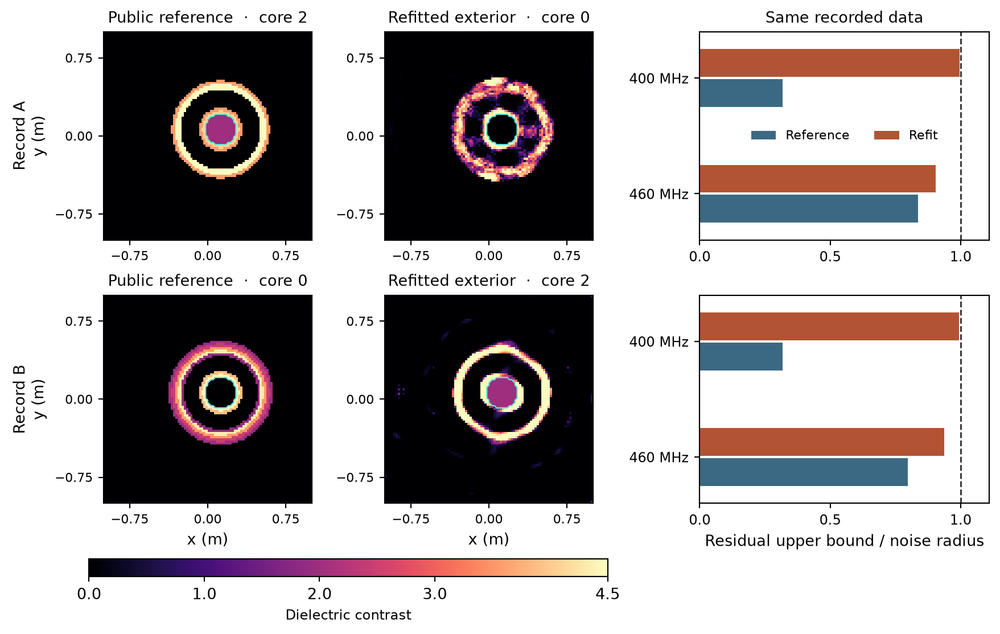

# 同一份相干读数，核心能否既是零又是二？

**两件 96² 样品分别都能。** 保持先前实际采下的 400 MHz 八发八收和 460 MHz 一发一读、各自的噪声半径、能量、硬件与物理参数不变。唯一改变是允许解释数据的外围材料在原始 \([0,4.5]\) 内自由变化。两件样品此前在制造公差内分别被判高、低；各自都有一对通过完整双频正演的材料，164 格连通核心分别恒为 0 和 2。核心面积 0.07118 m²。旧矩阵是两规格共同的既有记录，各样品新增的单标量不同，均读取原始封存值。

| 单脉冲样品与已判规格 | 公差内参考核心 | 参考材料残差上界，400 / 460 MHz | 宽盒另一份材料的核心 | 另一份残差上界，400 / 460 MHz |
|---|---:|---|---:|---|
| A（unit_415），高 | 2 | 0.317242 / 0.836890 | 0 | 0.994995 / 0.904351 |
| B（unit_862），低 | 0 | 0.317239 / 0.798156 | 2 | 0.994704 / 0.936616 |

两列均以各次采集的原定绝对半径为单位，向上取整。发送端仍为 0.375 幅度的同一量化波形。没有查阅样品真值、追加其他端口或改变接收合路。对每一原生物理解的重放以裸空间算子和 25 端加载电路独立完成。对 400 MHz 的八列矩阵，重放把谱误差保守地乘以 3 再计入 Frobenius 误差。两频材料相同，每格实非负且不超过 4.5；通过有理算术核对了全部核心格，所报均值精确为 0 和 2。[原生误差与逐矩阵费用](dual_verification.json) · [独立重放](verify_dual.py)

## 两条完整正演路线是否一致

第一条路线在裸空间解材料电流，再接入 25 端口，令额外探头开路。作为独立检查，第二条完全绕开反演程序的正演、观测读取与材料中心函数，改在保存的 24 端加载 Green 算子上直接解材料，再用空场项和带界的系数差还原开路读数。复数投影和开平方用 160-bit Arb；两个参考文件与两个重新拟合文件的 ROI 索引，分别对照原始 164 格几何。第二条给出反向核心残差上界 A 为 0.994964r / 0.904320r，B 为 0.994658r / 0.936610r。四个材料在两条路线上都通过。第二条重算用了 19.56 s 墙钟、19.23 CPU 秒。

两路共用冻结的几何、2D 离散传播核及其误差假设，因而并未消除真实天线或连续介质的模型误差。上面的“点估计至少错 1”是对该记录所允许的最坏材料的下界；具体隐藏试样上的误差不由它决定。[另一种推导的实现](verify_loaded.py) · [24 端逐材料结果](loaded_verification.json) · [独立审查的原问题](../../../reviews/neon08/public_response.md)

## 为什么第二次搜索找到了相反的材料

初次的有界 Gauss–Newton 只重选一次外区位置并折中两个残差。它对两个反向核心都没有过关。改为在 130 个实测量分量上同时对两个独立的球定价，每步都在 9,052 个合法外围格中重算补偿，再选择对两个读数有贡献的位置。整个核心保持指定的 0 或 2。外区更新后重新求强散射全波，用两份残差中较大的那一个决定是否接受。最终用独立原算子检查每个已存候选。这个过程构造了合法解释，无需对两份各 9,216 格的材料同时做全局分支搜索。[含盒约束的对偶推导](../../../theory/THEORY_ZH.md) · [测量空间求解程序](dual_response.py)

样品 A 追加五个接受步即通过。样品 B 初次十步时的两球上界仍为 1.047693、0.970389；从该物理材料继续更新十一步后才同时通过。保留了先前两次失败的逐步结果和候选。普通有界 GN 共用 51.83 CPU 秒，追加对偶两样品分别用 13.71 和 \(30.46+51.12\) CPU 秒，最后另付 6.09 CPU 秒对五份候选重新验算。初次候选导出时误用了布尔 ROI 索引，未写出结果，该五步运行另行重算，首次无单独进程计时。所有这些是反例搜索或复核费用，实际测量及原规格分类无需运行此搜索。[第一次 GN 搜索](REPORT_ZH.md) · [第二件在十步结束时的实物理候选](dual_unit_862.json) · [继续更新后的候选与成本](continued_unit_862.json)

## 这给任务误差什么硬限制

任一覆盖全部合法解释的窄区间必须同时含 0 和 2。因此对这两组具体读数，宽盒合同下任务直径至少为 2。任何只读这些数据的核心均值点估计，至少在同组两种解释之一有绝对误差不小于 1。这个结论跟图像反演器、延拓策略和初值无关，也不要求 0 与 2 之间所有值都可行。

使用经过独立标定的两份规格时，同一个读数可以把高规格核心均值限制于 \([1.99,2.01]\)，低规格限制于 \([0,0.01]\)。因此，增加一个接收数足以排除另一个制造规格；将该判决推广到未知外围会在这两组实际读数上产生错误。原 96² **八发追加、64 读数**的两个相反核心仍未决，它们使用另两件样品。这里的见证不能代替那项更强观测。[单脉冲规格判定](../REPORT_ZH.md) · [八发追加观测的同数据重拟合](../../postmeasurement/REPORT_ZH.md)

## 需要多少外围改动才可能产生相反的解释

以相反核心的公开参考件为起点，固定核心，仅改变外围。令 \(b_*\) 是同时进入两个实际观测球所需的最小外围逐格最大改动的下确界。对该件全部可能的外围逐格编辑，在**已经采下的单个复数**的实部方向，逐次扣除盒支撑、方向性全波余项、探头开路模型误差与接收噪声。原始高维全波见证同时给出另一端。将见证与参考件的每格差用有理数相减，再以每格真实面积计算体积加权代价。

| 记录 | 该改动及以下已排除 | 有合法材料的最大改动上界 | 该见证的面积加权 \(L^1\) 上界（m²） | 该见证的面积加权 \(L^2\) 上界（m） |
|---|---:|---:|---:|---:|
| A，反向核心 0 | 0.01861572 | 3.894513 | 0.570274 | 0.942347 |
| B，反向核心 2 | 0.01544189 | 4.5 | 0.341095 | 0.826059 |

左列对全部外围成立，只用了 460 MHz 已采一维实投影，可以保证一定范围的外围漂移不会翻转判定。右三列来自同一个通过两个频率的材料，只给所需成本的上界。中间区域仍未确定，现有结果不能据此给出器件容差的精确拐点。两件合计计算约 3.51 s 墙钟、3.46 s CPU。[逐预算带符号余量](background_budget.json) · [预算计算](background_budget.py)
