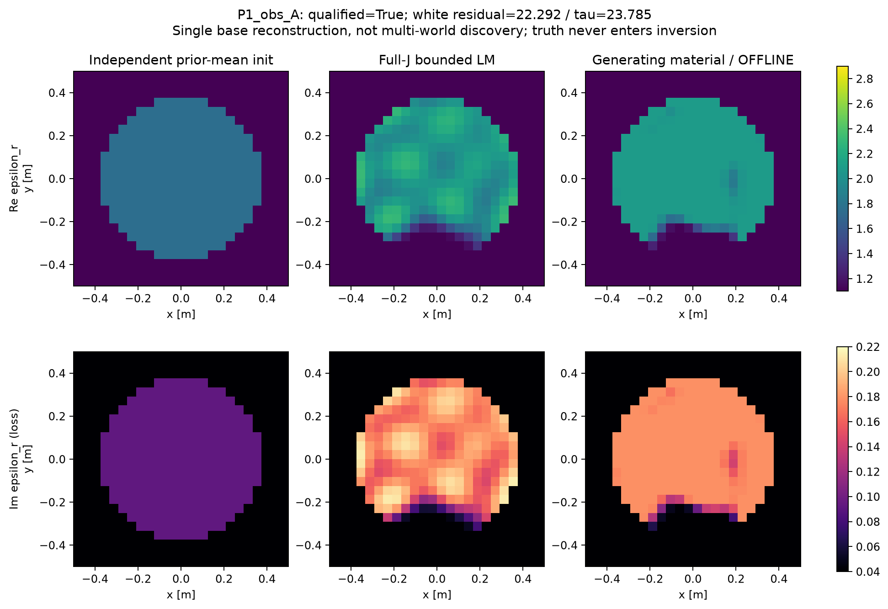
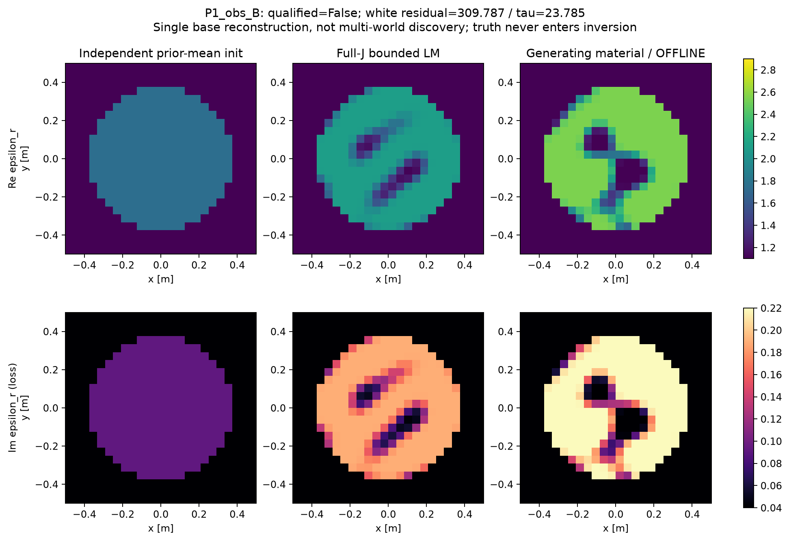
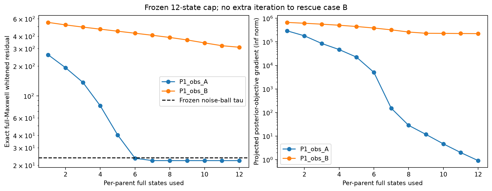
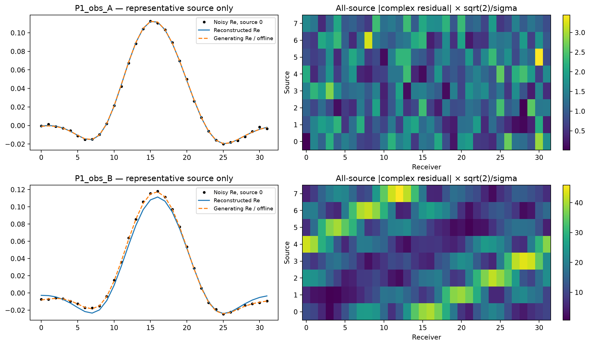

# P1真实Maxwell资格：取得1个合格基础解，另1个优化未完成

2026-10-18。本轮已按新增明确授权真实运行，不再只是材料生成。模型、prior、sigma、gain、两个parent与12states/parent限制均沿用已发布协议。未重跑旧P0/F3，未训练NN。

## 实际结果

| 条件 | 初始白化残差 | 最终白化残差 | noise-ball上限 | 资格 | 最后投影梯度∞范数 |
|---|---:|---:|---:|---|---:|
| A / dev000 | 259.9264 | 22.2923 | 23.7854 | PASS：合法且数据相容 | 0.911215 |
| B / dev001 | 551.3996 | 309.7873 | 23.7854 | FAIL：未相容 | 223974 |

两者均从z=0、u=.5的共同先验均值开始。在线反演只读取y、sigma和target identity，不读真实latent、GT、N3或结构标签。两份观测按事先保存的noise生成，无挑选seed或放大噪声。

**目前有1个合格P1 physics-only基础材料、0个新发现的替代世界。** A不是认证MAP，noise-ball也不是posterior支持边界；没有posterior概率或多模式结论。

## B为什么失败，当前能排除什么？

B的Φ由152020.76降至47984.08，投影梯度仍约2.24e5；每一步都降低目标，全部11次Gaussian更新长度均触及.5上限，但12states限额先到，不能视为收敛。固定Gaussian步长限幅与复杂材料形状的优化是当前瓶颈候选，尚未隔离各自影响；这也不保证追加迭代必然成功。

生成材料与反演使用同一P1、同一full-forward、mesh、source、receiver和固定gain/noise。闭账后仅用已保存数组检查：真实生成材料的白化噪声范数为A=23.085207、B=23.757422，均低于固定阈值。因此B的本轮失败不支持“先验里没有可行解”或“物理唯一性阻止反演”的结论。没有用这些GT信息修改在线初始化或重跑。

sigma仍为.00119211798514519，没有为新物体重新定标。按总散射响应RMS/sigma定义的实际SNR分别32.754/34.215dB，不是每物体固定20dB；总散射包含已知宿主响应。

## 物理与材料质量

26个端点全已立即保存，最大状态backward residual为1.54e-15；多源共享材料本构误差最大1.77e-15。完整白化J来自32个receiver共享adjoint，共24份，原数组均保留。

离线复材料MAE：A由0.162177降至0.042536，B由0.310640降至0.186809。这只用于评分，不用于选择endpoint。A与GT的材料RMS仍为0.080712，说明数据相容不等于精确材料恢复；不能因此将真实生成材料和逆解自动称两个已发现的重要posterior世界。

A损耗参数处于允许上界，投影梯度与active bounds在PHYSICS_METRICS中记录；未认证驻点。两例末端Dg数值rank均66，不把这些材料维数或小奇异值当exact-fiber存在证据。

## 全部成本与停止

新增26/32个full-material states、976/1024个complex full-solver RHS：208 forward RHS + 768 receiver-adjoint RHS；26次LU。受控job wall=5.476945s，含两truth、初始化、全部反演、导数、检查与端点持久化。不是算法独立cold/warm计时，也不是完整研究/上传host时间。旧paid背景导入单列，历史setup不当作免费。

没有数值异常或line-search拒绝；B属于科学/优化资格失败，仍计费。剩余6states/48RHS是原失败预留，不转用来追加迭代或寻找正例，阶段封账。物理之后的分析只读已有数组，没有新LU/RHS/forward。

## 科学决定

继续保留A作为真实P1物理anchor；B标记NONCONVERGED_AT_FROZEN_LIMIT。P1比旧双Gaussian chart更丰富，但现在不足以证明多解机制或NN价值。

F3-native、A17-X finite feedback、exact T-matrix、普通Full-J和goal-oriented ROM的共同机制比较仍NOT_RUN：本次授权只覆盖观测与独立物理资格，不以预留额度启动另一campaign。下一有价值的实验是在已合格A上冻结同材料位移/同成本对照；B应先做零新增物理的步长、局部模型与已有Jacobian分析，不能无限增加迭代。没有A17增量或强TAP算法贡献结论。

[机器可读结果](PHYSICS_METRICS.json) · [裁决](PHYSICS_DECISION.json) · [逐项账本](PHYSICS_LEDGER.jsonl) · [原始数组](https://github.com/migodam/b1-probabilistic-maxwell-imaging/releases/tag/p1-physics-qualification-20261018)
