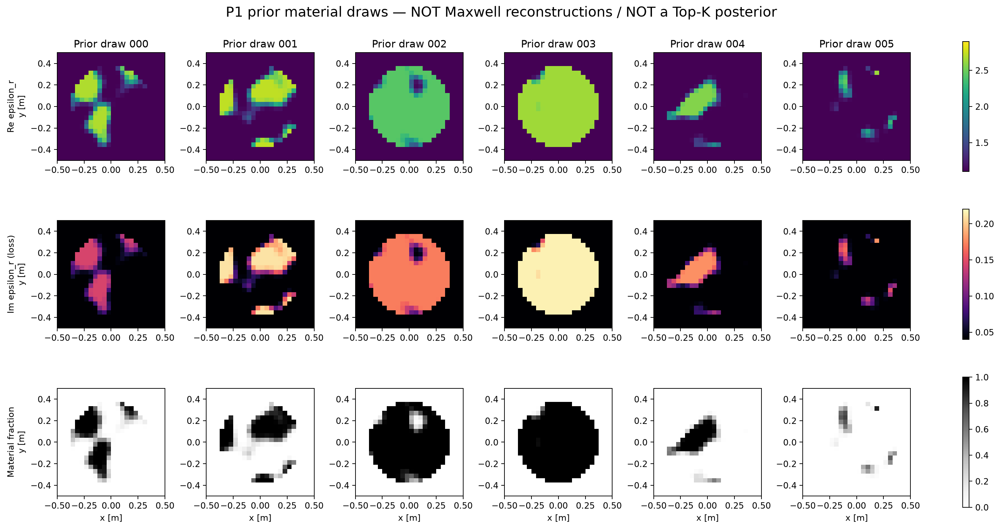
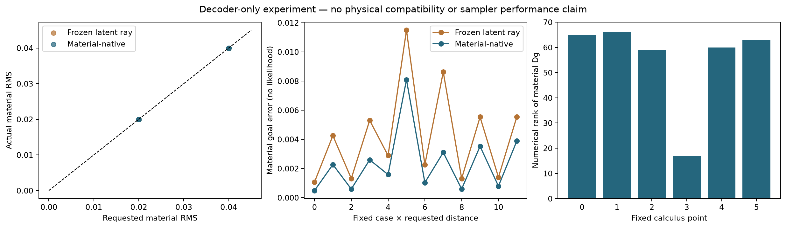

# P1从建议变成实现：材料支持已建立，Maxwell辨识仍待实验

2026-10-18。本轮实际完成P1生成器、prior/likelihood、材料侧数值运行和后续physics入口。原P0、F3、T/G、LXZ及A17-X报告保持原样；没有训练NN，也没有新增Maxwell求解。

## 1. 现在具备什么

| 对象 | 当前状态 |
|---|---|
| P1 prior law、decoder、解析材料导数 | 已实现并冻结 |
| 采集、host、噪声、gain、物理材料定义 | 已冻结，复用原24×24 TM合同 |
| 材料数据 | 192份实际生成并保存 |
| 独立材料运动 | frozen/native各12个实际端点，无Maxwell验证 |
| 观测与physics-only inversion代码 | 已实现，默认0预算、禁止物理导入 |
| 真实P1观测、合格anchor、ambiguity witness | NOT_RUN |
| Full-J / exact-port / goal-ROM / A17物理比较 | NOT_RUN |
| posterior reference、概率校准、NN | NOT_RUN |

这填补了上一轮“P1只有建议、没有prior实现”的缺口。不能把材料图当成同一观测的多个重建，也不能提前认定存在值得学习的fiber。

## 2. 物理与概率设计

P1用相关Gaussian场自然决定内部形状，C2饱和混合分数形成宿主/材料/过渡区。64个空间Gaussian变量与2个uniform材料参数，共66维。不输入孔洞数量或family label，不做peak normalization。

材料为chi=.1+.04i+phi(a+ib)，a在.8–1.8、b在.03–.18。它是被动有效TM材料模型；宿主区不是绝对空气。已知r≤.38包络含256cells，内部形状与混合分数未知。

prior在latent上明确正规化，饱和的多对一与可能原子质量保留为推前law。pCN+固定对角反射提案可保持该prior；material retraction是candidate-only，不是posterior sampler。详细定义见MODEL_AND_PRIOR。

仪器sigma固定.00119211798514519，与原已暴露尺度相同；未按新图像增大噪声或保持每parent20dB。32组noise draws在任何forward前保存，前两个白化噪声范数23.0852/23.7574；没有择seed。95%噪声球tau23.78545仅为相容性诊断，不是Gaussian支持边界。

## 3. 真正运行的材料结果

固定独立seeds生成128 calibration、32 development、32 material-check，共192份。所有样本现已检查，后续不称blind Maxwell validation。两个拟用于物理资格阶段的parent在生成前固定为dev000/dev001，不根据图像或真值误差挑选。

全材料Re chi范围.1–1.89873，Im chi .04–.21954；phase fraction数值为0到1（最多7e−16舍入）。独立校准parent配对的材料RMS中位数.55273，范围.26278–.93695，说明prior材料确有区别；尚未检查它们的散射是否可区分。

在128个calibration样本上，phi≥.5的事件：

| 输出事件 | count | prior频率 |
|---|---:|---:|
| 多个component | 71 | .55469 |
| 单component、无闭合宿主区 | 44 | .34375 |
| 单component、一个闭合宿主区 | 6 | .04688 |
| 单component、多个闭合宿主区 | 4 | .03125 |
| 无≥4cells的threshold component | 3 | .02344 |

这是已定义prior事件的抽样估计，Wilson区间在METRICS；不是后验质量，也不给展示图逐张赋概率。最后一项不等于整张图为纯宿主；192份中完全纯宿主样本为0，理论law仍允许饱和原子。

## 4. 材料几何与有限运动

6个固定calibration材料点，三个中心差分步长1e−3/3e−4/1e−4检查66坐标解析材料导数，最大相对误差1.66e−7。是decoder导数，不是Maxwell Jacobian。

在1e−8相对阈值下，6个材料切空间数值rank依次65/66/59/17/60/63。饱和会产生inactive方向和rank变化，不能把latent66维直接当可移动材料维数，更不能把Dg的kernel当Maxwell nullspace。

同6个已知prior点、相同方向，分别申请实际材料RMS .02/.04。frozen和material-native各12个端点，均达到申请距离；平均目标材料误差分别.004249/.002379。native按该decoder目标优化，本结果只说明代码和合法材料retraction可运行；没有数据相容、A17增量或物理teacher结论。

进一步逐端点复核发现：native只有2/12次优化器正常收敛，其余10/12均触及150次迭代上限。达到材料距离不等于优化驻点成立。两方法各仅1/12通过事前定义的结构变化尺度，因此不能把24个数组称为24种结构或24个新物理解。原始优化状态和失败消息保存在RETRACTION_RESULTS.json，汇总见evidence/RETRACTION_STATUS_AUDIT.json；没有为得到更好结果追加优化。

## 5. 后续真实运行入口已写好

tools/run_p1_physics.py包含数据生成和独立受约束物理反演：

- 数据生成模块单独读取dev000/dev001材料并付两次truth forward；在线文件只含observation、sigma、target_id。
- 反演模块从z=0、u=.5起步，只接收y及target；不读GT/种子、不用N3或truth warm start。
- 复用原A30 full solver和32receiver共享adjoint，使用完整latent J与proper Gaussian prior的bounded GN/LM。
- 每个返回endpoint立即保存q、材料、current/field/prediction/LU；失败前输入也单独持久化。state、RHS、adjoint、LU/action、wall及拒绝全部进入新账本。
- noise-compatible可行anchor与MAP驻点分开，不把优化ftol或低材料误差当资格。

当前预算为0，真实调用在A30 import之前被拒绝；实际材料运行确认backend modules为空。在线target配置删除数据生成seeds和隐含truth参数。没有用cached affine response冒充P1观测。

## 6. 成本、失败与决定

成功材料分析受控wall约.976s，包括样本恢复读取、数值导数、24个运动端点和持久化；它不是全部host研究时间。首attempt在记录字段合并处失败，192原材料及noise已保存；修复序列化后复用同一批数据，没有改prior/noise/seed。失败attempt的wall未测，明确保留，不将.976s冒充总费用。

本轮Maxwell states/RHS/LU均0，GPU/NN/Mie/新3D均0。旧paid背景cache继续复用，历史setup成本不当作免费部署；从零准备完整仪器的成本本轮未重新测量。

**决定：P1模型与材料实现READY；进入真实物理资格实验所需资产已具体化，但新物理预算仍未授权。** 下一阶段建议独立32states/1024RHS/600s CPU，覆盖2个truth、每parent最多12次独立反演state及6次失败预留。不能自动启动，也不借旧余额。

合格anchors取得后，才按A17X_P1_BINDING比较native/Full-J/X提案及full/exact-port/goal-ROM/A17求值；P1共同固定端口支持上限256，不将66latent当66port。现在仍没有新的同测量竞争世界、posterior模式或论文算法增量。

[下一物理阶段](PHYSICS_NEXT_RUN.md) · [实际数组与指标](METRICS.json) · [账本](RESOURCE_LEDGER.jsonl) · [复现](REPRODUCE.md)
