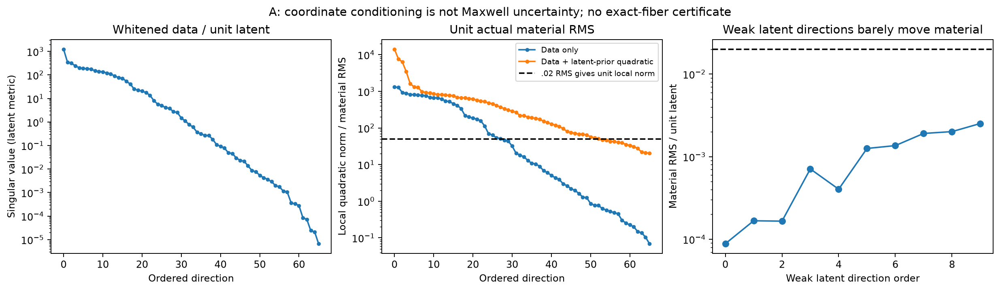
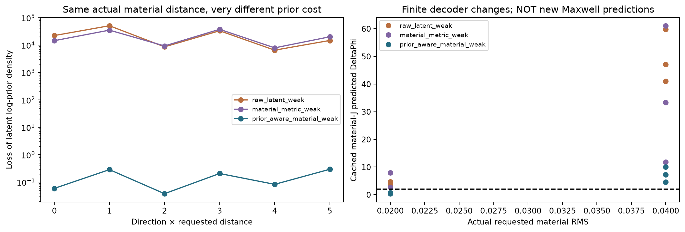
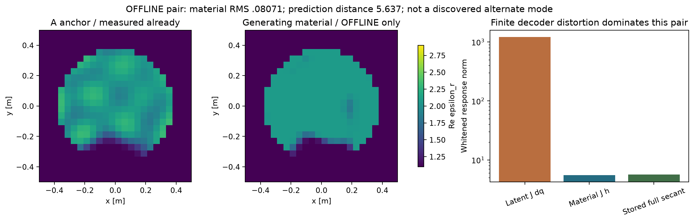
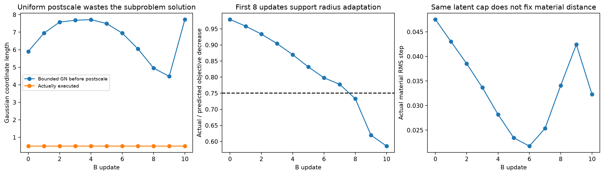

# P1的局部不确定性、GT差量和B优化失败：零新增物理审计

2026-10-18。先读最新P1入口、真实资格报告、完整PHYSICS_METRICS，以及A17-X/F3竞争审计、机制修订和冻结协议，再只读已经付费的材料、观测、J与prediction。未调用A30、旧LU或新RHS；不重跑F3，不训练NN。所有结果来自同一个冻结P1，不改prior/noise/gain。

## 1. 先给出结论

A值得进行一次小型、严格限额的finite-noise探索，但现在没有新的、full-Maxwell验证的替代材料。B值得修复标准优化器，但不能保证改法成功。现有结果不支持训练Explorer，也不支持以高阶feedback为主要瓶颈。

最弱latent方向确实混合了两件事：同样latent长度几乎不动材料，以及真实材料变化对观测不敏感。单看原始J的小奇异值，会把两者混在一起。材料归一化后，真实弱敏感性仍存在；加回原Gaussian prior的移动费用，又排除了很多看似自由、实际极不合理的大参数运动。

## 2. A的材料几何：不把饱和当成物理自由度

设Dg为缓存材料导数，A为正确白化的观测Jacobian。材料RMS度量矩阵为M=[Re Dg; Im Dg]/24。对M做薄SVD M=U S Vᵀ，令T=V S⁻¹，则MT=U。分析K=A T，比较的是单位真实材料RMS的响应，既不改变prior，也不插入任意Gram determinant充当材料密度。

A的256个ROI cells中，14个为精确宿主平台，242个在过渡区，无精确纯材料平台。Dg在1e−6/1e−8/1e−10相对阈值下均rank66，condition≈13744。这里没有由饱和导致的已确认exact同材料gauge；但ROI截断、相关场和饱和共同造成很不均匀的材料参数灵敏度。

原A的latent-J condition≈1.86e8；材料归一化后K condition≈19110，最小奇异值.06901/材料RMS。这说明严重病态有很大一部分来自坐标/decoder，而不是Maxwell自身；同时K仍具有很弱但非零的方向。阈值敏感性相同，没有exact local fiber证书。

以既定任务RMS .02、线性白化漂移≤1作描述性尺度，66个方向中38个满足该一阶尺度。加入原Gaussian prior二次移动代价后，仅13个满足同一组合二次项尺度。这些是局部线性/二次诊断，不是13个模式、credible interval或已验证的有限posterior区域；A在损耗上界，方向必须进入可行切锥。

最弱的三个原latent方向，每单位latent长度仅移动材料8.82e−5、1.67e−4、1.66e−4。沿合法半射线推进到实际材料RMS .02，Gaussian坐标却要移动114–211，latent log-prior损失6499–22191。这些射线本身不能作为重要后验质量的证据；“Gaussian处处有支持”不能用来忽略这样的prior代价。decoder是多对一的，未积分这些材料的其他preimage，不能进一步断言对应整个材料事件的质量为零。

单纯改为材料metric最弱方向仍会遇到同类问题。用原prior-aware组合二次项选择的三个方向，在同样实际RMS .02仅需Gaussian位移.337–.388，log-prior损失.038–.083。小点密度损失也不是event mass证据；这里仅作为proposal代价诊断。缓存完整材料J对这些有限decoder差量预测的DeltaPhi约.368/.515/.706；.04时升至4.57–10.09。

以上18个端点只是decoder-only计算，不是新Maxwell states。三条prior-aware射线在.02/.04均没有通过原P1结构变化检查：不能把它们称多个结构世界。方向先于GT evaluator冻结；当前只支持在.02任务尺度做一个小型物理可证伪pilot，.04保留为负向压力结果，不追加付费扩展。

## 3. GT只在隔离offline evaluator中：数据相容不等于不可区分

online脚本不读取offline_materials或dataset_truth端点。在线谱、方向、有限decoder试验和B分析先保存并封账，commit48f11e8固定后，独立p1_zero_offline.py才读取已保存GT端点；没有把GT送回提案或筛选。

A与GT复材料RMS=.0807125、MAE=.0425365；94.44%的有限材料差量能投到A的局部prior切空间，5.56%在其外。两者都是合法有限prior状态，不意味着它们的差量必须等于一个局部切向方向，也没有测过两者之间的Maxwell路径。

材料归一化后的谱阈值分别取1e−2/1e−3/1e−4，GT差量的弱方向能量占全材料差量26.78%/14.11%/.0287%；非常依赖“弱”的尺度。按任务.02对应白化漂移≤1的固定尺度，弱方向能量为79.46%，另5.56%在切空间外。不能只挑一个有利百分数宣称GT沿nullspace可达。

两均值的白化预测距离为5.6371。虽然两份材料都通过半径23.785的高维noise-ball，这并不说明它们的均值足够接近。对“两个已经固定的均值+同一已知Gaussian噪声”的未来独立测量，等先验最优二元误判率为Phi_normal(-d/2)≈.002412，即.2412%。这是固定pair的前瞻诊断；A是从当前y拟合出来的，不能把该数当当前数据的p值、复合假设检验、全局唯一性或posterior校准。

当前观测的Phi分别248.4726/266.4634，log likelihood ratio偏向A约17.9908；拟合后的A偏向自己并不意外。latent点prior密度也不同，但连续材料单图无非零质量；没有event evidence或posterior reference，不能报告两张图的概率。**目前没有合格的“重要竞争模式”见证。**

一个关键机制诊断：直接用latent差量预测得到白化响应范数1212.30；把真实有限材料差量送入完整材料J得到5.5227；缓存真实full-forward差值为5.6371。后者的Maxwell有限余项范数.7914，约真实响应的14.0%，而decoder有限secant相对切向外推的响应差达1211.88。

因此，在这一个离线pair上，巨大的latent有限步预测失效主要来自decoder/参数路径，不是巨大Maxwell高阶反馈。完整材料一阶预测的GT Phi为265.9101，与真实266.4634差约.5533，说明高阶项仍可影响精细likelihood，不能直接忽略；但它不是当前千倍尺度失真的主因。这不是新resolvent实验，也不证明所有方向都线性。

## 4. B失败更像优化机制问题，尚非物理或表示失败

B全过程不读GT。12个付费状态中，11次更新的Gaussian长度均被固定为.5；原始有界GN解长度4.48–7.73，之后被统一缩至约6.5%–11.2%。最后缓存子问题建议长度17.10，但从未支付新forward验证。

旧轨迹上，实际目标下降/局部预测下降比rho从.979降到.586，始终为正；前8步均>.75。说明早期局部模型有效，但算法没有利用良好预测扩大trust region；后期非线性误差增长，又说明不能简单取消步长上限。最后投影梯度约2.24e5，材料参数不在active bounds上，不能解释成边界KKT最优或已经收敛。

推荐对照是普通Full-J的**直接有界adaptive trust-region子问题**：把半径约束放进子问题求解，按实际/预测下降调半径，而不是先求一个长步再统一缩短所有坐标。保持Phi+.5||z||²这个原latent MAP目标、原property bounds、prior、noise、gain和source。它是成熟优化器的修复假设，不是A17创新，尚未真实验证。

## 5. A17-X与强基线怎么保留

此前A17-X审计已证明：相同current空间V/C下，exchange与普通Galerkin有限预测必须一致；小latent不保证小端口，不能把F3的七维当七端口。P1的共同ROI支持最多256cells，66latent也不是66port。

本轮把普通material-native和优化充分的Full-J放在A探索主对照，先修复B标准优化。A17-X保留为固定合法材料下的finite-state/current enrichment竞争机制；它不负责把任意current变成合法材料，也不与decoder曲率补偿混为一谈。任何后续增量检验必须保留optimized full、exact T-matrix、普通Full-J与goal-oriented ROM，给普通ROM相同复用权利并计入basis/dual/setup/fallback成本。

原两anchor A17-X协议目前仍仅满足一份合格anchor，不能追认PASS。本轮不重放F3或旧合成恒等式、不支付新端口/ROM/feedback RHS；没有A17精度、速度、概率或新世界增量结论。

## 6. 冻结两个最小实验与预算

| 拟议实验 | 新states上限 | 新complex RHS上限 | 受控物理wall | 目的 |
|---|---:|---:|---:|---|
| A：3方向×2强基线，每组proposal+一次共同corrector | 12 | 288 | 300s | .02真实材料尺度的finite-noise移动；结构单列 |
| B：原LM延续 vs直接adaptive TR，各8states | 16 | 640 | 600s | 恢复独立physics-only anchor，终端J/梯度计费 |
| 合计，仅建议 | 28 | 928 | 900s | 未授权、NOT_RUN |

具体目标、逐项费用、方向、停止和禁止事项见FROZEN_EXPERIMENT_PROTOCOL与机器可读JSON。A当前所有射线都没有结构变化资格，所以只允许把结果当有限噪声不确定性检验，不预设多世界。若真实数据漂移失败或回到anchor，结束该pilot；不降低.02、放大noise或加budget找正例。

**裁决：CONDITIONAL GO小型A/B物理检验；NO-GO当前结构多模式/NN/强TAP主张；新物理执行保持NO-GO直到新的明确授权。** 当前新Maxwell/RHS/LU均0，所有费用来自旧缓存另列，不用已封账6states/48RHS。没有任何新物理解。

[冻结协议](FROZEN_EXPERIMENT_PROTOCOL.md) · [在线输入清单](ONLINE_INPUT_MANIFEST.json) · [离线统计结果](OFFLINE_GT_PAIR_EVALUATION.json) · [新费用](RESOURCE_LEDGER.jsonl)
