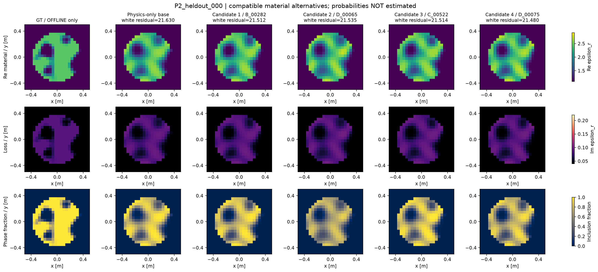
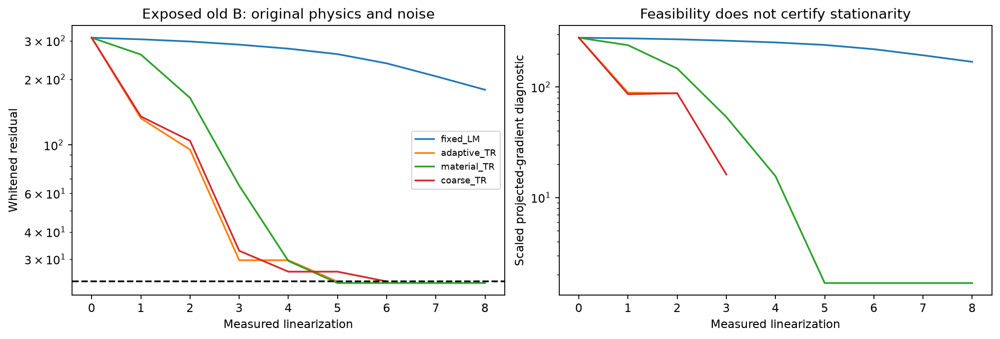
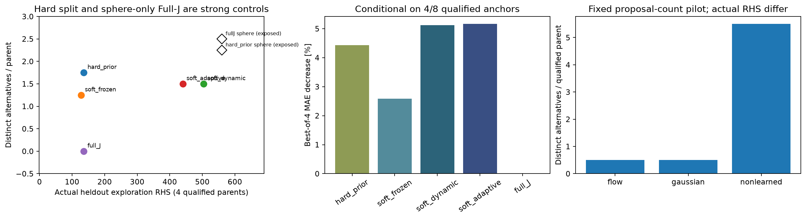
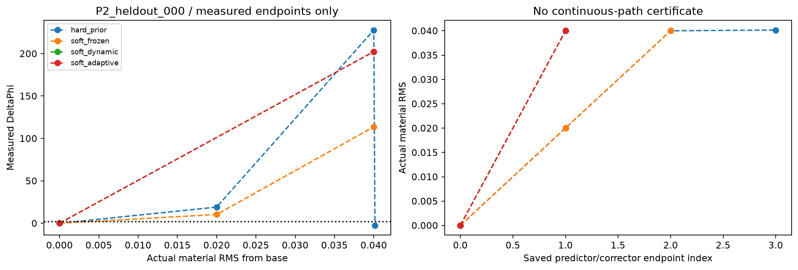
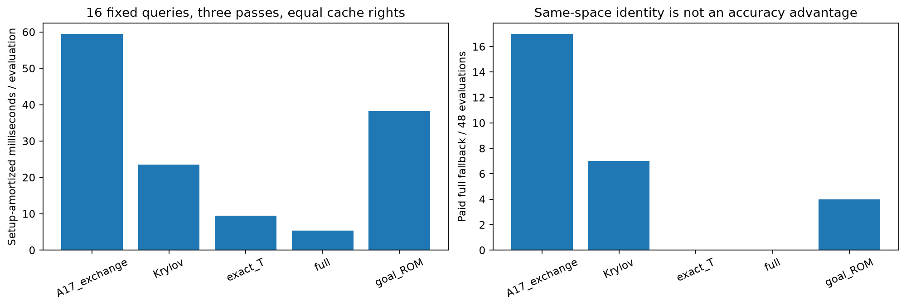

# Research P2：存在有限噪声材料自由度，但尚无独立的软谱生成算法优势

2026-10-19。最终裁决 **REDIRECT**。A–E已实际运行；没有将局部连续变化包装成多个重要posterior模式。所有后验概率为null。

## 先看这次究竟得到了什么

24个事前固定的新物体，15个得到合格physics-only基础材料；held-out仅4/8合格。首次冻结的材料archive在全部24对象保存69个任务尺度不同的替代解释，其中held-out为29个；这是按每份观测累加、最多12张代表的材料去重计数，不是69个拓扑模式或概率事件。

主held-out archive有1个达到原结构变化尺度的替代材料，0个拓扑事件改变。训练/验证的少数拓扑标签变化也不稳定：同时满足结构检查并在.25/.5/.75三个fraction阈值都改变的案例为0。故“可探索连续材料不确定性”有正证据，“发现重要不同拓扑世界”尚未建立。

全部8个held-out的基础复材料MAE为 **0.06513030**，在线farthest-first代表的Best-of-4为 **0.06424926**，下降约 **1.35%**。2,000次parent bootstrap的绝对改善区间为[0.00001504, 0.00197536]。它混合了多种方法及不同预算，只是联合archive的oracle诊断，不是某个算法的同成本胜出。

Best-of-K包含原基础图，oracle最小值按定义不会恶化；其bootstrap区间不能作为在线估计改进或新算法独立贡献的证据。在线默认Selected-MAE仍为基础图的.06513030。

动态软谱在合格子集的Best-of-4稍好，但比hard-prior使用更多RHS；动态减hard的配对MAE区间跨0。小Gaussian/Flow没有改善Best-of-4。A17更慢且fallback更多。因此本轮不支持“Soft Explorer / learned proposal / A17-X产生强算法增量”的论文主张。

## 1. 物理与先验，没有改成更容易的任务

原P1的64维相关Gaussian加两项uniform，C2被动材料fraction、24×24 scalar TM、8 sources/32 complex receivers、原host、gain=1及sigma=.00119211798514519全部保留。宿主区域不是空气孔。观测使用真正circular-complex Gaussian noise，实虚部方差sigma²/2；没有逐物体调SNR或noise。

24个新parent为12 train/4 validation/8 held-out，seed2026101901；旧A/B只是已暴露回归条件。图像显示epsilon_r=1+chi，实部、损耗与fraction全使用共同色标。这里不是三维vector-Maxwell或一般未知几何成像。

生成truth的24次forward计费。在线读取sanitize后的观测、合法材料及已付费物理因子；GT只在commit2024d77固定A–E之后，由独立offline脚本读取。后续sphere-only强基线补充发生在主评分之后，明确为EXPOSED审查，不能称新增盲测。

## 2. 先把物理反演修好

旧B的白化残差从309.787降到以下水平。固定.5截断LM继续运行仍不合格；直接TR、材料TR和coarse-to-fine都得到相容材料，但部分QP停止为SUBPROBLEM_FAILURE或预算停止，不能追认stationary MAP。

| 优化器 | 旧B最终白化残差 | noise-ball资格 | 停止原因 |
| --- | --- | --- | --- |
| fixed_LM | 178.9903 | False | STATE_LIMIT |
| adaptive_TR | 23.6922 | True | SUBPROBLEM_FAILURE |
| material_TR | 23.3406 | True | STATE_LIMIT |
| coarse_TR | 23.7352 | True | SUBPROBLEM_FAILURE |

新物体上按开发条件选择coarse_TR，最终15/24相容，9/24未恢复。这是优化与decoder数值条件问题的实证，不是“其余物体不存在合法材料”。全部真值本来由原prior生成；noise-ball只是有限相容判据，也不是Gaussian posterior硬支持。

## 3. 局部探索：真正的收益和代价

以M=[Re Dg;Im Dg]/24构造真实材料RMS frame，prior-aware矩阵同时包含数据项和原Gaussian penalty。soft cutoff由任务距离s决定：lambda_c=1/s²；没有根据held-out GT挑谱阈值。筛选只影响提案，未改变prior measure。

全部方法保持合法decoder、实际RMS .02/.04、原noise与property bounds。主探测器的signed progress阻止corrector回原点。每个接收端点都立即保存；.08只在development做stress。dynamic/adaptive的正结果是有限端点，不是精确fiber存在证明。

| 方法 | 合格held-out数 | 不同替代/对象 | Best-of-4 MAE | 该panel基础MAE |
| --- | --- | --- | --- | --- |
| B:full_J | 4 | 0.00 | 0.048404 | 0.048404 |
| B:hard_prior | 4 | 1.75 | 0.046260 | 0.048404 |
| B:native | 4 | 0.00 | 0.048404 | 0.048404 |
| B:random_matched | 4 | 0.00 | 0.048404 | 0.048404 |
| B:soft_Maxwell | 4 | 0.00 | 0.048404 | 0.048404 |
| B:soft_adaptive | 4 | 1.50 | 0.045905 | 0.048404 |
| B:soft_dynamic | 4 | 1.50 | 0.045928 | 0.048404 |
| B:soft_frozen | 4 | 1.25 | 0.047154 | 0.048404 |
| D:flow | 4 | 0.50 | 0.048404 | 0.048404 |
| D:gaussian | 4 | 0.50 | 0.048404 | 0.048404 |
| D:nonlearned | 4 | 5.50 | 0.046163 | 0.048404 |

上表方法只在已获得合格基础解的4个held-out对象执行。其余4个计入全部8对象的主风险，不能只拿这4个容易案例宣布一般恢复成功。K不足时保持实际K，未复制材料凑数。默认Top-1基础图始终保留；oracle Best-of-K不用于在线筛选。

普通随机、native及带随机方向进度约束的Full-J主对照较弱；这不证明Full-J本身不能探索。独立审查因此在B剩余额度内增加sphere-only Full-J与hard-prior初始化：只保持非零材料距离，取消人为角向限制。

补充对照在held-out找到 **10个Full-J、9个hard-prior** 去重替代解释；Full-J有1个结构变化，仍无重要拓扑模式证据。其全部8对象Best-of-4分别为0.06496037和0.06411802。这是已暴露审查，不作为新确认性胜出；但足以否定“只有软谱机制才能得到替代材料”的叙事。

## 4. 弯曲材料路径，有什么证据？

实际验证了RMS .02/.04的predictor/corrector端点，有方向更新与非线性数据修正。点之间未做稠密full-forward验证，无法承诺整个插值路径都相容，更不能称为精确等散射流形。图中的虚线仅连接已测点。

GT弱方向能量与Best-of-4收益在4个合格held-out上的Spearman约-0.40，样本太少，且没有正面可达性证据。大量GT差量投到弱空间，不足以推出Explorer能走到GT。

## 5. 全局搜索与正确概率核

在4 train+4 held-out上，独立multistart、prior jump+共同corrector与tempered pCN都真实运行。全局方法没有稳定恢复额外结构分支；高温与prior链的大量计算没有转化为冷链任务尺度移动。短链mixing不足，故不输出posterior质量、credible interval、ESS校准或无漏模式保证。

pCN与反射property proposal在原prior下可逆，温度t目标为p0(q) exp(-t Phi)。MH接受使用完整likelihood，交换使用正确温度比。deterministic corrector输出另记candidate-only。算法形式正确不表示这次16-sweep链已经收敛。

## 6. 学习提案没有增量

8个train parents提供54个真实合格、任务尺度、likelihood-competitive更新；validation有16个。三个seed的小Gaussian与四层Flow均训练3,000 updates，参数约3.29万/10.72万。没有GT监督，没有posterior distillation，没有训练期Maxwell调用，GPU为0。

学习的只是64维Gaussian更新分布，两项uniform property使用共同反射提案。held-out非学习对照平均每个合格parent有5.5个去重替代，Gaussian和Flow各.5个；二者Best-of-4均未优于基础图。D是相同提案次数/物理预算上限的pilot，decoder失败使实际RHS不同；不能把该计数当严格相同实际RHS的统计排名。失败生成的CPU成本保留在D阶段总wall，早退项没有单独可靠计时。

不能据此否定全部learned Explorer，但当前数据量、表示和小模型pilot没有值得扩大训练的实证。

## 7. A17-X：恒等式正确，实际增量否定

固定16个真实材料提案、相同噪声及缓存权利，包含所有端口setup、small core、pool、fallback和冷warm成本。exact T-matrix使用真实256-cell ROI，不把66 latent当66 ports。相同[V,C]下Schur exchange和直接Galerkin的最大差约1.91e-15。

| 评价器 | query+setup RHS | fallback /48 | cold中位ms | warm中位ms | setup摊销ms |
| --- | --- | --- | --- | --- | --- |
| A17_exchange | 296 | 17 | 38.660 | 47.572 | 59.490 |
| Krylov | 88 | 7 | 12.307 | 24.522 | 23.563 |
| exact_T | 1056 | 0 | 7.639 | 7.700 | 9.487 |
| full | 384 | 0 | 12.441 | 1.622 | 5.346 |
| goal_ROM | 192 | 4 | 13.635 | 28.911 | 38.249 |

exact_T表中的1056 RHS包含四个anchor及256列传播；不是query-only的0 RHS。A17的17/48 fallback高于goal-ROM的4/48，setup摊销时间约为optimized full的11.1倍。ordinary goal-ROM也未胜过full。warm basis随历史增长，rank与所有矩阵动作均保留；这些是本小型dense平台的测量，不外推到大型三维。

## 8. 数学贡献与先验工作的边界

材料尺度归一化与soft matrix filter可避免单看latent弱奇异值；线性重参数化并正确变换prior Hessian后，材料空间滤波相对差为5.27e-14。这是实现与几何一致性，不是新首创定理。LIS/DILI早已利用prior/likelihood谱结构；Riemannian MCMC已有位置依赖几何。

本轮可检验的新机制候选是：在材料任务尺度下分离decoder secant与Maxwell余项，决定何时付费刷新并保持有限进度。然而本次soft/dynamic并未在完整成本上明确优于hard split与强Full-J，因此尚不能将它升级为强IEEE TAP贡献。

## 进程隔离偏差

已执行A版本e5bd9d3将dataset生成与反演放在同一OS进程，未满足计划中的进程隔离。反演函数只接收观测、prior与物理接口；调用链未使用truth初始化、方向、排序或停止，但这不能替代OS隔离。独立offline评分是另一个进程。该偏差削弱隔离保证，不追认PASS。

封账后已新增独立generate_material_fiber_observations.py入口：先单独生成观测并保留同一A账本，退出后再启动反演进程。新入口未执行真实物理，不据此改写本轮结果；当前CAMPAIGN_CLOSED继续禁止新调用。

## 9. 全部成本、失败与下一步

| 阶段 | 计费states / 上限 | complex RHS / 上限 | 受控wall秒 |
| --- | --- | --- | --- |
| A | 383/600 | 12728/24000 | 66.594 |
| B | 482/1000 | 8312/34000 | 96.625 |
| C | 847/1200 | 16472/36000 | 83.535 |
| D | 240/700 | 7200/20000 | 65.645 |
| E | 284/500 | 2016/18000 | 6.844 |

最终 **2236计费states / 4000、46728 complex RHS /132000、319.243秒受控执行wall**。其中2012次真实fresh native full-forward/LU；E另保守计费固定材料ROM与factor-reuse尝试。物理operation spans合计166.339秒；它不含完整人机研究、编码、发布时间。NN训练CPU、GPU0。所有余量封账，不借旧余额。逐solve RHS、LU与总wall已对账；dense surrogate/SLSQP矩阵作用只包含在总wall，未全面保存逐callback次数，不声称完整FLOP账本。

C曾因property=-6.94e-18触发严格检查。原8states/320RHS及失败保持；只读回放确认机器精度误差后，以显式latent边界恢复继续，同一总账不重置。基础反演的subproblem failure、局部distance失败、重复点、短MH混合失败和无收益NN均保存。

**下一步选择REDIRECT：**保留便宜hard-prior/普通Full-J作为局部有限噪声基准，停止当前Flow与A17-X的优势主张。优先建立能被强Full-J与全局基线共同核验、具有稳定结构区别的ambiguity benchmark，或改进measurement设计；没有这样的正面实验，不训练更大的Explorer，也不包装强TAP论文。

[完整数据与代码](https://github.com/migodam/b1-probabilistic-maxwell-imaging/releases/tag/p2-material-fiber-20261019) · [逐项裁决](GO_NO_GO_DECISION.md) · [理论](THEORY_REFINEMENTS.md) · [复现](REPRODUCE.md)
