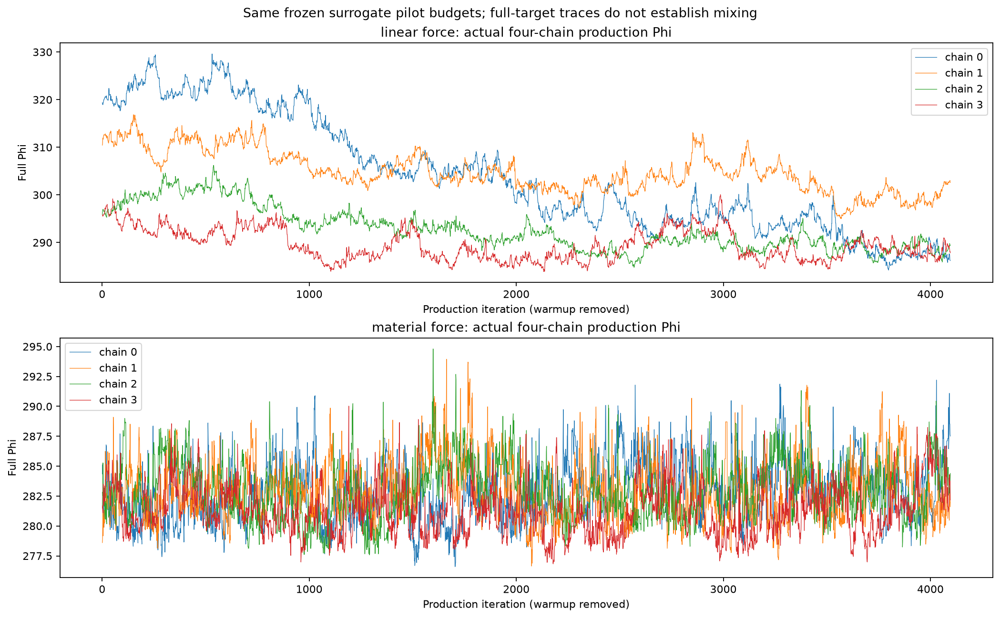
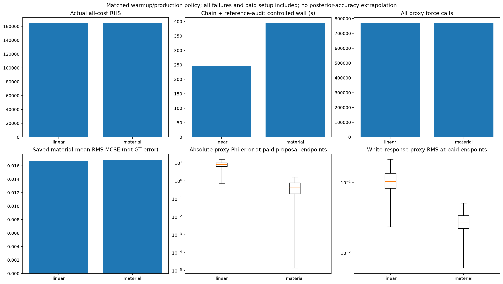

# Surrogate-force HMC: saved two-arm comparison

This analysis reads completed artifacts only. It does not qualify a reference, issue a GO/NO-GO or novelty judgment, or estimate posterior accuracy against truth.

The original parser failure remains preserved as ERROR with zero RHS. The valid fix1 sequence uses the same paid job IDs and the minimal production-policy fix recorded by the parent.

| Arm | All RHS | Controlled wall, chain + audit s | Force calls | Production acceptance | Step-size range | Material mean RMS MCSE | Saved reference status |
|---|---:|---:|---:|---:|---:|---:|---|
| linear | 164384 | 245.671 | 768112 | 0.796692 | 0.0004636..0.000613469 | 0.0166675 | UNQUALIFIED_WITHIN_MECHANISM_DIAGNOSTICS |
| material | 164384 | 393.749 | 768112 | 0.817261 | 0.00140917..0.00296844 | 0.016892 | UNQUALIFIED_WITHIN_MECHANISM_DIAGNOSTICS |

Between-arm saved mean-material RMS difference: 0.0319295098. This is a disagreement of two empirical references, not error against a true posterior or GT.

Every chain has 1024 warmup + 4096 production iterations. Costs include each chain's actual charged setup/warmup/production and its reference-audit wall. Frozen production step sizes differ by arm/chain. Proxy discrepancies were measured after MH at already-paid proposal endpoints, including rejected proposals; they are not current-state Phi errors.

JSON retains each original transition summary, numerical event counts, latent/property/material summaries and unassessed flags. Nonfinite proxy values remain in original NPZs and are counted explicitly; finite-only descriptive statistics never replace those raw failures.

Ordinary Full HMC is external context with unequal warmup/production lengths and potentially different setup. Its saved diagnostics are linked separately; no equal-budget or speedup claim is made.

## Figures

