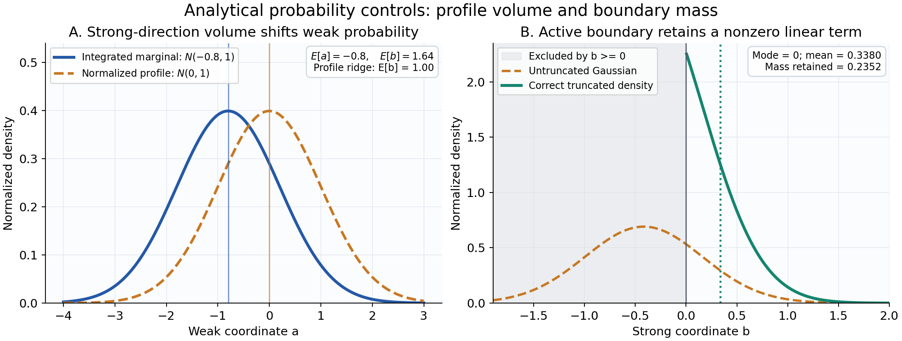
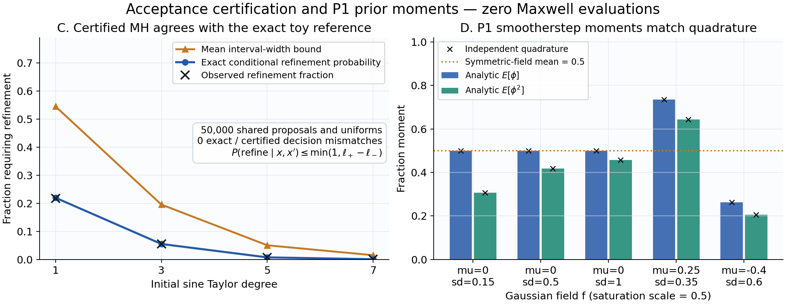

# 科研判断与阅读导航

**本研究值得继续，但应将核心对象改写为“有限噪声下、具有强方向条件厚度的局部后验区域”。** 弱观测方向适合组织非线性探索；它们不自动定义严格等数据流形，也不自动构成可积分的切分布。最有前景的成像路线，是计算弱方向边缘分布，同时保留或积分强方向的条件材料均值与方差。复杂生成模型应在这个统计合同成立后再进入。

本轮选择的主要投入方向为：**Geometry-Aware Bayesian Weak-Subspace Imaging，具体实现为非线性补偿坐标、强条件积分和材料 Bayes 决策。** 两个并行方向是：可认证 Maxwell 后验接受决策与计算复用；轻量条件密度与材料条件矩蒸馏。RL 优先研究预算、刷新与核选择，暂缓将其作为独立 posterior 生成器。完整流形 diffusion、Schrödinger bridge 和高维 geodesic transport 暂不列为首轮重投入。

这一选择不预设材料 MSE 必然下降。在线性 Gaussian、线性材料 decoder 情形，MAP 与 posterior mean 相同；正确估计分布只会增加不确定性信息，不会创造均值改善。P1 的潜在增量主要来自非线性饱和 decoder、强弱耦合、非对称边界及优化解与条件材料均值的差异。必须先测量这些来源是否足够大，再决定学习和几何复杂度。

报告区分三种结论等级：**已读证据**来自固定版本项目及原始文献；**条件推导**在列明假设下成立，许多使用标准定理；**待验证机制**是有理由进行下一轮实验的预测，尚无新的 Maxwell 成绩。本轮只运行解析概率与数值积分核验，新增 Maxwell 求解、付费物理实验和网络训练均为零。后文资源表是建议上限与启动条件，不是执行记录。

## 本轮最重要的六项推进

1. **中心曲面不必承担 posterior 支持。** 固定强弱坐标下，任意光滑补偿中心都可构成全维三角坐标变换；完整积分强方向后，弱边缘与中心的选择无关。这允许选择更平滑、计算更便宜的 strong-response spine。
2. **动态弱谱未必可积。** 即使 forward 光滑且满列秩，弱特征子空间也可能不满足 Frobenius 条件。因此“每一步沿弱方向走”与“在同一弱曲面上走”是不同命题。
3. **材料积分可以比 latent 积分更有结构。** P1 饱和多项式在 Gaussian 强条件近似下的像素均值和方差可用截断正态矩准确计算，不需要为每一个强条件样本再解 Maxwell。近似条件分布本身的费用和偏差仍需计入。
4. **把物理误差预算连接到材料风险。** 支持漏质量、forward 误差、强体积误差、条件材料均值误差与 Monte Carlo 方差可以分开控制；仅降低 residual 或增加候选数不能代替这些量。
5. **固定少量零宽轨迹不能表达全维局部 posterior。** 轨迹可以承担 continuation、分层积分和预算控制，但必须补足横向概率、体积与重叠修正。
6. **物理加速应瞄准后验决策。** 在同一 proposal 和同一个随机数下，可信 likelihood 区间可使一部分 MH 决策与 Full Maxwell 完全一致，而只在区间仍不确定时加精。新意要靠 Maxwell 中可用的证书和净费用优势证明。

# 1. 已有证据：P2 没有完成，也没有否定本次概率任务

## 1.1 阅读边界与固定版本

四个指定 START_HERE 均已获取，并进一步读取其模型、研究报告、比较表、理论修订、资源账本和审计协议。引用采用用户指定的固定 commit，见文末 [E1]–[E4]。原 A17 的 fixed-state feedback 与 paired-update 理论文稿也已读取 [E5]。历史 Research L 的数学与概率章节及理论附录、Research F 的关键理论和成本章节已读取 [E6]。B1、C1、X、T、G 以及其他历史讨论只在能检索到的摘要范围内参考；**未把摘要理解写成全文复核**。

本报告未重跑原项目的求解器或原始物理数组。下表是对已存报告和账本的审查，不是独立复现实验。研究包包含证据索引、固定 URL 与本轮读取范围。

| 证据 | 已确认内容 | 对 P3-L 的含义 |
|---|---|---|
| P1 | 66 维原先验；TM24；8 源、32 复接收；固定噪声；成功锚点仍有明显 GT 材料误差 | 统计合同可固定，但基础解不是已认证 MAP，更不是 posterior mean |
| Zero-Physics Audit | 局部数值满列秩；raw latent 条件数与材料归一化条件数相差很大；有限步 decoder 失真突出 | 不能假定 exact fiber；必须区别材料弱、先验弱和坐标病态 |
| P2 | 24 个新对象，15 个合格锚点；held-out 4/8 合格；大量有限噪声替代材料 | 连续候选存在，但候选档案不是概率参考 |
| P2 learned proposals | 54 个成功更新来自 8 个训练 parent；Gaussian/Flow 未产生实用增量 | 数据量与选择偏差不足以评估 proper posterior learning |
| A17-X / F3 | 当前 dense TM24 没有净加速；同空间 A17 与普通 Galerkin 等价 | 后验算法应以 optimized Full、Krylov、goal-ROM 为公平基线 |

## 1.2 必须保留的负证据

P2 全部 8 个 held-out 对象的基础 MAE 为 0.06513030；联合候选档案的 oracle Best-of-4 为 0.06424926，约改善 1.35%。这使用 GT 从多个候选中挑选，不是可部署的成像器，也不等价于 posterior mean。四个合格 held-out 对象中，Hard-Prior 与 Dynamic Soft-Spectral 的 Best-of-4 分别约为 0.046260 和 0.045928；后者增量的区间包含零，而对应 RHS 为 136 对 504。不能把这个结果翻译为“动态几何有成本优势”。[E3]

P2 最终记账为 2,236 个 charged states、46,728 RHS、319.243 秒墙钟，GPU 为零。48 个 evaluator 查询中，Full 的摊销时间约 5.346 ms，A17 约 59.490 ms；其中 fallback 决定仍依赖离线 Full 参考误差，**不是在线证书**。小 dense 系统的高效 LU、批量 RHS 与缓存优势必须继续保留。[E3]

P2 产生 69 个预先冻结判据下的不同材料替代，其中 held-out 29 个；概率字段没有合法估计。去重、成功 gate、adaptive exploration 和更长访问次数都会改变候选分布。不能事后对这些点按 likelihood softmax，再把它称为后验。[E3]

P2 原训练/反演在同一 OS process 内运行，虽有函数级数据隔离，离线 evaluator 单独运行；后续隔离入口已写出但未运行。新实验应保留这一历史限制，并建立真正隔离的 GT、inference 与 oracle evaluation 路径。基础反演失败的 9/24 对象也不能删除：它们来自同一个合法 prior，不代表物理上无解。[E3]

## 1.3 原先验本身就是强基线

P1 在 ROI 外为已知宿主 $\chi_b=0.1+0.04i$，ROI 内

$$
\chi_i=\chi_b+(A+iB)\phi_i(z),\quad
A=0.8+u_1,\ B=0.03+0.15u_2.
$$

原先验下 $f_i$ 是零均值 Gaussian，饱和函数满足 $\phi(-f)=1-\phi(f)$，故 $E\phi_i=1/2$。因此精确的零物理 prior mean 是

$$
E_0\chi_i=0.75+0.0925i\quad(i\in ROI),
\qquad E_0\chi_i=0.1+0.04i\quad(i\notin ROI).
$$

这一特定对称 prior 恰有 $g(E_0q)=E_0g(q)$；不能错误地把一般 Jensen 差异套在这里。条件 posterior 通常不再具有该对称性。所有新方法都应同时比较这个零物理均值、physics-only 锚点和优化充分的 deterministic inversion。

# 2. 全局数学框架与五种概率对象

## 2.1 原模型、噪声与参考测度

保留 $q=(z,u)\in\mathbb R^{64}\times[0,1]^2$，$z\sim N(0,I_{64})$、$u$ 独立均匀。P1 的 64 维 field 由 $8\times8$ DCT 基、相关长度参数及 DC 系数产生；它不是 64 个独立材料像素。二维 $24\times24$ TM/VIE、固定 ROI 的 256 个 cell、8 illuminations、32 complex receivers、所有源共享同一材料 law 均保持不变。[E1]

以 $dq=dz\,du$ 为参考：

$$
p_0(q)=(2\pi)^{-32}e^{-\|z\|^2/2}\mathbf1_{[0,1]^2}(u).
$$

固定复噪声 $\eta\sim\mathcal{CN}(0,\sigma^2I)$，$\sigma=0.00119211798514519$。将 256 个复数据实化为 512 维，再以 $\sqrt2/\sigma$ 白化，写为 $f(q)$ 和 $y_w$。于是

$$
\Phi(q)=\tfrac12\|f(q)-y_w\|^2
=\frac{\|F(g(q))-y\|^2}{\sigma^2},\qquad
U(q)=\Phi(q)+\tfrac12\|z\|^2.
$$

如果只把复 residual 除以 $\sigma$，前面没有额外的 $1/2$。这处系数错误会改变温度、credible intervals 和所有 Bayes 风险。完整 posterior 为

$$
\Pi(dq\mid y)=Z_y^{-1}e^{-U(q)}\mathbf1_{[0,1]^2}(u)dq.
$$

材料概率是 $g_\#\Pi$。饱和 decoder 可以产生降秩片段、重复材料表征甚至低维/原子推前成分；一般不存在一个全局普通“材料 Lebesgue density”。在 latent 上推断再推前最稳妥。材料 Gram determinant 不应凭空乘到原先验里。

## 2.2 明确声明局部区域

基础重建 $q_0=A(y)$ 只依赖测量和预定算法。可设

$$
\mathcal C_y=\{q:\|q-q_0\|_{P_c}\le R_q,
\ \|g(q)-g(q_0)\|_W\le R_\chi,
\ L(q)\text{ 满足已指定的稳定性条件}\}.
$$

半径、度量和触发规则在测试前冻结，可随 $y$ 合法计算，但不能用 held-out GT 来挑选。若另加 $\Phi\le c$ 硬门槛，得到的是再次截断的 posterior；Gaussian likelihood 本来在高 residual 区域仍有非零质量。Noise-ball 可以是几何诊断，不必成为硬支持。

局部 posterior 是 $\Pi_C=\Pi(\cdot\mid y,q\in\mathcal C_y)$，逃逸质量为 $\epsilon_C(y)=\Pi(\mathcal C_y^c\mid y)$。只运行被关在 $\mathcal C_y$ 内的链，不能估计 $\epsilon_C$。未获得独立估计时，应报告 LOCAL ONLY / escape mass unknown，而非“完整 posterior”。

## 2.3 五种对象不可互换

| 对象 | 定义 | 能解释什么 |
|---|---|---|
| Bayesian posterior | $p_0(q)e^{-\Phi(q)}/Z_y$ | 原模型给定数据后的概率 |
| 弱边缘 | $\pi_w(a)=\int\pi(a,b)db$ | 弱坐标质量，含强方向体积 |
| 条件/profile 曲面 | $b_*(a)=\arg\min_b U(a,b)$ | 条件优化中心；本身不是积分 |
| trajectory law | 随机路径 $Q_{0:T}$ 的联合分布，或指定 tube/曲线测度 | 策略访问与路径事件；不自动等于材料 posterior |
| supervised conditional law | joint 模拟下最小化 proper score 得到的 $r_\theta(a\mid c(y))$ | 所给 context 条件下的预测分布，受模型、数据和表示限制 |

连续点的 density 不是点概率，可以大于 1。有限候选的 softmax 只是该列表上的离散概率。普通 MCMC 应计入拒绝时的重复状态，不以候选新颖性去重，也不再按 posterior density 二次赋权。Importance sampling 则使用完整 $\gamma(q)/r(q)$；若来自 quadrature，还需对应体积权重。

## 2.4 三种谱及任务风险

令 $J=Df(q)$、$H_L=J^TJ$、$M=Dg^TWDg$。$W=I/576$ 对应全网格复材料 RMS 平方。

**先验相对信息谱**在 Gaussian 参考中解 $H_Lv=\lambda P_0v$，衡量 likelihood 相对 prior 的收缩。**材料可观测谱**解 $H_Lv=\lambda Mv$，衡量单位材料变化的观测强度。**后验材料不确定性谱**在局部 covariance $\Sigma$ 下由 $\Sigma^{1/2}M\Sigma^{1/2}$ 给出，衡量真正剩余的任务方差。三者回答不同问题。[R03–R06]

P1 的 uniform 属性内部 log-prior Hessian 是零；$12I$ 可作为 covariance 尺度，却不是原 prior 的 quadratic precision。建议第一版只对 64 维 Gaussian $z$ 作正交强弱分解，两个属性始终显式保留在外层。把 Gaussian 与 uniform 混入任意广义坐标并不错误，但原 box 和 prior density 必须完整变换。

在线性 Gaussian 模型、prior 白化特征方向中，设材料任务权重 $w_j=\|Dg\,v_j\|_W^2$，则

$$
\text{剩余材料方差}_j=\frac{w_j}{1+\lambda_j},\qquad
\text{数据带来的平均风险下降}_j=\frac{w_j\lambda_j}{1+\lambda_j}.
$$

弱方向可能贡献很大的不确定性，却只有很少关于个体 GT 的新增信息。若 likelihood 在这些坐标近乎常数，正确条件分布会接近先验条件分布；任何方法都不能凭同一份数据稳定恢复这部分偶然的 GT 细节。

若在线性 Gaussian 问题中，将一组方向的 likelihood 忽略、但完整保留它们的 prior，则 prior-predictive 平均 KL 误差为 $\tfrac12\sum_{j\in omitted}\log(1+\lambda_j)$。很多“小特征值”仍可能累积成大误差。非线性 certified reduction 需要 posterior 范围内的梯度积分与函数不等式，不能只用锚点谱。[R05]

# 3. 局部几何与拓扑：能证明什么

## 3.1 满列秩排除局部正维 exact fiber

**命题 1（标准局部嵌入结论）。** 若 $f:\mathbb R^n\to\mathbb R^m$ 为 $C^1$，$m\ge n$，且 $Df(q_0)$ 满列秩，则存在邻域 $N$，使 $f^{-1}(f(q_0))\cap N=\{q_0\}$。证明：选取 $n$ 个独立观测线性组合形成 $Pf$，$D(Pf)$ 可逆，应用逆函数定理。

若 $\Phi(q_0)<c$，连续性反而保证 $\{\Phi<c\}\cap N$ 含一个 $n$ 维开球。若 $\nabla\Phi\ne0$，$\Phi=c$ 是局部 $n-1$ 维边界。**finite-noise region 是全维的；它的薄、弯、长，并不改变这个维数。** 原始 exact-data level 也可能因噪声而为空。一般 constant-rank $r$ 的等数据集局部维数是 $n-r$，但不能将观测矩阵小奇异值直接当作零。[E2,E6]

P1 报告的数值满列秩只适用于已检查锚点、数值阈值和计算精度。它不是所有材料处的符号秩证明，也不否定相隔更远的多解。

**满秩不保证高似然区域简单。** 取 $f(x_1,x_2)=(x_1,x_2,x_1^2+x_2^2)$，$y=(0,0,1)$，则 Jacobian 处处满列秩，$f$ 甚至全局单射，而

$$
\Phi=\tfrac12(s^2-s+1),\qquad s=x_1^2+x_2^2.
$$

较低 sublevel 是环域。带噪数据偏离 forward image 就足以产生这种拓扑；无需 exact fiber。反之，若 $f(q_*)=y_w$ 且 $J_*$ 满列秩，$\nabla^2\Phi(q_*)=J_*^TJ_*\succ0$，足够小的局部 sublevel 为凸、可缩集合。两种结论不冲突。

## 3.2 条件 MAP ridge 与 strong-response spine

固定可逆坐标 $q=q_c+V_wa+V_sb$。若 $U_b(a_0,b_0)=0$，$U_{bb}(a_0,b_0)\succ0$，则 IFT 给局部唯一 stationary graph $b_*(a)$：

$$
Db_*=-U_{bb}^{-1}U_{ba},\qquad
\nabla^2 U_{prof}=U_{aa}-U_{ab}U_{bb}^{-1}U_{ba}.
$$

一般 $U\in C^2$ 只保证 $b_*\in C^1$，不能直接写连续主曲率。P1 的 smootherstep 是 $C^{2,1}$：二阶导连续且 Lipschitz，三阶导在饱和接缝跳变。非奇异 Maxwell 紧邻域内的 $U$ 也局部 $C^{2,1}$，因此在强 Hessian 不退化时 ridge 为 $C^{1,1}$，二阶曲率几乎处处存在；固定饱和 stratum 内则更光滑。

若整个产品邻域有 $U_{bb}\succeq\mu I$、$\|U_{ba}\|\le\gamma$、Hessian 的 Lipschitz 常数 $L_H$，则令 $k=\gamma/\mu$，

$$
\|Db_*\|\le k,\qquad
\|D^2b_*\|\le (L_H/\mu)(1+k^2)\quad\text{几乎处处}.
$$

证明先对 $U_b(a,b_*(a))=0$ 求导，再对 Hessian 沿 graph 的 Lipschitz restriction 作几乎处处求导；不能假定 ambient 三阶导在整张 graph 上存在。利用 $\|[I,Db_*]^T\|\le\sqrt{1+k^2}$。存在半径也可量化：若在 $A_R\times B_r$ 内上述强凸条件成立且 $\gamma R<\mu r$，球边界梯度向外，条件最小点唯一、位于内部，并满足 $\|b_*(a)-b_0\|\le k\|a-a_0\|$。单点 Hessian 正定不足以认证整个半径。

更适合 P1 正则性的中心可定义为

$$
h(a,b)=C_s^T[f(q_c+V_wa+V_sb)-f(q_c)]=0,
$$

其中 $C_s$ 是固定强观测 frame。若 $C_s^TJV_s$ 可逆，则 $b=\beta(a)$ 为 $C^2$ graph。若 $JV_w\perp JV_s$，锚点满足

$$
\beta'(0)=0,\qquad
\beta''(0)[u,v]=-(C_s^TJV_s)^{-1}C_s^TD^2f[V_wu,V_wv].
$$

它只保持选定的强响应分量，不保持全部数据，不要求锚点已是 MAP。它是一个计算中心，而不是新定义的真后验。

## 3.3 中心自由度与不变的弱边缘

**命题 2（完整积分后的中心不变性）。** 对任意规则 $\beta(a)$，定义全维坐标

$$
q=\Xi(a,\xi)=q_c+V_wa+V_s[\beta(a)+\xi].
$$

由于

$$
D\Xi=[V_w,V_s]
\begin{bmatrix}I&0\\D\beta&I\end{bmatrix},
\qquad |\det D\Xi|=|\det[V_w,V_s]|,
$$

正确目标为 $p_0(\Xi)e^{-\Phi(\Xi)}|\det[V_w,V_s]|\,da\,d\xi$。在全部合法 $\xi$ 域上积分，换元 $b=\beta(a)+\xi$，得到的弱边缘与 $\beta$ 无关。

这使“选哪个补偿曲面”成为数值条件与费用选择。冻结 $\xi=0$ 才会改变概率支持。若进一步令 $\xi=L(a)\zeta$，应包含 $|\det L(a)|$；若采用随位置旋转的 normal bundle，则一般不再有上述常数 determinant。曲面的材料体积 $\sqrt{\det G}$ 也不能与这个全维三角换元混用。

## 3.4 动态弱分布的可积性障碍

**命题 3（本轮明确构造的反例，使用标准 Frobenius 条件）。** 光滑满秩 forward 的弱谱子空间不必形成可积切分布。取 $0<\alpha<1$、$\varepsilon>0$，

$$
f(x,y,z)=(\sqrt\varepsilon x,\sqrt\varepsilon y,
\sqrt\varepsilon z,z-xy,\sqrt\alpha y).
$$

其 Gram 矩阵为 $H=\varepsilon I+\nabla(z-xy)\nabla(z-xy)^T+\alpha e_ye_y^T$。原点附近最强特征向量可取

$$
n=(-y,-x/(1-\alpha),1)+O(\|(x,y)\|^2).
$$

因此 $n\cdot(\nabla\times n)(0)=-\alpha/(1-\alpha)\ne0$。二维弱平面 $n^\perp$ 不满足 Frobenius 可积条件，不存在一张在邻域内处处与它相切的二维曲面。

这个例子不是 P1 中不可积性的实验证据，而是排除一般推理的反例。P1 可数值检查 $P_s[V_i,V_j]$ 的 normal leakage、闭合小回路的路径依赖，以及谱簇内的投影旋转。动态谱轨迹仍可合法且有用；只是不能据此宣称一个动态弱流形已经存在。

## 3.5 曲率、边界、切丛与可探索尺度

在规则 immersion $X(a)=W^{1/2}g(q(a))$ 上，$G_X=DX^TDX$ 给材料度量，切空间为 Range$(DX)$，法空间为其正交补，第二基本形式为 $P_ND^2X$ 按单位切向量归一化。以下取 $[V_w,V_s]$ 欧氏正交；一般非正交 frame 还需其算子范数因子。若 $\|Dg\|_W\le G_1$、$\|D^2g\|_W\le G_2$、$\sigma_{min}(DX)\ge s_*>0$，则 ridge 上

$$
\|\mathrm{II}\|\le
\frac{(1+k^2)(G_2+G_1L_H/\mu)}{s_*^2}.
$$

这里 decoder 曲率、response/prior 引起的 ridge 曲率及材料 metric 退化共同出现。若 $s_*\to0$，材料坐标几何可失效；此时不应继续计算假定正定的 Riemannian diffusion。

曲率只限制局部弯曲。reach 与 injectivity radius 还受非局部自接近、自交、边界和参数化退化影响；不能用 $1/\kappa$ 直接当全局安全半径。平行输运和 holonomy 可描述 moving frame 的路径依赖，但只有实际减少刷新或改善有效样本才构成算法理由。

uniform 属性边界使 KKT ridge 分片：严格互补且 active set 固定时可在 face 内用 IFT；active set 改变会产生折点或低正则转接。P1 已审计锚点损耗属性在上界，这不是可忽略的角落案例。边界 optimum 通常没有 posterior 原子质量，不能把它解释成后验集中在该 face。

## 3.6 P1 特有的半代数结构与有限拓扑类型

**命题 4（本轮针对固定 P1 的条件推导）。** 固定网格、DCT basis、Green 矩阵、测量与噪声，在 $L(q)$ 非奇异的局部半代数区域内，finite-noise sublevel、latent-reference HPD region、固定秩 strata、strong-response 约束及 box KKT 集合都是半代数集。因此可作有限兼容 Whitney 分层，有有限连通分量和有限 Betti numbers；随阈值变化的 sublevel family 可按 Hardt 定理分成有限个拓扑类型区间。[R23,R24]

证明步骤是具体的：每个 $f_i(z)$ 对 $z$ 线性；接缝 $f_i=\pm0.5$ 给有限超平面分割；每个片内 $\phi_i$ 为常数或五次多项式，$\chi_i$ 对 $(z,u)$ 为至多六次多项式；离散 $L=I-\operatorname{diag}(\chi)G$ 的实化矩阵为多项式，$L^{-1}$ 在非奇异处有理；故 $\Phi$ 与 $U=\Phi+\|z\|^2/2$ 分片有理。秩由 minors 表示，KKT 由有限等式不等式表示，argmin 可通过量词消元表达。应用半代数分层及 Hardt 局部平凡性即得。

不能进一步声称：整个 posterior density $e^{-U}$ 半代数；积分强变量后的弱 marginal 半代数；材料体积 HPD 具有相同性质；或者连续 Maxwell 无限维问题有同样有限拓扑。有限 strata 数也可能大到完全不可计算。Morse 描述还需临界点非退化等条件。

算法价值限于：跟踪 saturation event、边界和稳定性退化；在 2D/4D slices 研究临界阈值、连通性与瓶颈；在规则片内做 continuation。少数 slice 的 homology 不能证明 66 维 posterior 的全局拓扑。材料形状的拓扑与候选空间的拓扑始终是两回事。

# 4. 概率厚度、强方向积分与材料风险

## 4.1 三种强方向处理实际计算不同分布

写 $\gamma(a,b)=e^{-U(a,b)}\mathbf1_{B(a)}(b)$，任何非恒定坐标 determinant 已吸收到 $U$ 或 $\gamma$ 中。

**A：固定强坐标。** $\pi_A(a)\propto\gamma(a,b_0)$ 是指定版本的 conditional slice；给定连续点本身是零概率条件，需要 regular conditional density 或明确薄层极限。它遗漏强条件中心变化、体积及强方差。

**B：条件优化。** $\pi_B(a)\propto e^{-U(a,b_*(a))}$ 是 profile-potential law。只要人为指定这一 law，它可以合法归一化，但不等于原弱边缘。

**C：条件边缘化。** $\pi_w(a)\propto Z_s(a)$，$Z_s(a)=\int_{B(a)}e^{-U(a,b)}db$，才保留原弱坐标概率。成像还要计算 $m(a)=E[g(q)\mid a,y,C]$，而不是只把 $a$ 放回曲面中心。

无移动边界时，弱有效势 $V_w=-\log Z_s$ 满足

$$
\nabla_aV_w=E[U_a\mid a],\qquad
\nabla_a^2V_w=E[U_{aa}\mid a]-\operatorname{Cov}(U_a\mid a).
$$

第二项显示：强条件响应的波动会软化弱有效曲率。边缘几何不等于 profile 的 Schur complement；二者在精确 quadratic 模型等条件下才一致。若 $B(a)$ 随 $a$ 移动，求导还含 boundary flux，不能直接套用上式。

## 4.2 Laplace log-determinant 是概率体积，不是修饰项

若 $b_*$ 为内点条件 mode、$H_s=U_{bb}(a,b_*)\succ0$，令

$$
R_a(z)=U(a,b_*+z)-U_* -\tfrac12z^TH_sz.
$$

则下面的表达是恒等式：

$$
Z_s(a)=e^{-U_*}(2\pi)^{s/2}|H_s|^{-1/2}C(a),
$$

$$
C(a)=E_{\xi\sim N(0,I_s)}
\left[e^{-R_a(H_s^{-1/2}\xi)}
\mathbf1_{\{b_*+H_s^{-1/2}\xi\in B(a)\}}\right].
$$

普通 Laplace 令 $C\approx1$，弱负 log-density 因而包含 $+\tfrac12\log|H_s|$。同样的 profile 高度，强方向越窄，积分质量越小。真正重要的是 $\log C(a)$ 随 $a$ 的变化；全局常数会在归一化时抵消。[R07]

若无边界、$0\le\delta<1$，且对所有相关 $b$ 有 $(1-\delta)H_s\preceq U_{bb}(a,b)\preceq(1+\delta)H_s$，则

$$
(1+\delta)^{-s/2}\le C(a)\le(1-\delta)^{-s/2}.
$$

这由 quadratic 上下界积分直接得到，显示强维数 $s$ 会累积误差。每个方向看起来都近乎 Gaussian，不保证总 normalizer 可靠。多个强条件 mode 要分别求积分再相加，不能只选择最低的一个 mode。

一个准确的反例为

$$
U(a,b)=\tfrac12a^2+\tfrac12e^{2ka}(b-a^2)^2.
$$

profile 给 $a\sim N(0,1)$，真实边缘给 $a\sim N(-k,1)$，因为强积分额外产生 $e^{-ka}$。两条分布的中心可明显分离，即使每个条件 $b\mid a$ 都严格 Gaussian。此例直接分离“条件优化正确”和“边缘概率正确”。

## 4.3 边界不能只乘半个 Gaussian

若 optimum 位于边界，展开为 $U_*+g_b^Tz+z^TH_sz/2$，则截断 quadratic 积分为

$$
Z_{quad}=e^{-U_*+\frac12g_b^TH_s^{-1}g_b}
(2\pi)^{s/2}|H_s|^{-1/2}\,p_B,
$$

其中 $p_B=P[N(-H_s^{-1}g_b,H_s^{-1})\in B(a)-b_*]$。线性项在 active face 上一般不为零。一个 inward 坐标 $b\ge0$、$U=u+cb+hb^2/2$ 的准确积分为

$$
Z_s=e^{-u}\sqrt{2\pi/h}\,e^{c^2/(2h)}\Phi_N(-c/\sqrt h).
$$

只有 $c=0$ 才是半个 Gaussian；$c\gg\sqrt h$ 时宽度近似 $1/c$。P1 两个 bounded 属性应优先显式采样或积分，避免把这个困难隐藏进普通 Laplace。

## 4.4 条件材料矩是成像的必要接口

令 $X=g(q)$，则

$$
m_C=E_{\pi_w}[m(a)],\qquad
m(a)=E[X\mid a,y,C],
$$

$$
\operatorname{Cov}(X\mid y,C)
=E[\operatorname{Cov}(X\mid a,y,C)]
+\operatorname{Cov}(m(a)).
$$

即使只用低维外层积分，也能在内层条件计算准确时完整保留局部 MMSE。仅平均 $g(a,b_*)$ 会遗漏 strong mean-mode 差和 decoder 非线性；仅给 $m(a)$ 的样本则会漏掉第一项条件方差，credible intervals 过窄。

在无边界、充分尾衰减和 $U_{bb}\succeq\mu I$ 下，积分分部给 $E[(b-b_*)^TU_b]=s$，从强单调性得 $E\|b-b_*\|^2\le s/\mu$。若材料对 $b$ 的 Lipschitz 常数为 $L_s$，

$$
\|m(a)-g(a,b_*)\|_W\le L_s\sqrt{s/\mu}.
$$

若条件分布关于 mode 对称，可用二阶 decoder 界替代一阶界；否则必须保留 $D_bg(Eb-b_*)$。不能从强特征值大直接断言材料条件误差可忽略。

## 4.5 P1 的解析 Gaussian 条件材料矩

这是本轮建议优先实现的廉价模块。将两个属性留在外层 $x=(a,u)$；正交分解 $z=V_wa+V_sb$，使用强条件 Gaussian 参考 $r_x(b)=N(m_b,C_b)$。ROI 内 field 为线性 $f_i=k_i^Tz$，因而

$$
\mu_i=k_i^T(V_wa+V_sm_b),\quad
s_i^2=k_i^TV_sC_bV_s^Tk_i.
$$

P1 对 field 的饱和函数在 $|f|<1/2$ 为

$$
p(f)=\tfrac12+\tfrac{15}{8}f-5f^3+6f^5,
$$

左侧为 0，右侧为 1。设 $\alpha=(-1/2-\mu)/s$、$\beta=(1/2-\mu)/s$，标准正态 density/cdf 为 $\varphi_N,\Phi_N$，定义

$$
T_0=\Phi_N(\beta)-\Phi_N(\alpha),\quad
T_1=\varphi_N(\alpha)-\varphi_N(\beta),
$$

$$
T_j=\alpha^{j-1}\varphi_N(\alpha)
-\beta^{j-1}\varphi_N(\beta)+(j-1)T_{j-2},
$$

$$
M_n=\sum_{j=0}^n {n\choose j}\mu^{n-j}s^jT_j.
$$

若 $c_n$ 是 $p$ 的系数，则

$$
E_r\phi=1-\Phi_N(\beta)+\sum_{n=0}^5c_nM_n,
$$

$$
E_r\phi^2=1-\Phi_N(\beta)+\sum_{n=0}^{10}(c*c)_nM_n.
$$

因此 $E_r\chi_i=\chi_b+(A+iB)E_r\phi_i$，像素复方差为 $|A+iB|^2\operatorname{Var}_r\phi_i$。计算全部像素的 MSE trace 只需各像素方差；完整空间 covariance 则需双变量截断矩或其他积分。$s=0$ 直接计算 decoder；极端 tails 用稳定的 cdf difference、survival function 或低阶 quadrature fallback。

这对 **Gaussian 参考**是准确公式，不证明真实强条件 posterior Gaussian。获得 mode/Hessian、Gaussian reference 与真实 Maxwell correction 仍需付费。额外材料矩计算约为 $O(n_{ROI}s^2)$ 加标量矩，通常不需 Maxwell RHS。截断 Gaussian 矩与 Rao–Blackwell 本身是成熟工具；本轮机制是利用真实 P1 law 减少材料统计的内层成本。[R08,R09]

## 4.6 从 Gaussian 参考走向正确后验：importance / pseudo-marginal

令 $L(x)=\int\gamma(x,b)db$，$w=\gamma(x,b)/r_x(b)$，取 $K$ 个独立 reference samples，$\widehat L=K^{-1}\sum_jw_j$。它是非负无偏积分估计。以 $\widehat L$ 构造 pseudo-marginal MH，且拒绝时保留当前整组内层随机变量和权重，扩展目标的 $x$ 边缘是正确 posterior。每次拒绝后重抽分母会变成通常有偏的 Monte Carlo within Metropolis。[R10]

解析材料矩还允许控制变量。令 $h(b)=g(q)$、$m_r=E_rh$，用独立 pilot 或 cross-fitting 冻结矩阵 $C_x$：

$$
\widehat N_C=\frac1K\sum_j\{w_jh_j-C_x(h_j-m_r)\}.
$$

$E\widehat N_C=\int\gamma h$，但普通 $E[\widehat N_C/\widehat L]$ 一般不是正确条件均值。若另外假设 $\widehat L>0$ 在 reference 下几乎处处成立，并且链的扩展 stationary density 为 $\widetilde\pi(x,B)\propto\widehat L(x,B)\prod_jr_x(b_j)$，则分母被 size-bias 抵消：

$$
E_{\widetilde\pi}\frac{\widehat N_C}{\widehat L}
=\frac1Z\int E_r\widehat N_C\,dx=E_\pi h.
$$

严格正性对这个控制变量比值不能省略。普通 pseudo-marginal 的边缘正确性只需非负无偏；但 LOCAL-C 下所有内层样本可能落在截断区域外，导致 $\widehat L=0$ 而 $\widehat N_C\ne0$，上述抵消公式便可能失败。除非另证零权重事件的 numerator 为零或其积分为零，应停用这个 CV 比值；FULL 正 likelihood 配合全支持 reference 可满足严格正性。反例：$K=1$、$r=N(0,1)$、$\gamma=r\mathbf1_{b>0}$、$h=b$、$C=1$，扩展目标上的比值恒为零，却不等于真实均值 $\sqrt{2/\pi}$。因此该可选模块优先用于满足正性条件的 full target。

这是正确总体材料均值的 observable，不是 posterior 样本；不能用其频数构造 credible intervals。控制变量不能把 $\widehat L$ 改成可能为负的估计。reference support、可积性、权重退化和 log-likelihood estimator variance 必须审查。若 strong Gaussian 近似很差，增加控制变量并不能挽救 pseudo-marginal 黏滞。

## 4.7 统一误差账本与 Bayes 风险

**命题 5（组合误差界；基础概率工具标准）。** 假设材料支持在 $W$ 范数下直径为 $D<\infty$。从完整目标到局部区域、近似 forward、近似弱 marginal 和条件材料矩，分别定义：逃逸质量 $\epsilon_C$；$\omega_F=\operatorname{osc}_C(\widetilde\Phi-\Phi)$；弱 marginal 的 TV 误差 $e_m$；按算法弱密度平均的条件材料均值误差 $e_c$。若最终均值位于材料支持凸包，则

$$
\|\widetilde m-m_{full}\|_W
\le D\epsilon_C+D\tanh(\omega_F/4)+De_m+e_c.
\tag{P3L-1}
$$

证明：$m_{full}=(1-\epsilon_C)m_C+\epsilon_Cm_{out}$ 给第一项；最大耦合给 $\|E_\mu g-E_\nu g\|_W\le D\operatorname{TV}(\mu,\nu)$。若 $\nu\propto h\mu$ 且 $h\in[m,M]$，优化归一化常数可得

$$
\operatorname{TV}(\mu,\nu)
\le\frac{\sqrt M-\sqrt m}{\sqrt M+\sqrt m}
=\tanh\!\left(\tfrac14\log(M/m)\right).
$$

取 $h=e^{-(\widetilde\Phi-\Phi)}$ 给第二项；插入相同条件均值下的两个弱 marginal，再用三角不等式得其余项。若 $\sup|\widetilde\Phi-\Phi|\le\delta$，可取 TV $\le\tanh(\delta/2)$。Laplace volume 的 log 误差振幅也可同样转成 $e_m$ 的界。[R01,R02]

正确 full posterior 下，任意平方损失决策 $t$ 满足

$$
R_y(t)-R_y(m_{full})=\|t-m_{full}\|_W^2.
\tag{P3L-2}
$$

因此 (P3L-1) 右端平方控制 deterministic approximation 的条件 Bayes excess risk。无偏 Monte Carlo 再增加实际均值 covariance 的 $W$-trace；有限链初始化和非平稳偏差另记。一个 latent ESS 不能替代所有材料函数的 ESS。

这是一份可操作的误差预算：支持误差大时扩大局部范围；条件矩误差大时改进 strong integration；边缘体积误差大时做概率校正；物理误差已远小于 MCSE 时优先增加有效样本。标准 PDE Bayesian approximation 已研究 forward 到 posterior 的稳定性；这里的候选创新是让这些误差项真正可估计、可调度，并改善 Maxwell 材料风险，而非声称首创这一一般思想。

# 5. GT、Bayes 成像与校准的真实关系

## 5.1 GT 为何可能接近局部弱族，又为何没有保证

若基础反演正确恢复了数据强约束的方向、prior 模型正确、噪声典型、强方向 posterior 集中且局部线性/曲率误差小，则 $q^\dagger-q_0$ 的剩余误差可能主要位于弱材料方向。这是值得检验的条件机制。P1 audit 的一个对象有较高 prior-tangent 投影能量，但阈值变化使弱投影比例明显变化；有限 decoder secant 与 raw latent Taylor 差异巨大，不能把单点投影当作有限可达性保证。[E2]

需分别报告：GT 弱材料投影能量；GT 到所选曲面的最小材料距离；到曲面材料凸包的距离；强条件残差；与更大局部区域及 full-target reference 的差别。曲面距离只约束必须输出曲面上一点的估计器，不能约束 ensemble mean。例如单位圆上每点距原点 1，圆上均值却可恰是原点。

在线 inference 无 GT 时，能观察到的是 boundary hits、半径敏感性、不同 anchor 的后验矩不一致、跨 chart overlap 失败、强条件非 Gaussian、posterior predictive 异常和 full-kernel 逃逸。它们提示失配，不能唯一诊断“GT 在外面”。需要允许全维或更大区域的 control kernel，并在证据不足时声明无法认证。

## 5.2 最优估计取决于损失与允许行动集

平方复材料损失的 Bayes action 是 $E\chi$；$\sum_i|\hat\chi_i-\chi_i|$ 的 Bayes action 是每像素复平面的 geometric median。只有把 MAE 定义为 $|\Delta\Re|+|\Delta\Im|$ 才能分开取实虚 median。MAP 还依赖参考测度，不能在 latent、曲面弧长和材料体积之间不加区分地比较。

P1 的 posterior mean 未必位于 $g(Q)$：每个 sample 共享一个全局 $A+iB$，但 $E[\phi_i(A+iB)]$ 的实虚比例可以随像素改变。均值仍可保持点wise 被动性，却不必满足单样本 decoder law。如果交付要求一个原 law 合法材料，正确受限 Bayes action 是

$$
\hat\chi_{legal}\in\arg\min_{\chi\in g(Q)}\|\chi-m\|_W^2.
$$

其额外条件平方风险就是投影距离平方，不等于 MAP。posterior mean 的 nonlinear forward 也不等于 posterior predictive mean：$F(E\chi)\ne E F(\chi)$。均值的 residual 应另报，不能因为它不是最佳拟合就否定其风险最优性。

posterior mean 最优是模型下的条件期望命题，不保证每个固定 GT 的误差都降低，也不保证 MAE 同时改善。模型失配、局部截断、有限样本和优化不足都可破坏实际收益。

## 5.3 proper score 与“提高 GT 密度”

从原 joint law 抽 $q\sim p_0$、$y\sim p(y\mid q)$，context $c(y)$ 不访问 GT，标签为明确坐标 $a_y(q)$。总体 NLL

$$
E[-\log r_\theta(A\mid C)]
=H(A\mid C)+E_C\operatorname{KL}(\pi(A\mid C)\|r_\theta(A\mid C)).
$$

完整 $y$ 进入 context 时，其余 deterministic physics features 不增加新统计信息，但可以改善有限容量的表示与样本效率。每份连续 $y$ 只有一份 GT 并不构成理论障碍；有限数据记忆与方差塌缩才是实际风险。压缩 context 不充分时，网络学的是 $\pi(A\mid C)$，不是完整 $\pi(A\mid y)$。[R11,R12]

在 bounded 材料和完整概率目标下，forward KL $\delta$ 通过 Pinsker 可给均值偏差 $\le D\sqrt{\delta/2}$、额外平方风险 $\le D^2\delta/2$。若仅学 weak marginal，则还必须控制强条件矩。总体 NLL 改善并不保证每个对象、每个材料任务或 MAE 单调改善：不同误差方向与尾部具有不同任务价值。

只训练成功锚点若筛选完全由 $y$ 决定，不改变给定该 $y$ 的目标，但改变评价人群。若用 oracle MAE、GT 是否接近曲面来筛选，joint law 已被改变。把 GT 投到曲面后训练其坐标，学习的是该投影的推前分布，不一定是原弱边缘。

## 5.4 校准不能只看一种图

一个完全忽略 $y$、永远返回 prior samples 的算法，可以通过只依赖 $q$ 的标准 prior-predictive rank-SBC：GT 和 prior samples 在总体上仍可交换。这是已知的 SBC test-quantity 盲区。[R13,R14]

因此同时检查 latent/property/material ranks、数据依赖量如 $\Phi(q;y)$ 的 ranks、conditional coverage、posterior contraction、材料风险、held-out measurement prediction、shuffled-$y$ 对照和零物理 prior baseline。PPC 与数据一致也不能独立证明材料 posterior 正确。

若 $A_y\subset C_y$ 且 $\Pi(A_y\mid y,C_y)=1-\alpha$，则

$$
P(q^\dagger\in A_Y)
=E_Y[(1-\epsilon_C(Y))(1-\alpha)].
$$

所以局部 95% credible set 不具有自动的全模型 95% coverage；同时它仍不是对每一个固定 GT 的 frequentist coverage 保证。

# 6. Trajectory、多轨迹与 surface 的概率重建

## 6.1 固定曲线的测度障碍

若弱 posterior 在 $\mathbb R^d$ 中有 density，$d>1$，固定有限条 $C^1$ 或有限长度曲线并集的 $d$ 维体积为零。只在这些曲线上生成的 law 与完整弱 posterior 相互奇异，TV 为 1。精确单条连续路径事件在扩散路径空间中也通常概率为零，只有路径邻域或随机路径测度有意义。

这不否定 MCMC：有限经验 measure 也离散，但它可以对函数积分一致；随机初始化、随机路径族和全维噪声还可给全维单样本边缘。障碍针对固定低维生成支持，而不是“算法输出一串轨迹”。

若 posterior density 有界 $\rho\le B$，$K$ 条曲线总长度 $L$，其 $\epsilon$-tube 质量满足保守覆盖界

$$
\Pi_w(\Gamma_\epsilon)
\le B\,2^d\omega_d(L\epsilon^{d-1}+K\epsilon^d).
$$

证明：每条曲线取间距不超过 $\epsilon$ 的点，以半径 $2\epsilon$ 的球覆盖其邻域，再求体积上界。高维宽 posterior 不会因为画几条漂亮轨迹就变成廉价一维积分。

## 6.2 合法弧长、tube 与 foliation

若人为给曲线弧长 density $\rho_S$，参数 $t$ 下必须用 $\rho_S(q(t))\|q'(t)\|_Gdt$。直接归一化 $e^{-U(q(t))}dt$ 会随参数化改变，除非声明这就是希望定义的新 law。

代表原后验轨迹邻域时，使用 $q=T(t,z)$，把横截面概率积分：

$$
w(t)\propto\int e^{-U(T(t,z))}|\det DT(t,z)|dz.
$$

欧氏单位弧长中心曲线的规则 normal tube 在 reach 内具有 $|1-\kappa(t)\cdot z|$ 型局部 Jacobian；非单位速需乘速度，任意 moving frame 还需其完整 determinant。不能把三角补偿 chart 的常数 determinant 照搬到 normal tube。

多轨迹可用 foliation $q=\Psi(t,c)$：沿 $t$ 做 continuation 与高阶积分，横向 $c$ 用 MCMC、SMC 或 sparse quadrature。$c$ 的维数和积分难度并未消失。若多个 chart 重叠，可设 partition of unity $\omega_k\ge0$、$\sum_k\omega_k=1$，分量质量为 $Z_k=\int\omega_k\gamma$；也可用 normalized mixture proposal $r=\sum_k\alpha_kr_k$ 并以 $\gamma/r$ 加权。只除以生成该点的单个 chart density 一般会重复计数重叠。

## 6.3 少量轨迹何时足够

若目标是少量材料统计量而非完整 density，低维组织仍可能有效。设有合法耦合将目标质量移到所用 tube/节点，平均距离至多 $h$，材料映射的 Lipschitz 常数为 $L_g$，则

$$
\|E_\pi g-E_\nu g\|_W\le L_gW_1(\pi,\nu)\le L_gh.
$$

相应平方 Bayes excess risk 至多 $L_g^2h^2$。若横向 conditional material variance 很小、normal 积分准确或 posterior 确实集中在窄 tube，可以用少量 skeleton 组织均值积分。它不自动给 calibrated density 或 credible regions。合法权重与覆盖必须来自推断，不能用 held-out GT 反推。

| 表示 | 表达能力与成本 | 概率风险 | 最合适用途 |
|---|---|---|---|
| 单条 trajectory | 一维 continuation 便宜；缓存容易复用 | 横向质量缺失、GT 未必可达 | 几何诊断、局部条件积分、刷新研究 |
| 多条 trajectory | 能分支与覆盖更多区域；需轨迹间归一化 | overlap、tube 宽度、分量 normalizer | 低风险统计量的分层积分、atlas skeleton |
| $d$ 维 weak surface 加强条件厚度 | 可表示局部完整材料统计；成本随 $d$ 增长 | marginal/normal/局部支持偏差 | 当前主概率表示 |
| 全维 posterior | 无 weak restriction 偏差；可诊断局部逃逸 | mixing 与物理费用 | reference、fallback、方法认证 |

# 7. Maxwell 物理：曲率、误差与后验计算复用

## 7.1 有限响应与二阶材料反馈

采用 current 形式 $j=X(e+Gj)$，$L=I-XG$，$R=L^{-1}$，$E=e+Gj$。有限材料改变 $\Delta X$ 时

$$
\Delta j=(I-R\Delta XG)^{-1}R\Delta X E.
$$

若 $\kappa=\|R\Delta XG\|<1$，令 $b=R\Delta XE$，则

$$
\|\Delta f-Sb\|\le\|S\|\frac{\kappa}{1-\kappa}\|b\|.
$$

这是充分条件，不是必要条件；$\kappa\ge1$ 只表示该界不能用，不代表材料无效。获得可靠且不松的 $\|R\|$、output norm 和稳定性下界本身也有费用。old LU 可以解旧 $L$，不能精确代替新 $L$。

直 latent 路径上的导数满足

$$
L\dot j=\dot X E,\qquad
L\ddot j=\ddot X E+2\dot XG\dot j.
$$

因此 response 曲率含 decoder 二阶项和 Maxwell 再散射项；二者可以增强或抵消。对有限步优先计算廉价的准确 $\Delta\chi=g(q+\delta q)-g(q)$，使用 $J_\chi\Delta\chi$，再认证 Maxwell 余项：

$$
f(q+\delta q)-f(q)-J_q\delta q
=J_\chi(\Delta\chi-Dg\delta q)+e_{Maxwell}.
$$

P1 audit 的特定 A–GT pair 中，raw latent 线性响应范数约 1212，准确材料 secant 的线性物理响应约 5.523，full 响应约 5.637。该 pair 的主失真来自 decoder；不能据此断言所有 Maxwell 路径近乎线性。[E2] 上述恒等式和误差分解已有 Research L/F，不能重新包装为本轮首创。[E6]

## 7.2 何时必须刷新 Jacobian 和弱谱

若邻域 $\|D^2f\|\le L_f$，则 $\|J(q)-J(q_0)\|\le L_f\|q-q_0\|$。起始单位方向响应为 $\alpha_0$、弱阈值 $\alpha_*$，距离不超过 $(\alpha_*-\alpha_0)/L_f$ 时可保证该固定方向仍弱。这只是安全半径，不是实际变强位置的准确预测。moving 方向另加 $\|J\|\|v'\|$。

设 $A=M^{-1/2}H_LM^{-1/2}$，沿路径 $M\succeq mI$，则可用

$$
\|\dot A\|\le m^{-1}\|\dot H_L\|+
m^{-2}\|H_L\|\|\dot M\|.
$$

若弱强谱 gap 为 $g$，累计扰动界小于 $g/4$ 可配合 Weyl / Davis–Kahan 控制谱分组及 projector rotation。接近谱交叉时应跟踪整个谱簇，不能强行对应单根特征向量。$M$ 退化、gap 变小、decoder saturation 事件和强修正条件数恶化均触发 refresh。[R25]

最初先用有限差分/JVP 的实测局部曲率作为启发式调度，与完整刷新对照；只有获得邻域真上界时才称 certificate。需要比较“节省的刷新”与“估计曲率花掉的 JVP/HVP”，而不是默认曲率信息免费。

## 7.3 残差与 adjoint 的输出证书

对任意线性 state 方程 $Ax=b$、白化观测 $f=Cx$，近似状态 $\tilde x$ 的 primal residual 为 $r_p=b-A\tilde x$。近似 adjoint $\tilde Z$ 的 residual 为 $R_d=C^*-A^*\tilde Z$。若 $\beta\le\sigma_{min}(A)$ 是可靠下界，

$$
f-C\tilde x=\tilde Z^*r_p+R_d^*A^{-1}r_p.
$$

使用 dual correction $\tilde f_c=C\tilde x+\tilde Z^*r_p$ 后，

$$
\|f-\tilde f_c\|\le\|R_d\|\|r_p\|/\beta.
$$

若只需 likelihood，可以求与当前数据 residual 加权的一组 adjoint，而非全部 receiver basis。令 $A^*z=C^*\tilde r$，$\tilde r=C\tilde x-y_w$，则

$$
\Phi-\tilde\Phi
=\operatorname{Re}\langle\tilde z,r_p\rangle
+\operatorname{Re}\langle r_d,A^{-1}r_p\rangle
+\tfrac12\|CA^{-1}r_p\|^2.
$$

这给非对称 likelihood 区间。仅有 output error $\|f-\tilde f\|\le\epsilon_f$ 时，通用界为

$$
|\Phi-\tilde\Phi|\le\|\tilde f-y_w\|\epsilon_f+\epsilon_f^2/2.
$$

后者说明大量白化 residual 会放大小 forward error；“相对 response 误差很小”不等于 posterior 误差很小。PDE Bayesian approximation、goal-ROM 与 adjoint 的基本思想已有成熟研究。[R02,R26,R27]

## 7.4 与 Full-MH 逐步一致的认证决策

**命题 6（标准 MH 与区间计算的条件组合）。** 当前状态 $q$、候选 $q'$ 已固定，prior 与 proposal log-ratio 为 $c$，并有真包含区间 $\Phi(q)\in[L,U]$、$\Phi(q')\in[L',U']$。精确 MH log-ratio $\ell$ 位于

$$
[\ell_-,\ell_+]=[c+L-U',\ c+U-L'].
$$

只抽一次 $u\sim U(0,1)$。若 $\log u<\ell_-$，接受；若 $\log u>\ell_+$，拒绝；否则加精或 Full，始终保留本次 proposal 与随机数。于是最终接受序列与使用同样 proposal、同样随机数的 Full-MH 完全一致。

当初始区间的构造不依赖该 $u$ 时，条件加精概率满足

$$
P(\text{需加精}\mid q,q')\le\min(1,\ell_+-\ell_-),
$$

因为 $\log u$ 在负半轴的 density 不超过 1。这给出新的**计算目标**：以最少新增 RHS 收窄 posterior 决策区间，而不是一律逼近全部场。这个概率界不是独占新定理；Maxwell 中的非空证书、current-space 选择和净成本才是论文贡献候选。

若每步证书仅以条件概率 $1-\delta_t$ 成立，有限 $T$ 的链耦合失败概率至多 $\sum_t\delta_t$。固定验证集上的 99% coverage 不能代替沿 adaptive chain 的条件保证。

Delayed acceptance 则先按 surrogate 拒绝，再用 exact 第二阶段校正，保持目标但改变链与接受率；它不等于上述同随机数认证。固定 surrogate 最易分析；生产期间任意更新 proposal/代理须满足相应 adaptive MCMC 条件。仅改变 evaluator 精度的历史缓存，若最终决定仍完全准确，不改变统计核。[R28,R29]

## 7.5 A17 的合适角色

固定材料候选的 state residual 为 $r_V=b-Lx_V$。在旧 current space 上加入 $C_e$，可用 A17 dressed-channel 形式计算预测修正 $\delta f=Y_e\Gamma_e^{-1}C_e^*r_V$；这时右端是 state residual，不能把原 tangent 理论的 $B$ 直接混用。两个 ROM 的 likelihood 变化准确为

$$
\delta\tilde\Phi=\operatorname{Re}\langle\tilde r,\delta f\rangle+
\tfrac12\|\delta f\|^2.
$$

由此可根据 residual 干涉项与认证区间宽度选新增 current，而不只看 Jacobian Frobenius error。相同 $[V,C_e]$ 空间下 ordinary Galerkin 与 A17 预测相同；算法差异只能来自选空间、复用、认证与实现。paired GN step closure 也不自动给 covariance、log-determinant 或 posterior 保证。[E4,E5]

小 latent 维数不意味着 $\Delta X$ 低秩：对角材料变化可在几乎所有 cell 非零。只有实际像素支持或可验证算子压缩才可用低秩更新；P2/F3 的对照已对该混淆给出负证据。

## 7.6 能量恒等式的用途与界限

采用 $e^{-i\omega t}$ convention，被动材料有 $\operatorname{Im}\epsilon\succeq0$。耗散功率包含 $\frac\omega2\int E^*\operatorname{Im}\epsilon E+H^*\operatorname{Im}\mu H$。适当无耗外部条件下，extinction 等于 scattering 加 absorption；有耗材料不能套用 lossless conservation。[R30]

P1 有非零宿主 susceptibility，有限近场 receivers 也不是完整远场散射算子的酉观测。互易性、Poynting、optical theorem 可以检查 solver、排除物理不可能输出、提供稳定性或残差特征；它们不证明与指定测量相容。decoder 已保证的被动性若再作为 probability 奖励，会改变原 prior 或重复施加信息。

有限带噪采集也不同于完整 Maxwell boundary data 的唯一性定理；不能用连续边界唯一性证明 P1 的有限数据 posterior 应集中到单点。[R31]

## 7.7 成本模型与真正 break-even

记网格 state 维数 $n$、源数 $m$、latent 维数 $p$。dense Full 的主要费用为 $O(n^3)$ factorization 加 $O(n^2m)$ 多 RHS；全 Jacobian 可按实现用 tangent 或 receiver-adjoint 组织，必须实测 crossover。Riemannian Hessian、generalized eigensolve 的 $O(p^3)$ 在 $p=66$ 可能不大，但其物理 J/HVP 来源可能很贵。ROM setup、stability bound、geometry refresh 与 fallback 均计入。

对材料统计量 $h$，有效成本比较应近似为

$$
C_{alg}(h)=c_{step,alg}\,\tau_h+C_{setup}/N_{eff},
$$

其中 $\tau_h$ 是该统计量的 integrated autocorrelation time。只比较单步 ms 会忽略 mixing；只比较接受率也无效。learned 方法另报 cold-start 和 $N_{obs}$ 对象摊销，break-even 条件为训练总费除以每对象节省，若后者非正则永不摊平。

# 8. 概率本身的 PDE：正确的几何输运

## 8.1 目标测度与度量分开定义

在已验证的 $d$ 维 chart 上选正定度量 $G(a)$。这可以是材料 pullback、posterior preconditioner 或 regularized metric，但选择几何不应改变概率目标。若原边缘为 $p_a(a)da$，相对于 $d\mathrm{vol}_G=\sqrt{|G|}da$ 的 density 是

$$
\rho(a)=p_a(a)/\sqrt{|G(a)|},\qquad
V=-\log p_a+\tfrac12\log|G|.
$$

若错误地直接令 $\rho=e^{-U}$，则坐标目标变为 $e^{-U}\sqrt{|G|}da$，多了一项体积偏好。Xifara 等专门澄清了 Riemannian volume 与 Lebesgue density 的差别。[R16]

## 8.2 Fokker–Planck、不变性与边界

生成元

$$
\mathcal Lh=\Delta_Gh+\langle\nabla_G\log\rho,\nabla_Gh\rangle_G
$$

对应 density $v_t$（相对于体积形式）的方程

$$
\partial_tv_t=\operatorname{div}_G
\left[\rho\nabla_G(v_t/\rho)\right].
$$

在封闭流形，或有限域上施加 no-flux 条件，积分分部给 $\rho$ 不变及

$$
\frac{d}{dt}\operatorname{KL}(v_t\|\rho)
=-\int v_t\|\nabla_G\log(v_t/\rho)\|_G^2d\mathrm{vol}_G\le0.
$$

这只证明相对熵耗散；唯一性、遍历性和指数收敛仍需连通性、非退化、tail 或 log-Sobolev 等条件。存在多个不连通分量时，局部 diffusion 不会自动获得正确分量质量。

直接以坐标 density $p_a\,da$ 为目标，Itô SDE 可写为

$$
da^i=[G^{ij}\partial_j\log p_a+\partial_jG^{ij}]dt
+\sqrt2B^i_kdW^k,\quad BB^T=G^{-1}.
$$

Euclidean Langevin 对应常数 $G$，没有 metric divergence；材料几何方法的差异在状态依赖扩散和对应漂移，而非在 loss 中多放一个 curvature 项。Euler 离散通常产生 stationary bias；MALA 的完整正反提案密度可消除目标偏差。即使 drift 未包含理想连续 SDE 的 divergence，MH 仍可保证正确目标，但效率与极限动力学另论。[R15–R18]

若采用硬边界，反射扩散、受限 proposals 或拒绝越界各自需要正确实现；随意 clipping 会把概率堆积成边界原子。多 chart 的 extended target 可用 $\pi(q,k)=\pi(q)\omega_k(q)$，含坐标 Jacobian 和 overlap。metric 退化处不能硬算逆矩阵，应换 chart、保留 ambient kernel 或明确改用 regularized mobility。

## 8.3 Probability flow、flow matching 与 Schrödinger bridge

对于 $\partial_tv=-\operatorname{div}(bv)+\Delta v$，确定性 probability-flow 速度为 $b-\nabla\log v_t$，需要**当前时间密度**的 score。不能把最终 posterior score 直接代入并声称从 prior 运输到 posterior；在目标已平稳时，这样的速度可能为零。[R19]

对 annealing $\rho_t\propto p_0e^{-t\Phi}$，若取 gradient transport，速度势满足 weighted Poisson equation

$$
\operatorname{div}(\rho_t\nabla\psi_t)
=\rho_t(\Phi-E_{\rho_t}\Phi).
$$

未知 normalizer 不必显式输入，但未知的 density、期望和高维 Poisson 方程仍在。把问题写成 PDE 并没有自动使其可解。

Riemannian score models、flow matching on general geometries 和 diffusion Schrödinger bridge 已有原始方法。[R20–R22] 它们可免去每步 MH 拒绝，但终点精确性依赖正确训练分布、时间 score/向量场、边界处理与数值积分。一般 flow matching 的训练不需要 divergence，不意味着部署时精确 density evaluation 也没有 divergence/ODE 成本。SB 还需估计时空势或交替桥接，不是免费 posterior sampler。

若真实 posterior 并不集中于低维流形，较合理的做法是在完整 tube 坐标或 ambient latent 中用几何 preconditioning。若只在一个人为 surface 上做 diffusion，所得不变分布也只属于那个人为 surface。

| 概率动力学 | 是否需 $Z_y$ | 主要未知量/费用 | 保证边界 |
|---|---|---|---|
| Euclidean / preconditioned Langevin | 不需 | Maxwell gradient；离散步 | 连续不变性；离散需校正或偏差界 |
| Riemannian Langevin/HMC | 不需 | metric、导数、隐式积分/正反密度 | 规则几何和正确 volume 下成立 |
| annealed transport PDE | 不需显式 $Z$ | $E\Phi$、时变 density、Poisson 解 | 准确速度场与边界条件下 |
| score / probability flow | 不需训练目标 normalizer | 时间 score、大量 teacher 或 joint 数据 | 理想训练与积分；近似通常有偏 |
| Riemannian flow matching | 不需训练 normalizer | 合法 target samples、premetric、向量场 | 学习误差与几何近似另计 |
| Schrödinger bridge | 不需目标 $Z$ 的直接值 | 两端 law、桥势与迭代采样 | 桥问题解决后才有终点保证 |

# 9. 至少二十种实质不同的算法架构

以下不是要求全部实现。目的在于把统计目标、Maxwell 费用与失败机制逐项对齐，避免把不同近似混作同一“posterior 方法”。记 $C_F$ 为一次多源 forward，$C_\nabla$ 为 gradient，$C_J$ 为全 Jacobian，$C_H$ 为条件 Hessian 的增量费用。

## 9.1 不依赖大型网络的基线

| 架构 | 目标与机制 | 费用与正确性 | 主要失败 |
|---|---|---|---|
| 1. Full pCN + uniform reflection | Gaussian prior-preserving $z'=\sqrt{1-\beta^2}z+\beta\xi$；属性做对称反射；按 likelihood MH | 约每提案 $C_F$；原 posterior 不变 | 强方向限制全局步长；链慢 |
| 2. Elliptical slice sampling | Gaussian prior 椭圆上 slice；属性独立合法 block | 每更新不定次 $C_F$；不需梯度 | 强 likelihood 窄时 bracket shrink 频繁 |
| 3. Frozen blocked pCN/MALA | 弱场 pCN、强场条件 MALA、属性 slice/MH；每个 block 条件校正 | $C_F+C_\nabla$ 依核而定；完整联合目标 | frozen frame 远离锚点失配 |
| 4. LIS / DILI | 从 likelihood/prior 几何识别数据重要方向，补空间保留 prior-preserving moves | $C_J$ 或 JVP setup；dimension-independent 机制已有 | 单点谱误用；弱补空间仍需处理 |
| 5. Preconditioned HMC/NUTS | 长可逆轨迹穿过强相关区域 | 每 leapfrog 需 $C_\nabla$；MH 校正 | 多梯度昂贵；边界、曲率变化 |
| 6. Riemannian MALA/HMC | 状态依赖 metric，局部尺度适配 | $C_J,C_H$、metric 导数及正反密度 | 每步 geometry 超过 mixing 收益 |
| 7. Tempered transitions / replica exchange | 温度链跨局部瓶颈，仍保留声明区域 | 多份 $C_F$；正确交换或整路径接受 | 温度 ladder 差、预算分散 |
| 8. Tempered SMC | $\pi_t\propto p_0e^{-\beta_t\Phi}$，权重、重采样、合法 mutation | 粒子数乘温度与 moves；有限样本近似 | 权重退化、谱瓶颈和漏质量 |
| 9. Boundary-aware Laplace | 条件 mode/Hessian 加截断体积，低维外层积分 | 每外层 $C_F+C_H$；近似目标 | 非 Gaussian、边界线性项、多 mode |
| 10. Pseudo-marginal weak sampler | 用非负无偏 strong integral 驱动外层 MH | $K C_F$ / outer；扩展目标精确 | log 权重方差大、链黏滞 |

pCN/ESS 的成熟先例见 [R32,R33]；LIS/DILI 见 [R03,R04]。LIS 通常把**强信息**方向专门处理、弱补空间沿 prior 更新，和“删掉强方向、只在弱空间生成”不是同一思想。HMC 可作为低维/66维 reference 的强对照，但不要求所有生产方法在 66 维直接采样。2、4、8、16、24 维 weak field 坐标均值得测试，两个属性另计。[R42]

## 9.2 学习与输运架构

| 架构 | 数学目标 | 费用与保证 | 主要失败 |
|---|---|---|---|
| 11. CNN/MLP diagonal Gaussian | joint GT 条件 NLL | 训练需模拟与 anchors；显式 normalized | 强相关遗漏、summary 不充分 |
| 12. Full Gaussian / MDN | 全 covariance 或有限 mixture NLL | $O(d^2)$ 输出；可作 normalized proposal | tail、非椭圆弯曲、过拟合 |
| 13. Conditional normalizing flow | 可逆映射与 Jacobian density | 离线训练；sampling/density 快 | 源数据偏、gauge 混乱、尾部漏质量 |
| 14. Energy-based model | $r\propto e^{-E_\theta}$，负相/score 或 density-ratio 学习 | 未知 partition；通常仍需 sampler | normalization、负样本、不可比 scores |
| 15. Physics VI | 最小化 $E_r[\log r-\log p_0+\Phi]$ | 每训练采样需 Maxwell/可信代理；不需 $Z$ | reverse-KL 收缩、多 mode 遗漏 |
| 16. SVGD / particle transport | kernelized KL descent 或 ROM 辅助变分粒子 | 多粒子 gradient、kernel 与代理费用 | 有限粒子偏差、kernel 退化 |
| 17. Geometry score / flow matching | 条件时变 score 或 velocity loss | teacher/joint 数据、geometry、ODE/SDE | 终点偏差、支持与边界不正确 |
| 18. Teacher–student density + moments | 学 $\pi_w,m(a),S(a)$，可加 exact MH/IS | teacher 为主要费用；学生可快速摊销 | teacher 偏差被继承、ESS不足 |
| 19. Trajectory tube / foliation | 横向积分、沿线 quadrature、合法 overlap | continuation + transverse probability | 曲线少但真实有效维数高 |
| 20. RL proposal / compute policy | 学完整 trajectory 的材料矩误差与总费用 | 训练 rollout 昂贵；MH/SMC 才保概率 | 奖励诱导错误分布、反向支持缺失 |
| 21. Certified/DA physics sampler | 用误差区间或二阶段校正减少精确计算 | certificate/ROM setup+fallback | 界过松，小 dense Full 更便宜 |
| 22. Manifold lifting | 加辅助噪声变量形成高维约束流形 | constrained HMC、法向校正、volume | 几何维数增加、每步线性代数贵 |

VI、SVGD、ROM、manifold lifting、Riemannian generative modelling 皆有直接先例。[R20,R21,R26,R27,R35,R43,R44] 不能把这里的变量换成 susceptibility 后即声称新算法。真正应该比较的是在**相同概率目标与误差预算**下，每一种架构能否减少材料风险或完整推断费用。

# 10. 深入方案一：强条件厚度与材料积分的局部 Bayes 成像

## 10.1 机制与坐标

先只分解 Gaussian field：$z=V_wa+V_sb$，$V=[V_w,V_s]$ 正交，两个属性 $u$ 保留，外层 $x=(a,u)$ 维数为 $d+2$。若使用相对锚点坐标，原 Gaussian prior 的中心相应平移；不得把 $a,b$ 自动当作零均值独立变量。材料广义谱用于选 span，再用 Euclidean QR 定义概率坐标，便于处理原 prior。

生产实现有两个层级：

1. **可靠起点：完整 blocked posterior。** 各 block 都保留随机性，使用固定补偿坐标降低强弱耦合，target 始终是原 $\Pi$ 或已声明 $\Pi_C$。
2. **降低外层采样维数：strong marginal + conditional material moments。** 先做 boundary-aware Laplace/reference integral，再以 importance 或 pseudo-marginal 校正，必要时回到完整 blocked sampler。

“强方向准确条件响应”应理解为条件分布的准确处理，不能等同于每步把它优化到一个点。

## 10.2 伪代码

```text
Input: y, original prior, declared C_y, weak dimension d, budget
1. Obtain anchor q0 and Full Maxwell state; record anchor failure separately.
2. Compute material/prior/information diagnostics; select a Gaussian-field span.
3. Build fixed frame and optional strong-response spine beta(a,u).
4. Warm up dispersed chains; freeze proposal, chart and adaptation schedule.
5. For each production iteration:
   a. Update weak field coordinates with a normalized full-support proposal.
   b. Update strong residual block conditionally; do not collapse it to zero.
   c. Update two bounded properties with slice/MH or symmetric reflection.
   d. Use the full joint target and forward/reverse proposal probabilities.
   e. Record all states, including rejection repeats, costs and boundaries.
6. Estimate material mean, covariance and complex geometric median.
7. Optional collapsed variant:
   fit Gaussian strong reference, compute volume and analytic material moments;
   validate against inner full physics; use weighted or pseudo-marginal correction.
8. Report MCSE, escape-mass status, forward/conditional/marginal error budgets.
```

若 spine 每次随链历史任意改变，其反向 proposal 也会改变。首版冻结 atlas 与规则；后续只有满足 adaptive MCMC 条件才允许在线学习。full-rank proposal 可避免旋转 rank-$d$ 平面导致正向可达、反向概率为零的问题。

## 10.3 最小决定性实验

在同一批可靠 reference 对象上依次比较：固定强方向；profile；profile 加 log-determinant 与边界质量；再加解析材料矩；再加真实 Maxwell weighting；完整联合参考。这样能分离 normal volume、条件均值、非 Gaussian likelihood 与支持错误四个来源。

主要可验证预测：decoder transition 占比高、strong conditional variance 非零、属性靠边界的对象更可能有明显 mean-ridge 差；若真实 conditional posterior 近对称且局部 decoder 近线性，增量应减小。先验证该分层机制，再宣传平均风险改善。

## 10.4 论文可能性

标准 blocked MCMC、Laplace 和 Rao–Blackwell 不足以独立构成强 TAP 创新。可以形成论文的是：可检验的 Maxwell/decoder 曲率条件，强条件材料矩的结构化计算，准确校正后的风险误差界，以及在 held-out 材料成像上稳定的收益或清楚的可识别性边界。若与 optimized MAP 均值几乎一致，应承认风险头寸不足，把成果定位于可信 UQ 与成本。

# 11. 深入方案二：可认证接受决策与几何复用

## 11.1 算法目标

固定统计 kernel，先证明 evaluator 不改变采样分布，再比较净费用。缓存可包含 old factorization、Krylov basis、current/adjoint ROM、准确材料 secant、JVP、谱 projector 与可靠误差下界。任何 cheap score 都先作为 proposal/evaluator 工具，不作为新增 posterior factor。

```text
Input: fixed valid MH proposal Q, current q, cached physics/geometry
1. Draw candidate q' from Q(q, .); draw one uniform u and retain both.
2. Build cheap primal/dual approximations and true potential intervals.
3. Combine intervals with original prior and reverse Q into [ell-, ell+].
4. If log(u) < ell-: accept. If log(u) > ell+: reject.
5. Otherwise choose the cheapest certified refinement:
   recycle Krylov, enrich primal/dual ROM, add A17/Galerkin current,
   refresh sensitivities, or run optimized Full.
6. Repeat interval test without redrawing proposal or u.
7. Cache only validated quantities; account for every setup/refresh/fallback.
8. Separately trigger geometry refresh from gap, curvature and boundary events.
```

选 refinement 的目标可为“预计区间宽度下降 / RHS”，或根据剩余 $\log u$ 决策间隙选择任务方向。后者属于 evaluator 的合法自适应：不改变本次 proposal 和最终精确决定。若概率证书依赖 $u$，上述简单加精概率界需重新分析，不能照抄。

## 11.2 最小决定性实验与扩大条件

先对相同候选、相同 uniforms 比较 Full 与认证 evaluator 的决定一致性，严格区分证书真包含失败与 fallback。再比较整链相同 kernel 的 material ESS/秒；对 DA 则允许链不同，但目标和误差诊断相同。

必须保留 optimized dense Full、多 RHS、普通 Krylov recycling、goal-ROM、A17 同空间比较。至少检查 TM24、小幅更大网格和更高对比度的 crossover；大规模实验的执行需单独授权。只有 setup+refresh+bound+fallback 的总费用降低，才可声称加速。若稳定性界过松或 LU 太便宜，结果应是 NO-GO。

此方向与 Cui–Marzouk–Willcox、Chen–Ghattas 及 DINO 有直接重合：联合 parameter/state reduction、adjoint potential/gradient error、posterior error、geometric MCMC 和 delayed acceptance 均已研究。[R26–R29] P3-L 的潜在差异是**局部 Maxwell 材料路径、可计算的接受区间和实际任务方向选取**，不是 generic ROM+MCMC。

# 12. 深入方案三：朴素 CNN + MLP 密度及材料矩蒸馏

## 12.1 第一版应足够简单且可直接训练

取 $d=16$、train-derived 固定 Gaussian field frame，先只学 $a$ 的 full Gaussian。网络为：

| 模块 | 输入与层 | 参数数 |
|---|---|---:|
| 材料 CNN | Re/Im $\chi_0$、$\phi_0$、ROI 共 $4\times24\times24$；3层 $3\times3$ stride2 conv，4→16→32→64；576→128 | 97,584 |
| 数据 MLP | 原测量实化 512 与白化 residual 512；1024→256→128 | 295,296 |
| 物理 MLP | $q_0$、谱、projected gradient、material variance proxy，各66；264→128→64 | 42,176 |
| 融合 | 320→128 | 41,088 |
| Gaussian head | 16 个均值 + 136 个 Cholesky 参数 | 19,608 |
| 总数 | 激活用 SiLU；Cholesky 对角用 softplus+floor | **495,752** |

四分量 full-covariance MDN head 有 $4(1+16+136)=612$ 个输出，总数 **555,092**。这只是建模分布形状，不把 mixture component 解读成跨结构模式。independent Gaussian 是更便宜的必要对照，full covariance 先验证相关性是否确实重要，再决定 MDN/Flow。

两个 uniform 属性可由独立的小 Beta/有界 flow head 条件化建模，或保留 Bayesian block；如要构造 full-dimensional importance proposal，还必须给出强条件 density。第一版弱密度 head 本身不承担 full posterior 正确性。

## 12.2 训练数据、损失与防塌缩

第一种训练使用独立 prior parent 的 GT 与真实 Maxwell noisy data，最小化 weak-coordinate NLL；第二种训练用合格 posterior teacher，按 observation 近似等权蒸馏，二者分开报告。 还要明确目标：不经局部事件条件化的原 joint GT 监督学习的是 FULL posterior 的弱边缘；若要学习 LOCAL-C，需相应的局部 posterior teacher，或明确按事件 $q\in C_y$ 构造条件训练 law 并审查选择/权重。不能把全量 GT 的投影标签训练结果直接称为局部条件 posterior。density head 之外可训练 $m_\theta(a,y)$、$S_\theta(a,y)$，用解析 Gaussian 条件矩或经校正 teacher 提供监督。条件矩损失不能替代 density NLL。

```text
Training:
  freeze parent-level train/validation/test splits before generating anchors
  for each train parent, draw truth from original prior and independent noises
  compute anchor/context using y only; save all costs and failure statuses
  form weak labels in the declared frame, without nearest-surface oracle repair
  optimize Gaussian/MDN NLL; early-stop by independent validation proper score
  optional: distill conditional material mean/variance from qualified teachers
Inference:
  obtain y-only anchor and context; output a normalized conditional density
  integrate/supply strong conditional law and bounded property law
  compute material Bayes actions, or use this full proposal in exact IS/MH
Evaluation:
  held-out NLL + coverage + material risk + all training/physics amortization
```

不应把 joint NLL 训练出的 posterior 再当 prior 乘一次相同 likelihood；也不应无说明地添加 $\lambda E_r\Phi$ 后继续声称 NLL 的 proper optimum 不变。若选择 physics VI，目标应明确是 reverse KL，接受其 mode-seeking 偏差。方差 floor、weight decay、早停只能缓解有限样本问题，不能保证校准。

## 12.3 谱交叉、旋转与表示一致性

最大分量取正只能修复符号，不能修复近重根簇内旋转。Procrustes 对齐适合邻近 chart，但闭路可能有路径依赖。更稳妥的 dynamic Gaussian head 在 ambient 64 维输出 $m,D,U$，$D\succ0$、$U\in\mathbb R^{64\times8}$，再投影：

$$
\mu_a=V_w^Tm,\quad
\Sigma_a=V_w^T(D+UU^T)V_w.
$$

当 $V_w\to V_wO$ 时，均值与 covariance 自动按 $O^T\mu,O^T\Sigma O$ 变换，表示同一分布。该 head 640 个输出，总参数约 **558,704**。输入 geometry 也应使用 projector、谱簇不变量或完整 ambient 张量；不能一面使用任意排序 eigenvectors，一面宣称 gauge-invariant。

Flow 可在固定 chart 中用 coupling layers；dynamic chart 则需显式转接 determinant 或等变建模。若这些开销超出 d=16 full Gaussian 的收益，简单模型更好。

## 12.4 CNN 的价值只能由消融回答

完整 $y$ 已给定时，CNN 图像和 Jacobian 没有新信息，但提供 decoder 空间结构、ROI、transition 区域和优化位置的归纳偏置。必须比较参数数量相近的 context-MLP、CNN+MLP、只有 anchor、只有 prior、shuffled-$y$ 版本。若 physics context 已足够，CNN 应被删除。

teacher 的核心单位是独立 observation，不是相关 sample。每份 teacher 的有限 ESS、normalization 偏差和局部支持要记录；学生无法通过蒸馏消除教师错误。上线最稳形式是完整 normalized proposal 加 exact correction。没有强 proposal 或 strong integral 的 weak network，不能直接做全维 importance weighting。

# 13. 深入方案四：RL 学探索与预算，概率由合法核定义

## 13.1 RL 可做哪些实质决策

状态包含当前材料、白化 residual、弱谱 projector、curvature proxy、prior penalty、boundary 距离、trajectory 历史、当前 MCSE 和累计 RHS。动作包括方向/谱簇选择、步长、block 选择、刷新 Jacobian、加精 Maxwell、trajectory continuation/branch、增加 samples 或停止。

这些是带物理成本的序贯决策。相比固定随机提案，RL 可能学会“何时值得支付一次新 Jacobian”，这才是独立增量候选。PPO 适合离散调度，SAC 适合连续步长，offline/model-based RL 可复用旧 trajectory；但 contextual bandit、阈值策略和短 horizon 规划必须作为更便宜对照。

## 13.2 十类奖励及正确解释

| 奖励 | 能支持的用途 | 主要陷阱 |
|---|---|---|
| 1. Maxwell likelihood | warmup 修复、稳定移动 | 学成 MLE，不是 posterior |
| 2. log prior + likelihood | 寻找高密度点 | 忽略体积，mode collapse |
| 3. uncertainty 改善 | 降低 covariance 估计误差 | 直接奖励区间变窄会失校准 |
| 4. 材料 Bayes 风险 | 减少估计均值对 teacher 均值的误差 | teacher 偏差与噪声 |
| 5. 可达性、路径稳定 | 留在声明区域、减少 fallback | 稳定路径不等于正确 mass |
| 6. 未探索区域覆盖 | 避免局部停滞 | 过采低概率尾部 |
| 7. 有效材料差异 | material ESJD、减少重复 | 大跳跃不保证关键函数混合 |
| 8. 每 RHS 信息收益 | 降低材料 MCSE/费用 | 短链 MCSE 不稳定 |
| 9. GT terminal reward | 学近似 Bayes decision | 得到估计器，不是 posterior |
| 10. 多目标路径评分 | 概率积分误差、几何稳定与费用平衡 | 奖励若改 target，就失去原概率意义 |

对于固定 $y$，真实 posterior variance 和最小 Bayes risk 已固定；多采样只能降低**推断误差**，不能降低数据本身的材料不确定性。只有实际新增观测才是 Bayesian experimental design，其期望信息收益/风险下降是另一类任务，不能与计算预算混淆。[R36]

建议 trajectory terminal reward 为

$$
R_T=-\sum_{h\in\mathcal H}\omega_h
\frac{(\widehat E_T h-E_{ref}h)^2}
{\operatorname{Var}_{ref}(h)+\epsilon}
-\lambda\,\mathrm{Cost}_T.
$$

$\mathcal H$ 包含材料均值投影、总损耗、区域属性、transition fraction 和非线性材料统计。没有 reference 时可用多链 MCSE、跨链不一致和 jump proxy，但只能称启发式训练信号。

## 13.3 MH、SMC 与整条 trajectory 的概率

若策略选择动作 $j$ 的概率为 $w_j(q)$，动作 proposal 为 $Q_j(q,q')$，总体 proposal 为 $Q_\theta(q,q')=\sum_jw_j(q)Q_j(q,q')$，则 MH 必须包含完整正反 proposal：

$$
\alpha=1\wedge\frac{\pi(q')Q_\theta(q',q)}{\pi(q)Q_\theta(q,q')}.
$$

可用辅助动作标签，接受比含 $w_j(q')Q_j(q',q)/[w_j(q)Q_j(q,q')]$。仅说“每个候选 kernel 都 invariant”不够：均匀目标的两状态空间中，恒等核和 swap 核都合法，但若在 0 选恒等、在 1 选 swap，下一步全到 0。

将提案强制优化到 $b_*(a)$ 是 many-to-one map；对 full posterior 可能变成奇异 proposal，endpoint likelihood MH 不能修复。可选 collapsed target、corrector 后 normalized full-rank conditional noise、可逆增广轨迹，或完整路径空间 SMC weights。学习可逆轨迹与 MH 已有 L2HMC 等先例。[R37]

SMC tempering 的合法增量为 $e^{-(\beta_t-\beta_{t-1})\Phi(q)}$，随后用 $\pi_t$-invariant mutation。非平衡 policy transitions 需要完整 forward/backward kernel 权重；不能继续沿用只含温度差的权重。[R34]

## 13.4 实验与创新门槛

冻结训练后的 policy，在测试中保留正反动作概率；若 production 继续学习，需独立 adaptive MCMC 论证。停止规则、wall-time 与 state-dependent cost 也应冻结：不能按驻留秒数加权样本，不能把“当前看起来好了”作为未经审查的无偏停止规则。

2025 与 2026 已有 RL 设计 MH kernel 的原始论文；后续研究还指出某些设置下 acceptance/ESJD 奖励信号不足。[R38,R39] 因此仅做 PPO/SAC+MH 不是强创新。决定性比较是：在相同正确 kernel 家族、同等训练与物理总预算下，RL 相对固定 schedule、曲率阈值、contextual bandit 是否提高材料 ESS/秒并减少完整推断误差。如果只提高访问新颖性而不改善这些指标，应停止该支线。

# 14. 本轮完成的数学控制核验

本章结果来自研究包内的可复现 Python/SciPy 脚本，固定种子 20261019。它们是解析分布、截断积分、toy forward 与谱反例的检查；**Maxwell forward、LU、adjoint、JVP 及付费实验均为零。** 数值 quadrature 的一致性不等于 interval-arithmetic 认证，也不构成 P1 成像成绩。

## 14.1 Profile、边界和材料矩

体积反例取 $k=0.8$。外层 quadrature 给 $E[a]=-0.8000000000000002$、$E[b]=1.6400000000000001$；profile ridge 平均给 $E[b]=1$。精确 Laplace 因子在这个 Gaussian 条件例中完全恢复正确弱边缘。

边界例 $U(b)=1.25b+3b^2/2$、$b\ge0$，mode 为 0，mean 为 0.3379646399；配方后的 Gaussian 保留质量为 0.2352432110。忽略线性项使归一化积分高估约 63.82%。另三个上下/有限区间例的 normalizer、mean、variance 也与独立 quadrature 一致。

{width=95%}

P1 饱和函数的五组 Gaussian 均值/方差参数检查中，$E\phi$ 与 $E\phi^2$ 的递推矩公式和独立 quadrature 最大差约 $1.11\times10^{-12}$。这同时核验了第 1.3 节的原 prior 材料均值。

## 14.2 同随机数 MH 认证

在一维 $f(x)=0.15x^2+\sin x$ 的数学模型上，使用全局 Taylor remainder 界及 50,000 组共享 proposal/uniform，认证与 exact evaluator 的接受决定差异为 **0**。

| 初始 Taylor 阶数 | 需加精比例 | 条件加精概率平均 | 区间宽度上界平均 |
|---:|---:|---:|---:|
| 1 | 21.7800% | 21.9847% | 54.5443% |
| 3 | 5.5200% | 5.5049% | 19.5428% |
| 5 | 0.7300% | 0.7314% | 5.0444% |
| 7 | 0.0640% | 0.0687% | 1.5035% |

实际比例与条件概率的有限样本波动相容。核验脚本已预先计算所有 exact toy 值用于比较，所以该表不代表实际节约了对应物理计算，也不证明 Maxwell 的残差界足够紧。

{width=95%}

## 14.3 不可积弱平面的数值核验

对第 3.4 节反例，直接由 $5\times3$ Jacobian 构造 $H$，取 $\varepsilon=0.01$，有限差分步 $10^{-5}$。$\alpha=0.2,0.6$ 时分别得到 $n\cdot\operatorname{curl}n=-0.249999999913,-1.499999998331$，理论为 $-0.25,-1.5$；逐级减小步长显示二阶收敛。其 JSON 结果一并提供。

# 15. 可执行的分阶段实验 campaign

## 15.1 共同合同与隔离

保留 P1 原 prior、noise、acquisition、material law 与 ROI。GT generator 只输出经过冻结接口的 $y$；anchor、Jacobian、sampler、policy 不访问 GT。oracle evaluator 单独读取 truth 和输出文件。所有同 parent 的 noise replicas、trajectory、teacher samples 必须留在同一个划分，避免同物体跨 train/test。

基础反演成功率独立报告。主表包括全部对象的端到端风险，成功/失败分层为辅助表；失败对象使用预定的 Full/更宽区域/确定性 fallback，其成本和结果进入总表。不得仅挑“GT 在弱曲面附近”的对象训练，再声称对完整 prior 泛化。

先冻结三个 target 标签：FULL 原 posterior；LOCAL-$C$；SLICE/PROFILE 人工受限 law。所有图表显示标签，避免将不同目标的 sampler 用同一个 calibration 指标比较后不说明差异。

## 15.2 Stage I：低维控制与可靠概率 reference

**样本规模：** 解析 controls 加 32 个独立 P1 development parents；其中 16 个建立深 reference，覆盖锚点成功/失败、属性边界、decoder saturation 与不同谱。weak field 维数为 2、4、8，属性另计。

**reference 层级：** 固定两项属性的 2D conditional slice 可用高阶 quadrature；4D 可用稀疏/adaptive quadrature 加独立采样；8D 用长链与 SMC 交叉验证。若属性显式参与外层积分，维数分别增至 4、6、10。它们若冻结 strong 坐标，只能认证 slice。真实 weak marginal 必须由完整 66 维 reference、可靠 nested integration 或合法 pseudo-marginal 建立，不能把“外层 2D”当作其余 62 维 Maxwell 积分已解决。

深 reference 至少四条过分散链，warmup 与 production 分离；blocked pCN/MALA 与 HMC/tempered SMC 至少两种不同机制核对材料矩。建议初始每链 1,024 warmup + 4,096 production transitions，按方法真实 RHS 记账。最低材料函数 ESS 目标 1,000、rank-normalized split-$\widehat R<1.01$；同时要求 mean/variance 的 MCSE 小于待检测差异的三分之一。它们是诊断门槛，不是证明全局 mixing。

**建议上限：** 16 个深 reference 每个最多 300,000 RHS，合计 4.8M；另给 controls/slices 1.0M RHS，共 5.8M 上限。可再设 64 核 CPU 节点 48 小时墙钟上限，二者先触及即停。此上限是预算防护，不是墙钟预测；实际 hardware、LU 与 cache 需记录。未达参考质量即标 UNQUALIFIED，不无限追加。

**决定点：** normal volume 或 conditional material mean 是否造成可检测偏差？Full reference mean 相对 optimized MAP 是否有超出 MCSE 的风险空间？若没有，停止复杂 learned posterior 分支，保留 UQ/成本问题。

## 15.3 Stage II：P1 Local Posterior Benchmark

**规模：** 从全新训练/development pool 首批取 256 个 parents，预先固定算法与参数。weak field 维数 8、16、24；两个属性保持显式，故外层实际为 10、18、26 维。不要把全部算法乘全部维数做盲目全因子搜索：先统一 frozen sampler 与 strong A/B/C 三策略，再将胜出的维数/策略送下一阶段。

**基线：** 原 prior mean、physics-only、充分优化的 MAP、Full pCN/ESS、blocked pCN/MALA、边界 Laplace、profile 与带强条件矩的 weak marginal。P2 已有 cache 只作历史开发和启动信息，不进入新的 locked test。

**建议费用：** anchor 按单对象 cap；后验比较先按每 parent 40,000 RHS，总 10.24M，上限另计 anchor。用 Stage I 的合格 reference 子集校验主要偏差。若许多对象达 cap 仍无可靠 ESS，应降低方法数量或改核，而不是把不混合 samples 作为训练 posterior。

**自适应维数：** 按 posterior material covariance 的尾和、可估的梯度降维误差及 strong conditional material variance 选择；不使用 GT 投影选维数。将选维规则成本、额外 refresh 和维数失败计入。

## 15.4 Stage III：几何与计算复用

**规模：** 使用 Stage II 的 128 个指定对象；用相同候选/随机数建立 paired evaluator 测试，再比较整链。包含 frozen geometry、每步 dynamic geometry、curvature-triggered refresh、材料 secant predictor、trajectory tubes 与完整 surface sampler。

**重点变量：** projector rotation、normal Lie-bracket leakage、spine/Hessian 条件数、saturation event、normal volume variation、残差证书宽度、refinement/fallback 频率。对 bound 给实际误差/上界比值，区分真证书、经验 proxy 与失败。

**建议增量上限：** 5M RHS、64 核节点 48 小时；优先省去重复 Full 参考，通过同一个真实缓存服务多个只读 evaluator。所有为被比较方法新增的 setup 仍分别归账，不能把共同参考成本伪装成各方法免费可用的 oracle。

**扩大条件：** 相同目标下 material ESS/秒显著改善，或在同误差预算减少总费用；建议进入下一规模的工程门槛为完整成本至少节省 25%、paired 区间排除零收益，同时无概率质量劣化。25% 是本报告建议的预注册阈值，不是已得结果。若 TM24 无优势，可在已证明大规模复杂度机制后申请 TM48/TM96 或矩阵自由平台验证；本次不执行。

## 15.5 Stage IV：有统计意义的 learned probability 与 RL

**分批规模：** 先 2,048 个 train parents × 2 noises；仅在 NLL/coverage/风险和摊销门槛通过后扩大至 **8,192 train × 2 noises + 1,024 validation + 512 locked test 各 1 noise**。总 9,728 个 truth、17,920 contexts。Stage II/III 对象来自训练/development pool；Stage I 32 个理论 controls 单独记账。

truth forward 可以在同 parent 的多个噪声样本间复用；anchor 和 context 一般不能。8 sources 下完整大池的 truth generation 为 **77,824 RHS**。设每 anchor cap 为 64 fresh forwards + 24 incremental full-J refresh，且已核实 receiver-adjoint 方式每次完整 J 增量为 32 RHS，则

$$
C_{anchor}^{cap}=17{,}920(64\times8+24\times32)
=22{,}937{,}600\ \mathrm{RHS}.
$$

这个数字是**假定实现成立时的 worst-case cap**；若实际 J 组织方式不同，先修改 ledger，不能沿用 32。factorization 次数、JVP、linear algebra 和失败费用另外记录。

teacher 从 128 contexts 起步，最多 256 个，每个 cap 300,000 RHS，累计 cap 分别为 38.4M / 76.8M。最终可分 192 train、32 validation、32 final reference audit，最后 32 个仅在模型冻结后读取，不能流回训练。ESS 1,000 是最低目标，不是保证：四链各 4,096 production，总 16,384 个相关状态需综合 IAT 约不超过 16 才达该量级。MCSE 条件仍优先。

**训练预算建议：** 先冻结 Gaussian/MDN/MLP/CNN/Flow 五个代表配置，各 3 seeds，每个 model-seed run 最多 6 GPU 小时，15 runs 合计至多 90 小时；全部 neural search 初轮硬上限 96 GPU 小时。其余消融按阶段替换或另申请追加，不作未记账的全因子搜索。RL 先离线 cache 与 teacher moment reward，新增在线 rollout 单列最多 5M RHS；通过 bandit/阈值对照后才申请追加。不得把网络 forward 时间当全部推断成本。

**必须进行的消融：** diagonal/full Gaussian/MDN/Flow；MLP/CNN；固定 frame/ambient covariance；GT NLL/teacher distillation；density only/density+conditional moments；无校正/等预算 exact correction；RL/固定schedule/curvature threshold/bandit。训练集规模曲线必须显示独立 parent 数，而非候选样本数。

## 15.6 Stage V：锁定泛化与论文判断

主 locked test 为 512 个未用于调参的 parents，模型、局部区域、停止规则和失败策略全部冻结后运行。在线采样总 cap 为 20.48M RHS（512×40,000，跨预注册测试方法分配）；其 truth/anchor 已包含在大池账本，不重复收费。仅当主 P1 固定采集任务通过，再对其中预先选定 128 个 parents 增加独立 noise replicas，额外总 cap 5.5M RHS，包含新 anchor 与在线推断；若研究 acquisition 变化，另取 128 个新 parents，额外总 cap 5.5M RHS，包含 truth/anchor/推断，并按新采集重算 state/J 的真实费用；两个扩展均单独过门槛后决定执行，并重新定义相应 forward/likelihood/context，不能把改变采集后错误的旧 target 当作泛化。

统计单位是 parent。报告 paired bootstrap/层级模型的风险差区间，coverage 的 binomial 区间、谱/边界/锚点成功分层，附每对象结果而非只有平均。多 seeds 和多 noises 不得当独立 parents 虚增样本量。

材料 MSE 改善的建议主门槛为相对 optimized deterministic 至少 5%，95% paired 区间排除零，并保持预定 calibration 容忍度；5% 同样是拟议研究门槛。若只有 calibration 改善但均值风险没有，应形成 UQ/可识别性论文而非“成像精度突破”。若收益只出现在已筛掉失败对象的子集中，应按总体 end-to-end 风险重新判断。

## 15.7 核心评价表与费用 ledger

| 维度 | 必报指标 | 避免的替代指标 |
|---|---|---|
| 概率 | mean/covariance、material/latent credible coverage、data-dependent SBC、proper NLL、PPC、局部逃逸状态 | candidate 数、softmax、单独 SBC |
| 采样 | material-function bulk/tail ESS、MCSE、split-Rhat、跨机制 reference、bias estimate | 接受率或一个 latent ESS |
| 成像 | 全网格 complex MSE/RMSE、complex MAE、mean/median/MAP/合法 Bayes action、区域 UQ | oracle Best-of-K 作为部署成绩 |
| 覆盖 | GT 弱投影能量、surface/convex-hull 距离、radius sensitivity、强条件误差 | 单点切空间占比即有限可达性 |
| 成本 | truth/anchor/teacher/online RHS，LU，adjoint/JVP/HVP，geometry，训练，refresh/fallback，墙钟与内存 | 只报 NN inference ms |

建议每次操作写事件：parent、noise id、target label、stage、method、iteration、operation type、RHS、factorizations、wall time、cache owner、whether exact/certified/heuristic、failure reason。误差和成本都能追溯到原始操作，不再依赖事后估算。

# 16. 六类理论方向的成熟度与可发表增量

## Theory A：Prior- and Material-Aware Weak Posterior Geometry

已有 LIS、DILI、任务导向低秩 posterior approximation、log-Sobolev certified reduction；“广义特征向量选弱方向”不是新定理。[R03–R06] 本轮值得发展的是将 weak marginal、strong conditional material moments 与 (P3L-1) 的风险预算连接，并在 P1 中给出可估的 tail/条件误差。

核心假设是原 prior/reference 正确、材料有界、局部支持质量可审查、条件分布正则。可证明量是均值与 Bayes excess risk；反例是 weak directions 数量多但没有数据收缩、以及线性 Gaussian MAP=MMSE。数值检验按 volume、conditional mean、MCSE 分解，不以候选数检验。

## Theory B：Nonlinear Maxwell Local Solution Geometry

IFT、constant rank、continuation、resolvent 和 decoder/Maxwell 曲率拆分已成熟或已有 L/F。P1 的 $C^{2,1}$、active boundary、半代数 strata 与不可积分弱分布反例，使理论对象更加准确。可进一步研究：在已验证稳定域内，将材料 secant 和强响应 spine 的曲率界做成比 raw latent Taylor 更紧的半径控制。

需要 $L$ 非奇异、法向块可逆和局部 derivative bounds。反例包括满秩环形 sublevel、非 $C^2$ 的条件 MAP ridge、Frobenius 不可积。论文价值取决于这些障碍是否在实际材料路径中显著、是否促成更好的坐标和更少刷新。

## Theory C：Trajectory-to-Surface Probability Reconstruction

面积公式、coarea、tube volume、partition of unity、importance mixture 和 Wasserstein 积分界都属标准工具。可证明固定零宽曲线的支持障碍，以及正常厚度被积分时的均值误差界。潜在新贡献是**以材料风险而非完整 density 为目标**的自适应 trajectory quadrature：在有可估横向材料方差的条件下，把计算集中到高风险 transverse cells。

若真实 weak posterior 有高有效维数而每个方向都贡献材料方差，该路线遭遇维数灾难；少数 trajectory 没有普遍保证。最小实验需比较同预算的 surface sampler，并独立评估 tube 覆盖与重叠误差。

## Theory D：Geometry-Aware Probability Transport

本报告已从 volume、Laplace–Beltrami 与目标 density 推导不变性和熵耗散，但这是成熟理论。只有在 P1 的可验证 chart/边界上，获得更好的混合率、几何近似误差或物理费用定理，才可能成为独立贡献。暂不把一般流形 Langevin、flow matching 或 SB 的变量替换列为首要论文。

## Theory E：Maxwell-Constrained Posterior Error Bounds

从 forward error 到 likelihood、Hellinger/TV、moments 的链条已有 PDE inverse-problem 文献。[R01,R02] 新机会在于：给出非松的 Maxwell primal/dual 与 stability bound；按实际 residual 干涉控制 likelihood；结合材料支持直径把误差变成可审查成像风险。若证书的计算费接近 Full，理论虽正确但算法不成立。

## Theory F：Adaptive Geometry and Computation Reuse

Davis–Kahan、Krylov recycling、ROM、delayed acceptance 和 adaptive MCMC 均成熟。可验证的新机制是：decoder saturation events + response curvature + spectral gap 决定几何刷新；接受区间决定 Full 计算；二者共同服务于材料函数 ESS/费用。证明应分别处理统计 invariant kernel 和计算选择，避免“每个冻结核合法所以任意自适应合法”的错误。

决定性证据包括同随机数接受一致性、真实区间覆盖、每个刷新事件的必要性、整体 break-even。P2/A17-X 的成本负结果必须成为检验基线，不能被新名称绕过。

# 17. 文献重合与最终路线排序

## 17.1 直接重合的文献地图

| 文献群 | 已有的实质机制 | P3-L 不能据此宣称什么 |
|---|---|---|
| Stuart；Cotter–Dashti–Stuart | Bayesian PDE well-posedness、forward approximation 到 posterior | 首次用 PDE 误差控制后验 |
| Cui 等 LIS/DILI；Zahm 等；Spantini 等 | prior-relative 降维、function-space MCMC、任务风险与 certified reduction | 首次提出弱/强后验分解 |
| Girolami；Xifara；Lelièvre；Ma 等 | 流形/位置依赖扩散、volume、受限 dynamics、正确漂移 | 首次加入 metric 或 manifold sampler |
| Tierney–Kadane；Tallis；Casella–Robert | Laplace marginal moments、截断正态矩、Rao–Blackwell | 单独凭 logdet 或解析矩形成普适新理论 |
| Cui–Marzouk–Willcox；Chen–Ghattas；DINO | state/parameter ROM、adjoint、posterior 误差、几何 MCMC 和 DA | 首次把 surrogate、geometry、Bayes 拼在一起 |
| Song；De Bortoli；Chen–Lipman | score SDE、Riemannian generation、flow matching、SB | 任意换成 Maxwell 变量即新 transport |
| Papamakarios–Murray；Rezende–Mohamed | 条件 density、simulation inference、Flow VI | CNN/Flow 名称本身提供创新 |
| Levy 等；Wang 等 2025/2026 | learned HMC、RL 设计 MH kernel 与 reward | RL+MH 或 trajectory reward 本身新颖 |
| Au–Graham–Thiery | 通过辅助变量将噪声逆问题提升为约束流形 | noisy posterior 必须直接是低维 exact fiber |
| Dunlop–Iglesias–Stuart | nonlinear geometric prior 与 Bayesian level-set | 所有材料几何 prior 都是新问题 |

本轮检索以原始论文、作者论文和正式出版页为主。部分条目只核对了摘要/出版信息，具体定理没有逐篇逐行重证；本报告的条件命题均给出独立推导，不借未读定理编号背书。未发现直接把 P1 饱和材料条件矩、强响应补偿图和 Maxwell 接受证书按此风险合同整合的先例；这只是当前检索下的创新候选，不能保证不存在更近文献。

## 17.2 五个主方向的比较

下表为研究判断，不是实验测得分数。“风险潜力”指在条件成立时改善材料风险的可能性；“成功机会”也包括产出有价值的负结果和可信 UQ。

| 方向 | 数学原创性与重合 | 材料风险潜力 | TAP 价值判断 |
|---|---|---|---|
| A. Geometry-Aware Bayesian Weak-Subspace Imaging | 中；LIS/条件积分重合高，材料风险结构可深化 | 中至高，须证非线性条件均值有头寸 | **最高主线优先级**，需物理解释、泛化与强基线 |
| B. Learned Trajectory/Surface Posterior Estimation | 中低；SBI/Flow 成熟 | 中，足够独立数据与teacher时可摊销 | 适合并行；纯网络替换不足 |
| C. Physics/PDE-Constrained Probability Transport | 理论空间大，但通用理论重合高 | 未知；端点精度与geometry成本不明 | 暂缓重投入，先证chart和增量 |
| D. Certified Maxwell Posterior Decisions | 中至高的特化机制；generic ROM/DA 重合高 | 间接提高固定预算下风险/ESS | **最强物理计算并行方向** |
| E. Material-Risk Trajectory Quadrature / RL Budgeting | 中；积分/RL 工具成熟 | 条件性，低横向风险或异质费用时 | 小规模并行探索，需严格成本证据 |

| 方向 | 可实现性 | Maxwell 费用风险 | 下一步条件 |
|---|---|---|---|
| A | 高：先 blocked sampler 与条件矩 | 中：strong integration 可能贵 | 首先得到可信 reference 与材料均值增量 |
| B | 中高：0.5M baseline 可直接训练 | 离线高，在线可低 | 足够 parent、多样 teacher、无泄漏、真实摊销 |
| C | 中低：metric/score/chart 都未知 | 高 | 简单方法证明不足且geometry有净益 |
| D | 中：需要可靠稳定性与dual界 | 中至高，但可按规模产生优势 | online certificate 不松，Full/Krylov 公平胜出 |
| E | 中 | rollout 与横向覆盖可能吞噬收益 | 赢过阈值/bandit/surface 对照 |

**最终资源配置建议：A 为主要投入，D 与 B 为两个并行方向。** A 优先回答“正确概率是否真的改善成像”；D 优先回答“怎样让准确推断更便宜”；B 在前两者提供可靠目标后研究新观测上的摊销。E 作为有严格停机门槛的小支线，C 的完整 diffusion/SB 方案延后。

## 17.3 最适合独立成文的三个题目

**论文候选一：Nonlinear Conditional Material Integration for Local Bayesian Maxwell Imaging。** 主张条件材料均值与强体积对成像的作用；包含 P1 解析矩、一般误差界、边界与 decoder 曲率机制、Full reference 和 held-out 风险。若收益只来自基础 MAP 未优化，应否定该主张。

**论文候选二：Certified Posterior Decisions for Reusable Maxwell Solvers。** 主张以 primal/dual bounds、current-space refinement 和接受间隙减少精确物理计算；对同一统计核给一致性，计入所有setup与fallback，比较 optimized Full/Krylov/ROM/A17，在更大规模展示 crossover。generic interval-MH 公式不是论文的全部。

**论文候选三：Conditional Density and Material-Moment Distillation for Maxwell Inverse Imaging。** 主张 proper probability 与 conditional moments 的共同蒸馏；用显式 gauge 处理、zero-physics/SBC 负对照、corrected deployment 和总费用学习曲线建立可信度。若小 Gaussian 已够用，接受简单模型，不强上 diffusion。

## 17.4 需要明确保留的 NO-GO 条件

如果局部 escape mass 主导、弱限制持续漏 GT/重要 posterior 质量，则扩大 tube 或退回全维，不能用更强网络掩盖支持错误。如果 posterior mean 与优化充分的 MAP 没有实质差异，则概率仍可提供 UQ，但不应承诺 MSE 改善。如果证书成本超过 Full，则保留理论结论并停止该 evaluator。若 teacher 在预算内不能达到可信参考，不能拿未混合档案训练“真 posterior”。如果 RL 不能赢简单调度，即使 trajectory 更漂亮，也应停止。

本任务的最有价值结果可以是正面的风险改善，也可以是清楚的失败边界。真正应保留的是同一个统计合同：**原 prior 与 Maxwell likelihood 定义概率；局部几何组织计算；条件积分形成材料决策；独立 reference 与 held-out 风险判断方法是否有效。**

# 18. 固定项目证据与原始研究文献

## 18.1 项目证据

**[E1] P1 Material Target，固定 commit 2c97d398。** 已读 START_HERE、MODEL_AND_PRIOR、PHYSICS_QUALIFICATION_REPORT_ZH、RESEARCH_REPORT_ZH 及指标摘要。模型数值和初始物理资格结果均按该版本引用。[固定入口](https://raw.githubusercontent.com/migodam/b1-probabilistic-maxwell-imaging/2c97d398cc194e2c8bd2a74202d3a6e5dfb962fb/research/p1_material_target_20261018/START_HERE.md)。

**[E2] P1 Zero-Physics Audit，固定 commit cce615d3。** 已读 START_HERE、RESEARCH_REPORT_ZH、FROZEN_EXPERIMENT_PROTOCOL。[固定入口](https://raw.githubusercontent.com/migodam/b1-probabilistic-maxwell-imaging/cce615d3b39445966becca128ea03aa1c1a30ed4/research/p1_zero_physics_audit_20261018/START_HERE.md)。

**[E3] P2 Material Fiber，固定 commit 2571a038。** 已读完整研究报告、GO/NO-GO、METHOD_COMPARISON、THEORY_REFINEMENTS、PROTOCOL_DEVIATIONS 与资源/指标账本。[固定入口](https://raw.githubusercontent.com/migodam/b1-probabilistic-maxwell-imaging/2571a0385db47285aa2301a8b5138897ea999a87/research/p2_material_fiber_20261019/START_HERE.md)。

**[E4] A17-X × F3 Competition Audit，固定 commit d8ceb5dd。** 已读报告、GO/NO-GO、冻结比较协议和来源/目标 manifest。[固定入口](https://raw.githubusercontent.com/migodam/b1-probabilistic-maxwell-imaging/d8ceb5dd4ff0e3a78159f52ecdf6b106ea990758/research/a17x_f3_competition_audit/START_HERE.md)。

**[E5] A17 Maxwell Certified Exchange，固定 commit df61a1b5。** 已读 manuscript/CORE_THEORY.tex、CONDITIONAL_EXCHANGE_THEORY.tex，核对 fixed-state feedback、paired GN space 和 finite current exchange 的边界。[固定仓库版本](https://github.com/migodam/a17-maxwell-certified-exchange/tree/df61a1b533682a883cdaf65259b4528c354bd832)。

**[E6] 历史 Research L / F。** 从用户既有研究文件获得 Research_L_Full_Report.zip 与 Research_F_Full_Report_ZH.md；L 的数学/概率章节与完整理论附录、F 的关键理论/成本章节已读。它们已包含 exact/finite-noise 区分、finite resolvent、曲率拆分、coarea、normal Laplace、Davis–Kahan、局部质量限制等。其余历史 session 仅据可检索摘要用于避免重复，不作为未读取的原始实验依据。

## 18.2 Bayesian inversion、降维与积分

**[R01]** Stuart, A. M. (2010). *Inverse problems: A Bayesian perspective*. Acta Numerica 19, 451–559. [DOI: 10.1017/S0962492910000061](https://doi.org/10.1017/S0962492910000061)。函数空间 Bayesian inverse problems、well-posedness 与近似的基础。

**[R02]** Cotter, S. L., Dashti, M., Stuart, A. M. (2010). *Approximation of Bayesian inverse problems for PDEs*. SIAM Journal on Numerical Analysis 48(1), 322–345. [arXiv:0909.2126](https://arxiv.org/abs/0909.2126)；[DOI: 10.1137/090770734](https://doi.org/10.1137/090770734)。forward approximation 对 posterior 与统计量的误差。

**[R03]** Cui, T., Martin, J., Marzouk, Y. M., Solonen, A., Spantini, A. (2014). *Likelihood-informed dimension reduction for nonlinear inverse problems*. Inverse Problems 30, 114015. [arXiv:1403.4680](https://arxiv.org/abs/1403.4680)。LIS 与 prior/likelihood 相对结构。

**[R04]** Cui, T., Law, K. J. H., Marzouk, Y. M. (2016). *Dimension-independent likelihood-informed MCMC*. Journal of Computational Physics 304, 109–137. [arXiv:1411.3688](https://arxiv.org/abs/1411.3688)；[DOI: 10.1016/j.jcp.2015.10.008](https://doi.org/10.1016/j.jcp.2015.10.008)。

**[R05]** Zahm, O., Cui, T., Law, K., Spantini, A., Marzouk, Y. (2022). *Certified dimension reduction in nonlinear Bayesian inverse problems*. Mathematics of Computation 91, 1789–1835. [arXiv:1807.03712](https://arxiv.org/abs/1807.03712)；[DOI: 10.1090/mcom/3737](https://doi.org/10.1090/mcom/3737)。需要分布范围内的梯度与函数不等式，不是单点弱谱保证。

**[R06]** Spantini, A., Cui, T., Willcox, K., Tenorio, L., Marzouk, Y. (2017). *Goal-Oriented Optimal Approximations of Bayesian Linear Inverse Problems*. SIAM Journal on Scientific Computing 39(5). [arXiv:1607.01881](https://arxiv.org/abs/1607.01881)；[DOI: 10.1137/16M1082123](https://doi.org/10.1137/16M1082123)。任务导向 covariance/mean 与 Bayes 风险。

**[R07]** Tierney, L., Kadane, J. B. (1986). *Accurate Approximations for Posterior Moments and Marginal Densities*. JASA 81, 82–86. [DOI: 10.1080/01621459.1986.10478240](https://doi.org/10.1080/01621459.1986.10478240)。Laplace 边缘概率与矩。

**[R08]** Tallis, G. M. (1961). *The Moment Generating Function of the Truncated Multi-Normal Distribution*. JRSS B 23(1), 223–229. [DOI: 10.1111/j.2517-6161.1961.tb00408.x](https://doi.org/10.1111/j.2517-6161.1961.tb00408.x)。截断 Gaussian 矩的经典先例。

**[R09]** Casella, G., Robert, C. P. (1996). *Rao-Blackwellisation of sampling schemes*. Biometrika 83(1), 81–94. [DOI: 10.1093/biomet/83.1.81](https://doi.org/10.1093/biomet/83.1.81)。条件平均与采样方差降低；不是任意改变 MCMC kernel 都自动降低渐近方差。

**[R10]** Andrieu, C., Roberts, G. O. (2009). *The pseudo-marginal approach for efficient Monte Carlo computations*. Annals of Statistics 37(2), 697–725. [arXiv:0903.5480](https://arxiv.org/abs/0903.5480)；[DOI: 10.1214/07-AOS574](https://doi.org/10.1214/07-AOS574)。非负无偏权重与正确扩展目标。

## 18.3 概率学习与校准

**[R11]** Gneiting, T., Raftery, A. E. (2007). *Strictly Proper Scoring Rules, Prediction, and Estimation*. JASA 102, 359–378. [DOI: 10.1198/016214506000001437](https://doi.org/10.1198/016214506000001437)；[作者全文](https://www.stat.washington.edu/raftery/Research/PDF/Gneiting2007jasa.pdf)。

**[R12]** Papamakarios, G., Murray, I. (2016). *Fast epsilon-free Inference of Simulation Models with Bayesian Conditional Density Estimation*. NeurIPS 29. [arXiv:1605.06376](https://arxiv.org/abs/1605.06376)；[官方论文](https://papers.neurips.cc/paper_files/paper/2016/hash/6aca97005c68f1206823815f66102863-Abstract.html)。条件 density/MDN 用于 simulation inference。

**[R13]** Talts, S., Betancourt, M., Simpson, D., Vehtari, A., Gelman, A. (2018; revised 2020). *Validating Bayesian Inference Algorithms with Simulation-Based Calibration*. [arXiv:1804.06788](https://arxiv.org/abs/1804.06788)。SBC 工作流。

**[R14]** Modrák, M. et al. (2025; first online 2023). *Simulation-Based Calibration Checking for Bayesian Computation: The Choice of Test Quantities Shapes Sensitivity*. Bayesian Analysis 20(2), 461–488. [DOI: 10.1214/23-BA1404](https://doi.org/10.1214/23-BA1404)；[arXiv:2211.02383](https://arxiv.org/abs/2211.02383)。包含 posterior=prior 的盲区与 data-dependent tests。

## 18.4 几何 MCMC、扩散与概率输运

**[R15]** Girolami, M., Calderhead, B. (2011). *Riemann manifold Langevin and Hamiltonian Monte Carlo methods*. JRSS B 73(2), 123–214（含讨论）. [DOI: 10.1111/j.1467-9868.2010.00765.x](https://doi.org/10.1111/j.1467-9868.2010.00765.x)。

**[R16]** Xifara, T., Sherlock, C., Livingstone, S., Byrne, S., Girolami, M. (2014). *Langevin diffusions and the Metropolis-adjusted Langevin algorithm*. Statistics & Probability Letters 91, 14–19. [arXiv:1309.2983](https://arxiv.org/abs/1309.2983)。参考测度与位置依赖漂移。

**[R17]** Ma, Y.-A., Chen, T., Fox, E. (2015). *A Complete Recipe for Stochastic Gradient MCMC*. NeurIPS. [arXiv:1506.04696](https://arxiv.org/abs/1506.04696)。diffusion/mobility 与修正漂移的一般结构。

**[R18]** Lelièvre, T., Rousset, M., Stoltz, G. (2012). *Langevin dynamics with constraints and computation of free energy differences*. Mathematics of Computation 81. [arXiv:1006.4914](https://arxiv.org/abs/1006.4914)；[DOI: 10.1090/S0025-5718-2012-02594-4](https://doi.org/10.1090/S0025-5718-2012-02594-4)。受限几何数值积分、canonical measure 与 free energy。

**[R19]** Song, Y. et al. (2021). *Score-Based Generative Modeling through Stochastic Differential Equations*. ICLR. [arXiv:2011.13456](https://arxiv.org/abs/2011.13456)。reverse SDE 与 probability-flow ODE。

**[R20]** De Bortoli, V. et al. (2022). *Riemannian Score-Based Generative Modelling*. NeurIPS. [arXiv:2202.02763](https://arxiv.org/abs/2202.02763)。

**[R21]** Chen, R. T. Q., Lipman, Y. (2024). *Flow Matching on General Geometries*. ICLR. [arXiv:2302.03660](https://arxiv.org/abs/2302.03660)。premetric 与一般几何 flow matching。

**[R22]** De Bortoli, V., Thornton, J., Heng, J., Doucet, A. (2021). *Diffusion Schrödinger Bridge with Applications to Score-Based Generative Modeling*. NeurIPS. [arXiv:2106.01357](https://arxiv.org/abs/2106.01357)。

## 18.5 分层几何与计算误差

**[R23]** Hardt, R. M. (1980). *Semi-Algebraic Local-Triviality in Semi-Algebraic Mappings*. American Journal of Mathematics 102(2), 291–302. [DOI: 10.2307/2374240](https://doi.org/10.2307/2374240)。有限参数分割与半代数平凡性；本文只作适用条件下的专门化。

**[R24]** Kaloshin, V. (2000). *A geometric proof of the existence of Whitney stratifications*. [arXiv:math/0010144](https://arxiv.org/abs/math/0010144)。半代数/半解析分层存在性的研究证明。Whitney 的原始来源为 *Tangents to an analytic variety*, Annals of Mathematics 81 (1965), 496–549，[DOI: 10.2307/1970400](https://doi.org/10.2307/1970400)。

**[R25]** Davis, C., Kahan, W. M. (1970). *The rotation of eigenvectors by a perturbation. III*. SIAM Journal on Numerical Analysis 7(1), 1–46. [DOI: 10.1137/0707001](https://doi.org/10.1137/0707001)。谱隙下子空间旋转控制。

**[R26]** Cui, T., Marzouk, Y. M., Willcox, K. E. (2016). *Scalable posterior approximations for large-scale Bayesian inverse problems via likelihood-informed parameter and state reduction*. JCP 315, 363–387. [arXiv:1510.06053](https://arxiv.org/abs/1510.06053)；[DOI: 10.1016/j.jcp.2016.03.055](https://doi.org/10.1016/j.jcp.2016.03.055)。本任务最直接的 ROM/概率重合文献之一。

**[R27]** Chen, P., Ghattas, O. (2020 preprint). *Stein variational reduced basis Bayesian inversion*. [arXiv:2002.10924](https://arxiv.org/abs/2002.10924)。goal-oriented ROM、potential/gradient/posterior 与 transport 误差。

**[R28]** Christen, J. A., Fox, C. (2005). *Markov chain Monte Carlo Using an Approximation*. JCGS 14(4), 795–810. [作者全文](https://physics.otago.ac.nz/data/fox/publications/ApproxMCMCPreprint.pdf)。delayed acceptance 原始先例。

**[R29]** Cao, L., O’Leary-Roseberry, T., Ghattas, O. (2024 preprint). *Derivative-informed neural operator acceleration of geometric MCMC for infinite-dimensional Bayesian inverse problems*. [arXiv:2403.08220](https://arxiv.org/abs/2403.08220)；[v2 全文](https://arxiv.org/html/2403.08220v2)。DINO、几何 MCMC、DA、训练 RHS；Appendix C 已讨论 misfit 误差与接受行为。

## 18.6 Maxwell、采样与学习策略

**[R30]** Miller, O. D. et al. (2016). *Fundamental limits to optical response in absorptive systems*. Optics Express 24, 3329–3364. [arXiv:1503.03781](https://arxiv.org/abs/1503.03781)；[DOI: 10.1364/OE.24.003329](https://doi.org/10.1364/OE.24.003329)。有耗材料的 scattering、absorption、extinction 与响应界。

**[R31]** Ola, P., Päivärinta, L., Somersalo, E. (1993). *An inverse boundary value problem in electrodynamics*. Duke Mathematical Journal 70(3), 617–653. [DOI: 10.1215/S0012-7094-93-07014-7](https://doi.org/10.1215/S0012-7094-93-07014-7)。完整边界材料可识别性，不等于有限 noisy acquisition 唯一性。

**[R32]** Cotter, S. L., Roberts, G. O., Stuart, A. M., White, D. (2013). *MCMC Methods for Functions: Modifying Old Algorithms to Make Them Faster*. Statistical Science 28(3), 424–446. [arXiv:1202.0709](https://arxiv.org/abs/1202.0709)；[DOI: 10.1214/13-STS421](https://doi.org/10.1214/13-STS421)。pCN 与函数空间 reference。

**[R33]** Murray, I., Adams, R. P., MacKay, D. J. C. (2010). *Elliptical slice sampling*. AISTATS, PMLR 9, 541–548. [arXiv:1001.0175](https://arxiv.org/abs/1001.0175)。

**[R34]** Del Moral, P., Doucet, A., Jasra, A. (2006). *Sequential Monte Carlo Samplers*. JRSS B 68(3), 411–436. [DOI: 10.1111/j.1467-9868.2006.00553.x](https://doi.org/10.1111/j.1467-9868.2006.00553.x)；[作者全文](https://www.stats.ox.ac.uk/~doucet/delmoral_doucet_jasra_sequentialmontecarlosamplersJRSSB.pdf)。路径分布、权重与 mutation。

**[R35]** Au, K. X., Graham, M. M., Thiery, A. H. (2023). *Manifold lifting: scaling Markov chain Monte Carlo to the vanishing noise regime*. JRSS B 85(3), 757–782. [arXiv:2003.03950](https://arxiv.org/abs/2003.03950)；[正式全文](https://academic.oup.com/jrsssb/article/85/3/757/7137399)。

**[R36]** Huan, X., Marzouk, Y. M. (2013). *Simulation-based optimal Bayesian experimental design for nonlinear systems*. Journal of Computational Physics. [arXiv:1108.4146](https://arxiv.org/abs/1108.4146)。新增实验的期望信息增益；有别于对固定数据追加计算。

**[R37]** Levy, D., Hoffman, M. D., Sohl-Dickstein, J. (2018). *Generalizing Hamiltonian Monte Carlo with Neural Networks*. ICLR. [arXiv:1711.09268](https://arxiv.org/abs/1711.09268)。learned HMC 与正确校正。

**[R38]** Wang, C., Chen, W. Y., Kanagawa, H., Oates, C. J. (2025). *Reinforcement Learning for Adaptive MCMC*. AISTATS, PMLR 258, 640–648. [官方论文](https://proceedings.mlr.press/v258/wang25b.html)。

**[R39]** Wang, C., Fisher, M. A., Kanagawa, H., Chen, W. Y., Oates, C. J. (2026). *Harnessing the Power of Reinforcement Learning for Adaptive MCMC*. AISTATS, PMLR 300, 631–639. [官方论文](https://proceedings.mlr.press/v300/wang26a.html)；[arXiv:2507.00671](https://arxiv.org/abs/2507.00671)。奖励设计与 RL sampler 的直接先例。

**[R40]** Conrad, P. R., Marzouk, Y. M., Pillai, N. S., Smith, A. (2016). *Accelerating Asymptotically Exact MCMC for Computationally Intensive Models via Local Approximations*. JASA 111(516), 1591–1607. [arXiv:1402.1694](https://arxiv.org/abs/1402.1694)。有条件的 adaptive refinement 与遍历性，不能推广为任意在线代理。

**[R41]** Dunlop, M. M., Iglesias, M. A., Stuart, A. M. (2017). *Hierarchical Bayesian level set inversion*. Statistics and Computing 27, 1555–1584. [arXiv:1601.03605](https://arxiv.org/abs/1601.03605)；[DOI: 10.1007/s11222-016-9704-8](https://doi.org/10.1007/s11222-016-9704-8)。几何材料先验与 Bayesian inversion；不作为本任务跨拓扑生成的理由。

**[R42]** Neal, R. M. (2011). *MCMC using Hamiltonian dynamics*. Handbook of Markov Chain Monte Carlo, Chapter 5. [arXiv:1206.1901](https://arxiv.org/abs/1206.1901)。HMC、可逆与数值积分的标准来源。

**[R43]** Rezende, D. J., Mohamed, S. (2015). *Variational Inference with Normalizing Flows*. ICML, PMLR 37, 1530–1538. [arXiv:1505.05770](https://arxiv.org/abs/1505.05770)。

**[R44]** Liu, Q., Wang, D. (2016). *Stein Variational Gradient Descent: A General Purpose Bayesian Inference Algorithm*. NeurIPS. [arXiv:1608.04471](https://arxiv.org/abs/1608.04471)。

**[R45]** Roberts, G. O., Rosenthal, J. S. (2007). *Coupling and Ergodicity of Adaptive Markov Chain Monte Carlo Algorithms*. Journal of Applied Probability 44(2), 458–475. [DOI: 10.1239/jap/1183667414](https://doi.org/10.1239/jap/1183667414)。diminishing adaptation、containment 与非齐次链的条件。

# 19. 研究包内容与复核方式

主 PDF 与本 Markdown 来源包含完整科学判断、核心命题推导、22 类算法、四个深入方案、五阶段 campaign 及原始文献。研究包另含几何、概率算法、物理误差三个技术附录，提供更细的推导、反例和来源；附录各自的局部公式/文献编号不与主报告混用。

`checks/` 保存本轮数学脚本、JSON、图和说明；运行脚本只重新生成解析控制图，不调用 Maxwell。`EXPERIMENT_PROTOCOL.yaml` 是未来实验的机器可读建议配置，所有新物理执行授权均为 false。`evidence/` 保存已读取项目文件的永久 URL 与摘要索引，避免将历史报告数字误称本轮新实验。构建说明提供字体来源及 PDF 重建路径。

本报告完成了理论重定义、独立条件推导、方法比较、可复现数学核验与下一轮设计。尚待完成的科学事实是：真实 P1 posterior reference、材料风险增量、Maxwell 证书 tightness、学习泛化及更大规模 crossover。它们必须由下一轮独立实验决定。
