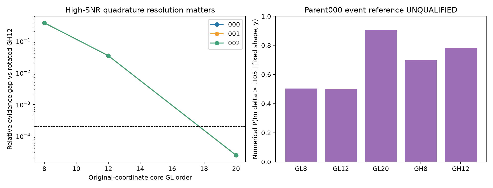
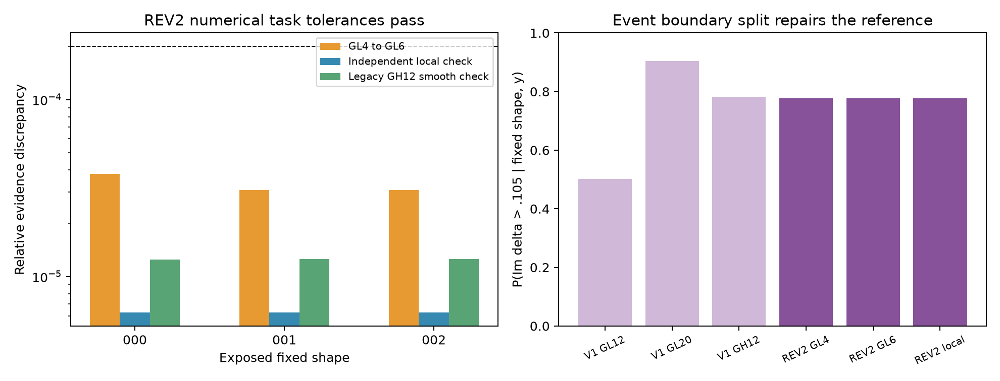

# R10：固定形状条件概率与随机结构的边界

固定一个空间形状后，两个材料属性仍然是随机变量。最优属性点只给出这个形状能有多好地拟合观测；积分还需要计算这一点周围有多少原prior质量。高信噪比使峰宽缩至约0.0015–0.0025；低维并不意味着粗网格自动可靠。本轮真正跑了三个暴露DEV父对象的原始Uniform2积分。首版参考不合格；经过事前另行冻结的峰分区与事件边界修订，三者均达到指定任务的数值容差，首版失败完整保留。这仍不是全局后验认证。

## 原测度、噪声与材料量

固定原Gaussian64为暴露anchor值，使用其原观测与相同历史噪声，不读取GT。属性矩形为 $D=[.8,1.8]\times[.03,.18]$，原密度为 $1/.15$；没有Gaussian化属性、没有新噪声、没有把prior密度替换为材料体积密度。圆对称复噪声的每个实分量方差为 $\sigma^2/2$，$\sigma=.00119211798514519$，所以

$$\Phi(\delta)=\|F(\delta)-y\|_2^2/\sigma^2,\qquad Z_z(y)=\int_D e^{-\Phi(\delta)}\,d\delta_Rd\delta_I/.15.$$

固定形状下材料均值是 $E[\chi\mid z,y]=h+a(z)E[\delta\mid z,y]$，不是 $\chi(E[z,\delta])$ 的一般代替。报告ROI均值时只平均256个ROI单元，不误用576全域或未归一化求和。两个冻结事件为ROI均值实/虚部超过 $h_{R/I}+a_{ROI,mean}(1.3,.105)$，等价于 $\delta_R>1.3$ 和 $\delta_I>.105$；它们与形状拓扑事件不同，固定形状没有新的拓扑随机性。

$Z_z$ 可作为固定条件的似然积分；$\min_\delta\Phi$ 是profile。本轮没有对原64维Gaussian形状prior再积分，因此 **不是Full66边缘概率、联合后验、全局证据或总体覆盖率**。形状本身由先前同一观测的anchor优化产生，本轮是暴露条件的计算研究，不是新锁定泛化试验。

## 实际积分与独立检查

先用原属性坐标有界最小二乘和解析Jacobian找profile点；Hessian使用解析gradient的差分计算，正定时用于自适应峰宽。以mode±8边际SD与prior矩形交集为core；原矩形剩余八个矩形同样数值积分，未删除原prior边界或尾部。依次core GL8/12/20、tail GL2/3/5，在原 $\delta_R,\delta_I$ 坐标保持正确Lebesgue权重。独立旋转Hessian坐标使用GH8/12，变换有正Jacobian，出prior节点不贡献。这是独立坐标的数值比对，不是区间包络或尾界证书。

冻结判据：相邻原坐标级与跨坐标相对证据差均<2e-4、属性均值差<2e-5、事件概率差<5e-4。首版三个对象结果如下；这部分的UNQUALIFIED状态保留，后文给出独立冻结修订。

| 父对象 | profile Phi | GL20 log Z | GH12 log Z | GL12→20相对证据差 | GL20 P(Imδ>.105) | GH12同事件 | 状态 |
|---|---:|---:|---:|---:|---:|---:|---|
| R9V_FRESH_000 | 225.0295 | -233.722708 | -233.722683 | 3.4801% | 0.904996 | 0.781987 | REFERENCE_UNQUALIFIED |
| R9V_FRESH_001 | 188.0665 | -196.286682 | -196.286657 | 3.4801% | 1.000000 | 1.000000 | REFERENCE_UNQUALIFIED |
| R9V_FRESH_002 | 239.7960 | -249.088360 | -249.088335 | 3.4801% | 1.000000 | 1.000000 | REFERENCE_UNQUALIFIED |

三对象的GL20与GH12证据差只有约2.5e-5，均值差小于1e-8，GH8/12证据本身约机器精度一致，但GL12→20的证据变化仍有3.48%，故未通过预定refinement门槛。不能挑较好的一对参考宣称收敛。各tail规则给出的数值质量很小，但规则没有给出峰遗漏/舍入的严格上界，**完整矩形有节点覆盖不等于全支持认证**。

父对象000的虚属性事件阈值穿过窄峰。未按不连续事件边界切开的GL与GH指标积分分别给出约.905与.782，相邻GL级差约.404。这一失败具有直接解释：光滑似然积分的快速稳定，并不自动赋予不连续事件同样的误差控制。需要另外设计在事件边界切开的积分或适当可靠边界规则；这一首版结果没有被覆盖；后续在根线程事前重新分配的总70,000 RHS256预算内，另行冻结针对积分域与事件边界的算法修订，数值容差保持不变。

完整属性与材料均值、方差、原始节点/权重/Phi、所有profile条件与收敛差保存在 `results/transfer/*conditional.json`、`*integration_nodes.csv`、`*conditional_arrays.npz` 和 `CONDITIONAL_SUMMARY.csv`。非合格数值均值不能作为已认证风险标签。没有模型训练、随机抽样覆盖认证、Full66均值/方差标签，也没有GT评分；原观测只用于条件计算。

## 与随机结构的连接

固定形状的有理传输消除了同一形状下反复LU的费用，却没有积分64维形状。若要让 $Z_z(y)$ 在跨形状概率中有意义，仍须保持原Gaussian64测度、正确计入属性体积因子、验证形状采样/积分与其权重；对每个形状只取最优属性会把profile与marginal混淆。当前正证据是“固定shape多节点查询的算子复用”，首版负证据是“高SNR两维积分及材料事件需要单独的可靠误差控制”；修订表明，事件边界切分在这个固定形状任务中能有效恢复数值稳定。两者都不支持把现有近似Gaussian provider升格为Full66后验。

## 独立冻结的REV2：峰分区与事件边界修复

根线程在修订结果产生前授权总成本上限70,000 RHS256。第一次节点预检配置 `transfer_revision2_frozen.json` 预计31,480 RHS256，超过剩余29,392，未执行任何节点；保留该预检文件。实际执行配置为 `transfer_revision2_frozen_v2.json`，计划上限3,647节点/29,176 RHS256，已在新物理运行前冻结。

主积分继续保持原属性坐标与完整prior矩形；增加mode、mode±2SD、mode±8SD及**实事件1.3、虚事件.105边界**的分段，core逐块GL4/GL6、tail逐块GL1/GL2。每个矩形内事件恒定，因此不会用未切开的不连续指标乘一个为光滑函数设计的规则。独立检查保持原虚坐标，以协方差三角变换构造条件实坐标GH6，再在虚坐标各峰/事件段做GL6；它只覆盖虚坐标core，明确标作**LOCAL**检查，不能冒充全支持参考。另与旧旋转GH12比较光滑证据/均值；不再用旧未切开的GH指标作为事件真值。

| 父对象 | 分段GL6 log Z | 材料ROI均值Re | 材料ROI均值Im | P(Imδ>.105) | GL4→6证据差 | 事件refinement差 | 独立LOCAL事件差 | 修订状态 |
|---|---:|---:|---:|---:|---:|---:|---:|---|
| R9V_FRESH_000 | -233.722670 | 0.84264547 | 0.09106561 | 0.77647527 | 3.8e-05 | 2.4e-05 | 9.39e-08 | NUMERICAL_TASK_PASS |
| R9V_FRESH_001 | -196.286644 | 0.65835693 | 0.08407526 | 1.00000000 | 3.08e-05 | 2.22e-16 | 9.99e-16 | NUMERICAL_TASK_PASS |
| R9V_FRESH_002 | -249.088323 | 1.16448546 | 0.11714435 | 1.00000000 | 3.07e-05 | 1.11e-15 | 2.22e-16 | NUMERICAL_TASK_PASS |

三个对象的证据refinement差为3.07e-5–3.80e-5，跨独立LOCAL坐标证据差约6.25e-6，属性均值跨坐标差<1e-9；父对象000的事件概率稳定在约 **.7764753**，refinement差2.40e-5，独立LOCAL差9.39e-8。另两个对象这一事件在数值精度内接近1，不把浮点1解释为严格零补事件质量。

三者的准确状态是 **NUMERICAL_FIXED_SHAPE_TASK_REFERENCE_PASS**，只针对本次固定形状、原Uniform2条件的证据/均值/两个冻结事件达到事前数值门槛。完整矩形的尾块经过实际数值积分，细级数值tail质量约6.90e-42、7.63e-17、2.48e-16；没有严格峰遗漏、舍入或尾部上界，所以 **strict/full-support certificate仍为false**。数值通过与全局认证两项没有混用。

修订新增 **29,176 RHS256 / 0 LU256**，wall **3.892s**；总新增 **69,784 RHS256 / 270 LU256 / 0 RHS576**，包括最初失败9,552 RHS与全部重复验证，预算没有清零。`RESULTS_revision2.json`、`RECEIPT_revision2.json`、`*_conditional_revision2.json`、`*_integration_nodes_revision2.csv`、`*_conditional_revision2_arrays.npz` 是修订原始结果；旧文件保留其原状态。当前最小经验压缩阶数、严格尾界、Full66形状积分仍未建立。
