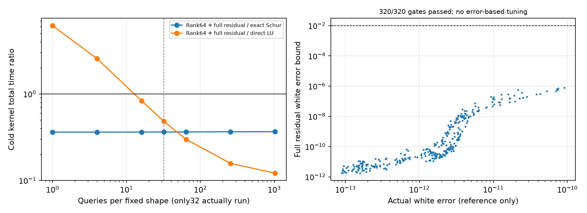
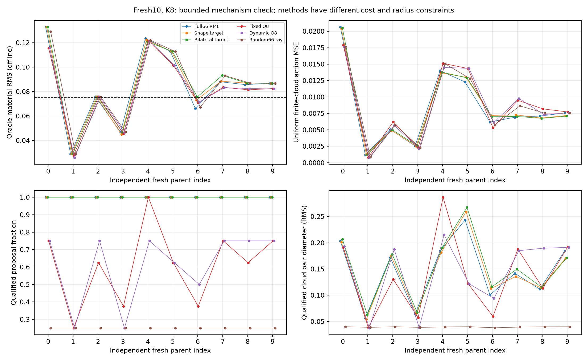
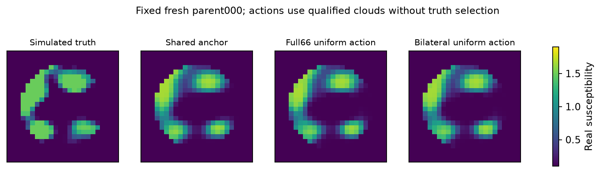
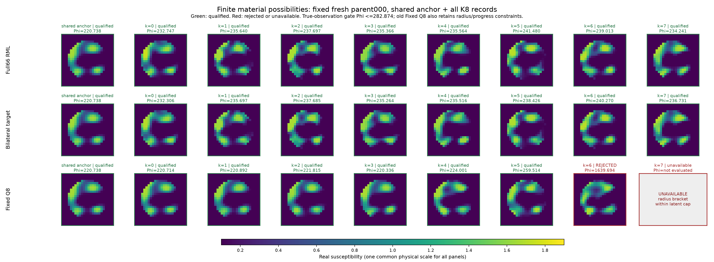

# R10-BI：形状固定后的 Maxwell 响应复用成立，材料覆盖突破尚未出现

本轮从三个结构入口出发，完成了推导、代码、真实非线性 Maxwell、独立评分与论文审查。最值得保留的结果是：**同一非均匀材料形状对应的多个复物性查询，可以通过小阶传递实现、完整物理 residual 和损耗稳定性界降低费用。** 最重要的负结果是：双边感知提案虽然更接近 Full-J 信息，仍没有解决 R9 的材料方向覆盖缺口。

本研究不宣称发现新的 Maxwell 恒等式、认证的最小实现、连续物理 fiber 或 Full66 posterior。研究决定是：保留固定形状条件计算这条有真实费用证据的路线，停止扩大本轮双边随机目标提案；论文优先采用物理计算主线，材料可能性成像作为尚未突破的目标与反证。

## 1. 这90分钟实际完成了什么

计时从 2026-10-30 01:42:28 新加坡时间开始，硬截止03:12:28。理论与查新由显式 Astra/xhigh 子任务承担；两项实验实现及独立QA使用显式Sol/high。主线程亲自推导能量稳定性与误差控制，选择后续实验并合并科学判断。物理计算固定单worker、BLAS单线程，未购买外部算力。

完成内容：

- 原R9只读证据、原P1 prior/decoder/白化、256阶精确ROI接口核对。
- 8个已暴露开发形状的精确Schur摊销、3个固定形状的属性条件积分。
- 8个开发对象×16提案×3方法，共384次随机目标候选尝试。
- 10个全新独立parent×8提案×6方法，共480次候选尝试；预测封存后评分。
- 8个开发形状、4个压缩阶数、30幅度节点的结构筛选。
- 独立于上述压缩开发形状的10个形状×32新幅度节点，共320次固定rank64核确认。
- 同一固定形状、836个既有合格求积节点上的完整条件任务费用重放。
- 原始失败、源文件修复、零新增物理的独立重评分、配对bootstrap、论文近邻审查和公式集扩充。

全部新计算合计 **306,096 RHS256、16,928其他阶数RHS、9,273 LU256、0新RHS576**。把小系统RHS也保守计入同一预算，共323,024，低于350,000。旧宿主setup为264 RHS576/1 LU576，只读复用并单列；不能把它称为免费从零初始化。各分支受控物理作业wall约303.5秒，科研总时钟另计。详见 [成本总账](COST_SUMMARY.json)（逐调用账本见[无损证据包](PUBLICATION.md)）、[结果JSON](EXPERIMENT_RESULTS.json) 与 [独立QA](INDEPENDENT_QA.md)。

## 2. 不变的物理与历史边界

原P1：24×24 scalar-TM/VIE，完整576格、ROI256格，8源×32复接收；Gaussian64形状与Uniform2物性；原C² quintic decoder；被动复材料；source-major packing；$\sigma=0.00119211798514519$。实际正演始终是完整非线性Maxwell，所有主要方法共用精确256阶ROI后端。

原R9的32个新对象已成为本轮开发历史：Fixed354/512、Dynamic362/512、Random103/512个合格非锚点；GT邻域RMS≤.075覆盖6/32、5/32、5/32；锚点3/32。固定弱空间并没有达到20%端到端节时，19/32的候选仿射空间存在方向缺口。本轮没有更改这些结果，也没有靠增加weak8半径掩盖它们。

新Fresh10与旧R9对象不重叠。三种新机制在开发GT评分前已经冻结；Fresh10完整协议在开发评分之后、Fresh生成之前冻结，机制未据开发GT修改。Fresh预测于UTC Unix1793296900.744封存，GT评分于1793296921.918打开。后续压缩核确认使用这10个形状，但在其GT已公开后进行，**只称heldout-shape核实验，不再称第二次盲测材料确认**。

## 3. 数学结构：什么真正固定，什么仍然变化

固定宿主消元后

$$F(D)-F_h=O(I-DC)^{-1}DE_R.$$

原decoder使 $D=\delta A(z)$。令 $P=A^{1/2}$、$B=PCP$、$L=OP$、$R=PE_R$，得到

$$F(z,\delta)-F_h=\delta L(I-\delta B)^{-1}R.$$

这是对非均匀空间形状成立的精确离散表达，零占据率不需要除零。固定形状时 $B,L,R$ 可复用；改变形状后通常必须更新。它与T-operator、材料独立模态、eigenpermittivity及标准有理传递理论直接重合，不能当成新定理。

真正用于算法的下一步是控制近似误差。写 $K_\delta=\delta^{-1}I-B$，则

$$b_\delta=\frac{\operatorname{Im}\delta}{|\delta|^2}+\lambda_{min}\!\left(\frac{B-B^*}{2i}\right)>0
\quad\Rightarrow\quad\|K_\delta^{-1}\|_2\le b_\delta^{-1}.$$

这不要求 $B$ Hermitian或正规。本轮最小Hermitian虚部特征值略负，保留了这个事实；合法材料损耗仍使下界为正。对压缩解 $\tilde u$，计算完整residual $r=R-K_\delta\tilde u$，得到白化输出误差上界

$$e\le\frac{\sqrt2\|L\|_F\|r\|_F}{\sigma b_\delta},\qquad |\Phi-\tilde\Phi|\le\|\tilde r_y\|e+e^2/2.$$

采用原先冻结的 $e\le.01$、势误差界≤.1双门，不通过则完整精确回退。数值特征值没有区间外包，因此这里是**离散数值资格**，不是严格连续PDE或机器区间证书。完整推导见 [双边理论](BILATERAL_OPERATOR_THEORY.md)、[能量与互易](PHYSICS_ENERGY_AND_RECIPROCITY.md)，公式集新增 [F-BI-001—018](../maxwell_formula_atlas/09_BILATERAL_SHAPE_AMPLITUDE.md)。

## 4. 物理复用：有收益，但必须有足够多的同形状查询

### 4.1 精确256阶Schur

8开发形状中，一次Schur setup为32.81—81.21ms；每幅度节点p50为.552—.781ms，对照直接LU为1.963—2.282ms。实际盈亏点21—58次查询。只算一个幅度时，Schur通常不划算。

这既不是固定背景ROI消元的重复贡献，也不是整套成像系统的加速；它处理的是同一形状下的幅度扫描、条件优化或积分。详见 [形状—幅度实验](SHAPE_AMPLITUDE_TRANSFER.md)。

### 4.2 压缩响应与独立形状核确认

采用标准可达block-Krylov空间，$V_r=\operatorname{orth}[R,BR,\ldots]$，在其中投影 $B$ 并作小阶Schur。没有显式优化所有电流，也没有移除原64维形状自由度。

开发阶段r32在240节点中没有一个通过残差门；r64全部通过，所以只冻结r64进入另外10形状、320新幅度节点。结果320/320通过，0回退，最大实测白化误差$9.13\times10^{-11}$，最大数值误差界$8.01\times10^{-7}$。这里的细小误差是算法运行附带诊断；实验目的在费用与适用条件，不是重复测试恒等式。

| 10形状，每形状32次查询 | 冷形状setup＋全部查询总时间 | 相对直接LU节省 |
|---|---:|---:|
| 直接256阶LU | 0.238701s | 基线 |
| 精确256阶Schur | 0.317346s | −32.95% |
| rank64＋完整residual双门 | 0.115014s | **51.82%** |

相对精确Schur节省63.76%。这些实际32节点费用包括形状矩阵构造、稳定性计算、基构造、小Schur与端口变换。共享历史宿主缓存读取另需.016098s；双方均加上后，相对直接LU节省约48.54%。从零重建宿主setup未在本次计时，不能宣称完全冷启动全系统51.82%。

M1/M4仍输给直接LU；M16的16.8%收益是根据本轮实测单次费用作的摊销推算，**只有M32是该确认的实际工作负载**。这是一轮受控计时与10形状确认，没有跨机器或跨时段稳定性保证。64不是已证明的最小阶数；回退代码存在但这一批未触发。

详见 [独立形状核报告](REDUCED_RESPONSE_FRESH10.md) 与完整节点数组。

## 5. 材料可能性成像：新提案没有超过强随机目标基线

三种数学机制进入真实计算：完整66维RML式随机数据/prior目标；仅64维形状随机prior目标、属性联合校正；宿主双边Gram整形的形状随机目标。全部仍用同一个完整66维GN正确器，允许相同变量、同样最大12次forward/8次J，原观测作最终资格判断。

这里的2×2属性块消元是普通联合GN的等价线性代数，**没有实现非线性variable projection**。不得把“形状随机目标”写成已经先精确优化或积分了属性。

三种新机制的DEV结果都是0/8达到GT邻域覆盖。Fresh10结果如下，K=8，GT邻域RMS≤.075，合格集不含失败点，空集动作回退锚点：

| 方法 | 合格非锚点率 | GT覆盖 | offline best材料MSE | 不看GT的均匀材料动作MSE |
|---|---:|---:|---:|---:|
| 原物理锚点 | — | 2/10 | .00840003 | .00840003 |
| Full66 RML式目标 | 100% | 3/10 | .00814439 | .00835286 |
| Shape-target联合GN | 100% | 3/10 | .00822191 | .00842637 |
| Bilateral-target联合GN | 100% | 2/10 | .00832325 | .00838969 |
| R9 Fixed Q8 | 61.25% | 3/10 | .00724536 | .00873832 |
| R9 Dynamic Q8 | 61.25% | 3/10 | .00726201 | .00859198 |
| R9 Random66 | 25% | 3/10 | .00813026 | .00838875 |

注意公平边界：新三方法彼此预算、变量自由度和随机数匹配；旧R9方法每候选6次forward/4次J，并保留旧半径、前进规则和latent位移限制。因此六方法是**同K、不同费用的描述性成本—质量比较**，不是相同预算的优越性试验。所有共享anchor成本单列，所有失败计入。

在已暴露DEV8上，固定双边Gram与Full-J的平均Frobenius相似度约.9649，source-only/receiver-only约.8905/.8907；但更像Full-J没有使材料覆盖变好。该提案只使用宿主感知结构和decoder-at-zero，trace归一化还消去了噪声整体尺度，不是自适应posterior几何。

Fresh10采用parent配对20,000次bootstrap、4项family的98.75%双侧区间：Bilateral−Full66覆盖差−.10，区间[−.40,0]；均匀动作MSE差$+3.68\times10^{-5}$，区间[−.000234,.000362]。没有正收益证据。Full66与Fixed的覆盖全体配对相同，不代表总体等效；材料动作差区间也跨零。10个parent只支撑小规模机制审查。

RML式候选只是物理相容材料可能性，不是正确posterior样本。表中的offline best使用GT只评估集合容量，不能当在线图像。均匀权重与likelihood启发式权重也不被赋予posterior资格。主问题仍然是空间形状覆盖，不是给现有候选换权重。

画廊固定第000对象，列出所有K8提案，保留拒绝与不可用格，不用GT挑图。详见 [画廊身份说明](CLOUD_GALLERY.md)。

## 6. 条件概率：积分问题真实解决了一小部分，Full66仍未解决

固定形状下保留原属性Uniform先验：

$$\bar L(z)=\frac1{.15}\int_{.8}^{1.8}\int_{.03}^{.18}e^{-\Phi(z,\alpha+i\beta)}d\beta\,d\alpha.$$

原版求积没有通过：窄峰使GL12/20的evidence仍相差约3.48%，硬事件不能靠两个未切事件边界的规则相互一致就宣布可靠。第一次执行还因有向Jacobian行列式产生负权重，修复为绝对值，失败9552 RHS保留。

第二版预先声明事件边界分割、峰区划分及独立条件坐标检查。3个固定形状达到数值任务门；evidence相邻规则差约3.1—3.8×10⁻⁵。第一个形状的 $P(\operatorname{Im}\delta>.105\mid z,y)$ 为.7764753，原未合格结果完整保留。

进一步在第一个开发形状的836个合格细规则节点上，匹配比较精确Schur与rank64双门实现。保留完全相同节点、权重、原先验及事件，836/836通过门，无回退。包含新形状setup、全部响应和求积，费用从.287601s降为.117270s，节省 **59.22%**；evidence、均值、方差、事件均满足原数值容差。历史profile与网格构造作为共同既有工作复用，不能据此宣称整个自适应积分流程或成像系统节省59%。

这是 **NUMERICAL_FIXED_SHAPE_TASK_REPLAY**。独立求积只给数值参考；没有全支持区间外包，节点级势误差门也不是全支持posterior证书。未知形状外层积分没有执行，Full66 posterior仍UNQUALIFIED。详见 [概率结构](PROBABILITY_AND_STOCHASTIC_STRUCTURE.md) 与 [实际任务重放](PROBABILITY_WORKLOAD_REPLAY.md)。

## 7. 负结果、实现修复与未运行内容

保留r32压缩全部拒绝、原条件积分未合格、9552 RHS的积分失败、Fresh适配层错误和额外40 RHS/1 LU、全部未合格候选。Fresh适配错误修复的是缺失观测字段，保留已完成结果并重放中断项；修复时尚未读取Fresh GT。另有零物理的重复phase参数错误，均留下源码与日志。

Fresh诊断的一条继承说明误称使用历史J，实际是新付费anchor J；原文件保留，独立勘误映射解释来源。不是改动数值结果。详见 [失败分析](FAILURE_ANALYSIS.md)。

本轮未做：真正非线性属性variable projection、大规模Full66概率积分、SDE、神经生成器、全材料族公共最小实现、跨采集/噪声泛化、完整边界能量实验、Research W迁移。未以计划代替结果。当前prior已经被动，有限receiver也不是完整散射功率测量，所以没有新增能量观测用于缩小候选集。

## 8. 十个问题与最终论文决定

**Q1 双边结构的新信息。** 相比receiver-only，它引入源端照明及其与材料导数的耦合；它是已知T-operator/distorted-Born结构。新证据是其信息匹配改善却未产生候选覆盖收益。

**Q2 形状—幅度的算法价值。** 有。同形状重复查询时，精确Schur和残差合格的64阶响应可摊销。少量查询时直接LU更强；没有全系统成像加速结论。

**Q3 新材料坐标。** 本轮双边目标没有超过强Full66随机目标，没有解决R9方向缺口，应停止扩大这一具体启发式。

**Q4 最小实现。** 测得有用rank64，不是严格最小阶数。r32在本轮误差门下失败；所有材料共享的精确低维实现未建立。

**Q5 编码解码消掉什么。** 精确ROI消元去掉固定宿主状态；当前压缩进一步减少固定形状重复查询的内部解阶数。材料本身仍64+2维，未知形状没有被消除。

**Q6 能量与互易。** 它们给出条件稳定性与误差控制，但没有增加测量信息、没有验证有限receiver上的全局optical theorem。

**Q7 条件概率。** 固定形状原属性先验下，3个数值参考及1个匹配费用重放通过。没有Full66质量、严格尾界或形状分支覆盖证明。

**Q8 SDE。** 尚无额外结构性收益证据。正确形状marginal drift需要真实属性积分梯度；本轮停止在条件积分，不为写出SDE而付费采样。

**Q9 GT覆盖。** 没有新的明显提升。Fresh10 Full66/Shape为3/10、Bilateral2/10、anchor2/10；与R9方案相比无支持优越性的统计证据。

**Q10 写什么论文。** 优先Narrative A：固定形状的材料幅度响应复用及物理任务误差控制，明确标准理论来源。Narrative B保留完整负对照，不声称材料可能性成像突破；Narrative C仅为条件计算支撑。强IEEE TAP资格仍 **HOLD**：目前是有用、可复核的结构组合与费用结果，尚需跨噪声/损耗/更大二维网格、接近共振及回退场景证明独立实用增量，并对最接近材料独立模态/模型降阶方法作同任务对照。

## 9. 下一项唯一优先实验

固定已经选出的rank64+双门策略，研究**形状更新过程中还能复用多少输入输出响应**：在同一真实非线性反演的合法形状步上，以任务误差决定复用或重建，与每次直接LU及成熟rational/block-Krylov方法比较全流程费用。只有这个实验能回答本轮的条件核加速能否转化为真正形状成像收益。先做有限、可证伪的路径裁决，不再扩大宿主双边弱方向云，也不启动大Flow或SDE。

本轮完整论文草稿：[中文叙事](PAPER_NARRATIVE_V2_ZH.md)、[英文摘要与论文结构](PAPER_NARRATIVE_V2_EN.md)；最近先例和不能声称的新颖性：[查新账本](PRIOR_ART_AND_NOVELTY.md)；下一轮：[交接](GPT_PRO_HANDOFF/START_HERE.md)。
