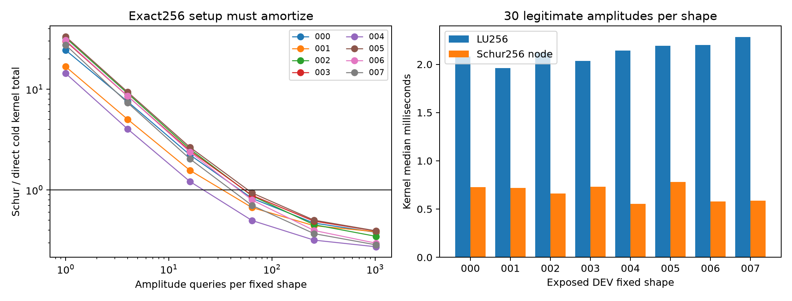

# R10：固定形状后的复振幅传输与真实费用

这一步先问一个具体的物理问题：同一个物体的空间占比形状已经固定，只改变材料的实部、虚部属性时，是否值得反复做一次完整的256阶消元？答案取决于每个形状要查询多少次。一次复杂Schur分解需要预付费用，但之后每个属性点只需求解上三角系统。本轮在8个已经暴露的DEV形状上实际测量这种交换，未建立跨形状统一压缩、Full66后验或新的Maxwell物理定律。

## 精确公式与非厄米边界

原P1材料为 $\chi=h+\delta a(z)$，其中 $h=.1+.04i$，$a(z)\in[0,1]^{256}$ 是原quintic占比，$\delta=(.8+u_1)+i(.03+.15u_2)$，$u\sim U([0,1]^2)$。固定主机背景的R9缓存给出 $C,E_R,O,F_h$。定义 $P=\operatorname{diag}(\sqrt a)$，$B=PCP$，$L=OP$，$R=PE_R$，则

$$F(\delta)=F_h+\delta L(I-\delta B)^{-1}R.$$

$P$ 必须只使用非负占比的平方根；复属性幅度留在 $\delta$ 中。即使材料被动，$B$ 仍为一般复非厄米矩阵，不能用Hermitian特征分解。使用复杂Schur $B=QTQ^*$ 后

$$F(\delta)=F_h+\delta (LQ)(I-\delta T)^{-1}(Q^*R).$$

这是同一有限离散原模型的精确代数重排。解析属性导数为 $F'(\delta)=L(I-\delta B)^{-2}R$，独立实、虚方向分别为 $F'$ 和 $iF'$；优化阶段的第二次8列求解同样记账。

## 冻结测量与成本解释

配置为 `config/transfer_frozen.json`。形状与观测来自R9 `R9V_FRESH_000..007`；每个形状固定原Gaussian64，30次属性点均位于原始矩形内，两种方法使用完全相同的点、交替先后次序。每次8列求解均事前记账，BLAS1，未重新计算576阶背景。历史R9缓存已支付264 RHS576与1 LU576，这不属于本轮新增费用；新run确实读取缓存，其读取时间另列。

表中cold是“形状算子形成 + 当前方法的形状级预付 + M次节点”的同窗口内核费用，输入读取、保存、Python账本不在内核计时中。完整流程receipt另列，不能把缓存命中宣称为从原始采集起的零成本冷启动。M=1/4/16/64/256/1024是用实际30次节点时间分布推算的摊销表，并未为每个M重跑M次，也没有把历史576阶费用藏入新节点费用。

| DEV形状 | LU节点p50 ms | Schur节点p50 ms | Schur预付 ms | p50 break-even M |
|---|---:|---:|---:|---:|
| R9V_FRESH_000 | 2.079 | 0.728 | 63.328 | 47 |
| R9V_FRESH_001 | 1.963 | 0.719 | 37.960 | 31 |
| R9V_FRESH_002 | 2.124 | 0.661 | 76.548 | 53 |
| R9V_FRESH_003 | 2.036 | 0.730 | 68.670 | 53 |
| R9V_FRESH_004 | 2.141 | 0.552 | 32.810 | 21 |
| R9V_FRESH_005 | 2.191 | 0.781 | 81.211 | 58 |
| R9V_FRESH_006 | 2.199 | 0.578 | 74.978 | 47 |
| R9V_FRESH_007 | 2.282 | 0.587 | 65.140 | 39 |

原始逐次范围、条件数估计、残差与完整M表见 `results/transfer/TIMINGS.csv` 和 `RESULTS.json`。240对节点的最大白化端口差为 **4.447e-12**；这只是有意义的费用/准确度比较中的同模型一致性检查，不作为单独机器精度科学结论。最大1范数条件数估计为 **29.938**。质量未靠低阶近似换取。

## 账本、失败与结论边界

最终新增总数 **69,784 RHS256 / 270 LU256 / 0 RHS576**（包括另外冻结的积分修订29,176 RHS256），包含首个失败尝试的 **9,552 RHS256 / 30 LU256**。首跑在旋转坐标积分中误用带符号det作为正Lebesgue体积Jacobian，严格JSON拒绝NaN，未生成合格结果；修正为 $|\det|$ 后在原总预算内重放。失败源、日志与receipt保存在 `src/transfer_campaign_failed_v1.py`、`results/transfer/attempt1.log`、`RECEIPT_attempt1.json`；账本连续追加，没有清零重记。修正只恢复数学上的正积分测度，未改prior、门槛或物理数据。

首失败、修正重放与积分修订三次控制流程wall合计 **13.238s**，CPU合计 **11.691s**；峰值RSS **112.97MB**。时间包含数组IO、账本与积分工作，kernel表另有清楚窗口。

结果支持有限范围结论：固定形状重复属性查询时，256阶Schur三角节点比256阶LU快，但预付需要21–58次查询左右才能摊回。单点或少量候选并无冷成本优势；每变一个Gaussian64形状仍要重新形成、分解B。没有执行可选block-Krylov/有理降阶扫描，**经验最小阶数=NOT_RUN；认证最小阶数=未建立**。本轮未把256阶代数重排冒充低阶可控误差模型。

## 零新增RHS的稳定性检查

将振幅写入 $K_\delta=\delta^{-1}I-B$，有 $F-F_h=LK_\delta^{-1}R$。若 $\beta=\lambda_{min}(\operatorname{Im}_H B)$ 且 $b_\delta=\operatorname{Im}\delta/|\delta|^2+\beta>0$，那么 $-\operatorname{Im}_H K_\delta\succeq b_\delta I$，从而 $\|K_\delta^{-1}\|_2\le1/b_\delta$，不要求矩阵正规。近似状态残差 $r=R-K_\delta\widehat u$ 给出 $\|L(u-\widehat u)\|_F\le\|L\|_2\|r\|_F/b_\delta$。

8个缓存B的实际数值特征值显示 **beta为负**（约−4.55e-5到−3.50e-5），不能宣称Im_HB为半正定；合法复属性的被动项仍使全矩形数值下界b至少约.009211。该代数coercivity是有用的残差验收结构，详见 `results/transfer/COERCIVITY_ZERO_RHS.json`；它没有正确质量度量之外的物理解释，也没有浮点特征值的严格区间认证。本轮积分修订用完原重新分配预算的大部分，未追加低阶模型或回退扫描。

## 复核与复现入口

只读重建两份报告、三个图与汇总表：从项目根目录使用原指定解释器 `/Volumes/migodam's-external-brain/Research/Inv_SLAM/Gaussian/.venv_nn/bin/python` 运行 `research/p3l_r10_bilateral_structure/src/transfer_report.py`。它只读取结果，不触发Maxwell节点，也不改变冻结配置。

真实物理复现入口为 `transfer_campaign.py freeze/run` 与 `transfer_revision2.py freeze/run`。当前目录是已封账记录，不能在这里重跑覆盖。完整复现应使用另一个输出目录并先冻结配置、确认只读原R4 prior/background、原R9 host SETUP及R9V暴露anchor/observation路径；仍须单物理worker token与相同BLAS1。V1的带符号Jacobian错误源单独留作审计，不是推荐重现时再次付费执行的算法；想复现历史成本时应保留其失败9552 RHS，而非伪装成科学必需费用。REV2没有新增LU或Schur分解，直接复用前阶段持久化的固定形状Schur数组。报告脚本与原始CSV/NPZ足以独立重算表中数值统计。

成本拆分为：首失败9,552 RHS256/30 LU256；更正后主流程新付 **31,056 RHS256/240 LU256**（receipt里40,608是至该阶段的累计值）；事件/峰积分修订新付29,176 RHS256/0 LU256；总69,784 RHS256/270 LU256。成功计时表是8形状×30属性点=240配对节点，失败阶段另有父对象000的30对计时，全部费用进入总账。每个LU前向8列、每个Schur前向8列；属性优化的解析导数额外8列；所有积分节点都是8列。
