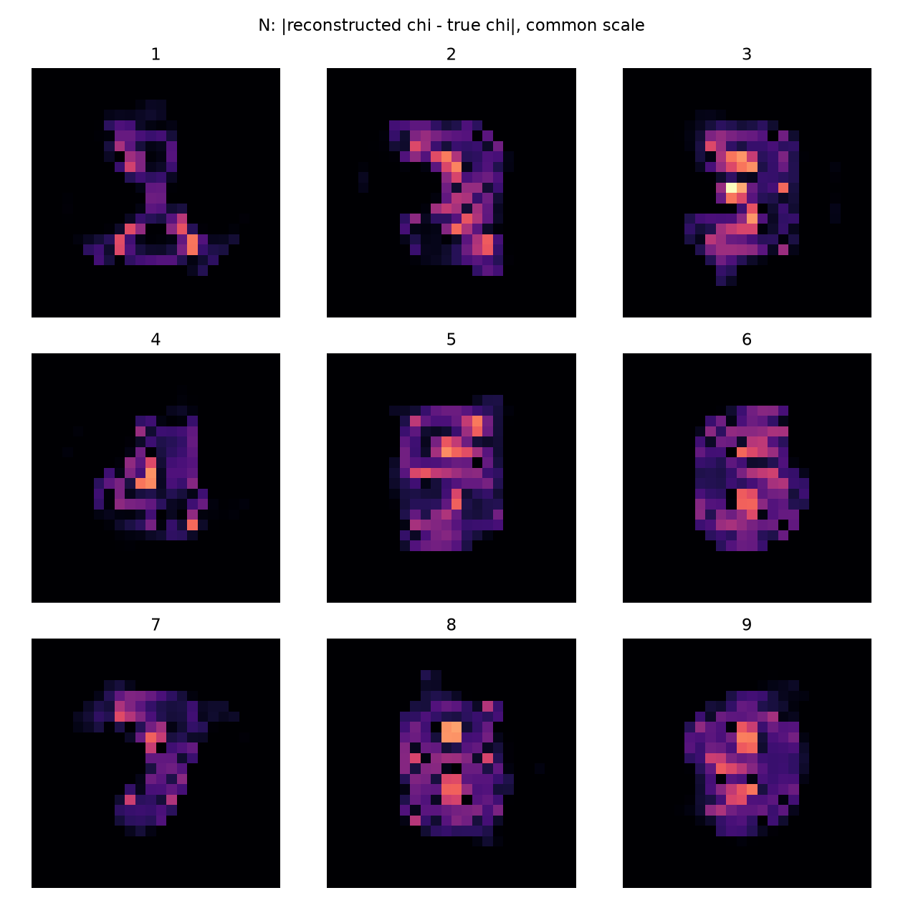
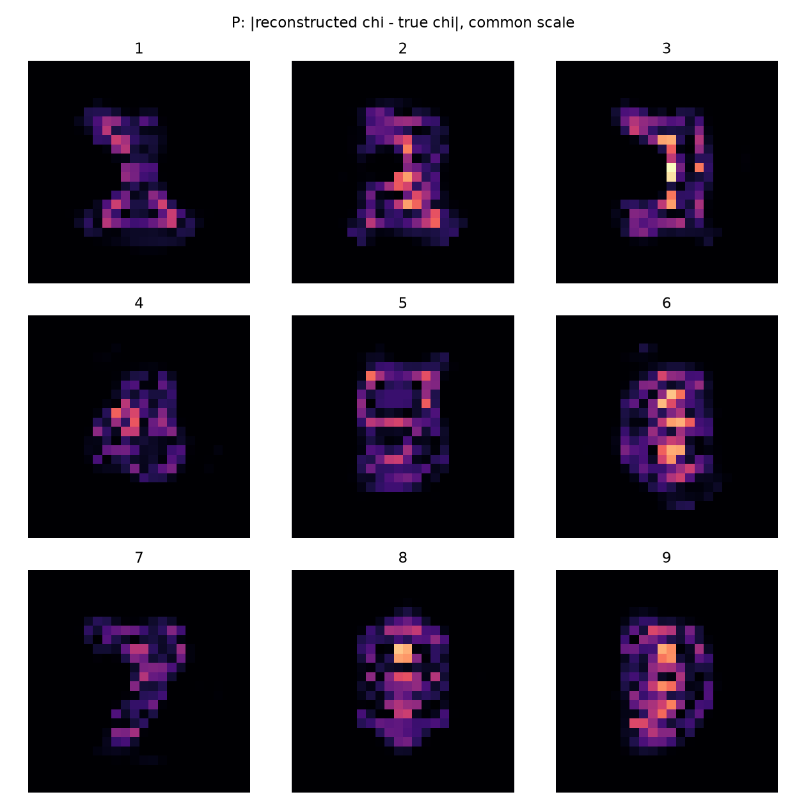

# 九数字实际视觉审查

主线程实际打开全部8张匿名后端九宫格PNG。先把A–I的盲读、0–5分和理由写入audit/BLIND_READ_N.json与BLIND_READ_P.json，随后才读BLIND_KEY_SEALED.json和GT。四种后端的图像无可见差别；盲读是主线程主观评价，不是独立人群识别实验。

|数据|数字|盲读|视觉0–5|IoU|GT孔洞→重建孔洞|完整Φ|
|---|---:|---|---:|---:|---|---:|
|N|1|1|4|0.7288|0→0|268.723|
|N|2|2|3|0.6571|0→0|258.746|
|N|3|3|3|0.6806|0→0|262.344|
|N|4|4|3|0.8000|1→0|266.982|
|N|5|5|3|0.6486|0→0|266.824|
|N|6|6|3|0.4225|1→0|302.240|
|N|7|7|4|0.6923|0→0|273.402|
|N|8|0/8|1|0.5930|2→0|235.848|
|N|9|9/3|2|0.5205|1→0|264.478|
|P|1|1|4|0.7069|0→0|261.310|
|P|2|2|4|0.6061|0→0|243.574|
|P|3|3|4|0.6557|0→0|255.400|
|P|4|4|4|0.7333|1→0|258.652|
|P|5|5|3|0.7222|0→0|251.508|
|P|6|6|3|0.5405|1→0|220.020|
|P|7|7|4|0.6471|0→0|288.882|
|P|8|0/8|1|0.5882|2→1|265.256|
|P|9|9/3|2|0.5676|1→0|252.841|

1和7较可靠。2/3/5的连接和弯折较模糊；4交叉可辨但内部孔丢失；6/9闭环未保留。8在N为0/2孔、P为1/2孔，均没有完整恢复。N9与P9盲读都记为9/3，8记为0/8，不能事后改成全部识别正确。

全部算法相同质量，不能凭A更快的小核将其视觉评分抬高。N与P的真值不同，二者SSIM或MSE不能作为纯算法因果比较。

显示是原24网格最近邻放大，无平滑显示或高分辨率重建伪装。mask、孔洞和连通数均在原网格计算。逐像素误差与拓扑不受视觉主观评分替代。

占比阈值0.5是预注册任务。新N模型的全局a–delta尺度gauge可影响占比掩膜，故另有事后固定材料对比度掩膜CSV；它没有替换主指标或改变任何图像。原P1 Full66不据此宣称普遍gauge。

## 逐数字评分理由的中文解释

这是对已封存盲读的中文说明，不在GT解封后改读数或分数。N/P分数为主线程主观0–5等级，不是独立人群识别统计。

|数字|N评分与理由|P评分与理由|
|---:|---|---|
|1|4：单竖干、顶帽与底脚可分，边界偏糊|4：竖干和底脚清楚|
|2|3：上横转弯和下横可辨，斜连接糊|4：上弧、下降段和底横可分|
|3|3：右竖连接上下左伸，腰部不清|4：可读作3，但注意本轮P真值本身已丢中横，不能当清晰3恢复成功|
|4|3：斜笔与右竖可辨，交叉处糊|4：斜笔与右竖交叉可分，但孔洞未保留|
|5|3：左上与右下团块、中弯可见|3：上部团块与下部弯曲可见，仍糊|
|6|3：左上弯干与下部圆团可见，孔弱|3：下部有凹区，但闭环不可靠|
|7|4：顶横和下降斜笔清楚|4：顶横、斜笔清楚|
|8|1：仅灰阶中央凹区，无两个清楚孔|1：一个长孔，未保留双孔|
|9|2：可读9或3，上环不清|2：9/3混淆，上环弱|

主线程另行打开P真值后发现P3表示失败，见[资格补充](REPORT_QUALIFICATION_UPDATE.md)。这项GT表示判断与此前重建盲读分开存储，原盲读记录不改写。
