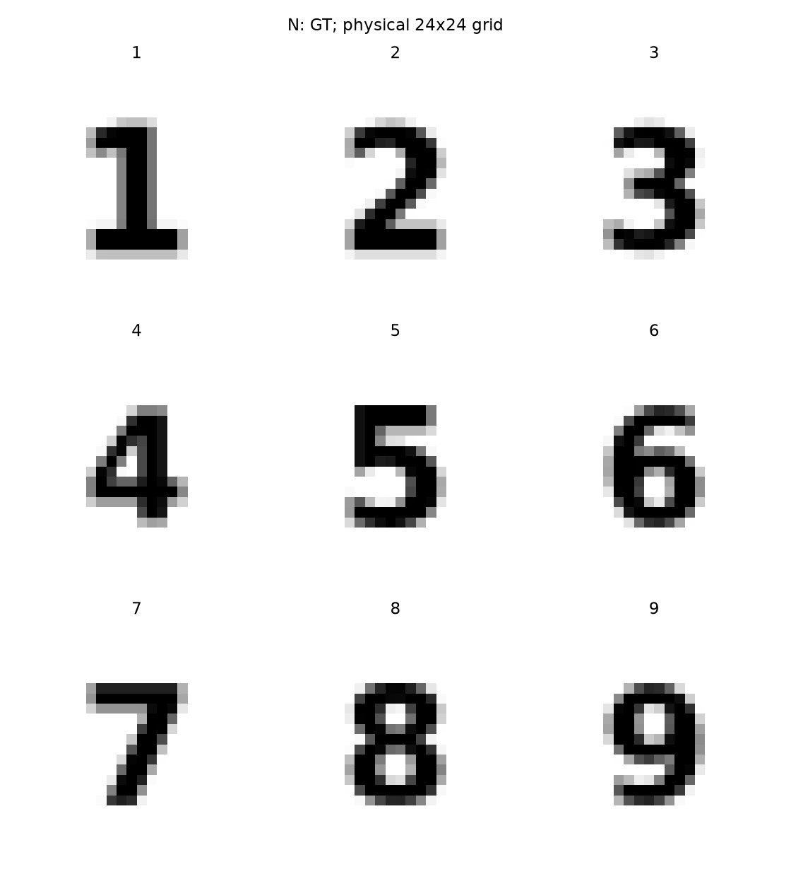
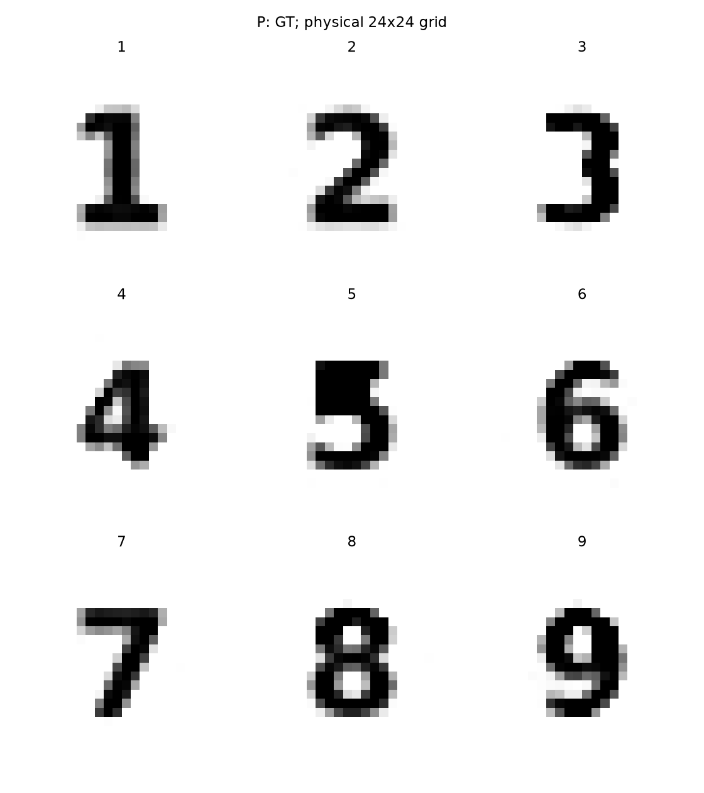
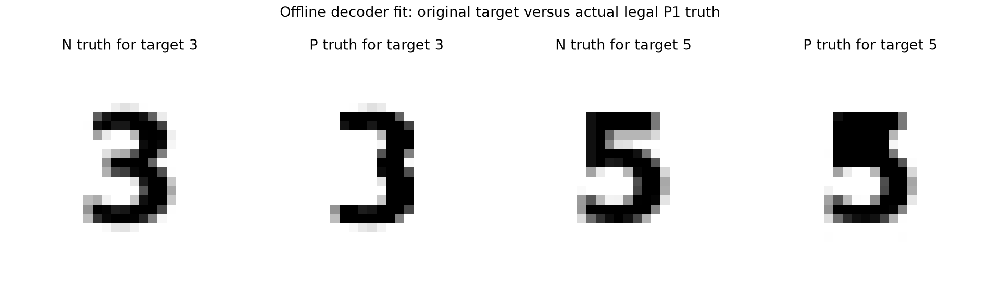

# P1 decoder数字表达能力

**视觉资格补充：P目标3本次离线构造丢失中横，标为 `DECODER_REPRESENTABILITY_FAIL_VISUAL_THIS_FIT`。原数值fit门仍PASS，原数据不改；不能将P称为九个清晰数字。见[补充说明](REPORT_QUALIFICATION_UPDATE.md)。**

先拟合占比再用decoder输出作为物理truth，不把目标字体当作P真值。门在拟合前固定为ROI occupancyMSE≤0.025且阈值IoU≥0.75。全部九个达到该有限图形门，3与5误差明显较大；有限L-BFGS拟合并未全部满足优化收敛。

|数字|P拟合occupancy MSE|阈值IoU|GT latent范数|有限拟合是否收敛|
|---:|---:|---:|---:|---|
|1|0.000803|0.9107|61.91|False|
|2|0.000187|1.0000|53.07|False|
|3|0.018040|0.9322|60.35|False|
|4|0.001602|0.9286|69.60|False|
|5|0.017885|0.8986|47.85|False|
|6|0.001376|1.0000|79.32|False|
|7|0.000256|0.9783|53.95|False|
|8|0.001197|0.9868|74.03|False|
|9|0.003290|0.9692|94.48|False|

范数48–94远高于Gaussian64典型半径约8。合法先验支持不等于高先验概率。P反演仍使用原Gaussianized点目标，低范数平滑解可比高范数truth有更低原目标；不能从P图像模糊推断decoder表达失败，更不能宣称九个典型P1随机parent。

## 实际GT视觉检查

P3数值门通过而视觉失败；P5有失真但仍可读。不能把本轮构造上限/优化失败等同整个decoder无法表达。全部九个对象不替换。
