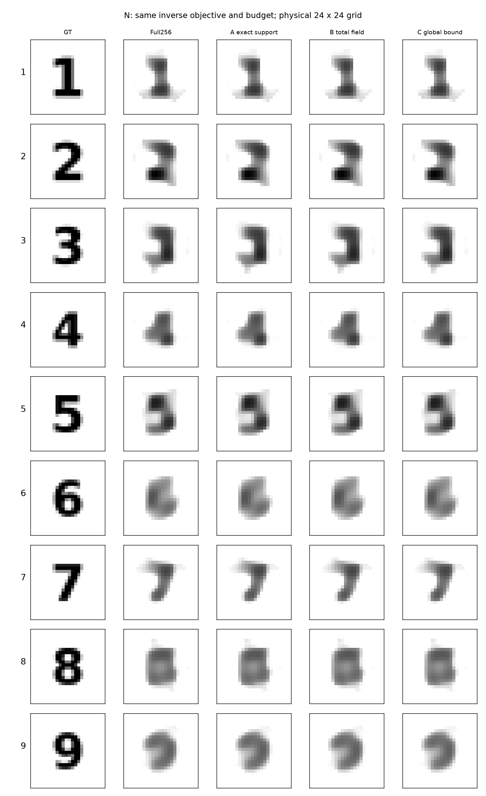
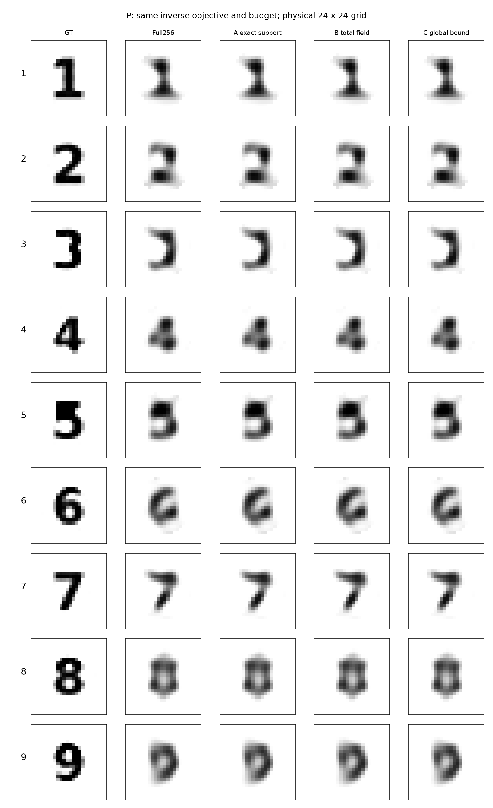

# Research P3L-R11-S3：稳定 Maxwell 结构与数字 1–9 真正逆成像

**视觉资格补充：P目标3本次离线构造丢失中横，标为 `DECODER_REPRESENTABILITY_FAIL_VISUAL_THIS_FIT`。原数值fit门仍PASS，原数据不改；不能将P称为九个清晰数字。见[补充说明](REPORT_QUALIFICATION_UPDATE.md)。**

本轮完成三条可运行结构算法、两套各九个数字对象，以及 **72 次真实非线性 Maxwell 材料反演**。所有预测先封存，再由主线程实际打开匿名 PNG 盲读，随后解封GT评分。最可靠的正面结果是精确活动支撑的物理核收益；没有证明新的材料成像能力，固定总场与全形状耗散控制没有在本轮形成有效加速。

**必须同时保留资源协议失败。** 自设全阶数LU硬上限为12,000，实际合计28,727，超出16,727。根因是只在分支/单对象执行RHS检查，未建立跨作业LU原子预留。发现后停止全部新增物理求解，未改写上限，也未把all-order LU偷换为LU256。保留数值证据不等于整轮预算PASS。RHS合计363,240/400,000，含144个新增576阶RHS；历史宿主264 RHS576另列。详见[COST_SUMMARY.json](COST_SUMMARY.json)、[失败记录](FAILURE_ANALYSIS.md)。

## 1. 先看实际图像

这是逐格材料反演，算法没有输入数字标签、字体模板或GT latent，没有枚举九个模板。显示仅最近邻放大24×24物理网格。

### N：物理合法的原生数字，新的258维反演模型

### P：原P1 decoder可实现的近似数字，原Gaussianized66反演

四个后端输出几乎相同。这首先是同一物理与反演目标的一致性，不是四种方法同时改善了图像。数字1和7的大笔画较清楚；4的交叉结构可见但孔洞丢失。数字8最明显失败：N的两个孔均未保留，P仅保留一个孔。6和9的闭环也未可靠恢复。主线程盲读把9记作“9/3”、8记作“0/8”，未在解封后修改。详见[视觉审查](DIGITS_VISUAL_REVIEW_ZH.md)。

## 2. 数据、逆问题与盲法

固定原P1 TM24/VIE、256格圆形ROI、8源×32复接收、原self-term与Green、host=0.1+0.04i、sigma=0.00119211798514519及source-major Re32/Im32白化。先用原576阶完整电流方程生成每份truth响应，并与精确ROI合同复核；再加原圆复Gaussian噪声。所有方法共享同一y。

N直接使用字体的格内占比，物性固定生成于1.3+0.105i。反演是占比256+Gaussianized属性2的box约束新模型，固定TV/IRLS、ridge和属性惩罚。P使用原Gaussian64+quintic和原属性变换，离线拟合只构造合法truth；在线初始化x=0，不读取拟合latent。原Gaussianized点目标为Phi+0.5||x||²，不是native uniform坐标的点目标。

P的九个拟合均达到预注册图形误差门，但GT latent范数47.85–94.48，典型Gaussian64半径约8。**它们是可表达而极不典型的设计对象，不是九个独立prior-predictive P1样本。** 拟合达到1200步上限且未全部满足优化收敛；实际truth仍严格取decoder输出，不取目标字体。

|数字|P拟合occupancy MSE|阈值IoU|GT latent范数|有限拟合是否收敛|
|---:|---:|---:|---:|---|
|1|0.000803|0.9107|61.91|False|
|2|0.000187|1.0000|53.07|False|
|3|0.018040|0.9322|60.35|False|
|4|0.001602|0.9286|69.60|False|
|5|0.017885|0.8986|47.85|False|
|6|0.001376|1.0000|79.32|False|
|7|0.000256|0.9783|53.95|False|
|8|0.001197|0.9868|74.03|False|
|9|0.003290|0.9692|94.48|False|

所有方法按各自N/P合同共用初始化、正则、阻尼GN/IRLS、线搜索及80-J/240-forward上限。N九图均到80-J上限，不能称已充分收敛的全局最优反演；P按预定objective stopping结束，也不证明全局最优。两套数据不能互相当成纯求解器优劣比较。truth物性恰为共同初始化的区间中点，是有利的设计条件，未知物性鲁棒性未建立。

## 3. A：精确支撑消元实际解决了什么

只删严格a_i=0的电流状态行，解|S|阶系统；全部源共用一次分解。**没有删去这些格点的材料导数列。** 非活动格点的导数包含直达和重散射，所以原生占比可出生新支持。保留全部256列后，正演与完整Jacobian仍是原离散Maxwell的精确计算。

数字truth的活动状态数为71–112，相对256降维56.25%–72.27%。这项静态核使用已知数字GT形状作为物理输入，身份为ORACLE_KERNEL_ONLY，并没有把GT支持给逆问题。同一静态数字核：forward节时84.92%，完整J核节时63.54%；这是36个配对节点的有限计时窗口，不是整套逆成像加速。R10不同稠密度形状的初始配对窗口forward节时38.80%、完整J节时19.52%；后续优化代码的独立窗口为27.83%、15.65%，不可跨窗口挑最优比值。

真正逆问题中支持会变密。N终点平均141.44个活动格点，P159.56。A在N九图整个作业wall为12.1738s，完整LU为9.5617s，观察到增加27.32%；P为2.2544s对2.8884s，观察到减少21.95%。窗口未按新独立重复作严格性能确认，且存在并行资源竞争，不能宣称普遍20%全系统优势。数值图像没有改善。P平台内的专用有限幅度support-birth算法 **NOT_RUN**；这里的支持变化来自普通原生projected GN完整导数，不冒称新反演原理。

## 4. B：固定总场克服了哪个障碍，又为什么失败

总场输入E_R固定，确实移除了R10 weighted输入sqrt(A)E_R在零支持激活时必变的障碍。但当前CA仍随形状变化，固定注入不推出共同低维可达空间。全部新形状仍支付CAV、OAV、投影与完整residual成本。

在原R10的24形状×8节点中，固定anchor总场rank32/64/96/128分别只有0/1/5/14个通过原双门；固定Green多项式rank32/64/96全部0/192。旧weighted64为0/192，每形状重建weighted64为184/192，余8个为实际rank61未执行小核。anchor128有119个实际白化误差≤0.01，但只有14个通过完整bound+potential门；仍有73个实际超限，所以既存在截断误差，也存在上界保守性，不能全归结为其中之一。

主数字反演B的N共1317次、P共383次forward trial全部实际回退。需要Jacobian时直接用精确一致F/J，因为响应误差门不自动控制J。没有免费省掉32个导数RHS。真正的current/SOM/TSOM联合材料反演 **NOT_RUN**，本轮不能以总场Galerkin失败否定TSOM。

## 5. C：全形状界存在，但没有自动形成加速

原固定C的Hermitian虚部最小本征值=-4.5739299047e-5；beta*=同值。原幅度矩形给b*=0.009210948658>0。因此，对全部0≤a≤1与原物性矩形，标准耗散强制性推导给出统一resolvent范数界。在实际实现中是float64条件数值界，没有区间向外舍入或连续PDE资格。

用完整总场residual和端口范数计算white≤0.01、potential≤0.1门。不通过有限增阶再精确回退。同192节点、同固定Green基中，全局与局部两臂都0/192通过。在另付一次固定谱分析之外，当前形状的界/端口更新累计约0.00548s（global）对0.19036s（local）。这不是全局方法的全部冷setup；减少了逐形状谱分析，却没有减少最终精确LU。128阶实际误差也全部超0.01，因此该组失败不只是全局常数太松。数字C同样所有1700个forward trial回退，成本上升。

## 6. 逐对象质量与真实费用

|数据|方法|全网格复MSE|IoU|SSIM|noise-ball|九图总wall(s)|RHS|全阶LU|
|---|---|---:|---:|---:|---:|---:|---:|---:|
|N|FULL256|0.03171430|0.6382|0.7132|8/9|9.5617|39,408|2,046|
|N|AGENT_A|0.03171430|0.6382|0.7132|8/9|12.1738|39,408|2,046|
|N|AGENT_B|0.03171430|0.6382|0.7132|8/9|37.7857|71,016|5,997|
|N|AGENT_C|0.03171430|0.6382|0.7132|8/9|27.4585|81,552|7,314|
|P|FULL256|0.02624559|0.6409|0.7795|8/9|2.8884|12,056|615|
|P|AGENT_A|0.02624559|0.6409|0.7795|8/9|2.2544|12,056|615|
|P|AGENT_B|0.02624559|0.6409|0.7795|8/9|10.4639|21,248|1,764|
|P|AGENT_C|0.02624559|0.6409|0.7795|8/9|6.6027|24,312|2,147|

表中wall从每对象载入输入前开始，包含本对象基构建、优化、门、回退、最终完整检查与预测保存；不含解释器启动、历史宿主物理setup、离线GT构造及后评分。因此是现有cache下的完整反演作业窗口，不是从零建模冷启动。

B/C的当前实现还包含非结构性开销：精确总场Jacobian用额外矩阵乘法恢复电流灵敏度，相比公共current-form Full-J并非同样低开销；global bound每对象冷建实例，固定谱常数尚未跨九对象摊销。未在物理STOP后改代码重跑。这限制wall比例的因果解读；但所有trial都回退时，原精确求解加上失败小核的额外RHS仍没有节约，不能靠这些实现改进把零接受率改成实证正收益。

RHS逐阶数另见JSON；保守合计RHS不是不同矩阵阶数的等价FLOP。每个失败的小LU和回退均入账。B/C原始physics_kernel_wall曾重复计入current projection；原始回执保留，表中corrected_kernel_wall由父级完成事件重算，整个作业wall、RHS、LU不变。

每个dataset的noise-ball均为8/9。N的6、P的7未通过。noise-ball不等于恢复细笔画/闭环，正确truth对随机噪声也不保证落入固定球。P数字7的truth噪声Phi=298.864已超过固定球，而重建Phi=288.882；仍保留FAIL，不降低门。N数字6的truth噪声Phi=275.392在球内，重建302.240未通过。本轮许多模糊图像满足数据球，因此只能确认当前材料、观测与优化目标的有限结果，不能从模糊图像证明物理不可辨识或唯一性失败。

|数据|数字|盲读|视觉0–5|IoU|GT孔洞→重建孔洞|完整Φ|
|---|---:|---|---:|---:|---|---:|
|N|1|1|4|0.7288|0→0|268.723|
|N|2|2|3|0.6571|0→0|258.746|
|N|3|3|3|0.6806|0→0|262.344|
|N|4|4|3|0.8000|1→0|266.982|
|N|5|5|3|0.6486|0→0|266.824|
|N|6|6|3|0.4225|1→0|302.240|
|N|7|7|4|0.6923|0→0|273.402|
|N|8|0/8|1|0.5930|2→0|235.848|
|N|9|9/3|2|0.5205|1→0|264.478|
|P|1|1|4|0.7069|0→0|261.310|
|P|2|2|4|0.6061|0→0|243.574|
|P|3|3|4|0.6557|0→0|255.400|
|P|4|4|4|0.7333|1→0|258.652|
|P|5|5|3|0.7222|0→0|251.508|
|P|6|6|3|0.5405|1→0|220.020|
|P|7|7|4|0.6471|0→0|288.882|
|P|8|0/8|1|0.5882|2→1|265.256|
|P|9|9/3|2|0.5676|1→0|252.841|

GT与重建的原目标值另见[离线诊断CSV](audit/PRIOR_AND_CONVERGENCE_DIAGNOSTICS.csv)。P的高范数truth受到很大的原prior点惩罚，重建通常用更平滑的低范数材料解释数据；它不是decoder无法表达数字的证据。N仍存在80-J截断、TV平滑、全局物性—占比补偿与有限数据的共同影响，尚未把原因完全分离。

### 占比与物性的尺度自由度：仅限新N模型

N自由占比满足a→a/c、delta→c delta时真实D与chi完全不变，只要两者都在合法范围。它是同材料参数化gauge，不是Maxwell材料多解；不能外推原P1 Full66存在这种全局gauge。原占比阈值0.5指标原样保留，但它依赖该参数化尺度。主指标仍是真实复材料MSE。另附[事后材料掩膜诊断](audit/POSTHOC_MATERIAL_MASK_DIAGNOSTICS.csv)，按固定Re(chi−host)≥0.65比较，不替代预注册主比较，也不据此重选模型。

### 哪些数字最好、哪些最差

按预定材料MSE，N最好为7（0.01839），最差为3（0.04237）；按占比IoU，N最好为4（0.8000），最差为6（0.4225）。P材料MSE最好为7（0.01198），最差为6（0.04018）。这些排序不等于所有拓扑正确：4孔洞丢失，7在P的噪声球FAIL；8的双孔两套均失败。宽笔画较易保留，细连接/闭环受平滑、有限步与材料属性耦合影响，本轮没有把这些因素与物理信息极限单独识别。

## 7. 是否合并A+B+C

B+C已经作为C-controlled实际实现并运行九图；没有费用收益。A+B与A+B+C，以及A对R10 rank64的统一同窗口逆成像计时 **NOT_RUN**：固定基没有可重复的增量，且发现资源越限后禁止继续增加物理。没有将三条线路强行命名为成功AS-FTRC。

保留A作为可选精确物理核、C作为可计算的数值误差门；停止扩大本轮固定多项式总场基和当前全局门驱动的组合。理论上还能检验小规模受控降阶导数或真正TSOM变量投影，但它们在本轮是未执行工作，不能用未来可能性救本轮NO-GO。

## 8. 原创性与下一项最小问题

精确支撑消元、块导数、Krylov/Galerkin、TSOM投影、耗散范数界均有标准背景。本轮新证据是：保留非活动材料导数的具体支持可变实现、同合同九数字反演、输入障碍消除后仍不足的总场负例，以及全形状界有效却未能加速的分项裁决。它们值得作为方法学和实现边界保留，尚不足以支持强IEEE TAP独立算法主张。

[作者MR-FFT-TSOM全文](https://renchengsong.github.io/papers/TGRS2329032.pdf)已包含电流子空间、内部传播筛选与数据/状态残差；[Forestiere–Miano](https://arxiv.org/abs/1611.04501)已有固定形状材料无关模式和幅度有理响应。不能把“固定物理载体”或“形状材料分离”本身重新宣称首创。有限ScholarQA检索有429缺口，指定三篇身份已核验；没有全球查新保证。

下一轮唯一优先问题应是：在明确定义的更小预算内，真正的共享材料TSOM/变量投影是否能减少Full-J反演费用并保留闭环，而非继续扩大已经失败的固定Green多项式基。先修复全局原子费用预留，再开新物理实验；本轮不自动启动下一轮。

## 9. 可追溯交付

- [开始阅读](START_HERE.md)、[科学裁决](GO_NO_GO.md)、[统一数字合同](UNIFIED_DIGIT_BENCHMARK.md)
- [A详细报告](agent_a/REPORT_ZH.md)、[B详细报告](agent_b/REPORT_ZH.md)、[C详细报告](agent_c/REPORT_ZH.md)
- [逐数字CSV](DIGIT_PER_NUMBER_RESULTS.csv)、[方法CSV](METHOD_COMPARISON.csv)、[结果JSON](EXPERIMENT_RESULTS.json)
- [盲读与GT后视觉审查](DIGITS_VISUAL_REVIEW_ZH.md)、[可复现入口](REPRODUCE.md)、[源码与输入manifest](SOURCE_MANIFEST.json)
- [12条新推导](../maxwell_formula_atlas/11_ACTIVE_SUPPORT_TOTAL_FIELD_AND_GLOBAL_BOUNDS.md)，累计158条可追溯公式。

所有原R10/R9报告与原始账本只读。R11最终状态为数值实验已完成、资源协议FAIL、成像新增收益未建立；这些资格不得合并成单一PASS。