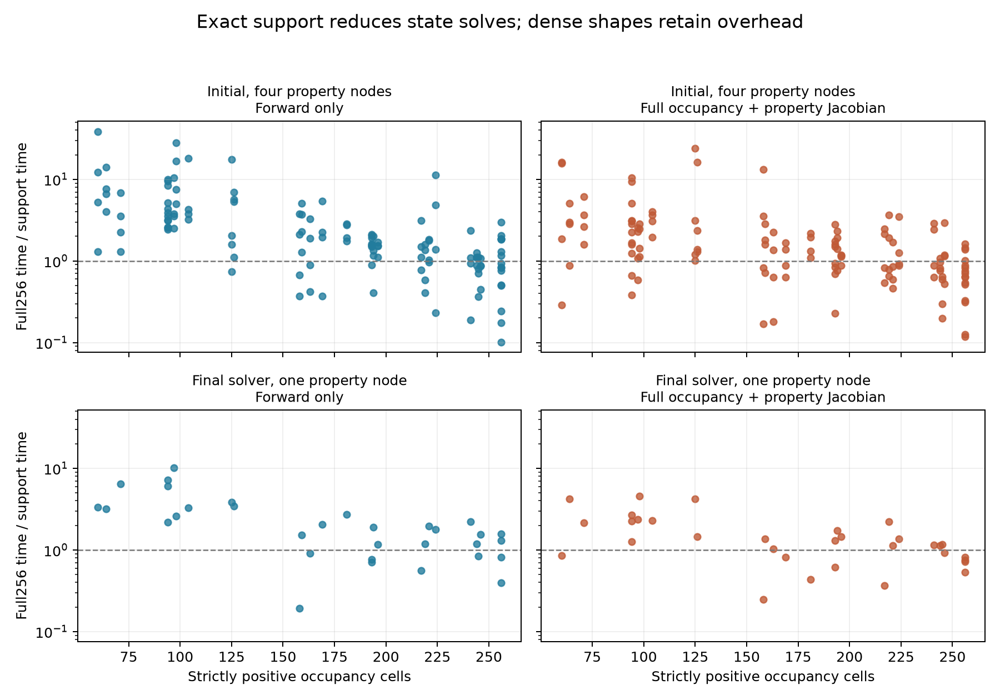
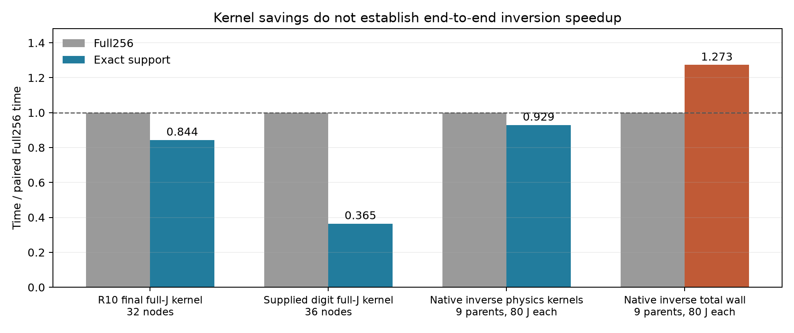

# R11-S3 A：保留支持出生导数的精确活动支持求解

本分支实现一个适用于严格零占比材料的精确状态消元：当前占比恰好为零的格点没有当前散射电流，所以不必进入当前状态线性系统；但这些格点可以在下一步成为材料，**它们的材料导数必须保留**。本实现缩小状态求解阶数，没有冻结材料支持，也没有降低材料参数维数。

代码、历史物理核和主线程明确释放的18个N/P数字占比核已完成。九数字反演由主线程运行，本分支不读取隐藏真值，不据核误差判断图像质量。本报告的数值关系仅属于原离散 scalar-TM/VIE 模型。

**全轮费用协议状态为 `CAP_EXCEEDED`。** 主线程发现冻结的全阶LU上限12,000没有跨job执行，立即停止新增物理。本分支独立从72个反演逐调用JSONL复算得到22,544次LU，单反演部分已超10,544次；本分支核另有787次LU。所有数字预测保留，但本轮不能称在冻结费用协议内完成。没有把小系统LU排除，也没有抬高预算。下述数值和费用均保留这个协议失败背景。

## 1. 为什么严格零占比允许精确消元

固定宿主与ROI消元后，记当前材料对比度为 $D=\delta\operatorname{diag}(a)$，宿主照明为 $E$，内部交互算子为 $C$，到接收端的映射为 $O$。散射电流满足

$$h=D(E+Ch),\qquad F=F_h+Oh.$$

格点 $i$ 的 $a_i=0$ 时，方程直接给出 $h_i=0$，不是一个小量近似。令 $S=\{i:a_i>0\}$，严格保留所有正占比，便有

$$M_S=I-\delta\operatorname{diag}(a_S)C_{SS},\qquad
h_S=M_S^{-1}\delta\operatorname{diag}(a_S)E_S,$$

$$F=F_h+O_Sh_S,\qquad e=E+C_{:,S}h_S.$$

代码不使用阈值、epsilon、相对幅度截断或软稀疏。负占比输入会报错，避免把负对比度静默当成零。空支持无需LU，返回宿主响应；满支持仍是256阶问题。该代数依赖原占比非负模型，不能推广成任意符号对比度的同一支持规则。

## 2. 零格点也有导数：完整256列 Jacobian

微分原电流方程得到

$$dh=(I-DC)^{-1}\operatorname{diag}(e)(\delta\,da+a\,d\delta).$$

因此即使 $a_i=0$、$h_i=0$，也可能有 $dh_i=\delta e_i da_i\ne0$。把非活动格点的Jacobian列置零，会禁止优化器产生新材料，已不再等价于完整物理。

令

$$Z=O_SM_S^{-1},\qquad
T_O=O+\delta Z\operatorname{diag}(a_S)C_{S,:}.$$

则

$$dF=T_O\operatorname{diag}(e)(\delta\,da+a\,d\delta),$$

$$\frac{\partial F_{rs}}{\partial a_j}=\delta (T_O)_{rj}e_{js},\qquad
\frac{\partial F}{\partial\delta}=T_O\operatorname{diag}(a)e.$$

反向端口计算使用普通转置线性系统 $M_S^TZ^T=O_S^T$，不是共轭转置；对复物性保持holomorphic导数。实部、虚部属性导数分别为 $J_\delta$ 与 $iJ_\delta$。返回的复观测顺序固定为 `F.T.reshape(-1)`，即8个源块，每块32接收。

进一步利用 $ZM_S=O_S$，活动块满足精确关系

$$T_{O,:,S}=Z.$$

最终代码只对非活动块 $I$ 计算

$$T_{O,:,I}=O_I+\delta Z\operatorname{diag}(a_S)C_{S,I}.$$

满支持时无需额外的间接场乘法。最初实现对全部256列形成该乘法，已保存为 `solver_initial.py`；最终接口为 `solver.py`。两个版本的实测批次分别保留，不能拿不同批次时钟声称这项代数修改带来确定的额外节时。

支持集合变化不造成完整响应的一阶不连续：每个精确支持表达都等于同一个完整解析resolvent。这里把零电流从当前状态求解中消去，没有把它从未来材料坐标中消去。这与R10冻结加权Krylov基无法注入新支持的机制不同。

## 3. 实现接口与费用

`Solver(C,O,E,Fh,sigma,ledger=None).evaluate(a,delta,need_jac=False,y=None)` 返回 `F`，需要时返回完整 `J_occ` 与 `J_delta`，并附阶数、RHS、LU、活动/非活动列数和wall。可调用ledger与主线程 `shared/core.py` 的接口相容。

非空支持的forward需要一次 $|S|$ 阶LU和8个复RHS；完整Jacobian另需32个同阶转置RHS，总计40。空支持0 RHS，满支持256阶。形成全256列Jacobian、全总场以及非活动再散射项仍有成本，不能把这一方法写成256个材料参数的压缩。粗略主成本为 $O(s^3+s^2(8+32)+32s(256-s)+256s\cdot8)$，另有不可消失的全Jacobian输出成本。

所有核脚本在导入数值库前设置BLAS单线程环境，并使用 `threadpool_limits(1)`。当前运行时的 `threadpool_info()` 返回空列表，环境配置已记录，不能据此谎称获得了第三方库的非空运行时线程清单。核代码无576阶求解入口。

## 4. R10真实占比核：完成与负证据

输入为R10已有8个anchor和24个合法路径占比，仅读取命名NPZ的 `fraction` 与 `delta`，以及既有宿主ROI缓存的 `C/O/ER/Fh/ROI`。未读取真实材料评分，不修改历史文件。支持阶数60—256。

第一批在修改活动块端口形成之前执行：32形状×4个预定属性节点，每节点分别测forward与完整Jacobian，交替两方法执行顺序。第二批在最终代码上对同32形状的固定第0节点执行，独立保存。

| 已完成批次 | 配对节点数 | Full256总秒 | 精确支持总秒 | 实测节时 | 支持更快节点 |
|---|---:|---:|---:|---:|---:|
| 初版，forward | 128 | .461884 | .282676 | 38.80% | 97/128 |
| 初版，完整Jacobian | 128 | .732300 | .589354 | 19.52% | 79/128 |
| 最终版，forward | 32 | .077354 | .055828 | 27.83% | 24/32 |
| 最终版，完整Jacobian | 32 | .129389 | .109142 | 15.65% | 21/32 |

这些是受控物理核工作负载的实际加总，包含当前矩阵形成、LU、端口与Jacobian形成；没有单独的免费热身。读文件、逐节点写账本不在单核计时内，但在job wall中。单次节点计时存在调度抖动和明显离群比值，没有多机器、多时段或总体统计保证；不能据此声称稳定端到端收益。

负证据必须保留：最终版 $s=256$ 的4个Jacobian节点均更慢，汇总节时为 **−35.58%**；$128\le s\le223$ 的12个Jacobian节点汇总为 **−8.68%**。$s\le127$ 的11个Jacobian节点则节省53.12%。这里不能用支持单一阈值承诺所有节点都加速，满支持根本没有消去状态。

所有已测响应的最大白化差异为 $2.94\times10^{-13}$；初版完整占比Jacobian最大相对差异 $1.09\times10^{-15}$，最终版为 $5.72\times10^{-16}$。这些是验证代码保持完整物理语义的附带诊断，不是本研究的科学贡献，也不构成图像准确性证据。

## 5. 一次必要的支持出生独立核对

在 `R10BI_FRESH_000_ANCHOR` 上，预先按宿主照明范数选一个当前恰好为零的格点145，不使用数据残差或GT。将其占比从0改为 $10^{-4}$，支持阶数193变为194。该格点占比导数列范数为 .0109632，确实不是零。

独立参考从完整256阶电流方程直接解隐式切向量，而不是再次构造同一 $T_O$ 公式：支持出生导数相对差异 $5.40\times10^{-16}$，复物性导数相对差异 $6.04\times10^{-16}$。真正正占比步的相对线性化余项为 $4.65\times10^{-6}$。只执行这一必要实物理核对，没有epsilon网格、恒等式扫参或新增无关精度campaign。将非活动导数列置零将使这个切向量的相对错误为1。

## 6. 数字占比核有收益，原生反演端到端收益未出现

主线程明确释放的 `data/kernel_digit_shapes.npz` 只用于核任务；18个占比包括9个原生N与9个原Gaussian/quintic拟合P，严格支持71—112。冻结两个合法原属性端点 $.8+.03i$、$1.8+.18i$，两方法交替顺序。该占比文件没有传入在线反演器。

| 数字已知占比工作负载 | 配对节点 | Full256秒 | 精确支持秒 | 节时 |
|---|---:|---:|---:|---:|
| forward | 36 | .137919 | .020796 | 84.92% |
| 完整占比/物性Jacobian | 36 | .180340 | .065747 | 63.54% |

分别看N/P，完整Jacobian核实测节省68.66%/58.52%。这是一个短窗口的受控核费用，不能推断两数据集总体差异。最大完整占比Jacobian相对差异 $5.21\times10^{-16}$；全部非活动格点导数仍保留。

对主线程已封存的原生N九数字Full256/A反演，本分支只读预测、history和费用receipt，没有读GT：9/9具有相同80次J和相同39,408个复RHS；最大材料向量范数差 $4.47\times10^{-13}$、最大Phi差 $1.65\times10^{-12}$。9/9接受状态路径都有支持计数增加，实际路径支持111—256，确实允许支持出生。

但这九个反演的物理核总费用只从4.934568s降至4.586080s，节省7.06%；完整job wall从9.561673s增至12.173761s，**节时−27.32%**。这轮原生反演不能宣称端到端加速。主线程最后在全阶LU超预算后取消进一步计时重放，不能追加物理来修饰这个负结果。

全部9个原生Full256/A结果都停止在80J `MAX_J`，不是优化器收敛；8/9末态通过noise ball。材料图像质量、IoU、Dice、MSE由主线程独立评分。设计真值属性恰好等于属性中点初值，也是应公开的有利条件；P拟合真值高norm latent不代表典型原P1抽样。

## 7. 费用账本、协议失败与未完成范围

本分支的账本为追加写 `COST_LEDGER.jsonl`，每次求解尝试之前预留RHS和LU，不抹掉旧批次。最终终身累计 **18,888/20,000个复RHS（所有阶数统一保守计入）**：初版R10 12,288；最终版R10 3,072；独立出生核对72；18数字占比核3,456。共 **787次全阶LU**（512+128+3+144），0个新增576阶RHS。历史宿主setup复用单列，不冒充零成本从零初始化。收到STOP后没有新增物理，只进行已有数组/JSON后处理。

冻结全轮契约为40万保守RHS、12,000个**所有阶数**LU；这个LU上限已经违反。本分支独立审查72个反演原始账本，确认总22,544 LU、301,056 RHS，且每个封存receipt都与原始JSONL一致。主线程循环只有累计RHS的批次检查，没有跨job LU检查；不能把费用已经写出等同于预算已被执行。仅主反演+A核就至少23,331 LU，尚未加B/C独立核及真值构造。见 `INDEPENDENT_CAP_BREACH_AUDIT.json`。数值预测不被删除，费用协议状态不允许改写为PASS。

| 任务 | 状态 | 边界 |
|---|---|---|
| 严格支持forward与完整占比/物性Jacobian | COMPLETE | 所有正占比均保留，所有零格点导数保留 |
| R10 32形状物理核费用 | COMPLETE | 一个受控窗口，两个独立计时批次 |
| 一次独立支持出生检查 | COMPLETE | 使用完整隐式切向量与实际正占比步 |
| 18个N/P数字占比物理核 | COMPLETE | 明确释放的核输入，未进入在线反演 |
| N九数字同优化器配对反演 | COMPLETE_SCOPED | 主线程运行；A独立检查配对端点和费用，未读GT |
| 全轮冻结费用协议 | CAP_EXCEEDED | 主反演全阶LU22,544已超过12,000；停止新增物理 |
| 跨支持LU低秩更新/逆矩阵维护 | NOT_RUN | 当前每次按精确当前支持重建；不以计划充结果 |
| 后验、Full66覆盖、连续PDE或通用最小实现 | NOT_RUN | 核代数与计时不提供这些资格 |

已执行的同观测、同初值、同优化器Full256配对反演保留了同一预算端点，但当前端到端wall没有收益。不能根据数字真值支持直接给反演器一个有利稀疏mask，也不能在协议失败后增加计算补救本轮加速结论。

## 文件

- `solver.py`：最终可调用后端；`solver_initial.py`：最初完整端口乘法实现，保留审计。
- `benchmark.py`、`CONTRACT_R10*.json`：预定R10核任务与两次冻结批次。
- `R10_KERNEL_NODES.csv`、`R10_OPTIMIZED_KERNEL_NODES.csv`：全部节点费用和完整导数差异。
- `R10_KERNEL_SUMMARY.json`、`R10_OPTIMIZED_KERNEL_SUMMARY.json`：汇总；`SUPPORT_COST_GROUPS.json`：保留慢节点分组。
- `SUPPORT_BIRTH_CHECK.json`：独立出生导数与实际出生步。
- `DIGIT_KERNEL_NODES.csv`、`DIGIT_KERNEL_SUMMARY.json`：18个明确释放的数字占比核任务。
- `ONLINE_DRIVER_AUDIT_ZH.md`、`N_PAIRED_INVERSE_NO_GT_AUDIT.json`：在线输入边界、配对反演端点与全流程费用。
- `INDEPENDENT_CAP_BREACH_AUDIT.json`：独立原始费用复算及全阶LU协议失败。
- `COST_LEDGER.jsonl`、`RECEIPT_*.json`：逐尝试费用与累计receipt；不修改历史原件。
