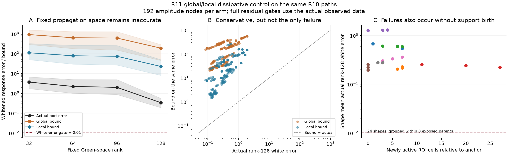
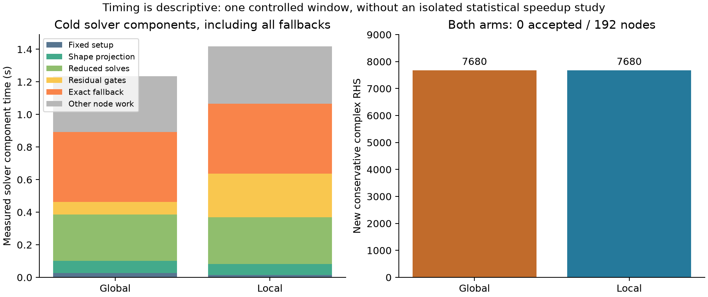

# R11 Sol-C：全局耗散界、总场近似求解与真实回退费用

## 已执行结论

固定宿主消元后的离散 Green 算子确实允许一个覆盖全部合法占据率和属性矩形的正耗散下界。其数值为

\[
\lambda_{\min}(\operatorname{Im}_H C)=-4.5739299047015534\times10^{-5},\qquad
b_*=0.009210948658001952>0.
\]

因此无需每换一个形状就重新计算 256 阶加权矩阵的最小耗散特征值，也能对**已计算的完整物理缺陷**给出条件误差界。它不是免费解决正演：本次固定 Green 总场空间的 32/64/96/128 阶实测仍不准确。在同一批 R10 的 192 个路径节点上，全局界和局部界均为 **0/192 通过，192/192 精确回退**。128 阶实际白化响应误差的最小值为 0.0839293，已超过 0.01 门；故本批失败不能全部归因于保守界太松。

实现已接入主线程数字反演。这里报告的是独立的历史路径核验；数字反演质量和费用由主线程另行封存与评分。没有用真值选择空间、阶数、回退或路径节点。主线程随后发现整个 R11 实验的 all-order LU 总数超过其自冻结的 12,000 门，整体资源状态记为 **CAP_EXCEEDED**；本分支的数学界和局部限额不能将整个实验恢复为资源合规或成本 GO。

## 1. 物理直觉：损耗能限制被遗漏传播的放大

误差问题可以分为两步。先把近似场放回原完整状态方程，测量它没有满足的那部分激励；再问原系统会把这部分激励放大多少。材料的正虚部为第二步提供损耗控制。Green 算子自身的 Hermitian 虚部略有负特征值，所以不能直接假设其半正定；必须保留实际负值，并由材料损耗抵消它。

这里沿用原 P1 离散物理。ROI 阶数为 256，8 个源、32 个接收端，噪声固定为 \(\sigma=0.00119211798514519\)。固定算子为 \(C,O,E,F_h\)。材料增量为 \(D=\delta A\)，其中 \(A=\operatorname{diag}(a)\)、\(0\le a_i\le1\)，\(\delta=x+iy\) 满足 \(x\in[.8,1.8]\)、\(y\in[.03,.18]\)。

原总场方程与输出是

\[
(I-\delta C A)e=E,\qquad F=F_h+\delta O A e.
\]

令 \(P=A^{1/2}\)、\(B=PCP\)、\(K_\delta=\delta^{-1}I-B\)。即使某些占据率为零，以下推导也无需 \(P^{-1}\)。

## 2. 不随形状变化的耗散下界

记 \(H_C=(C-C^*)/(2i)\)，定义

\[
\beta_*:=\min\{0,\lambda_{\min}(H_C)\}.
\]

对任意向量 \(v\)，有

\[
v^*\operatorname{Im}_H(B)v=(Pv)^*H_C(Pv)
\ge \beta_*\|Pv\|^2
\ge \beta_*\|v\|^2.
\]

最后一步同时使用 \(0\preceq P^2\preceq I\) 与 \(\beta_*\le0\)。因此即使 \(H_C\) 的最小特征值为正，也应选择 0 作为对所有可含零格点的形状统一有效的下界；不能把正特征值直接沿用给每个 \(PCP\)。

另一方面，

\[
-\operatorname{Im}_H K_\delta
=\frac{\operatorname{Im}\delta}{|\delta|^2}I+\operatorname{Im}_H B.
\]

在本矩形内，\(y/(x^2+y^2)\) 随正 \(x\) 递减；因 \(y<x\)，它随 \(y\) 递增。因此其最小值发生于 \((x,y)=(1.8,.03)\)：

\[
\min_\delta\frac{\operatorname{Im}\delta}{|\delta|^2}
=\frac{.03}{1.8^2+.03^2}=0.009256687957048967.
\]

故

\[
b_*:=\frac{.03}{1.8^2+.03^2}+\beta_*=0.009210948658001952.
\]

若 \(b_*>0\)，Cauchy–Schwarz 给出 \(\sigma_{\min}(K_\delta)\ge b_*\)，从而 \(\|K_\delta^{-1}\|_2\le b_*^{-1}\)。这个推导不要求 \(C\) 正规或与 \(A\) 对易。若实际计算得到 \(b_*\le0\)，代码明确拒绝用该界验收，并进行精确回退；没有把无效稳定性量裁剪为正数。

## 3. 从总场缺陷到输出与势误差

给任意近似总场 \(\widetilde e\)，必须在原完整算子上计算

\[
r_E=E-(I-\delta C A)\widetilde e.
\]

由原状态方程，有

\[
K_\delta[\delta P(e-\widetilde e)]=P r_E,
\qquad F-\widetilde F=OP K_\delta^{-1}P r_E.
\]

因此白化输出误差的全局稳定性界为

\[
\epsilon_F:=\|W_\sigma(F-\widetilde F)\|_2
\le \frac{\sqrt2\,\|OP\|_2\,\|P r_E\|_F}{\sigma b_*}.
\]

代码对每个新形状计算 32 行接收矩阵的谱范数，随后在同形状的属性节点间复用。也提供统一 \(\|O\|_2\) 选项，因为 \(\|OP\|_2\le\|O\|_2\)，但本次路径比较使用前者。全局稳定性界不意味着全部门控量都与形状无关。

采用实际观测 \(y\)，\(\widetilde\rho=\|W_\sigma(\widetilde F-y)\|\)，有

\[
|\Phi(F)-\Phi(\widetilde F)|\le\widetilde\rho\,\epsilon_F+\tfrac12\epsilon_F^2,
\qquad \Phi(F)=\|F-y\|_F^2/\sigma^2.
\]

只有当白化界不超过 0.01 且势误差界不超过 0.1 时，近似输出才被返回。缺失观测、无效域、非有限量或非正稳定性量都不能验收。

零占据率与支持出生不使上述变换除零。总场注入 \(E\) 固定，改变的是传播 \(CA\)、输出 \(OA\) 与缺陷权重 \(P\)。这移除了 R10 加权状态 anchor 基在新支持上严格为零的注入障碍，却没有证明一个低阶固定总场空间足以覆盖全部形状。

## 4. 已运行的算法与反演接口

固定空间由 \(C\) 与 \(E\) 的 block Krylov 构造，注入为固定总场 \(E\)。嵌套阶数为 32、64、96、128，不补零伪造缺失阶数。每个新形状实际计算并缓存 \(CAV\)、\(OAV\)、\(V^*CAV\) 与 \(V^*E\)，依次求解

\[
(I-\delta V_r^*CAV_r)z_r=V_r^*E,
\qquad \widetilde e=V_rz_r.
\]

每次都计算完整 256 行的 \(r_E\)，由上述物理界决定接受或扩大到下一个预定阶数；全部失败则真正执行一笔新的 256 阶、8 RHS 精确求解。没有用与真值或缓存参考的实际误差决定接受。全局臂和局部臂使用同一个 Galerkin 实现、相同空间与节点，只改变耗散分母；局部臂每形状重新计算 \(\lambda_{\min}(\operatorname{Im}_H PCP)\)，并使用当前 \(\delta\)。

`controlled_solver.py` 的 `GlobalControlledSolver.evaluate(a, delta, need_jac=False, y=None)` 返回 `F(32,8)`。要求 Jacobian 时，直接返回一致的精确场与源优先排列的 `J_occ(256,256)`、`J_delta(256)`，实付 8 个正演加 32 个接收转置 RHS。**近似导数未受控、未使用**；不能把总场近似的输出界宣称为梯度误差界。

共享数值引擎来自 Sol-B 的 `fixed_total_field.py`，全局界与门控对象由 Sol-C 实现。它是标准 Galerkin、耗散 resolvent 界与 exact fallback 的组合；没有把它称为原始 TSOM 算法或新的最小实现定理。

## 5. 同一 R10 路径的实际结果

输入为已暴露的 8 个 parent、每个 parent 的 3 个真实 decoder 路径形状、每个形状 8 个已存属性节点，共 24 个形状、192 个节点。参考是 R10 先前付费保存的 `DIRECT_LU` 输出；本次没有为它重新求解。观测来自仅含观测的 online 文件。没有读取真值文件，也没有材料覆盖评分。

| 项目 | 全局界 | 局部界 |
|---|---:|---:|
| 近似验收 / 节点 | 0 / 192 | 0 / 192 |
| 精确回退 / 节点 | 192 / 192 | 192 / 192 |
| 新保守 RHS | 7,680 | 7,680 |
| 128 阶实际白化误差，中位数 | 0.336543 | 0.336543 |
| 128 阶实际白化误差，最小—最大 | 0.0839293—1.934887 | 相同 |
| 128 阶白化界，中位数 | 188.765 | 22.5789 |
| 当前形状界 setup 累计 / 秒 | 0.005478 | 0.190358 |
| 带回退的求解器冷组件 / 秒 | 1.235662 | 1.419127 |

全局界相对于局部界的白化上界比为 1.476—23.702，中位数 6.588；局部耗散分母为 0.0135993—0.218322。全局界较松是实测事实，但即使使用实际误差，128 阶也没有节点达到 0.01 白化门。全部 1,536 个已计算近似节点的实际响应误差和势误差都被相应浮点界覆盖；这是本批保存节点的复核结果，不能取代精确谱量或 outward rounding。

24 个形状中 20 个有严格新支持，最多 27 格；另外 4 个没有新支持，对应 32 个属性节点的 128 阶实际白化误差仍为 0.0839293—1.88319。由此只能说固定 Green 总场空间仍有不足，不能把支持出生当作唯一原因，也不能由此否定所有固定空间方法。

图中带状区域为节点间四分位范围，并非置信区间；24 个形状分组于 8 个 parent，不作为 24 个独立抽样单位。面板 C 显示每个形状在 8 个属性节点上的平均实际误差。

## 6. 费用、检查与证据边界

历史路径研究新增 15,360 个保守复 RHS：32、64、96、128、256 阶各 3,072；共 1,920 次各阶 LU，其中精确回退 LU256 为 384。另有一次真实支持出生形状的反演接口核验，付费 80 RHS256、2 LU256（本臂 40，独立共享精确参考 40）。**Sol-C 合计 15,440 RHS，新增 RHS576=0**，低于 20,000 分支限额。两个不可覆盖的 append-only ledger 均保留。

包含接口核验后，本分支各阶 LU 为 32/64/96/128 阶各 384 次、256 阶 386 次，**all-order LU 合计 1,922**。不能把 all-order LU 改写成仅计 LU256。

接口检查确认源优先 Jacobian 与共享精确实现一致；差值只用于接口排列与实现核验，不新增科学验收门。最终主反演仍应独立精确核验候选材料。

路径窗口总墙钟为 3.207848 秒，含读取、参考误差后处理和捕获既有数组的仪器开销。表内两个求解器冷组件之和为 2.654789 秒，剩余 0.553059 秒属于研究记录与审计开销，包括额外未使用的界对象构造。应保留这两个计时边界。单线程 BLAS 不等于独占整台机器；这是一次窗口的描述性成本，**没有统计加速比结论**。全局界省掉了局部大特征值计算，但本次两臂都新增了完整回退费用，故不存在由此推出的正演或反演净加速。

固定宿主缓存本身不是冷获取免费：原 R9 已付费的 setup 为 264 RHS576、1 LU576，本次只复用它，新增费用另列。本次不改写历史文件，不扩阶补救失败，也不以路径结果宣称全先验后验、连续 PDE、精确纤维或数字识别成功。

数学不等式对精确离散谱量成立。实际实现采用 complex128/float64 特征值与范数，没有区间运算、外向舍入或连续离散化误差界，资格为 **数值离散、有限浮点、条件有效**。即使全局系数对材料域统一，逐查询的场残差与门控也不自动构成全支持概率误差证书。

## 产物

- `dissipative_bound.py`：全局/局部耗散门控；`controlled_solver.py`：主反演接口。
- `path_campaign.py`：保守 20,000 RHS 上限、实际近似与回退研究；`path_results/` 保留 CSV、JSON 与原始费用 ledger。
- `analyze_and_report.py`：零求解后处理；`RANK_SUMMARY.csv`、`ANALYSIS.json` 与 PNG/PDF 图。
- `API_VERIFICATION.json`、`API_COST_LEDGER.jsonl`：真实支持出生形状的接口核验。
- `INDEPENDENT_WHITENING_JACOBIAN_AUDIT.md`：共享白化、链式导数与原噪声标定的只读审查。

运行环境为 Gaussian 根下既有 `.venv_nn`；图表后处理不会调用正演求解器。数字反演主实验及其 GT 评分不包含在本报告的验收率中。
