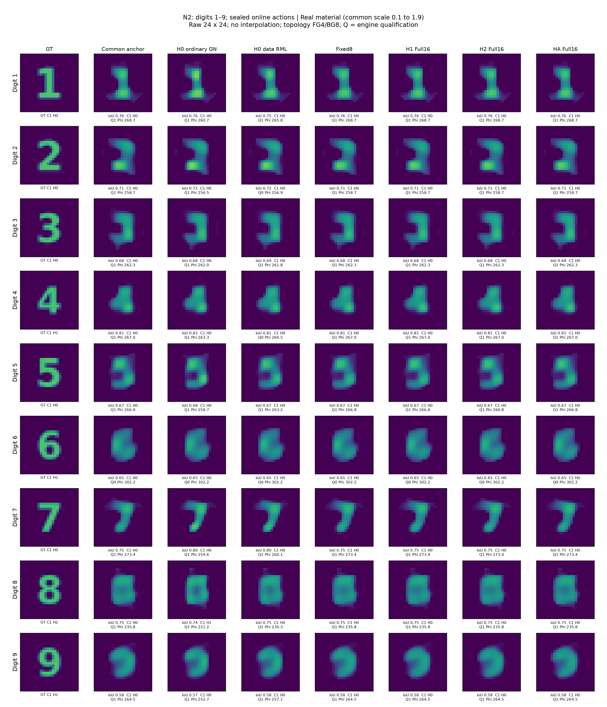
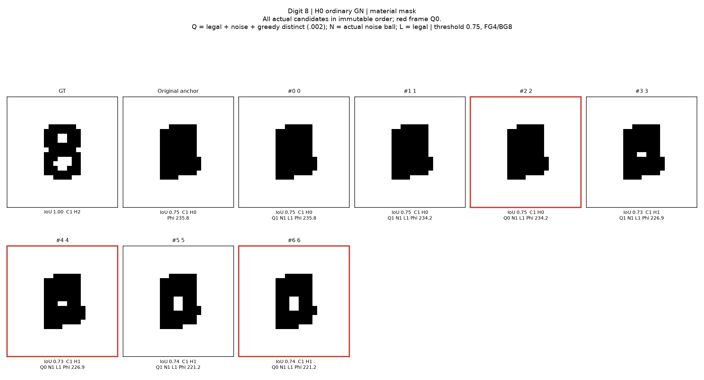
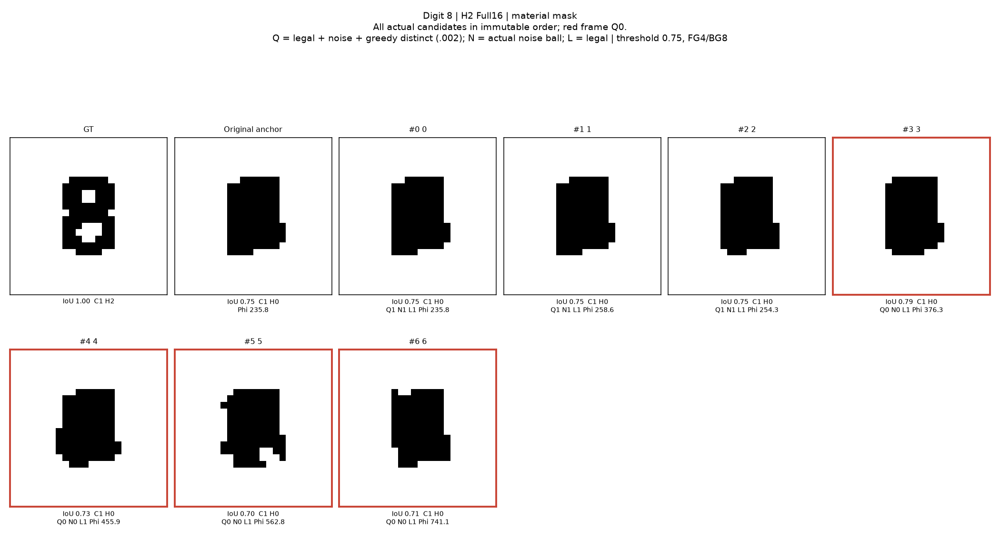

# Research P3L-R12-BF：双边模式可以精确组织信息，继续分层没有解决材料覆盖

2026年10月30日。原 P1 TM24 完整非线性 Maxwell；四个已暴露开发对象；R11 的九个冻结 physics-native 数字；全部新增物理已停止。

**本轮裁决：不保留 H-BMC 的递归分层作为下一项主算法。** 完整双边分解与同一状态的 Full-J 包含同样的局部材料信息。移动后 Jacobian 确实改变，但本次一次更新、自适应更新和扩大到 weak32，都没有把四个 R9 难例带入 RMS≤0.075 的 GT 邻域。九数字上，分层方法的在线选图仍是原锚点；普通 Full-J 继续优化反而降低了材料误差。数字8的双孔在全部已计算候选中都未恢复。

这不是以概率校准为理由停止。我们实际计算、封存并评分了材料候选集合；失败发生在材料覆盖与选图，而不是“尚未证明 posterior”。

## 先看实际成像

左列是真实材料，随后是原 R11 Full256 锚点、普通继续 GN、随机数据目标，以及固定8维、单层16维、更新一次16维、自适应16维。每一格保持原24×24物理分辨率，显示只作最近邻放大。没有用输入模板代替输出，也没有用 GT 挑选在线图像。

**1、7最易辨认；3的中间结构与5的转折仍有混淆；4、6、9的孔未恢复；8仍缺双孔。** 普通继续 GN 能在8上打开一个孔。降低材料MSE不等于恢复数字拓扑：占比与材料属性还有尺度耦合，材料阈值与占比阈值必须分开看。

完整图、逐对象原始数值和原始匿名读图记录见 [视觉报告](DIGITS_VISUAL_REVIEW_ZH.md)、[逐数字表](DIGIT_PER_NUMBER_RESULTS.csv) 和 [数字8全部候选](figures/n2_online_and_clouds/DIGIT8_CLOUD_H1_FULL16_MATERIAL_MASK.png)。

## 1. 本轮真正运行了什么

- 原 P1：固定取 R9 记录顺序的前四个暴露对象。它们全部是历史覆盖难例，不是新的 locked test。每个对象保留旧物理锚点，并用正确随机数据/先验目标生成三个新 RML 入口；在线只按观测与材料距离选择两个不同入口开展探索。
- 八臂：普通 Full66 RML、匹配实现的 fixed8、H1-full16、H2-full16、HA-full16、receiver16、pair32-mode 构成的16维方向，以及 full32，共32组候选云。H1/H2/HA使用相同初始模式、随机系数和 corrector，主要差异是探索空间何时刷新。
- 数字 N1：九数字×五臂。线性提案被盒约束阻断，未产生付费非锚点材料。完整保留，不能拿它宣称 Maxwell 探索失败。
- 数字 N2：读取数字 GT 前明确改为盒约束回缩提案、普通 active-set/fraction-to-boundary corrector，保留原数据、物理、TV正则与噪声门。九数字×六臂，共54组真正的材料探索；加入没有随机化、没有分层的普通继续 GN 强对照。
- 两单元控制：实际 Green TM-VIE 的孤立双根、非根固定点以及另一个三实参数/一复端口的连续曲线；它们是定义清楚的小模型控制，不是 P1 新纤维证据。

三项 Sol 分工先并行启动。A、C后续遇模型容量限制，分别由 Sol/max 接续文档和作图；本轮原先已运行的 ultra 没有打断。后续新 Agent 的上限按用户新指令设为 max。未调用 Astra、DeepSeek、云GPU或训练新网络。

## 2. 双边结构的确定结论

固定宿主消元后，原完整离散模型为

\[
F(D)=F_h+O(I-DC)^{-1}DE_R.
\]

当前材料的微分是

\[
dF=L_D\operatorname{diag}(dd)R_D,\quad
L_D=O(I-DC)^{-1},\quad R_D=(I-CD)^{-1}E_R.
\]

若两侧分别 SVD，每对接收—照明模式的材料系数是内部奇异向量的逐格点乘积，带两侧奇异值乘积权重。它不是两个内部子空间的交集。完整材料 Gram 为

\[
H_D=(L_D^*L_D)\circ\overline{R_DR_D^*},\qquad
H_x=\frac{2}{\sigma^2}\Re(D_x^*H_DD_x).
\]

**保留所有模式时，这就是同一个 Full-J 的 \(J^TJ\)，不是新增测量信息。** 分开截断两端或只保留部分模式对，会改变分析算子；尤其在弱谱尾部不能仅凭“大奇异值模式对”排序保证保留材料弱方向。receiver-only、source-only 和 pair 截断保留为消融，不冒称额外物理。

数值实现优先在材料有效秩坐标中对因子做 SVD，避免先形成 Gram 再平方条件数。材料度量始终是复材料全576格 RMS，即 \(\|\Delta m\|/24\)。去除的是数值局部 decoder-null 方向，不能从这一操作推导全局 gauge。

详见 [精确模式推导](BILATERAL_MODE_DERIVATION.md) 和新公式集 [F-BF-001—009](../maxwell_formula_atlas/12_BILATERAL_MATERIAL_MODES_AND_FIXED_POINTS.html)。公式集现为167条；标准恒等式没有包装成新定理。

## 3. 为什么加入原先验，仍不改变数据的信息量

纯数据 generalized weak16 中有些单位材料方向需要很大的 latent 位移。已保存的 decoder-only 有限射线审查中，纯数据组只有12/272条达到0.02材料RMS；各先验感知组为272/272。另有弱空间组合可产生较大有限材料变化，故不能据这项列方向结果宣称整个纯数据弱空间不可行。

主比较在首次候选求解前追加冻结：使用原 Gaussian prior 曲率，分解

\[
T^T(J^TJ+I)T,
\]

其中 \(T\) 是材料有效秩的单位RMS提升。实现为增广因子 \([JT;T]\) 的 SVD。这是先验代价下的方向选择，与 R9 思路相接；\(I\) 不是额外的 Maxwell 数据。

N数字使用另一个自由258维材料合同及原 R11 TV正则。它的提案度量使用锚点处冻结的 TV 曲率；corrector使用当前相同 TV目标。这样不能把更换图像先验的收益误记给双边刷新。

## 4. 近单位固定点谱的实际含义

对数据阻尼映射 \(T_\mu=x-(J^TJ+\mu I)^{-1}J^Tr\)，在精确数据根处才有

\[
\lambda_i=\frac{\mu}{\sigma_i^2+\mu}.
\]

非根处还包含 \((DJ[h])^Tr\) 与预条件器导数项。\(\mu=1\) 与先验曲率的量纲参照相同，也不意味着这个只含数据梯度的映射就是 MAP；实际 MAP/RML corrector还有 \(x-\xi\) 或原 TV 梯度。

因此本轮不靠放大阻尼制造“单位方向”，也不把强制固定 weak 坐标形成的单位左模态当作材料纤维。两单元实际控制存在接近1的阻尼谱方向，仍是局部满秩的孤立根。这直接说明近单位谱不能证明连续解集。另一个明确定义的三实参数模型有可推导的有理固定响应曲线；该曲线不推广为 Full66 证据。

详见 [固定点报告](FIXED_POINT_SPECTRUM_AUDIT.md)、[横向延拓](TRANSVERSE_CONTINUATION.md)。小模型解析与数值资格分开，未声明连续PDE认证。

## 5. 同一 Jacobian 的第二次 SVD：删去

若 \(Q_w\) 已由 \(J\) 的右奇异向量构成，则 \(JQ_w\) 的 SVD只重现所选谱与基内旋转。没有新的物理观测，也没有额外非线性信息。因此该方案标为 `REDUNDANT_REDECOMPOSITION`，不作为候选算法扩张。

真正更新状态后得到的新 \(J(x')\) 则不同。本轮保存128个有限 secant 诊断与96组 projector 对照，确实观察到响应线性化误差与弱空间变化。但抽取的状态包括拒绝步和不同入口，它们不全是同一条被认证的连续路径；不能把这些变化率写成统一曲率界或全局 contraction 常数。

**有新的局部信息，不代表再分解这些信息就改善候选覆盖。** 下面的端到端对照正是对此作裁决。

## 6. 原 P1：实际材料覆盖没有改善

每臂使用相同完整ROI物理、两个共享入口、最多12次提案、三档0.02/0.05/0.10材料目标步长，standalone上限5400 RHS和240 LU包含共享新入口费用。相同的是预算上限与物理/优化规则，实际支付费用不相等，未用完额度没有被补成虚构工作。

|方法|不同合格材料均数，含锚点|最近GT材料MSE均值，仅离线|ε=.075覆盖|
|---|---:|---:|---:|
|Full66 RML|14.00|0.01192526|0/4|
|匹配 fixed8|12.25|0.01389469|0/4|
|H1-full16|11.25|0.01301772|0/4|
|H2-full16|11.25|0.01335964|0/4|
|HA-full16|11.25|0.01319854|0/4|
|receiver16|10.50|0.01236190|0/4|
|pair16|10.50|0.01441167|0/4|
|full32|7.75|0.01387411|0/4|

所有方法用原公开目标选择的材料都还是共同原始锚点，平均 MSE为0.01481536。表中的最近GT材料是 oracle集合容量，不是可部署输出。H2共更新8次、HA共13次（四对象×两入口合计）；没有转化成新的主ε命中或单幅动作收益。weak32也没有胜过16。

这些材料变化不全在旧weak8图像中；但“超出旧weak8”本身仍不足以解决GT方向覆盖。原R9四难例的完整66切向比weak8更能解释GT残差，是历史离线线索；本轮没有因此假设任意Full66局部方法必然恢复GT。

**停止第三层强制递归与新的独立 parent 扩大。** 本轮不支持“分解越多越好”；同时，4个暴露难例不能证明所有分层方法在所有条件下都无用。

## 7. 九数字：先排除边界假失败，再作真实探索

N数字是256格自由占比加两个物性参数的258维新材料合同，不是原Gaussian64/quintic的概率模型。R11 P数字3的中横表示失败原样继承，本轮未替换P真值或用P结果混入N。

N1直接沿线性弱方向走，因锚点有大量0/1占比而越出盒约束；普通 corrector也在不完善的边界处理处停止。九数字×五臂全部保留，分类为 `INITIALIZATION_BOUNDARY_FAILURE_NOT_PHYSICAL_TEST`。

在读取N的GT前，N2采用普通

\[
x_{pred}=\mathcal P_{box}(x+t v),
\]

并在实际回缩预测点固定 weak 坐标，执行普通一阶横向校正、active-set与边界步长控制。回缩通常离开原线性weak空间，日志明确记录；不能把它称为纯weak直线。该处理属于成熟有约束优化，没有独立Maxwell原创性。

|在线动作|九数字平均复材料MSE|实际noise-ball通过|
|---|---:|---:|
|R11原锚点|0.03171430|8/9|
|普通 Full-J 继续GN|0.02880951|8/9|
|随机数据目标|0.03036269|8/9|
|fixed8 / H1 / H2 / HA|0.03171430|8/9|

普通继续GN比旧锚点降低约9.16%材料MSE，但支付了额外优化费用，不能称作本轮双边分层收益。MSE下降也没有恢复4/6/8/9的全部孔洞；occupancy阈值还受幅度—占比尺度自由度影响，应同时看纯材料阈值。

数字6的锚点 \(\Phi\approx302.24\) 超过冻结门282.8738，全部方法均未产生合格云，失败对象没有删除。Q是“合法、噪声合格且贪心去重”的组合标志；N才是单独噪声门。Q0/N1可只是重复点，不能写成物理失败。

## 8. 数字8：多算一层没有打开第二个孔

六法各7个实际存储候选，合计42个，均没有在冻结的材料阈值0.75或占比阈值0.5下形成两个孔。普通GN出现噪声合格的一孔材料与无孔锚点；其余几个较大提案有噪声不合格者，全部保留。

这支持一个有限的任务见证：在本次采集和门内，至少普通GN候选可有不同孔洞计数。它不支持“已覆盖正确双孔”、候选频率就是概率、或沿所有中间状态已建立连续解管。没有检查全连续区间，不能把合格端点自动变成合格路径。

## 9. 费用与执行范围

最终新增费用 **163,994 complex RHS、6,974 全阶数物理LU、0新576阶RHS**，低于300,000/12,000/1,024上限。固定宿主cache来自历史完整物理setup，历史264 RHS576单列，不称从零冷启动免费。

本轮先预留再执行的跨进程原子费用在全部实际求解中使用，失败和重启成本保留；没有把R11未用额度转入本轮。一次trace数组JSON序列化失败只重做结果组装，原付费分支结果未重跑。R11超LU上限的失败没有改写。

本轮后半段遵从用户新指令，不再增加防御性代码、机器精度恒等式测试或重复比对。最后只聚合已有实验费用、完成实际图像阅读、数值结果与交付。

全费用与实际支付/standalone区分见 [成本摘要](RESOURCE_SUMMARY.json)、[中央账本](COST_LEDGER.jsonl) 和 [全局预算汇总](GLOBAL_BUDGET_AUDIT.json)。不存在20%端到端加速的合格主张。

当前逐作业wall包含保存完整Jacobian等证据的IO，不是关闭日志后的部署延迟；不能把它与R10/R11另一个窗口的微秒核数字直接相除。SVD/QR等CPU工作纳入作业wall，未把它们冒充新的Maxwell RHS。

## 10. 科研与论文判断

1. **保留：** 精确双边材料模态公式、因子SVD实现、数据/先验/材料度量的区分，以及不动点非根项和强制单位模态的明确解释。
2. **删去：** 同一Jacobian上的nested SVD；本合同下继续强制第三次分层；“当前谱变化就是材料覆盖改善”的推论。
3. **算法结果：** 一阶predictor–corrector能构造有限噪声候选，但本轮分层没有优于普通Full-J/RML。没有新匹配R7 Jets实验，不能由不同预算表宣称全面替代高阶法。
4. **材料可能性：** 只报告实际合法、观测相容、去重的材料及任务范围。Full66 posterior、精确连续材料纤维、全域分支覆盖均未建立。
5. **强TAP：** `HOLD`。双边因子、TSOM子空间、Newton延拓、近单位固定点谱和RML都具有成熟先例；本轮没有足够独立反演收益支撑把它们合成新框架。

下一项最小可证伪的问题不是再分一次SVD，而是：**在不限定于单个局部弱方向簇的情况下，改变全局入口/材料形状表示，能否在与普通Full66随机目标相同费用下真正提高ε=.075材料覆盖？** 在这个问题有新机制前，停止H-BMC层数扩张。详见 [GO/NO-GO](GO_NO_GO.md)、[中英文论文定位](PAPER_NARRATIVE_ZH.md)、[交接](GPT_PRO_HANDOFF/START_HERE.md)。

## 11. 对十个问题的直接回答

|问题|本轮答案|
|---|---|
|双边与Full-J SVD的本质差别？|完整双边给出物理因子和模态解释；拉回同一材料坐标后信息相同。截断后才成为不同近似|
|逐格点乘积是否有用？|给出合法材料模式的构造，已实现；本轮没有独立覆盖收益|
|同一弱空间再次SVD？|冗余，不保留为新算法|
|新材料处再次SVD？|可以获得改变的敏感性结构；本轮确实发生，但未改善主任务|
|近单位方向多少是gauge？|四个原P1锚点的材料与数据数值秩均66，局部decoder-null数为0。μ=1、λ代理≥.9的计数分别31/34/28/31，均对应非零一阶材料变化；这是非根锚点的假想根谱代理，不是实际DT或精确纤维证书。N自由占比合同另有尺度gauge，不外推P1|
|一阶法替代Jets？|已能生成数据相容材料；本轮未重跑匹配Jets，不能给全面替代或成本胜出结论|
|几层最好？|本轮H2/HA未胜H1，H0普通RML的离线最近材料更好；不继续强制H3|
|R9方向缺口解决了吗？|没有，四难例主ε覆盖全部0/4；更多不同方向不等于命中GT邻域|
|九数字拓扑改善了吗？|分层臂没有；普通额外GN可打开8的一个孔但没有双孔。不能据失败证明物理不可辨识|
|哪条支持强TAP？|当前无已成立的独立优越算法，HOLD。保留精确组织结构与负结果，下一机制先改变全局入口/材料表示|
