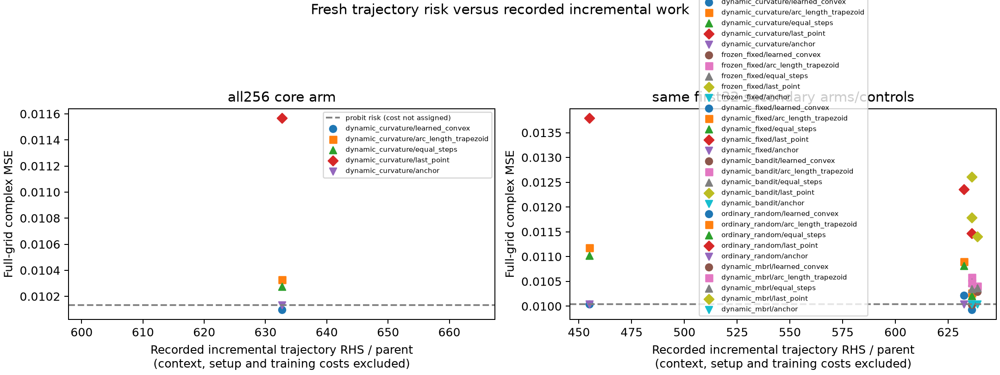

# 局部几何与真实有限轨迹

所有轨迹均从只依赖观测的paid physics anchor出发，GT不参与提案、方向、修正或停止。Gaussian64方向使用材料RMS归一化的prior-aware广义谱；两个bounded属性固定。弱维数4，任务步长0.02/0.04，signed progress至少半步，decoder先验保持合法。

实际比较frozen、每步dynamic、curvature threshold、普通随机方向、contextual bandit和小型model-based horizon3 policy。bandit/MBRL用明确TRAIN轨迹风险监督；没有把访问频率叫posterior。PPO/SAC未扩展：已有行为数据只覆盖8个TRAIN parent，简单策略没有独立风险收益，不能以更大policy掩盖这个限制；这与FULL reference未合格无关。

## 首批256个对象的冻结主轨迹

256条曲率轨迹全部完成，共2048个被选端点；2048个prior合法、2048个保持实际步长、2009个noise-ball内、1934个同时noise-ball内且相对固定基础点ΔΦ≤2。完整predictor/corrector共4049次实付端点，incremental161960RHS。

因此存在任务尺度的有限噪声、prior-supported材料移动。但ΔΦ≤2是启发式likelihood竞争诊断，不是95%credible region；有限Gaussian prior penalty不等于某个区域有重要posterior mass。相邻端点相容也不是整条连续连接路径的证明。

弧长风险动作MSE=0.010329425，相对强点的风险降低为-1.96%，两主比较调整后的97.5%区间[-4.33%, 0.21%]，没有达到风险改进。额外16-state普通优化对照也不能将其变为成功。开发集约9.95%的弧长平均改善未复现在新对象上。

监督凸组合次级风险约0.01009647，区间跨零；不得事后替换失败的弧长主比较。前32人的五臂实际对照和全部失败保留；随机方向只7/256被选端点同时通过两个数据判据，说明几何对**数据可行移动**有作用，但不能据此宣布风险或posterior胜利。

## GT几何只能离线解释

新256个对象的GT−point材料RMS中位数0.09645；完整prediction距离中位数4.991。latent线性响应中位数221.67，材料secant线性响应5.085，Maxwell余项0.820。对这些GT secant，decoder非线性是更大的线性化障碍，不能把它全叫Maxwell feedback。

任务尺度0.02/0.04/0.08的prior-aware弱能量平均分别为58.19%/25.58%/0.23%。这不是此前单一obs_A的79.46%的普遍复现；阈值/先验度量不同也须分开。有限GT差量投影在弱空间不意味着可沿在线路径找到GT。

## 真实P1动态弱分布的Frobenius诊断

两个paid DEV anchor，固定rank4 projector定义材料RMS归一化场；两步长中央差分并做两种反向Euler回路，总48states/1920RHS，非toy代数。

| 已暴露anchor | h | normal leakage | 材料回路/bracket相对误差 |
|---|---|---|---|
| DEV_000 | 0.001 | 0.9339 | 0.0206 |
| DEV_000 | 0.002 | 0.9340 | 0.0402 |
| DEV_030 | 0.001 | 0.8223 | 0.0817 |
| DEV_030 | 0.002 | 0.8233 | 0.1577 |

DEV000两尺度材料bracket相对变化0.00236，DEV030约0.0236；probe材料rank保持64，弱/其余谱gap约0.28–0.30。回路/bracket误差随h减半而减小。这是该具体弱分布局部不对合的数值证据，提示不能默认把dynamic弱方向当单张坐标面。

它不证明所有P1区域不可积，不否定finite-noise不确定性，不证明不存在更高维路径或精确fiber。零宽轨迹的弧长law也不是原66维Lebesgue/Gaussian posterior law。Trajectory tubes、重叠质量与FULL posterior积分仍NOT_RUN，不伪造权重。

