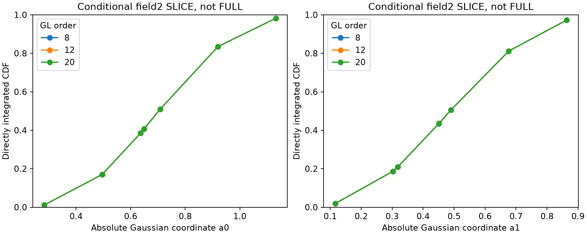

# 非 Gaussian 推断：新机制、实际失败与条件参考

本轮并非重复上一轮单一GN Gaussian。实现完整支撑多中心三角Student proposal、逐照明源渐进同化SMC、真正state-dependent Full-J metric MALA、source-adjoint frozen-metric MALA、归一化learned proposal加exact MH，以及两个不同的Full-Maxwell二维条件目标。所有被拒提案、重复状态、祖先和失败费用保存。

## 完整66维 P1：全部仍 UNQUALIFIED

|方法|实际结果|新增RHS|含义|
|---|---|---:|---|
|多中心非线性Student独立MH|4096 production提案全部拒绝|32800|合法proposal与完整支撑不保证mixing|
|逐源SMC，DEV000|到达8源；ESS64但仅1个原先验祖先|199168|不能用最终weightESS掩盖genealogical collapse|
|逐源SMC，DEV030|到达8源；ESS57.19但仅1个祖先|123392|不是合格FULL reference|
|真实动态Full-J metric MALA|最小有限material ESS4.14，最大Rhat3.00|102400|刷新几何并未解决混合|
|冻结metric＋真实source adjoint梯度|最小有限ESS5.61，最大Rhat1.86|102400|高接受率也不意味着准确|
|learned10＋prior56，两个frame的完整校正|大量/全部拒绝，常数函数未评估|147456|低维NLL改善不能补齐56维conditional|

动态/冻结MALA各有4条链，production RHS均81920；能做到的transition数量不同，必须按实际RHS/MCSE比较。动态材料均值RMS MCSE约0.00512、冻结约0.01037，但两者都缺混合资格，不能据此宣布后验准确度胜出。常数链的MCSE0不是误差为零。

被拒Student提案的中位真实ΔΦ约40203，而latent线性预测约10.98。decoder饱和区跨越、材料secant和Maxwell余项共同导致失真，余项有显著负交叉项，不可将范数分数当作可加因果百分比。逐源SMC改善部分能量并没有获得可靠祖先覆盖；完整后验失败并未阻断监督和轨迹实验。

## 原属性方框 SLICE

固定64维材料场，仅在原两个uniform属性完整[0,1]²上积分。8/12/20阶分区积分与4条MH独立对照。两个DEV都达到该条件积分的预设数值细化停止标准；material mean链/积分RMS差约1.24e-5和5.70e-5，属性Rhat约1.0015–1.0040。整体posterior_qualification仍false，因为这不是积分掉其余64维的FULL marginal。

早期全局GH/GL欠分辨结果保留，没有覆盖。不能把近边界uniform属性当无界Gaussian或随手乘半Gaussian常数。

## 真正非线性 Gaussian field2 SLICE

在DEV030 paid anchor固定其余62个正交Gaussian坐标和两属性，absolute a∼N(0,I2)，使用真实非线性decoder与Full likelihood。它可以检验材料场Jensen effect，不是完整posterior。

GH9/17/33/65/97出现CDF节点混叠；后续对**同一目标**用t=NormalCDF(a)转换整单位方框，原Gaussian prior与Jacobian精确抵消，再用64块GL8/12/20直接积分CDF。未截断掉尾部，也不加Gram determinant。

最终logZ=-277.292613066，材料Jensen gap RMS=0.000749465。12→20的材料均值RMS差为3.52e-07，切点CDF最大差约1.14e-05；但logZ差7.64e-06仍高于冻结的1e-6，未达到连续两次全标准，**UNQUALIFIED标记保留**，没有为取得PASS放宽门槛。

GH97节点CDF与直接积分的最大差约0.276/0.279；不能将此误说成MCMC全部漏模式。已有pCN pooled ECDF与新积分差约0.0153/0.0164，material mean差约0.000481，位于其有限MC误差尺度。条件Jensen gap不等于总体成像收益，也不能解释CNN全部风险改善。

## 明确未完成

没有合格66维FULL posterior、全材料可信区间、全局漏质量界或后验校准；不输出候选posterior probability。没有把二维SLICE称为FULL marginal。下一步应研究保留真实强弱耦合和非Gaussiandecoder边界的conditional transport，而非继续加同一个GN proposal的链长。
