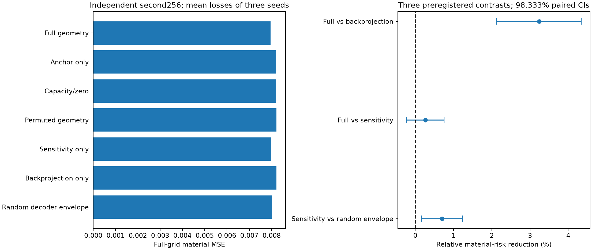
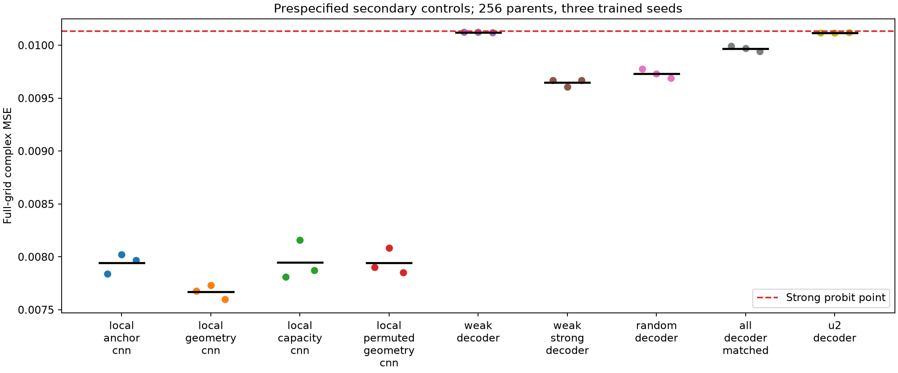

# P3L-R2：从失败的 Gaussian 平均到可泛化的材料风险估计

## 本轮回答了什么

这轮获得了明确的材料成像风险改善，也保留了完整后验和轨迹方法的失败。首批256个全新独立对象上，验证集冻结的5842参数局部物理上下文CNN，将强Probit点的全网格复材料MSE从 **0.010131196** 降到 **0.007571318**，下降 **25.27%**；两项预注册主比较校正后的97.5%区间为 **[22.34%, 27.99%]**。全部对象、39个变差对象和所有失败均进入分母。

这项正面结果属于 joint-simulation 监督材料风险；没有合格66维FULL posterior，也未证明学习图等于真实posterior mean。主学习图仅138/256通过原noise-ball，不能把它们称为256个新物理材料世界。冻结弧长轨迹平均风险增加约1.96%，没有获得预期增量。

## 从上一轮失败中改变了什么

原P3-L完成800个独立parent、128个当时全新的测试对象和约837万RHS，但11组FULL参考全部未合格，Gaussian平均MSE0.061502、Probit点0.011031；15次神经训练全部选择update0。这些是封账的具体算法失败，不能推出真实Bayes均值不如MAP或材料概率不可学习。

本轮把三个目标独立推进：A用真实材料MSE监督条件估计；B使用新的非Gaussian inference并保留概率资格；C实际执行非线性有限轨迹和风险策略。没有让B的失败关闭A/C，也没有将A的成功转写为B的概率正确性。

## 固定的物理与概率合同

沿用P1原64维相关Gaussian场＋2维uniform属性、C²饱和decoder、24×24二维标量TM/VIE、256-cell ROI、8 sources×32 complex receivers、原背景与acquisition。σ固定0.00119211798514519，实虚噪声各σ²/2；Φ=||F−y||²/σ²。prior与noise没有为制造成功而放宽。所有Full是这个离散二维模型，不是3D vector或真实测量认证。

原native目标为Φ+||z||²/2；probit将u=NormalCDF(η)，原prior恰推送为Gaussian66，但该坐标密度的mode与native MAP不同。我们称它“Probit坐标点”，不混淆参数化依赖的MAP。GT仅用于生成、TRAIN监督与闭合后的独立离线评分，未用于在线init、提案、排序、stopping或fallback。

新32,768train、2,048validation；只有512/128子集建立physics contexts，避免为所有训练材料支付96-step反演。原来暴露过的对象仅作开发诊断。第一批新256个对象比较主风险和轨迹；随后另以固定新256个对象确认通道机制。两批分别冻结、分别评分，不混作一次事前512个对象检验。

## 材料成像的主要实际结果

| 材料估计 | 全网格 complex MSE | complex MAE |
|---|---|---|
| 原先验材料均值 | 0.183006369 | 0.265802706 |
| native TRF 点（96-state cap） | 0.011599449 | 0.044030327 |
| 强 Probit 点（再64-state cap） | 0.010131196 | 0.040596178 |
| 普通额外16-state对照 | 0.010135124 | 0.040602874 |
| measurement-only 监督 MLP | 0.014252733 | 0.051304448 |
| 冻结的局部几何 CNN＋材料矩形投影 | 0.007571318 | 0.031025169 |

普通额外16-state物理优化没有降低材料风险，控制了简单多迭代解释。measurement-only网络有数据规模增益，但仍弱于强点；大物理CNN未必优于小局部卷积。低容量、空间共享和合适物理上下文，而非模型名字或更多参数，解释了最直接的工程差异。

217/256个对象的风险改善，39个对象变差。主模型在原材料矩形上的投影具有逐真值平方误差不增性质，但矩形大于decoder image。网络和轨迹材料平均都作为**风险动作**评价，不能当posterior samples、事件概率或合法新解。

## 几何究竟贡献多少：两批对照

首批三固定训练seed中，几何局部CNN的MSE均值0.00766939，仅基础图CNN为0.00794370，额外收益约3.45%；同参数零通道和固定空间置乱也不能解释这点增量。但大部分主改善已经出现在小型局部anchor CNN中，所以不能说全部25.27%来自弱空间。

进一步代数检查发现：固定frame V下的sensitivity map恰为 `|δ| h'(Az/τ)/τ · ||A_i V||`。当前材料只通过decoder导数进入；Maxwell只通过冻结的TRAIN平均谱形成固定空间包络。这一事实要求拆开sensitivity/backprojection，并用独立J的随机包络作强对照。

第二批21个模型、7家族、三seed，全部checkpoint和3项比较在新观测前冻结；训练仍只读旧512/128。结果如下，未按新测试换主模型：

| 第二批固定家族（三 seed 风险均值） | 全网格 MSE |
|---|---|
| 完整灵敏度＋回投影 | 0.007951131 |
| 仅基础图＋属性 | 0.008201364 |
| 同参数、附加通道置零 | 0.008203460 |
| 附加图固定空间置乱 | 0.008215816 |
| 仅训练谱灵敏度图 | 0.007971895 |
| 仅残差回投影图 | 0.008217417 |
| 仅随机谱 decoder 灵敏度图 | 0.008027756 |

| 第二批事前冻结的主比较 | 相对风险降低 | 98.333% 配对区间 | 实际裁决 |
|---|---|---|---|
| 完整灵敏度＋回投影 / 仅残差回投影图 | 3.24% | [2.13%, 4.34%] | CANDIDATE_LOWER_RISK |
| 完整灵敏度＋回投影 / 仅训练谱灵敏度图 | 0.26% | [-0.23%, 0.75%] | UNRESOLVED |
| 仅训练谱灵敏度图 / 仅随机谱 decoder 灵敏度图 | 0.70% | [0.17%, 1.24%] | CANDIDATE_LOWER_RISK |

完整灵敏度＋回投影 相对 仅残差回投影图在这批确认对象上风险较低。 完整灵敏度＋回投影 相对 仅训练谱灵敏度图的调整后区间跨零，独立增量没有建立。 仅训练谱灵敏度图 相对 仅随机谱 decoder 灵敏度图在这批确认对象上风险较低。

这个确认所能支持的，是具体输入通道与固定框架的有限样本风险作用；它不自动证明动态Maxwell几何、A17反馈或普遍采样定理。原P1训练先验之外的泛化仍缺证据。

## 风险改善发生在哪里

独立离线归因显示，基础点的过渡相单元贡献约99.10%的总风险改善；多数真实纯相在基础图中仍灰化。学习动作更接近纠正这类材料风险偏差，而不是发现一个已经认证的nullspace世界。

在材料RMS正交切空间分解下，约13.03%的修正能量在局部prior tangent之外，这部分贡献约5.83%的风险收益。大部分收益位于切空间投影；不能把全部改善解释为decoder外在曲率。这是评分后的探索性解释，不用于改变模型。

## 概率路线：独立推进，但不降低资格

新的三角Student完整MH4096次production提案全拒；逐源SMC确实到达全部8源，但终点ESS64/57仍只有1个先验祖先。动态Full-J metric MALA和冻结source-adjoint MALA在同102400RHS下都不合格，最大material Rhat约3.00/1.86。两个learned10＋prior56 exact-correction控制仍不能补齐高维conditional；MCSE0停滞函数保留为未评估。

低维参考也产生了具体新证据。原属性box的两个SLICE分区积分达到其细化停止标准，并与四链核对。真正field2非Gaussian SLICE从GH节点CDF改为同目标的prior-CDF整方框分区积分，切点CDF更稳定；但严格logZ差标准未通过，原UNQUALIFIED保留。条件Jensen gap约0.000749材料RMS，不能转写为FULL后验或解释全部成像收益。

固定10维联合模拟密度在首批新对象上NLL明显优于自身无条件prior；90%逐分量宏覆盖约89.02%/88.48%，后者仍有小幅欠覆盖。它们是投影坐标概率诊断，不是66维或材料可信区间校准。

## 几何与轨迹：可行移动不等于风险积分

动态曲率256条轨迹全部完成，2048个合法选中端点保留0.02/0.04实际RMS步长；1934个同时处于noise-ball且相对基础点ΔΦ≤2。确有任务尺度、prior-supported有限噪声材料运动，但这不是重要posterior mass或整条连续等数据路径证明。

主弧长动作风险却更差，调整区间不支持改善；次级凸组合和简单策略也未建立稳健收益。训练risk policy不需要MCMC teacher，我们已实际训练bandit及model-based规划并在线运行，失败没有归咎于概率reference门槛。

两个真实P1 anchor的rank4弱projector bracket诊断进一步显示normal leakage约0.93/0.82，两个差分尺度和反向回路一致到各自数值误差。它是当前动态弱分布非对合的局部数值证据，不能默认把它当单张流形；也不否定更高维finite-noise区域。48个states和1920RHS全计费。

GT−point离线弱能量随尺度显著变化：0.02/0.04/0.08平均58.19%/25.58%/0.23%。原单对象79.46%不是全体事实，更不是在线找到GT的成功证据。

## 完整费用、内存和复现

| 方向 | 新增 complex RHS | state attempts | 已结算受控 wall 秒 |
|---|---|---|---|
| A | 2109800 | 86961 | 6277.66 |
| B | 1334472 | 150169 | 1769.78 |
| C | 311800 | 7795 | 1981.66 |
| D | 147456 | 18432 | 210.34 |
| L | 2052800 | 59360 | 1390.60 |

以上是写报告时的资源快照，共5,956,328RHS；最终打包/分析结算及完整追加式ledger另见[资源报告](RESOURCE_SUMMARY.md)。总硬上限20,000,000RHS、24h受控CPU、24GPU-hours未扩张，GPU实际0，不使用付费外部服务。计入truth、forward、receiver adjoint、source gradient、失败、拒绝、line-search和训练；历史已付background/setup与cache复用有单独记录。

只运行一个物理worker，transfer cache最多4个，原始endpoint立即持久化。可重复材料网络重放已在一份新对象上实际得到0差、0RHS；它只证明保存上下文下的重放，不把完整物理生成或部署setup说成免费。原A30外部源码版本、环境、依赖和大数组恢复方式见[复现说明](REPRODUCE.md)。

## 最终判断与下一步

本轮是 **监督材料风险 GO，FULL posterior UNQUALIFIED，当前轨迹风险积分 NO-GO**。A17在dense TM24没有已建立独立成本优势，不强行整合；已有负结果继续有效。最值得继续的是低容量材料风险模型及其可解释的decoder/空间物理上下文，而非重复失败Gaussian补齐或盲目扩大网络/policy。

目前有真实风险结果、定向控制和P1几何现象，但强IEEE TAP贡献尚未成立。需要证明哪些Maxwell特化设计超越普通重建后处理、decoder几何和已有amortized方法，并验证独立采集/噪声/材料支持。不能把CNN、LIS、Frobenius或Schur恒等式本身当原创贡献。

三个具体新理论问题及必要原始证据已整理为[GPT Pro Handoff](GPT_PRO_HANDOFF/START_HERE.md)。它们围绕：材料风险方向与信息方向的差别；饱和decoder下非Gaussian强弱conditional耦合；不对合弱分布如何支持合法、有效且值得计算的探索/积分。下一步须据真实证据重新设计，不自动续烧本轮预算。

[完整固定图库](gallery.html) · [学习控制](LEARNED_MODEL_COMPARISON.md) · [概率报告](NON_GAUSSIAN_POSTERIOR_REPORT.md) · [几何报告](GEOMETRY_TRAJECTORY_RESULTS.md) · [冻结泛化](LOCKED_GENERALIZATION.md) · [失败与限制](FAILURE_ANALYSIS.md) · [数学及文献范围](THEORY_AND_METHODS.md)
