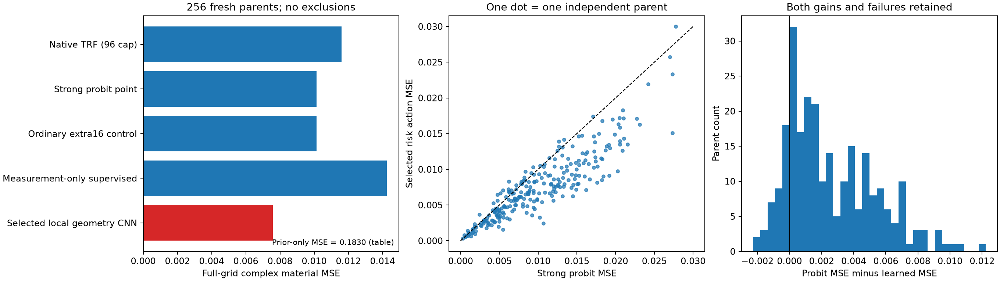

# P3L-R2：真实材料风险改善，完整后验仍未解决

本轮完成 32,768 个独立训练材料、2,048 个 validation 材料，以及两批分别冻结的 256 个全新测试材料。沿用原 P1 与真实 24×24 TM Maxwell，不训练新的三维模型，不把旧128测试对象冒称新盲测。

**首批主要结果：** 材料 MSE 从 **0.010131196** 降为 **0.007571318**，降低 **25.27%**；两项主比较调整后的 **97.5% 区间 [22.34%, 27.99%]**。217/256对象改善，39个变差，全部保留。普通额外16-state优化没有解释该收益。

这是一项**监督材料风险**结果，不是已认证 posterior mean。学习图仅138/256通过原noise-ball，不能作为256个新物理世界；66维 FULL posterior 仍 UNQUALIFIED。弧长轨迹平均未改善材料风险。

[完整中文报告](report.html) · [固定对象图库](gallery.html) · [原始 Markdown 报告](RESEARCH_REPORT_ZH.md) · [裁决](GO_NO_GO.md)

第二批独立机制确认采用21模型、7家族、3个训练seed，另有3项预注册主比较。完整灵敏度＋回投影 相对 仅残差回投影图在这批确认对象上风险较低。 完整灵敏度＋回投影 相对 仅训练谱灵敏度图的调整后区间跨零，独立增量没有建立。 仅训练谱灵敏度图 相对 仅随机谱 decoder 灵敏度图在这批确认对象上风险较低。

[监督风险](SUPERVISED_RISK_RESULTS.md) · [网络与消融](LEARNED_MODEL_COMPARISON.md) · [非Gaussian推断](NON_GAUSSIAN_POSTERIOR_REPORT.md) · [几何轨迹](GEOMETRY_TRAJECTORY_RESULTS.md) · [两批泛化合同](LOCKED_GENERALIZATION.md) · [数学定义](THEORY_AND_METHODS.md) · [独立审查](AUDIT/locked_statistics/FINAL_REVIEW.md) · [失败](FAILURE_ANALYSIS.md)

[GPT Pro 独立研究交接](GPT_PRO_HANDOFF/START_HERE.md) · [可复现入口](REPRODUCE.md) · [环境](ENVIRONMENT.json) · [费用](RESOURCE_SUMMARY.md) · [完整证据 Release](https://github.com/migodam/b1-probabilistic-maxwell-imaging/releases/tag/p3lr2-risk-posterior-20261023)

源码、表图与说明在原B1仓库；较大端点、链、检查点和完整费用账本在证据Release。本轮科学资格与公开可访问状态分别记录。
