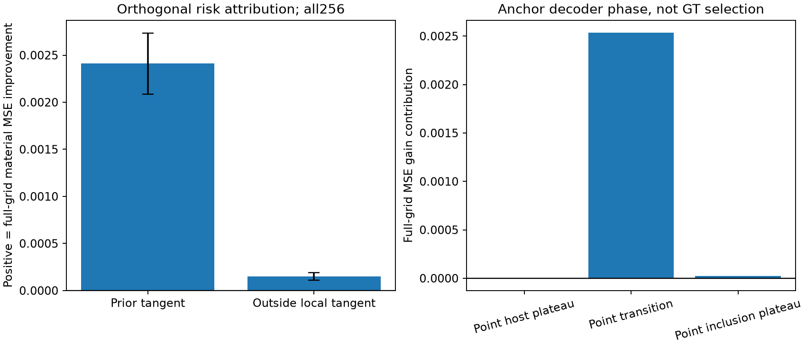

# 直接材料风险学习的实际结果

本轮没有等待MCMC teacher。独立原先验材料与原Maxwell noisy observation形成联合模拟数据，实际复数材料MSE直接监督风险估计器。3种数据规模4096/16384/32768、多个网络容量和三个训练seed均实际运行；模型选择只使用既有validation，不能按测试对象换checkpoint。

measurement-only MLP随独立parent增加而改善，但首批新对象上仍弱于物理点估计：MSE为0.014252733。大网络不自动有优势；仅512train物理上下文的小型共享局部CNN才取得主要风险改善。训练上下文是native48+probit48，测试强上下文native96+probit64；这个budget/covariate shift明确保留。

| 材料估计 | 全网格 complex MSE | complex MAE |
|---|---|---|
| 原先验材料均值 | 0.183006369 | 0.265802706 |
| native TRF 点（96-state cap） | 0.011599449 | 0.044030327 |
| 强 Probit 点（再64-state cap） | 0.010131196 | 0.040596178 |
| 普通额外16-state对照 | 0.010135124 | 0.040602874 |
| measurement-only 监督 MLP | 0.014252733 | 0.051304448 |
| 冻结的局部几何 CNN＋材料矩形投影 | 0.007571318 | 0.031025169 |

主模型5842参数，由验证集冻结seed33及材料矩形投影；alpha=1，实质就是选定CNN风险动作，不是测试后再融合。MSE下降25.27%、97.5%区间[22.34%, 27.99%]。全网格MAE也从0.040596178降到0.031025169。训练和研究费用不为免费；线上各方法共享同一实付物理重建，网络本身不新增Maxwell求解。

217人改善、39个对象变差。总体风险成功不保证每个人正确，也不保证任意新prior/噪声/采集几何泛化。第一个256-parent主结果不因第二批某个控制更好而重选。

## 风险收益不是后验资格

平方损失下 E[χ|y] 的最优性是数学事实；有限网络在新对象上风险较低，只支持一个较好的条件材料估计器，不能证明它已经等于该条件均值，更不能赋予候选概率。矩形投影包含所有原P1真值，逐材料平方误差不增加；它并不保证输出在单个decoder image中。

| 风险动作（真实 Full forward 检查） | Φ 中位数 | noise-ball 内数量 |
|---|---|---|
| classical_postprocess | 240.210 | 256/256 |
| fused | 279.634 | 138/256 |
| dynamic_curvature__arc_length_trapezoid | 240.492 | 251/256 |
| projected_direct | 703.962 | 0/256 |

上述是风险图本身的Full prediction，不是posterior predictive分布。强物理点全部位于noise-ball，学习风险图只有138/256位于其中。因此需要物理候选时应继续保留基础点；不能把学习图标为新增合法材料解。

## 后验评分后的机制归因（探索性）

在GT材料相分层，误差下降来自宿主、过渡和纯夹杂三个区域，均按parent重采样，未把像素当独立对象。按基础点的decoder相分层，99.10%的总MSE收益来自基础点仍处于过渡带的单元。它更符合修正基础成像的灰化/风险偏差，不是已经证明的饱和nullspace探索。

学习修正的13.03%能量在基础点先验线性切空间之外，但该部分只贡献5.83%的风险改善；大部分收益在切空间投影分量中。不能用“所有收益都来自曲率”解释本实验。此归因未改变任何在线方法。

