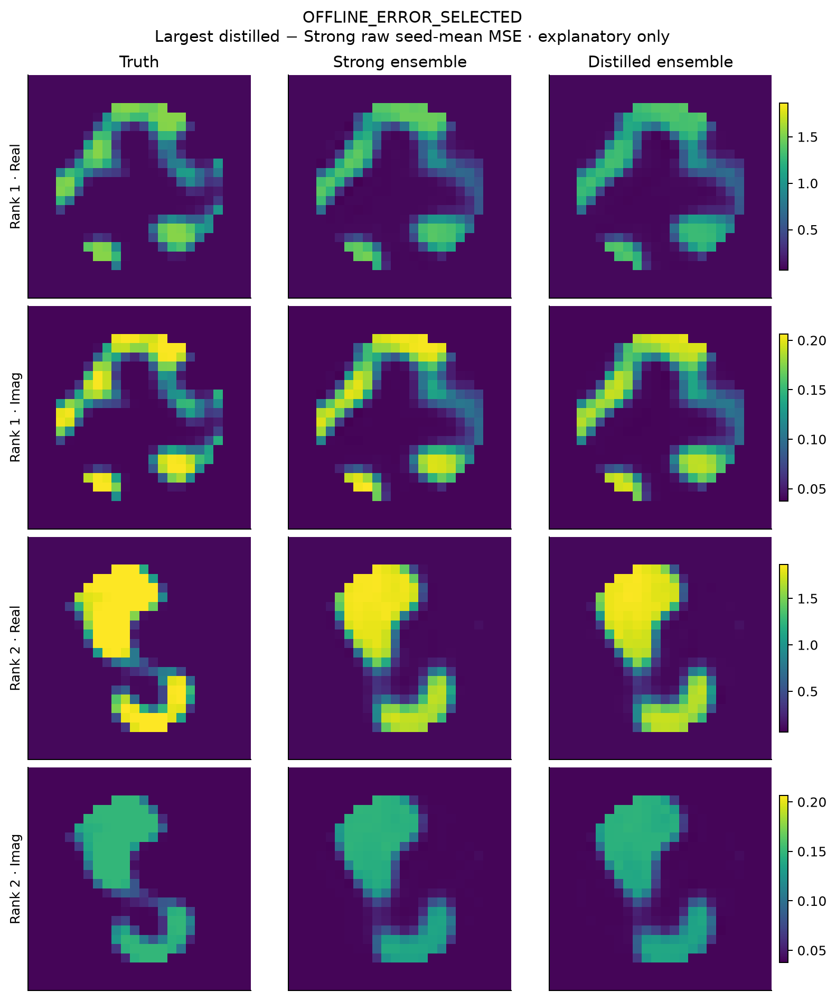

# 失败、未确认和范围限制

1. **80%保留率统计门未通过。** pooled点估计80.70%仅稍过门；单侧contrast下界为负；A批低于80%，clipped总体为78.61%。保留原VAL92.96%的开发事实，但不能再将其当独立泛化估计。新结果并不证明真实保留率低于80%，只表示不足以确认。
2. **蒸馏与K32等价性未建立。** 点MSE略高、差异区间跨零；缺乏显著差异不是非劣性或等价证书。相对Strong的改善有支持，故也不应把整个蒸馏模型称为无效。
3. **全系统加速不明显。** provider节省约98%是真，但平均1.73秒锚点主导，batch64全系统推导节省仅0.0117%。离线teacher与学生训练不能忽略，CPU/GPU秒不能直接合价。
4. **确定性更准确不等于更快。** canonical Q64完整学习链约为K32的2.46倍；网络部分较慢，端到端额外约0.037%。原Q16图不能冒用为Q64成本。
5. **数值/优化限制保留。** 原CPU/MPS门仍FAIL；338/512 Probit报告scipy success，174保留有限最佳点，未删除或看GT重启。无全局优化、posterior或所有anchor驻点资格主张。
6. **具体机制未完全归因。** 共同P1统计合同与历史一致，但有限样本波动、开发选择乐观和student/head分歧仍可能影响VAL到TEST差异。本轮没有证据证明分布改变或唯一归因teacher失配。旧VAL已选择过；禁止回头改模型再称独立。
7. **Maxwell专属增量未建立。** 过渡相占比大且风险原本集中，不能把区域改善当作传播信息不可替代性；上一轮RRR控制负结果继续保留。

实际数值求解接口失败0，未隐藏failed proposal或fallback成本。事后最差图是解释性GT选例，明确标注OFFLINE_ERROR_SELECTED，不能充当在线选图或新方法。微小fontcache警告后使用临时缓存正常渲染，未影响统计。

