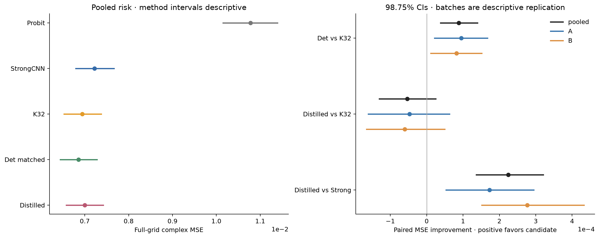
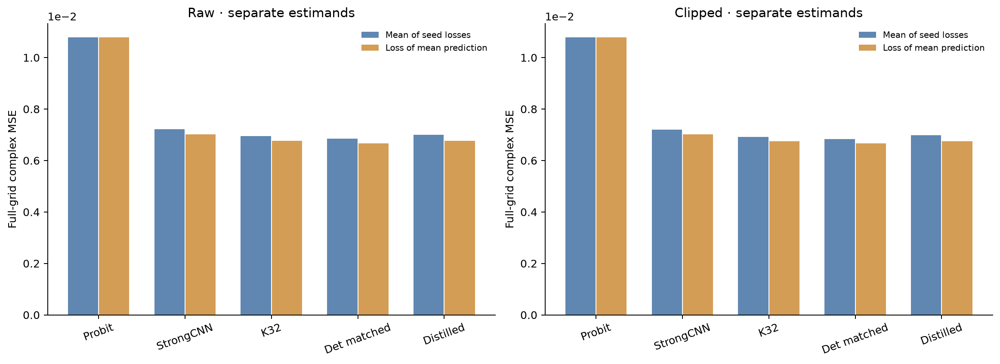

# 材料风险：泛化收益与门槛分别判断

|冻结方法|Raw MSE|Complex MAE|ROI MSE|三seed图像ensemble MSE（次要）|
|---|---:|---:|---:|---:|
|Physics Probit|0.010781033|0.043393155|0.024257325|0.010781033|
|R4 Strong CNN|0.007221538|0.030979507|0.016248460|0.007017586|
|原 Gaussian K32|0.006943309|0.029950755|0.015622444|0.006758229|
|确定性 Q64 + matched head|0.006854734|0.029695298|0.015423151|0.006674041|
|214k 蒸馏 W128|0.006997018|0.030205546|0.015743291|0.006760994|

原K32相对Strong CNN的MSE改善 3.853%；确定性匹配方案 5.079%；蒸馏器 3.109%。相对同原R4配置的Probit点，deterministic与distilled分别降低 36.42%、35.10%。该点中338/512报告成功，其余按原规则保留有限最佳点，不能称全部优化充分。这些是新对象上的监督材料风险，不是后验正确性的资格。

确定性 matched 比K32低 1.276%，配对校正区间支持正改善。额外冻结头控制 det_frozen 的MSE为 0.006857774，保持原head仅换输入已解释观察总改善的 96.57%；matched-head额外差为 3.03985968e-06。该分解为描述，不能给不同训练seed/head制度的差异赋予单因素因果结论。K32方差为ddof0、确定性为population variance，故输入变化包含MC噪声及31/32方差尺度差，不是仅一项“积分精确性”。

三seedensemble的蒸馏MSE约与K32ensemble接近，但主门固定为seed平均loss。它们不是可互换的口径；不能用ensemble二次宣布80%主门通过。预测不是prior合法单一世界，passive-clipped也不等于原P1 decoder支持。未对每份学习图额外求Maxwell，不给它们赋noise-ball或posterior标签。

