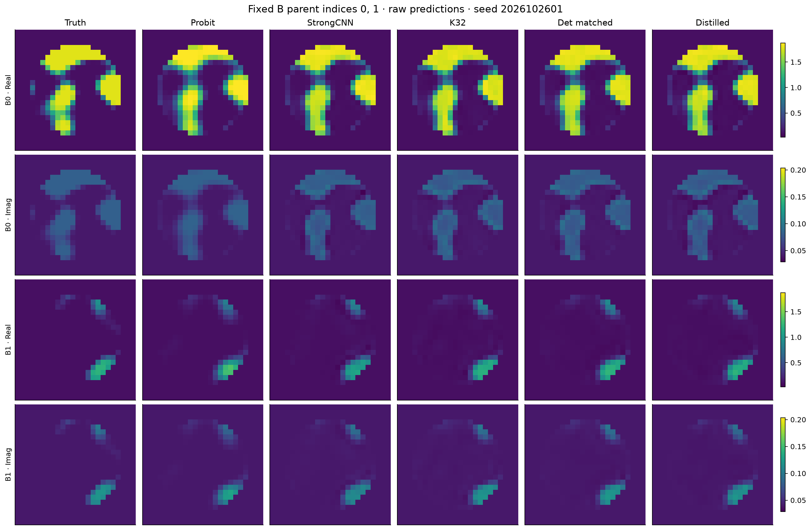

# TEST-B：256个全新独立对象

本批原先只冻结seed、未生成GT或观测；本次实际运行原P1 Full Maxwell，并完成完整Native96+Probit64。使用与另一批完全相同的冻结模型和配置，所有预测封存后才评分。没有删除异常对象、修改checkpoint或重训。

|冻结动作|Full-grid complex MSE|
|---|---:|
|Physics Probit|0.010504463|
|R4 Strong CNN|0.007031056|
|原 Gaussian K32|0.006694334|
|确定性 Q64 + matched head|0.006612293|
|214k 蒸馏 W128|0.006754587|

增量保留率为 **82.1061%**；98.75%配对bootstrap区间为 [59.28%, 124.97%]。80%线性contrast为 7.0917985e-06，单侧98.75%下界为 -6.8229964e-05，不能确认达到80%。

这是预冻结的独立复验描述。pooled512的四比较family是主要推断范围；不能从两批中挑显著者作为额外主结论。确定性方案相对K32、蒸馏器相对Strong的方向与另一批一致。蒸馏器相对K32点风险略高，不将“差异未显著”解释为等价证明。

逐parent、逐seed的MSE/MAE、ROI风险、被动裁剪、图像ensemble与fallback在证据包 `raw/offline_scores/PARENT_METRICS.csv/.npz`；正式预测在 `raw/predictions/B/`。实际图采用事先固定的parent0/1、seed2026102601，非GT选优。

