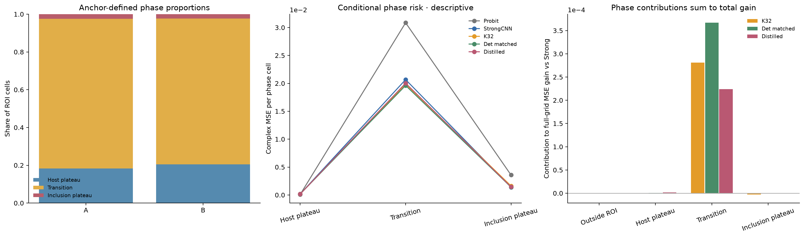

# Anchor相区误差机制

相区完全由原physics anchor场值/halfwidth在ROI内按≤−1、(−1,1)、≥1划分，没有用GT材料给在线算法分类。

|Anchor相区|ROI占比|Strong每单元MSE|K32|Det matched|Distilled|
|---|---:|---:|---:|---:|---:|
|host_plateau|19.331%|0.00017453|0.00017437|0.00017015|0.00015622|
|transition|78.280%|0.02067178|0.01986443|0.01961749|0.02002864|
|inclusion_plateau|2.390%|0.00137591|0.00162740|0.00141097|0.00145209|

过渡相占ROI **78.28%**，不是薄薄一圈边界。Strong基准几乎全部风险已位于过渡相；因此大部分改善集中于它，不足以证明特殊Maxwell传播机制。Strong→distilled增量的 **99.66%**、K32→deterministic增量的 **97.00%** 来自该区。百分比可受其他区负改善抵消，不能当像素成功率。

每单元风险和总贡献不同：前者除该相区实际单元数，后者除576并按parent平均。空相区有显式valid mask，不按零误差混入。纯inclusion仅约2.39%，其中属性估计与anchor相区误分类耦合，未把该组均值当真实posterior材料属性。

