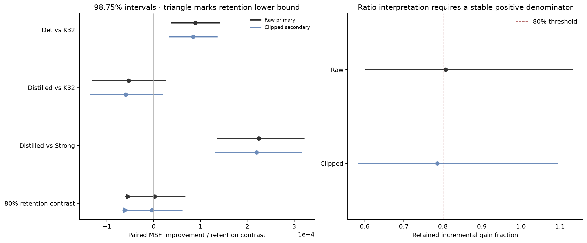

# 512-parent 预冻结配对统计

统计单位是512个独立parent，不是1536个seed/parent组合。主动作先对三个冻结seed的对象级loss取平均；ensemble图像平均的风险另列。两批各256、pooled按批分层重采样，20,000次，共用分子分母和全部方法的parent抽样。四比较Bonferroni family-wise alpha=.05，双侧区间98.75%，retention单侧下界98.75%。脚本、RNG和loss数组完整提供。

|冻结动作|Full-grid complex MSE|
|---|---:|
|Physics Probit|0.010781033|
|R4 Strong CNN|0.007221538|
|原 Gaussian K32|0.006943309|
|确定性 Q64 + matched head|0.006854734|
|214k 蒸馏 W128|0.006997018|

|主比较（正值有利于候选）|配对MSE差|调整后98.75%双侧区间|
|---|---:|---|
|K32 − deterministic|8.8574943e-05|[3.8239399e-05, 0.0001400331]|
|K32 − distilled|-5.3709521e-05|[-0.00013012192, 2.4819405e-05]|
|Strong − distilled|0.00022451978|[0.00013646141, 0.0003207804]|
|(Strong−distilled) − .8(Strong−K32)|1.936339e-06|[-6.0461092e-05, 6.6370271e-05]|

K32新增改善分母为 0.000278229298，调整区间排除零，20,000次pooled抽样中非正分母为0，故比率可解释。保留率 **80.69595%**，双侧98.75%区间 **[60.283%, 113.125%]**，单侧下界 62.301%。正式门以线性contrast为准：下界 -5.43035633e-05<0，**HOLD**。

点估计略高80%，不等于统计证明≥80%。A为78.535%，B为82.106%，80%contrast在两批符号相反。总体比率按合并风险差计算，不是简单平均两个批次的百分比。蒸馏相对Strong的调整区间为正；det相对K32也为正；蒸馏相对K32区间跨零，既没有证明更优，也没有证明与K32等价。

被动裁剪为预声明次要敏感性：retention点估计 78.614%，低于80%，同样不支持该门。不能改用ensemble或只报raw点估计救结论。所有区间为有限parent的bootstrap推断，不是精确有限样本概率保证，也不包含无限训练seed的不确定性。

