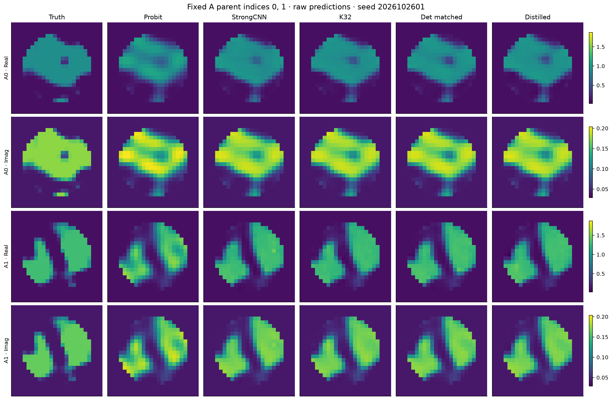

# R5-B 独立确认：真实风险收益成立，80%保留率尚未确认

**512 个全新 Maxwell 对象、冻结模型、原 Native96 / Probit64、完整预测封存后评分，已全部完成。214272 参数蒸馏器相对 Strong CNN 的 MSE 降低 3.11%，有配对统计支持；但增量保留率仅为 80.70%，调整后的区间为 [60.28%, 113.12%]，不能统计确认至少80%。**

|冻结动作|Full-grid complex MSE|
|---|---:|
|Physics Probit|0.010781033|
|R4 Strong CNN|0.007221538|
|原 Gaussian K32|0.006943309|
|确定性 Q64 + matched head|0.006854734|
|214k 蒸馏 W128|0.006997018|

确定性 Q64 + matched head 比 K32 的 MSE 进一步低 1.28%，四比较校正后区间排除零。两批均同向。蒸馏器的 batch64 provider 费用降低97.97%，完整学习链降低46.32%；包含平均1.7303秒物理锚点时，推导的全系统节省仅0.0117%，不能称整个 Maxwell 系统快约49倍。

[完整中文报告](RESEARCH_REPORT_ZH.md) · [A批](NEW_TEST_A_RESULTS.md) · [B批](NEW_TEST_B_RESULTS.md) · [512配对统计](POOLED_512_STATISTICS.md) · [风险比较](MATERIAL_RISK_COMPARISON.md) · [完整成本](ONLINE_AND_END_TO_END_COST.md) · [裁决](GO_NO_GO.md) · [Pro交接](GPT_PRO_HANDOFF/START_HERE.md)

实际物理费用 **1,999,504 / 3,300,000 RHS**，56,734 次状态/LU，未新增训练。原 R4/R5、旧验证集结果和原 CPU/MPS FAIL 不改写。新图是监督材料风险动作，不是 posterior 样本；本轮没有 FULL posterior、校准概率或新 Maxwell 专属机制的成功声明。
