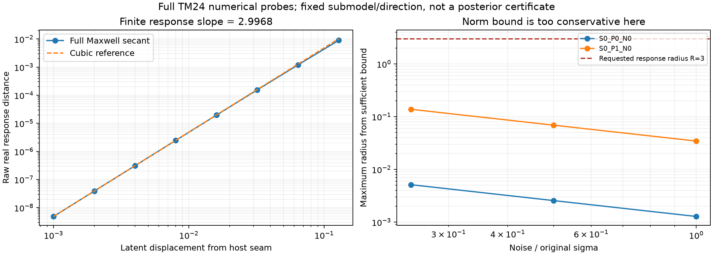

# Research P3L-R5：响应概率坐标与材料风险压缩

本轮 A/B 已并行完成真实实验和有限修订。**A：正则区域的数值材料矩明显更准确，但完整覆盖、分支资格和成本优势未建立，裁决 REDIRECT。B：材料统计压缩通过开发门，裁决 CONDITIONAL GO；没有新的独立测试确认。Maxwell 专属风险增量及强 IEEE TAP 核心贡献均未建立。**

最重要的结果有四项：

1. 真实 TM24 的一个预定子模型存在正先验体积的宿主平台。固定正秩响应图会漏掉它，不能把求逆失败当作可忽略概率。
2. 正则属性—几何耦合案例在 sigma/4 时，响应积分材料均值与独立原坐标积分相差 **0.000339 posterior SD**；GN/Laplace 约 **0.1075 SD**。这是局部数值矩的进步，尚非全局后验或成本成功。
3. 仅由测量驱动的 **214,272 参数**压缩器，在已有 VAL256 上保留 Gaussian fusion 相对强 CNN 新增风险收益的 **92.96%**。在CPU单线程、batch64、每parent口径下，其额外 provider 推断成本为优化 K32 的 **2.54%**；完整 provider、特征整理和 head 成本为 **54.57%**。共同物理反演成本没有消失。
4. 同配置新 256+256 对象确认受硬预算限制，**NOT_RUN**。没有用旧测试数据或一步廉价锚点替代它。

[A完整结果](stage_a_response_coordinates/RESEARCH_REPORT_ZH.md) · [B完整结果](stage_b_material_risk/REPORT_ZH.md) · [科研裁决](GO_NO_GO.md) · [冻结协议](FROZEN_PROTOCOL.md) · [复现](REPRODUCE.md) · [下一轮Pro交接](GPT_PRO_HANDOFF/START_HERE.md)

## 1. 为什么本轮分成两条路线

R4 已表明：一个完整生成模型可以改善 latent NLL，却仍严重错配原噪声尺度的 Maxwell 响应；同一个不合格概率模型的粗糙全局材料统计，又能帮助局部 CNN 降低材料误差。它们分别是概率计算与监督风险表示问题，不能互相替代。

A 检查真实响应换元能否明确处理窄厚度、概率体积和分支。B 检查有用的全局统计是否必须由大 provider 和 K32 Monte Carlo 产生。B 没有等待 A 的后验资格，A 也没有因 B 得到风险收益而停止。

正式输入为用户提供的 R5 ZIP，包含完整中文报告、推导、独立任务书及 R4 紧凑阅读包。后者不是训练大数据或模型权重。本轮实际恢复了本地 joint TRAIN32768/VAL2048、强 context TRAIN1024/VAL256 和冻结模型。科学起点固定为 R4 提交 `85b7bcbf39f0eeab7062ecce17531538151082bf`，后续交付清理版本差异另列于资产审计。没有修改历史预算或负结果。

## 2. 未改变的统计和物理对象

原 P1 Gaussianized latent 为 X~N(0,I66)，前64维生成相关场，后2维通过标准正态CDF生成有界均匀属性。材料使用原 C² quintic saturation，后验相对于原 latent 测度定义。

Full forward 仍为24×24 scalar TM/VIE，256 ROI cells、8源、每源32复接收器，sigma=0.00119211798514519。每源依次32实部、32虚部打包，实白化系数 sqrt(2)/sigma，Phi=||F-y||²/sigma²。没有 Born 替代、噪声放宽、额外材料 Gram prior 或 noise-ball 后验硬截断。

共享接口实际核验了 forward、材料链式导数、两方向JVP、receiver-J及adjoint。有限差分相对误差 **3.90e-10**，两种J相对差 **1.14e-15**，梯度相对差 **2.69e-16**。这80 RHS已计入A，而非免费物理。

A 是三个新定义的二维截断Gaussian子模型，其他64维固定为公开零值；**不是66维边缘 posterior**。B 是监督材料风险动作；Gaussian law下矩积分正确，不表示该 law 已等于真实后验。

## 3. A：实际做了什么

冻结子空间为 (0,1)、(0,64)、(12,27)，活动先验为标准Gaussian条件于 [-4,4]²。每组两个独立 parent，三档噪声 sigma、sigma/2、sigma/4，共18份观测。三档共享标准 innovation，并分别生成对应含噪数据。统计独立单位只有6个parent。

先通过19组解析扫描的7项检查及3项积分测试，再实际运行原坐标数值积分、rank1响应积分、部分rank2响应图、GN/LIS、observed-Hessian Laplace及局部QR-RTO。真实响应目标保留原prior、未投影残差、determinant、sigma^rank和区域权重。

解析体积反例中，sigma=.125时 profile 弱边缘 TV为0.213906，删determinant为0.216927；单分支 x² 例漏掉一半质量。它们是代数/数值单元，不是新的Maxwell结果。

### 3.1 初版为何失败，怎样修订

v1 的冻结斜率逆映射漏掉大量节点，9/15/21阶原坐标求积在部分案例也未收敛。其identity混合权重没有自动补回失败图的概率，不能将结果重新归一化后称完整后验。

v2 改为有界求根和条件区间，随后发现实际decoder秩变化。v3 显式分离宿主、转变与纯夹杂区域，保留解析区域体积和层内潜变量方差。旧失败、代码、partial与费用均保留。独立审查还修复了缓存J视图被原地归一化的问题；受影响的旧协方差结果没有被提升为主证据。

### 3.2 一个实际的混合秩障碍

在 (x0,x64) 子模型中，ROI场为0.65*x0，半宽为0.5：

|区域|材料变化|材料映射秩|
|---|---|---:|
|x0<=-10/13|始终为host，属性也不可见|0|
|-10/13<x0<10/13|相分数与属性共同变化|2|
|x0>=10/13|相分数固定为1，仅属性变化|1|

上下平台各有 **0.22086048** 的先验质量。宿主分支的未归一化权重可精确写为该质量乘 exp(-Phi_host)，但还须与其余区域证据共同归一化。

直接分层求积估计，宿主parent的后验host质量随三档噪声约为0.92652、0.94128、0.95314；前两档材料均值收敛仍未过1% SD门，所以不称严格分支概率参考。

父线程另做真实Maxwell接缝测试：latent接缝导数为0，而物理材料方向的响应作用范数约1.777；有限响应对步长的log-log斜率为 **2.996758**。这与 H(-1+e)=1.25e³+O(e⁴) 一致，支持这一案例的主要退化来自decoder接缝。它不是新增Maxwell零空间，也不证明GT沿局部路径可达。[推导与范围](audit/MIXED_RANK_DECODER_DERIVATION.md)

### 3.3 正则区域确实有精度收益，但不能扩大主张

|实际案例，sigma/4|原坐标材料均值阶数变化/SD|响应与原坐标均值差/SD|Gaussian基线|
|---|---:|---:|---|
|属性—几何耦合parent P1|5.34e-7|3.39e-4|GN/Laplace均值误差约0.1075 SD，TV约0.0595|
|高阶场parent P0|7.00e-8|1.59e-6|高阶场正常案例的GN/Laplace已经很强，最末案例TV约0.0043|

前者说明正确非Gaussian积分可修复单Gaussian的材料矩误差；后者说明不能预设响应方法处处需要复杂化。rank2图没有弱变量，不能拿它替代弱边缘体积实验。

QR-RTO实际执行了求逆和付费determinant：正则coupled三档各8/8成功，高阶场各4/4，host为0/8。全局分支和成功集归一化未建立，因此只称局部数值RTO尝试。普通Spline、manifold lifting、Full-66及大规模SBC/Gamma均 **NOT_RUN**。

### 3.4 理论界是否能指导计算

另对两个观测驱动中心，付费取得完整逆动作并评估decoder全局导数界与Neumann稳定半径。固定强方向上的充分半径约为5.34e-5和2.81e-4；六个“响应半径R=3”的充分条件全部失败，噪声半径比约21.77–2344.73。这里的界太保守，不能解释成逆映射不存在。

这是固定强方向线段上的精确算术公式的float64评估；矩阵范数没有定向舍入包络，中心也不保证选中残差为零，不是全二维域或连续PDE证书。有限采样的权重范围没有被冒充全域Delta。

**A裁决：REDIRECT。** 数值材料矩的局部证据成立；全局覆盖、branch资格、TV证书、同精度20%成本优势未建立。不继续Full-66扩大。

## 4. B：从确定性矩到真正的provider压缩

本轮完整恢复原Gaussian law到原x坐标，核验场—属性covariance为零后才采用独立特例。另实现相关Gaussian的一维外积分、属性CDF二阶矩、实虚交叉矩、稳定尾部和退化方差。对独立高精度积分误差小于4e-15，百万MC检查的均值偏差小于1.54个标准误。

原K32方差为ddof=0，期望是population variance的31/32；确定性矩采用population variance。冻结head替换和匹配重训分别保留，不宣称去随机性必然改善任何非线性head。

### 4.1 已暴露VAL256，三个seed的parent平均loss

|方法|全网格complex MSE|
|---|---:|
|冻结R4 Strong CNN|0.00746135|
|原Gaussian K32+冻结融合head|0.00714550|
|确定性矩+原冻结head|0.00704106|
|确定性矩+匹配重训head|0.00703415|
|120192参数直接GT矩provider+匹配head|0.00732359|
|蒸馏width64，4096 teacher对象|0.00732090|
|蒸馏width64，32768 teacher对象|0.00724784|
|蒸馏width128，32768 teacher对象|**0.00716774**|

主值是raw风险，clipped值与ensemble另列。新风险估计并未超过原K32的绝对风险；它保留了Strong CNN到K32增量的 **92.9591%**。被动clip口径的保留率为91.72%，方向相同，未混用分子分母。

该保留率的98.333%探索性parent配对bootstrap区间为 **[71.60%,135.63%]**，下端未超过80%。因此只是开发集点估计通过，尚不能统计确认保留率至少80%；VAL已经用于模型选择，该区间更不能替代新对象确认。

确定性矩仍保留682943参数encoder，只删除采样。真正的在线压缩来自新训练的raw-y统计蒸馏器：214272参数，两层128-unit隐藏层，输出4个ROI统计通道，再进入匹配局部head。teacher是原Gaussian的确定性统计，joint TRAIN只读y和parent，不读取GT作蒸馏标签；risk head仍使用合法TRAIN材料监督。

这并不提供一个新posterior density，也不要求蒸馏输出对应同一个合法Gaussian。它是功能表示。三个objective/data/capacity修订保留：直接GT矩不足，4096 teacher不足，32768+width64保留约67.6%，最后width128保留约93%；之后停止容量搜索。

### 4.2 同预算物理特征没有独立胜出

实际运行raw-y、decoder-only、physical-residual和同谱随机四类RRR控制，rank=2/4/8/16，ridge=.001/.01/.1/1。随后完成18个baseline CNN的嵌套二折训练，独立审查训练/留出名单无监督重叠。四类纠正均未改善数据外风险，没有约2%的Maxwell专属增量。

RRR是已知工具。有限样本训练谱、GT残差能量、或者静态信息谱，均不能单独证明这些误差可由观测预测。负结果限于本轮冻结特征与线性类，不否定所有非线性物理context。

### 4.3 额外provider成本与整个系统成本分开

采用规范化的最终30次CPU单线程实测，batch64，单位为每parent微秒：

|路径|provider本身|provider+特征整理+head|
|---|---:|---:|
|优化过的原K32|332.26|640.91|
|确定性Q16|664.45|992.64|
|蒸馏width128|8.45|349.73|

确定性积分本身在这个batch制度下更慢；“解析”不是速度保证。蒸馏器的额外provider比值为 **0.02545**，完整附加链比值为 **0.54567**。单parent也通过额外provider的1/3门，原始计时与分位数保留，未挑选有利receipt。

没有把原API重复encoder计算留给基线；优化K32缓存每parent/batch参数，保留原随机流和Gaussian law。四通道重放最大差1.01e-6，低于事先2e-6容差。共同物理anchor、旧数据生成、离线teacher和新训练都另列；不能将97.5%的provider节省称为整个Maxwell系统节省。

### 4.4 主要收益仍集中在过渡相

VAL ROI的anchor相区约为host19.34%、transition78.25%、inclusion2.41%。transition每单元MSE从Strong CNN的0.021364，降至K32的0.020443、确定性匹配的0.020127、蒸馏器的0.020513。它并不是仅占一圈的薄边缘；占比、基准风险和单位单元收益必须一起解释。

这些结果支持低容量的全局统计与局部估计互补，尚不能将收益归因于Maxwell特有传播几何。材料风险图也没有被重新命名为合法单一世界或Bayes posterior mean。

## 5. 独立验证和执行缺口

B原同配置512个确认锚点历史上实际消耗约1,934,840 RHS；本轮确认硬上限为32768。两批256仅准备了种子清单，未生成新truth或观测。没有降级原native96+probit64反演，也没有把旧R4两批测试重新称盲测。VAL已经用于容量/数据和rank选择，因此其区间只能作开发性证据。

两个finalists及三seed checkpoint已冻结：确定性匹配方案、214272参数蒸馏方案。进一步确认需要新的独立预算，详见交接。

原CPU推理入口对MPS保存图的3e-6逐像素容差有3项失败，最大3.945e-6；平均风险差至多9.31e-10。原FAIL保留，未事后放宽容差。它不改变本轮8位风险表的方向，但不能把所有推理重放写成PASS。

## 6. 全部费用和失败

|项目|实际新增|硬上限|
|---|---:|---:|
|A材料状态预留attempts|32705|32768|
|A forward RHS|261632|262144|
|A derivative/adjoint RHS|30152|40960|
|A总RHS|291784|303104|
|A受控物理wall|374.924秒|24小时|
|B新增物理|0 RHS|确认32768 RHS|
|B训练fit MPS时间|460.0秒|24 GPU小时|
|B保守整作业GPU预留wall|506.3秒|24 GPU小时|

A含资格核验、初版失败、父线程逆范数与接缝probe，不回退已预留失败额度。一次状态在RHS前中断，故attempts×8比实际forward RHS多8；两个失败/中断保留，未完成动作0。

B实际包含42个网络fit和24个最终选定RRR模型（另含网格与OOF重复拟合），包括objective/data/capacity与嵌套fold修订。初次高K诊断达到5.77GB、超内部3GiB限额，已保留失败并改为4096分块，修复后peak1.50GB；此后观察到训练峰值低于3GiB。另有宽方差recurrence与高相关CDF的数值失败及修复。没有CPU/MPS合并内存上界的严格证明。

原始场和逐点数组只保存本轮需要的精度与内容，采用无损压缩和有限live LU。没有为每个endpoint持久化大LU。历史数据不重计为本轮新增，也不被声称为从零部署免费。[资源账本](RESOURCE_LEDGER.json)及各阶段完整账本为费用依据，打包/上传另记。

## 7. 对研究问题的裁决

|问题|本轮回答|
|---|---|
|响应坐标能否正确表达真实概率体积？|公式与解析单元成立；真实正常区有数值矩一致性，混合秩域仍需明确分层|
|低噪声是否自动更稳？|正则例改善，但全域rank变化与覆盖不随小噪声自动消失|
|可否超过成熟RTO/Laplace/LIS？|有材料矩精度差，未建立同可信概率精度和完整成本优势|
|确定性矩能否替代K32？|功能和重训有验证收益；直接积分不保证更快|
|可否删除0.68M在线provider？|开发集上可以用214272参数功能蒸馏器替代，约93%增量保留；独立确认待做|
|风险残差谱能否预测数据外增益？|本轮线性控制未成功，嵌套OOF后仍无增益|
|Maxwell专属信息增量成立吗？|没有；现有正结果更像全局功能表示压缩|
|A/B应融合吗？|不融合。概率分支未合格，风险结果不能补它的资格|
|强IEEE TAP论文是否已具备？|尚不具备。缺独立确认及不可被成熟概率方法/普通全局统计替代的Maxwell机制|

下一步最有价值的两件事不同：B先固定现有finalists完成同配置独立确认，停止无边界架构扩张；A研究饱和层的混合秩参考和可计算覆盖，或转向更合适的RTO/分层积分。不启动Full-66大训练，也不为论文需要强行整合A17、Flow或几何模块。
