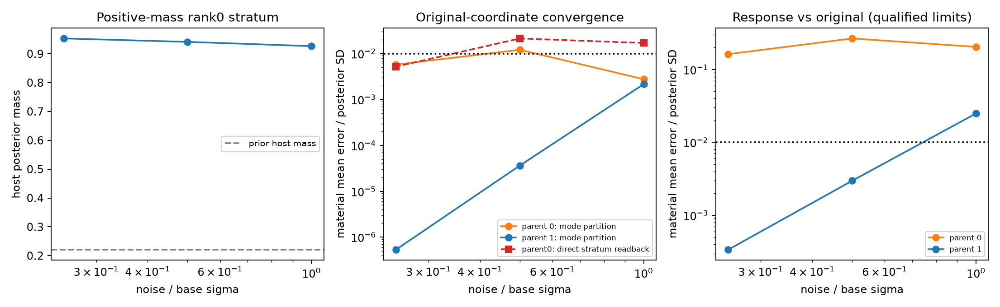
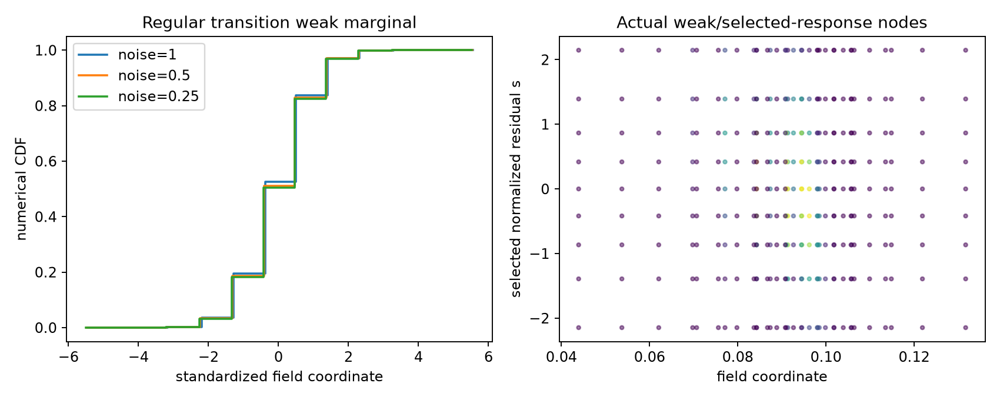

# A：响应图实际结果

完成3个冻结二维模型、6个parent、18观测。所有观测有真实原坐标推断尝试；不同case参考资格不同。正常coupled在sigma/4的响应积分均值误差约0.000339 SD，高阶场rank2案例约1.59e-6 SD；没有全局TV或覆盖证书。

[完整A报告](stage_a_response_coordinates/RESEARCH_REPORT_ZH.md) · [18行原始表](stage_a_response_coordinates/OBSERVATION_SUMMARY.csv)

