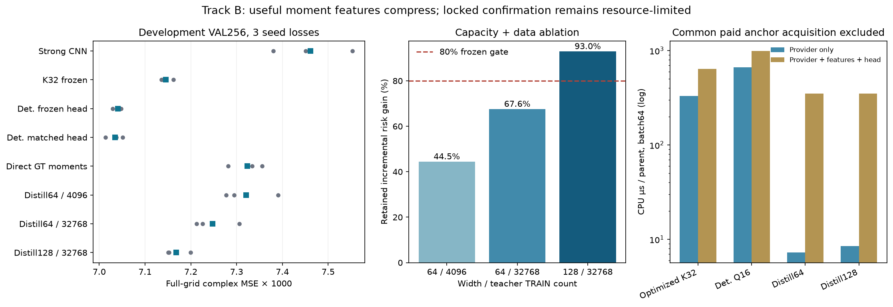

# B：功能统计压缩与物理归因

原Gaussian provider为682943参数。仅替换确定性积分未删除它，且在batch64下比优化K32更慢。新的214272参数raw-y蒸馏器直接预测四通道功能统计，匹配risk head；保留原K32相对Strong CNN增量的92.96%，额外provider费用2.54%，完整附加链54.57%。

这些均为已有VAL256，原teacher和物理anchor费用保留。它不是校准posterior，也不证明Maxwell特有几何。直接GT矩、两个小容量/数据版本和失败RRR控制全部报告。

[容量、风险和成本](stage_b_material_risk/REPORT_ZH.md) · [原始30次计时](stage_b_material_risk/OPTIMIZED_COST_BENCHMARK.json) · [独立成本审查](audit/B_OPTIMIZED_COST_INDEPENDENT_REVIEW.json)

