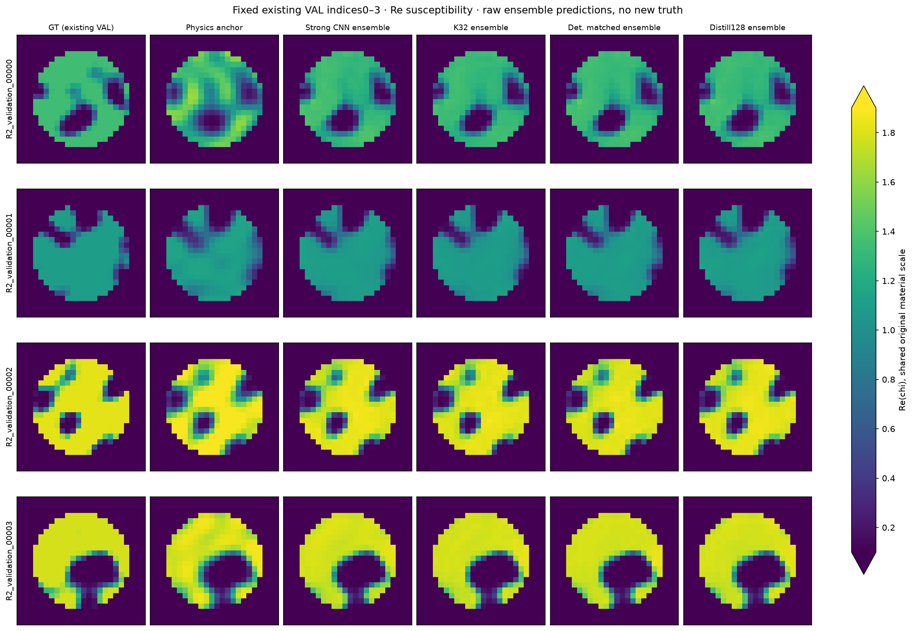
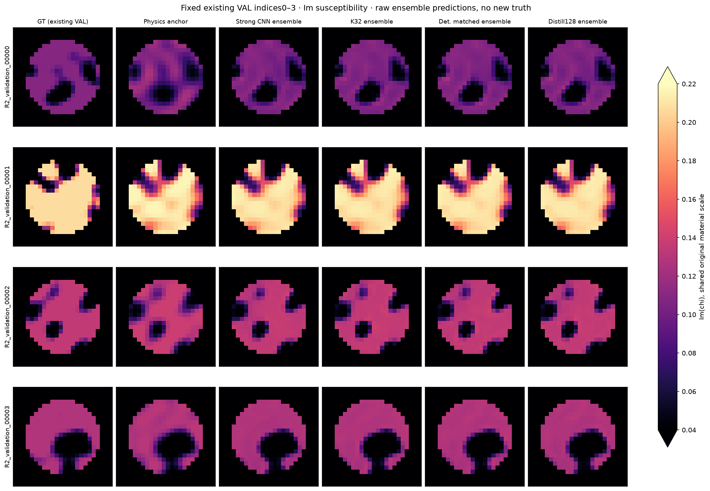
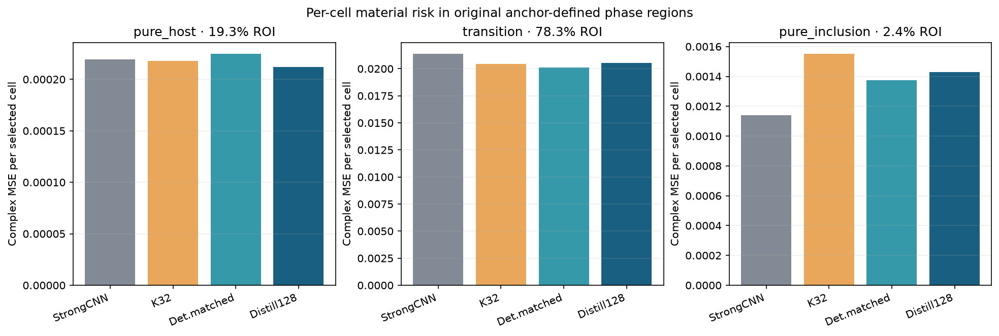
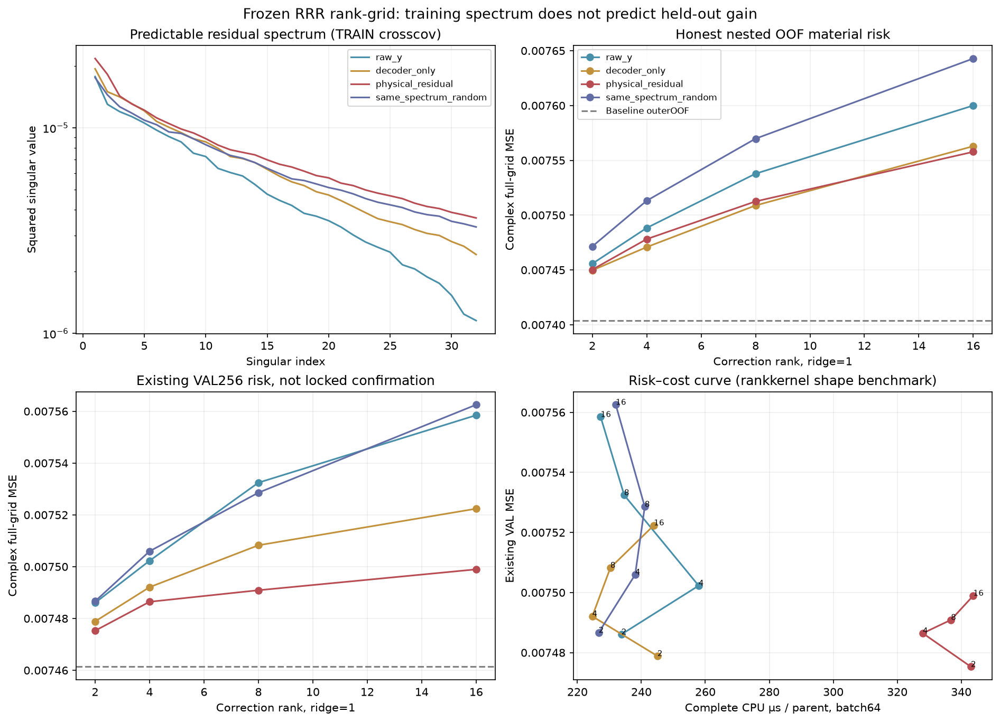

# Track B：材料矩与风险表示，已完成 development，独立确认受预算限制

本轮没有增加物理调用。最有信息量的结果是：Gaussian 模型输出的四个材料矩可以用一个 **214,272 参数**、仅消费原始测量的模型蒸馏；其三 seed 验证风险保留原 Gaussian fusion 相对强 CNN 新增收益的 **92.96%**，额外 provider 的 batch64 推断费用约为优化 K32 的 **2.54%**。这是已有 VAL256 上的压缩候选，**不是新的独立 TEST 确认，也不是 posterior 概率合格证据**。完整 provider + 特征整理 + risk head 的费用仍约为 K32 的 **54.57%**；共同物理 anchor 成本尚未删除。

## 1. 恢复资产与实际定义

只读恢复 R4 真正的 Gaussian checkpoint、三份原 fusion head、三份 strong CNN、TRAIN32768 / VAL2048、付费的 TRAIN1024 / VAL256 强 anchor，以及原 C2 decoder。原 x 的变换是 `x = (x_normalized * x_scale + x_mean) @ frame_inverse`。实际 checkpoint 恢复后的场–属性 covariance 为零，因此生产路径可以将属性与场的期望相乘；这一结论来自实际 frame/covariance 核验，不能从网络坐标 diagonal 字样推断。

Gaussian encoder 保留 **682,943** 参数。原测量为 source-major Re32/Im32，噪声 sigma = 0.00119211798514519，白化为 sqrt(2)/sigma。所有训练与推断均保持原模型、温度 0.5、C2 quintic 与两个 probit 属性区间。没有替换 sigmoid、重标噪声或引入新 prior。

`material_moments.py` 实现任意联合 Gaussian 下的一维场积分：先在给定场值时计算属性 probit 的一阶、二阶和实虚交叉 CDF，再对 C2 饱和函数及平方积分。保留场–属性 covariance 和属性之间 covariance；退化场方差取极限。`gaussian_image` 返回完整四通道，可选逐像素 Re–Im covariance。它没有声称提供完整跨像素 posterior sampler。

原 R4 K32 使用 empirical variance `ddof=0`，其期望是 population variance 的 31/32；确定性路径计算 population variance，是大 K 极限，**没有乘 31/32**。因此冻结 head 的替换是明确的输入分布改变诊断；匹配重训才测试改变后的表示链。

## 2. 数值资格与失败留痕

- 相关/强相关/退化/尾部/平台边缘案例：确定性材料均值及边缘方差对独立 adaptive quadrature 的绝对误差小于 4e-15；每例 1,000,000 MC 的均值误差小于 1.54 个 MC 标准误，联合 covariance 也检验。
- 真正恢复的 Gaussian provider：8 个 VAL parents 各 131,072 MC 作为积分参考，全部使用 4096 分块；材料四通道 RMSE 约 2e-4 至 7e-4，符合有限 MC 误差量级。
- 实际 VAL256 上 Q16、Q32、Q64 均与 Q128 的 float32 四通道结果一致。生产训练使用稳定 Q64；Q16 是本 checkpoint/该验证范围的数值快路径，不能据此宣称任意极窄 Gaussian 都可固定低阶积分。
- 宽方差截断多项式 recurrence 曾发生 2.23e-5 消减误差，已改为条件不良时稳定积分；高相关属性 CDF 固定节点曾误差 1.03e-5，已用角度变换并在 |rho| > .95 时 adaptive fallback。初次失败文件全部保留。
- **一次初始 high-K 全像素 materialization 的 RSS 达到 5.77 GB，违反 3 GiB 限制**，已作为失败保留；随后改为 streaming，重跑 peak 1.50 GB。此后训练主任务观察到的峰值低于 3 GiB，但没有声称证明连续 host + MPS 联合分配总量的硬上界。

## 3. 四个必要比较与直接压缩修订

风险是每 parent 的 full-grid complex MSE，再对三个训练 seed 的 loss 取平均。ensemble 图像风险另列，不混用。新 head seed 固定为 2026102601 / 02 / 03；冻结历史 head seed 为 2026102501 / 02 / 03。

| 表示/处理 | 三 seed 平均 loss | 三 seed ensemble 图像 loss |
|---|---:|---:|
| Strong CNN | 0.00746135 | 0.00726474 |
| K32 frozen | 0.00714550 | 0.00697119 |
| Det. frozen head | 0.00704106 | 0.00687947 |
| Det. matched head | 0.00703415 | 0.00686099 |
| Direct GT moments | 0.00732359 | 0.00712011 |
| Distill64 / 4096 | 0.00732090 | 0.00705254 |
| Distill64 / 32768 | 0.00724784 | 0.00701433 |
| Distill128 / 32768 | 0.00716774 | 0.00693198 |

确定性矩 + 原 head 从 0.00714550 降至 0.00704106；匹配重训为 0.00703415。这说明此处去除 K32 扰动有验证收益，**不证明任意非线性 head 去 MC 噪声必然改善**。独立训练 seed 与历史 head seed 不相同，因而纯输入替换与新训练增量应分开解释。

原监督材料矩 provider 实际已经很小：**120,192 参数**，并非 0.68M。它只保留 43.61% 的 fusion 增量，因此保留这一负面证据。随后在同一第四表示臂内预声明 objective/capacity 修订：用 Gaussian 确定性四通道作 teacher，raw-y → 64 → 64 → 4ROI，**103,552 参数**。teacher 只读 joint TRAIN 的 y,parent，不 materialize GT。4096 teacher 数据仅保留 44.47%；按冻结的严格正 VAL 均值差 gate，扩大既有 TRAIN 到 32768 后保留 67.60%。最后一组预声明 width128/128（实际 214,272 参数）达到 92.96%。各 provider 与匹配 head 均固定 4000 updates、三 seed；没有继续搜索容量或更新步数。width128 协议的参数估算 214144 漏计128个 bias，实际架构未变，实际值在 checkpoint/结果中为准。

这里“删除 encoder”指在线蒸馏模型替代原 Gaussian 682,943 参数 encoder。离线 teacher 仍依赖那个已训练模型、其 latent-supervised TRAIN32768，以及历史数据和物理支出，不能称为免费或无监督生成真实 posterior。

## 4. RRR：训练谱收益没有转化成数据外收益

使用输入 covariance 白化后的输出–输入 cross-covariance SVD，固定 rank {2,4,8,16} 和 ridge {.001,.01,.1,1}；**没有对 GT covariance 做 PCA 然后称其可预测**。比较 raw-y、decoder-only、physical residual、与物理输入同谱的随机 measurement projection，feature normalizer/PCA 只使用相应 TRAIN。

原 correction-only OOF 以全 TRAIN 训练的冻结 CNN 为 m0，并条件于全 TRAIN 的无监督输入 PCA；这一窄结果保留，不能称 end-to-end crossfit。随后实际完成 18 个 baseline CNN fit 的诚实嵌套二折：每 outer heldout512 的 baseline 仅用另512训练；RRR 用于 outerTRAIN 的 residual 由两个 inner256 baseline 交叉产生。所有 baseline 固定最后4000更新，不通过 outer heldout 或 global VAL 选 checkpoint。C 独立读取全部18训练/heldout parent 集，确认没有 supervised overlap。

| RRR 表示 | 最终 VAL loss | nested baseline OOF loss | nested corrected OOF loss |
|---|---:|---:|---:|
| raw_y | 0.00748607 | 0.00740386 | 0.00745570 |
| decoder_only | 0.00747886 | 0.00740386 | 0.00744965 |
| physical_residual | 0.00747528 | 0.00740386 | 0.00745032 |
| same_spectrum_random | 0.00748665 | 0.00740386 | 0.00747147 |

全部仍由 VAL 选择 rank2/ridge1；nested OOF correction 对 baseline 变差，没有约2%的物理专属增量。结论仅限冻结的线性 rank/feature/数据制度，不能升级成所有非线性可压缩表示均不存在。

剩余边界：原几何 frame 使用历史全 TRAIN online J，是无监督 conditional/transductive geometry，不是完全 fold-inductive 新几何；最终 VAL 的 m0 是冻结 fullTRAIN CNN，训练 residual 来自 halfTRAIN OOF baseline，数据制度存在已声明差别。VAL 选定 rank/ridge 后的 nested OOF 分数仍是次要、经选择的诊断。三个确定性 RRR 行是配对三 baseline seed，而非三次独立随机纠正学习；随机控制与 fold 划分才有单独 RNG。

## 5. 区域与属性诊断

统一用原 y-only anchor 的 field 阈值 ±1 划分 ROI；不是用 GT 或 posterior 的相区。

| anchor 区域 | ROI占比 | Strong CNN 每单元 MSE | K32 | Deterministic matched | Distill128 |
|---|---:|---:|---:|---:|---:|
| pure_host | 19.34% | 0.0002195 | 0.0002181 | 0.0002247 | 0.0002119 |
| transition | 78.25% | 0.0213637 | 0.0204433 | 0.0201270 | 0.0205125 |
| pure_inclusion | 2.41% | 0.0011404 | 0.0015504 | 0.0013746 | 0.0014297 |

`RESULTS.json` 另给逐单元改善与 pure-inclusion 属性误差。属性诊断是 ensemble 材料在 anchor-pure-inclusion 像素的平均，含 anchor 相区污染，不能当成纯 posterior 属性估计；pure-host 材料本身不能识别两种 inclusion 属性。

## 6. 实测成本与门槛

为防止旧 API 重复执行 encoder 让对照虚慢，优化 K32 只按 parent/batch 执行一次 Gaussian encoder，再按原 parent seed 和 chunk8 RNG 产生32 draw。与存储的原四通道最大差 1.01e-6（预声明2e-6数值容差），不改变原 Gaussian law/frame/decoder。原 API、vectorized 参考和优化 receipt 均保留。

以下统一采用最终 `OPTIMIZED_COST_BENCHMARK.json` 的 **CPU 单线程、batch64、每 parent 微秒**；30 次原始 provider/full timing、p10/p90、环境、冷加载与首次推断均已保存，不能混用不同 receipt 的有利分子和分母。

| 路径 | provider only µs | provider+特征+head µs |
|---|---:|---:|
| Optimized K32 | 332.26 | 640.91 |
| Det. Q16 | 664.45 | 992.64 |
| Distill64 | 7.25 | 352.09 |
| Distill128 | 8.45 | 349.73 |

Distill128 在现有 VAL 上通过原先的“保留至少80%新增风险收益、额外 provider 费用≤1/3”两项点估计：**92.96% 与 2.54%**。如果另要求完整 provider+特征+head 也≤1/3，batch64 不通过：比值 **54.57%**。二者必须分开报告，不能删除共同 head/feature 开销，也不能把 provider 加速比例当成含 Maxwell anchor 的系统加速。

新训练 fit GPU wall 合计 **460.0s**；whole-job 保守 GPU 预留 wall **506.3s**；从冻结协议到关闭的实际受控间隔 **2542.5s**，均在24h范围。所有新增物理 RHS = **0**。完整 ledger 含失败与所有 objective/data/capacity/fold 修订，未覆盖或重写 R4 ledger。

## 7. 最终状态与停止边界

- `B0_NUMERICAL`: **PASS**，指近似 Gaussian law 的 decoder 积分，不指真实 posterior。
- `B2_COMPRESSION_DEVELOPMENT`: **PROVISIONAL_PASS**（原“额外 provider”定义）；完整 pipeline≤1/3 的更强定义 **FAIL**。
- `PHYSICS_SPECIFIC_RRR_INCREMENT`: **NOT_ESTABLISHED**；冻结线性控制没有收益。
- `FRESH_256_PLUS_256_CONFIRMATION`: **RESOURCE_LIMITED / NOT_RUN**。相同 R4 native96+probit64 anchor 的历史512 parent成本约1,934,840 RHS，远超独立 B cap32768；没有用廉价降级 anchor 冒充公平确认，没有以旧已暴露 R4 TEST 重命名盲测。
- 两个 prospective finalists **deterministic_matched**、**distilled_w128_n32768** 与全部候选 checkpoint 已在 `SELECTION_FROZEN.json` 冻结，新 truth 未生成。停止本分支架构/容量/步数扩张；后续独立确认必须遵守既定预算/协议。

以上是可审查的局部算法结果，不是新的基本 Gaussian 积分理论、完整 posterior 资格、物理任务表示原创性、或最终发表接受结论。最终科学判断由主 Codex 进行。

主要机器证据：`RESULTS.json`、`METRICS.csv`、`COST_LEDGER.json`、`SELECTION_FROZEN.json`、`MOMENT_VALIDATION.json`、`JOINT_CDF_VALIDATION.json`、`OPTIMIZED_COST_BENCHMARK.json`、`NESTED_RRR_SUMMARY.json`、各 seed checkpoint 与逐100 update loss JSONL。所有细节只写本 B 子目录。

## 8. 最终推断复现、bootstrap 与交付图

**CPU/MPS 交叉设备复现门 FAIL 留痕**：`INFERENCE_REPLAY.json` 预声明3e-6预测误差容差未通过；最大差 3.94517929e-06，最大平均risk差 9.31322575e-10。没有放宽容差，也没有将此记录改成PASS。它是float32设备/批操作漂移，risk差远小于所报科学效应，但“数值影响很小”不等于原复现门通过。独立的CPU单线程二次全新Action加载/推断在全部256VAL、两个finalists、各3seeds上逐数组完全一致，`CPU_EXACT_REPRODUCIBILITY.json` **PASS**。两项检查具有不同含义。

最终canonical配对bootstrap：20,000次parent重采样，三个seed的loss先取平均，未bootstrap三个seed、未用ensemble loss；CI为98.333%，所有数据为选择用VAL，因此**仅探索性**。以下正差表示候选优于原K32，retention的分母按同一bootstrap共同计算；两份旧探索性comparison记录保留，不混作新确认。

| action | candidate | K32−candidate | paired gain CI | retained increment | retention CI |
|---|---|---:|---|---:|---|
| raw | deterministic_matched | 0.00011134 | [0.00004733, 0.00017594] | 135.25% | [113.38%, 181.03%] |
| raw | distilled_w128_n32768 | -0.00002224 | [-0.00010916, 0.00006852] | 92.96% | [71.60%, 135.63%] |
| passive_clipped | deterministic_matched | 0.00010865 | [0.00004482, 0.00017328] | 134.30% | [112.58%, 178.54%] |
| passive_clipped | distilled_w128_n32768 | -0.00002622 | [-0.00011318, 0.00006451] | 91.72% | [70.52%, 133.57%] |

所以92.96%的点估计不能写成“已独立证明至少80%”：retention区间仍宽，finalists只是冻结的后续确认候选。raw与clipped增量保留分别为92.96%与91.72%，没有混用三seed ensemble图像risk。

教师32768缓存生成一次耗CPU wall **29.15s**，容量64/128及各3seeds复用；batch64仅provider每parent节省约 **323.81µs**。只将教师生成CPU wall与这一CPU节省相除，约需 **90032 parents** 才摊销该项；**这不是总成本break-even**，尚未计原Gaussian训练、原joint数据/物理、新student/head GPU训练或共同付费anchor。不能把CPU/GPU wall直接当等价能耗/价格。

交付入口 `inference.py:Action(method,seed).predict(y,online,batch_size=64)`；完整shape与只读source资产路径、三seed checkpoint见 `REPRODUCE.md` 与 `SELECTION_FROZEN.json`。冻结receipt使用实际UTC时间戳，避免与用户Asia/Singapore展示日期混淆。

固定现有VAL索引0–3，不按loss挑图；全部预测为三seed ensemble、raw未裁剪，实部/虚部分别共享原物理色阶，超界用colorbar两端标识。它们不是新lockedtruth或代表性优胜案例。

rank成本图使用完整baseline+真实feature变换+shape-equivalent dense rank kernel+最终输出整理的实际CPU计时，**计时kernel仅将存储rank2因子重复到对应shape，不作为拟合的高rank模型**；风险曲线则完全取已存储的真实rank2/4/8/16拟合结果。没有为了补图重新训练/拟合。成本曲线的非单调点属于实测时序波动，不作rank越大越快的机制主张。
