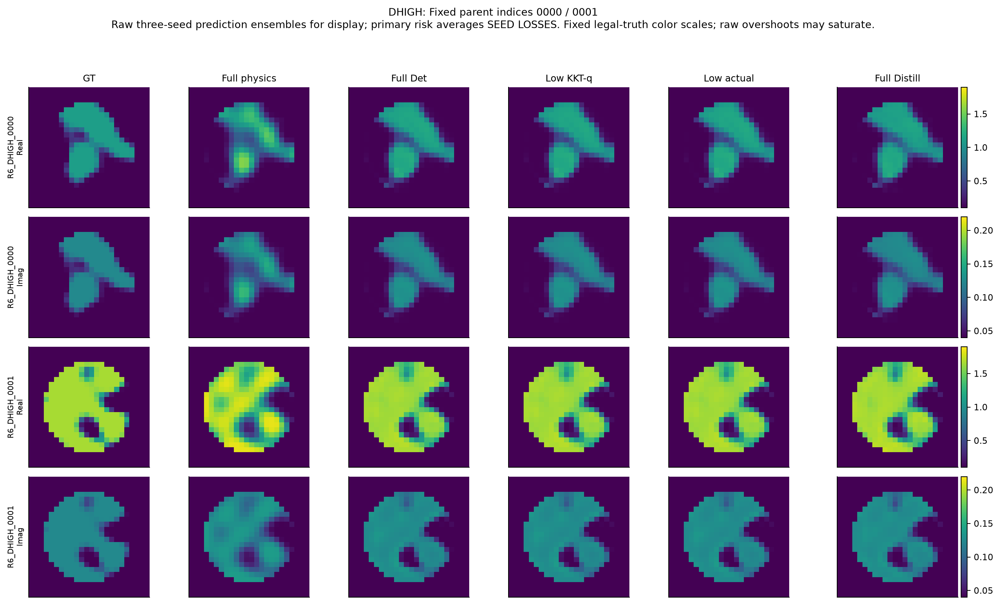

# Research P3L-R6：任务最优Maxwell材料计算的实际结果

本轮完成了分层概率、同容量功能学习、物理锚点优化及两档新噪声的独立实验。最实用的结果是：原始Full Maxwell不变，减少不必要的前置优化，在两批新对象上能明显减少实际物理计算。最重要的限制是：强化后的普通对照同样很强，完整后验仍未认证，目前不能把这项收益升级为独立Maxwell理论突破。

物理实验已封账：**6,860,984 RHS、210,355个新状态/LU**，低于8,000,000硬上限。33个新训练阶段保留全部checkpoint、日志和失败。新确认使用512个独立parent，不复用R5-B的已暴露512。两组noise分开统计，不合并成一个有利均值。

## 1. 这次究竟在研究什么？

一份穿透/散射数据通常不能把材料的每个自由度都确定下来。我们希望知道两件不同的事：怎样对材料不确定性分配正确概率；怎样用有限计算得到更接近真实材料的图像。低误差图像可以由监督学习获得，不必已经解决完整posterior；低残差的一个物理解也不自动是后验样本。

R5-B已独立确认Gaussian全局统计加局部CNN能改善风险，但214k蒸馏器的至少80%收益保留仍未统计通过。其微秒级provider压缩对1.73秒共同物理锚点几乎没有整系统加速。R6因此同时追求正确的材料概率结构、稳定的功能学习和真正少做物理工作，而非再增加Flow名称。

## 2. 固定合同与证据身份

仍是原P1：Gaussian64×Uniform2，经精确probit得到Gaussian66；24×24 TM/VIE、576全网格、256ROI、8源×32复接收；原quintic精确平台、被动复材料、source-major packing；sigma=.00119211798514519。原Native96及Probit64优化器数学与容差未改。新低成本方案另有身份，未冒称原完整配置。

A的二维/三维模型将其余latent固定、活动Gaussian明确截断于[-4,4]，不是Full66边缘。B的图像是材料平方风险点决策。C/D降低优化预算但每次仍调用同精度Full Maxwell。三个对象不混称posterior。

[统计合同](SHARED_STATISTICAL_CONTRACT.md)、[历史事实](PRIOR_EVIDENCE_AND_FAILURES.md)、[复现入口](REPRODUCE.md)给出完整定义。原R5-B1,999,504 RHS没有重新计入R6。

## 3. A：材料分层、补偿和条件依赖

### 正确概率体积可以显式写出，但不能忽略窄likelihood

在三维均匀子模型中，材料增量V=QD，Q是相分数，D是复属性。host为原子；pure与transition源域不同，却可映射到同一材料。正确材料密度要把这些原像的prior质量相加，并保留Q的负二次换元因子。

全局网格的prior归一化通过，仍漏掉regular/overlap的窄Maxwell likelihood。局部GN白化加真实prior纤维的GH15→21可稳定材料矩，regular均值差约3.93e−10，但没有全域tail或外部模式质量界。因而只有Q1/Q2数值证据，没有连续TV证书或Full66认证。

同一保存节点的平坦材料prior对照显示，regular中prior纤维权重使均值变化约.11198个材料SD，likelihood mode到平坦likelihood均值仅.00263SD。不能只拟合条件mode后把体积删除。

### 强补偿可以消去全部变化，因为材料根本没变

上接缝未补偿真实Maxwell响应的末三点斜率约2.989。只允许实属性补偿，还剩8.098%的首项法向系数；实虚属性都可调时，D/Q补偿让材料相同，材料RMS差约1.48e−16，观测差落到浮点底噪。它是同材料gauge，不是发现另一种材料世界，也不能在数值底噪上拟合更高接缝阶。

这还给出一个条件几何解释：均匀复材料参数下，非极点处Maxwell响应复解析；完整复通道的两实导数列具有相同范数并实正交。这是标准Cauchy–Riemann性质的具体应用，不是任意非均匀材料场的各向同性定理。

### 即使边缘正确，独立组合也会创造错误材料

固定非零材料V=v后，正确纤维上D=v/Q。将精确Q、D条件边缘独立相乘，材料均值变成v·EQ·E(1/Q)，非退化纤维时偏离v。标准Cauchy–Schwarz给出这个偏差的正性；其意义在于不能把相关性错误都归为边缘Gaussian形状不好。

两例各32对合法条件纤维，在固定一次置乱后保持经验边缘却破坏配对。材料均值ROI位移为.002485/.026078，完整复观测的归一化L2差均值15.53/117.58；实际新增448 RHS，十个完全相同材料命中缓存。总体精确边缘乘积的实均值偏差为.002638/.018028，与有限32对单次置乱分别报告。

这些不是Full posterior draws或Gamma校准。它们给出一个真实Maxwell控制反例：把latent gauge误当独立材料不确定性可以制造大量错误响应。不能用它单独解释旧Full66 Gaussian失败的全部原因。

### 任务误差仍没有形成成本胜利

host端点latent Jacobian为零，但分层后验权重迁移产生非零材料任务响应；between-source项约占有限规则导数范数28%。材料均值和phase事件确实不要求相同概率精度。然而本轮没有建立认证材料均值比认证branch质量更便宜的成本分离；4D未扩大，原门没有放宽。A最终为REDIRECT。

详见[A分层](STAGE_A_STRATIFIED_PROBABILITY.md)、[补偿](STAGE_A_MAXWELL_COMPENSATION.md)、[任务积分](STAGE_A_TASK_INTEGRATION.md)。

## 4. B：任务加权训练并未自动更好

四个新目标都使用N1024、214272参数provider、6418参数head、相同batch schedule与4000+4000更新，各三seed。历史N32768只作部署强基准，跨数据规模不能作监督目标的因果比较。

|目标|匹配head的VAL full MSE|
|---|---:|
|历史feature N32768|.00716774|
|feature_control N1024|.00763536|
|直接GT action N1024|.00758068|
|feature+action N1024|.00763846|
|GT+action N1024|.00790106|

12个provider和12个head都真实训练，保留update0、checkpoint选择和曲线。新目标没有胜过历史部署器，因而没有在新D上反复改网络。固定seed交换显示provider/head配对有影响，但有限分解不是总体训练方差；不能据此证明容量足够。

任务响应矩另做12个低成本ridge试验。恢复的无噪响应/噪声在float64中精确重组观测，误差约4.6e−17；高SNR的1/sigma²仍将回归一致性误差放大。中心化目标比原始矩相减更稳定，仍不足以作为可信posterior covariance。没有把这个失败转换成全部概率网络无效。

[功能学习](STAGE_B_FUNCTIONAL_DISTILLATION.md)、[seed与action](STAGE_B_SEED_VARIANCE_AND_ACTION_RISK.md)、[任务响应矩](STAGE_B_MAXWELL_CONTEXT_ABLATION.md)。

## 5. C：真正有收益的是少做哪些物理工作？

最初同时截断Native和Probit的方法损害风险，新的512匹配head也没有通过相对原强head的1%非劣门。我们保留负结果，没有换成较弱Full512基线来制造成功。

转而保留较充分Probit、减少Native。Native优化的Uniform属性点目标与Probit的Gaussianized坐标点目标不同；前者更接近box边界，后者再承担坐标prior代价。开发中多做Native没有减少后续Probit工作。只是描述性机制，不是所有问题的普遍定理。

另提出不改权重的KKT特征闭合：原网络的残差反投影g=Jᵀwhite(y−F)在Gaussian场驻点应等于z，正号不能弄反。新noise下使用已知倍率r z。该替代只改变一个风险特征，不伪造Jacobian；原优化器仍支付真实J费用。投影收缩给出特征空间误差界，不能直接当成网络风险或posterior证书。

普通direct-prior Probit也是必要强对照。它在CDEV上同样过门，所以不能宣称Native阶段分配具有独立价值。

## 6. D：512个新对象的冻结结果

两个新noise条件分别256对象，模型权重不变，全部预测先封存再评分。六臂三seed，主风险先平均seed loss；20000 parent配对bootstrap，全局8比较Bonferroni，单侧99.375%。

|噪声|原完整确定性MSE|24+64 q候选MSE|风险变化|原完整系统秒|候选秒|原窗口节时|
|---|---:|---:|---:|---:|---:|---:|
|sigma×.5|.005463559|.005335107|−2.351%|4.4509|2.9131|34.551%|
|sigma×2|.009534329|.009555500|+.222%|2.5127|1.6943|32.571%|

两条件通过原冻结1% NI及20%wall门。同端点q对真实梯度的独立风险收益仅低噪通过，高噪未建立。transition占ROI74.65%/80.92%，主要改善或损失均在这里；不能把它简单说成薄边缘增强或Maxwell专属作用。

## 7. 为什么没有直接宣布突破？

**强化完整基线后，低噪风险资格不足。** 同样q特征放到完整96+64，MSE=.005315940；低成本候选比它高.3606%，1% NI上界仍为+1.26745e−5。原确认PASS不改，但更强比较未确认，不能只展示较弱特征的完整基线。

**普通优化同样有竞争力。** 预先冻结的direct-prior Probit128补充64+64结果很接近或更好；不是全512独立确认，更不能根据这次GT再改cap。

**时间窗口影响很大。** 又付费重放first16/条件×三算法，共96路径、268544 RHS。所有端点与封存完全一致，但绝对wall改变。同窗口低成本方案节时27.65%/32.77%，direct-prior节时29.31%/36.34%；二者之间没有确定胜者。低噪新窗口20%节时下界只有16.82%，因此跨窗口至少20%还未确认。

[新确认详情](STAGE_D_LOCKED_GENERALIZATION.md)、[同窗口复测](track_c/common_window_timing/RESULTS.json)、[独立计时审查](audit/r6_evidence/TIMING_DRIFT_REVIEW.md)。

## 8. 成本、错误与复现

|阶段|新增RHS|
|---|---:|
|A分层/补偿/控制|158144|
|B复用数据学习|0|
|C开发/匹配anchor/普通强控制|2864200|
|D新512/补充/同窗口重放|3838640|
|总计|6860984|

中央JSONL逐行与快照对账，无活动action/job、无物理数值失败；一项JSON报告失败原样保留，独立审计后零新增物理恢复。物理job wall5147.36秒，solver kernel3310.51秒；保守MPS训练job .2414 device-hour。它们不是把所有编辑/文献I/O都伪称已经逐条CPU profiling。其他分析、推断和交付费用有各自收据，详见[资源](RESOURCE_SUMMARY.json)。

原CPU/MPS3e−6门FAIL不改；本轮设备漂移单列。相区评分早期错误、dtype修复、数值积分失败和所有新目标负结果见[失败分析](FAILURE_ANALYSIS.md)。原始数组无损保存，没有为清理磁盘删掉失败或账本，也没有保存每个query的LU强引用。

## 9. 论文与下一轮判断

A提供具体的材料商/条件依赖反例；B未改善部署基准；C提供真实费用改善，但简单普通优化和特征强化控制削弱了独立创新主张。当前 **GO-TAP=REDIRECT**。不建议把分层、CNN、KKT和early stopping机械拼成一个大架构。

已有模型导数作为学习迭代特征的研究先例，QoI导向Bayesian逆问题误差/停止也有明确先例。[Manninen等作者预印本](https://arxiv.org/abs/2510.27487v2)、[Kerfriden等作者全文](https://pmc.ncbi.nlm.nih.gov/articles/PMC6416561/)支持这些广义背景；不是本轮精确算法等价证明。ScholarQA的429与文献覆盖缺口保留，不能以未检出宣称首次。

下一轮应围绕三个可推理的问题：非均匀材料商如何保留条件copula；接缝漏质量与材料任务误差如何给廉价证书；stationarity-defect何时值得再做一次真实J。具体数据和反例见[GPT Pro交接](GPT_PRO_HANDOFF/START_HERE.md)。

完整逐路线判定见[GO/NO-GO](GO_NO_GO.md)。本轮没有认证Full66 posterior、没有获得posterior calibration、没有证明任意layout或更大网格的加速，也没有把历史80%保留率HOLD改成PASS。
