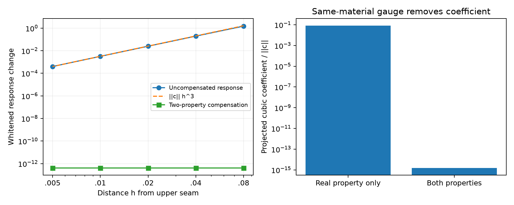

# Stage A：Maxwell响应、补偿与同材料gauge

纯相接缝附近的源坐标变化，不一定产生不可消除的物理变化。固定两项材料属性时，饱和decoder的上接缝给出立方材料偏移；若允许属性随Q共同调整，D/Q可以在合法box内部保持材料完全不变。这个gauge已经来自原decoder的多对一映射，**不是Maxwell传播新制造的材料零空间或新不辨识性**。[补偿记录](track_a/COMPENSATION.json)与[源数据CSV](track_a/analysis/COMPENSATION_SOURCE.csv)保留每个有限h的实际响应。 当前费用补注：root随后完成[固定材料copula控制](track_a/COPULA_COUNTEREXAMPLE_REPORT_ZH.md)，实际追加448 RHS/56个新状态，另复用10个字节相同材料；A当前总计158144 RHS。本文下方157696或旧analysis的157656是各自完成时点的阶段小计，不回写旧账；图表由独立可复现脚本与源清单生成。

已保存的未补偿白化响应在h=.08到.005由1.51490降到0.000398448，最后三点log斜率2.98939，接近立方阶；首项系数范数为3203.18004，||ΔF||/h³逐渐接近该系数。两属性补偿后的材料RMS约1.48e-16、白化响应约4.15e-13，已到浮点底噪，不能对这条常数底噪曲线拟合“更高阶响应率”。只开放实属性时仍留下约8.09831%的法向系数；实虚属性均开放时相对余项约1.56e-15。[斜率和系数](track_a/analysis/GAUGE_SLOPES.json)只描述这个固定条件子模型。

为保留完整向量，主线程另付40 RHS（8 forward+32 derivative），保存[材料Jacobian与系数](EVIDENCE_PACKAGE.md)及[原始cache](EVIDENCE_PACKAGE.md)。1/2/4/8 sources的完整复通道子集，Gram相对单位阵误差约2.19e-17至3.52e-16；一属性余项比均为0.0809831321，两属性余项接近float64零。这里参数尺度先去除了虚属性区间宽度.15，不能直接把同一Gram式套到Gaussianized属性坐标。A总费用据此更新为**157696 RHS**，向量子选不另算独立物理复现。

[独立共形审查](audit/r6_evidence/CONFORMAL_THEOREM_REVIEW.md)解释了这些数：固定其他材料且离散VIE矩阵可逆时，统一复材料幅度v的响应F(v)局部全纯，实化导数两列为a与ia；保留完整复通道的复线性selection/相容whitening保留等范数与正交。这是标准复解析性质在该子模型的应用，不是一般非均匀材料场的全局共形定理、全局单射或新的nullspace结论。只取实部、一般不相容实协方差、极点附近或a=0时需重新判断。

还须区分有限h的付费响应与同一J构造系数的代数投影：后者近零本身不是额外独立验证了三次渐近。host端Q→0时属性切空间坍缩，不能照搬pure端补偿；合法属性box也可能截断D/Q路径。所有标量/求积资格保持Q1/Q2，没有连续PDE或全posterior认证；[图源清单](track_a/analysis/FIGURE_SOURCES.json)可追溯实际数据。

