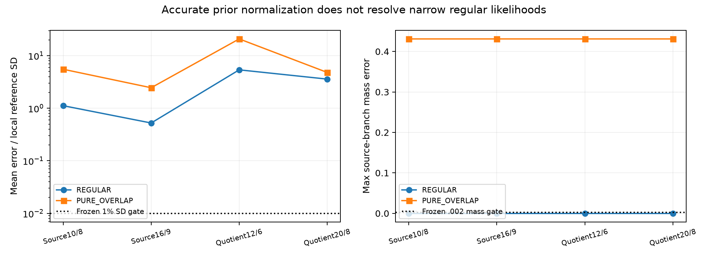

# Stage A：源分层与材料商概率

材料相同，并不意味着源坐标和latent事件相同。本轮把host平台单独保留为原子，把transition与pure源域分开计权；两者的材料像可以重叠，不能把两个源标签当成两个不同材料世界。实验仅覆盖固定2D/3D均匀子模型：活动Gaussian坐标截断于[-4,4]、其余坐标固定为0，**不是Full66后验的边缘**。[数学对象](THEORY_AND_COUNTEREXAMPLES.md)、[实际协议](track_a/FROZEN_PROTOCOL.json)与[独立prior审计](audit/r6_quotient_prior/REPORT_ZH.md)给出完整范围。 当前费用补注：root随后完成[固定材料copula控制](track_a/COPULA_COUNTEREXAMPLE_REPORT_ZH.md)，实际追加448 RHS/56个新状态，另复用10个字节相同材料；A当前总计158144 RHS。本文下方157696或旧analysis的157656是各自完成时点的阶段小计，不回写旧账；图表由独立可复现脚本与源清单生成。

材料增量为V=QD。给定Q>0时，二维属性到材料的Jacobian为Q²，因此连续prior密度包含Q^-2纤维权重；host原子质量与pure源质量均为0.2208604823，transition为0.5582790354。属性截断/probit变换后的矩形面积是0.1499809979，未遗漏归一化常数。R=t³、I=θt³的面积Jacobian为3t⁵，只改善接缝积分，不删除host原子。初版纯相矩形indicator与latent事件未分panel的失败保留在[初版QA](audit/r6_quotient_prior/QA_initial_unsplit.json)；修订后计划商网格prior总质量为1.0000164523与1.0000043335，source分支/phase质量与解析值约相符至1e-15，仍只属于数值Q1/Q2诊断。

真实Maxwell查询显示，prior归一化准确仍可能完全漏掉窄likelihood。REGULAR中，S3 source10/8→16/9相对局部GH21均值误差为1.119→0.524个材料SD；quotient12/6→20/8为5.380→3.585 SD。PURE_OVERLAP对应source为5.520→2.456 SD、quotient为20.848→4.802 SD。全局规则几乎把overlap质量全归transition，而保留纤维权重的局部GH21给出transition/pure=0.5688963452/0.4311036548；这些是条件子模型的源标签积分质量。[逐任务原始表](track_a/analysis/TASK_QUALIFICATION.csv)保留失败，不以prior质量接近1替代posterior资格。

独立GN白化材料积分GH15→21的REGULAR均值差约3.93e-10、overlap约1e-15，并通过本轮固定refinement门；但是Gaussian重要性网格的外部mode与尾部没有全局上界，**没有全局概率证书，也没有离散节点对连续密度的TV声明**。4D扩展保持NOT_RUN。A实际物理费用为157696 RHS：全局积分146552、局部参考11104、显式保存向量的复测40；不是仅报157656。对应三份[全局receipt](raw/jobs/stratified_uniform_submodels/CLOSED.json)、[局部receipt](raw/jobs/local_material_GN_reference/CLOSED.json)、[向量receipt](raw/jobs/compensation_saved_vectors/CLOSED.json)的wall合计约171.321秒、CPU约167.347秒。

图直接来自已付费节点及[CSV](track_a/analysis/GLOBAL_GRID_TASKS.csv)；本报告只整理已完成数据，新增RHS/训练均为0。准确材料均值与准确事件概率的成本分离仍为NOT_ESTABLISHED，最终科学解释由主线程审查。

