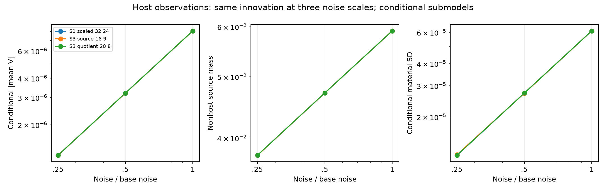

# Stage A：材料任务、事件与积分成本

材料均值可以很接近host，同时“不是host”的概率仍明显非零；这两种任务不应共享一个未经检查的概率精度结论。三个固定host观测只改变噪声尺度，使用同一个噪声innovation。S3 source最细规则在σ比例1/.5/.25下，材料增量实部均值为8.06050e-6、3.18995e-6、1.26501e-6，nonhost源质量为0.0590994、0.0471467、0.0375571。三点log斜率分别约1.33586与0.32703，属于这组条件观测的描述，**不是总体Bayes风险率或渐近证明**。[host CSV](track_a/analysis/HOST_TRAJECTORIES.csv)与[斜率](track_a/analysis/HOST_SLOPES.json)可重绘结果。 当前费用补注：root随后完成[固定材料copula控制](track_a/COPULA_COUNTEREXAMPLE_REPORT_ZH.md)，实际追加448 RHS/56个新状态，另复用10个字节相同材料；A当前总计158144 RHS。本文下方157696或旧analysis的157656是各自完成时点的阶段小计，不回写旧账；图表由独立可复现脚本与源清单生成。

固定任务门未改动：均值绝对差≤1e-5且差/参考材料SD≤.01；分支质量、latent Q>.5和材料Re增量>.02事件的概率差≤.002。host粗细规则在当前refinement比较中已同时通过均值与mass门，S3 source在σ/4的均值差约.0097935 SD，接近但没有超过原门。regular全局规则却未通过均值门，overlap分支误差约.4311。因而**材料均值比事件/分支概率更便宜的成本分离为NOT_ESTABLISHED**；不能把host的局部数值现象升级为一般成本优势。[任务资格表](track_a/analysis/TASK_QUALIFICATION.csv)也单列SD与logevidence变化，没有换成更宽松目标。

局部GN白化且保留prior fibre权重的GH15/21参考解析了REGULAR与PURE_OVERLAP，仍只有Q1/Q2数值收敛、无global tail certificate。REGULAR的likelihood Gaussian mode与纤维积分均值相差.10936个材料SD；在同一批已付费GH21节点上移除材料prior密度，mode→flat-density均值仅.002626 SD、flat-density→fibre均值则为.111978 SD。overlap对应.002565与.000617 SD。这个固定节点对照说明本例prior fibre权重不能随意删除，但不提供Full66 posterior结论。[局部参考CSV](track_a/analysis/GN_FIBRE_REFERENCE.csv)、[固定节点重加权CSV](track_a/analysis/PRIOR_FIBRE_REWEIGHTING.csv)及[NPZ](track_a/analysis/PRIOR_FIBRE_REWEIGHTING.npz)保留计算口径。 原冻结latent Q>.5在这两个GH窗口为0/约1，不能展示非平凡gauge不确定性；另作[POSTHOC次要Q功能分析](track_a/analysis/POSTHOC_LATENT_Q_REPORT_ZH.md)，GH21的E[Q]/Var(Q)为REGULAR .110927/.000306951、overlap .925074/.01093717，后者几乎全来自同材料within-fibre变动。新功能量独立比较GH15/21与GL96/128，没有自动继承材料参考资格、没有改主阈值或新增物理。

同一批缓存节点还分解了层内/层间task-response covariance。以最细quotient host σ为例，导数范数的within/between项约.0025931/.0009989，总范数约.0035920；host层内材料固定不排除层间权重迁移。对sqrt(2)×pack(y)的中央差分只重加权已存响应，步长σ×1e-4时与同一有限规则代数导数的最大相对差约1.56e-9。它核查恒等式实现，**不补足未收敛网格的posterior参考资格**。[导数CSV](track_a/analysis/WITHIN_BETWEEN_DERIVATIVES.csv)与[差分CSV](track_a/analysis/FIXED_NODE_FINITE_DIFFERENCES.csv)明确标注conditional model范围。

A实际157696 RHS由146552全局网格、11104局部参考及40向量复测组成；局部两个case的GH15+21节点各需5328 RHS，剩余448 RHS用于mode/J/line-search，不能隐去。原全局response节点在5个观测任务间复用，不重复计费。4D保持NOT_RUN，global tail与严格遗漏任务界未取得；[实际成本表](track_a/analysis/GLOBAL_METHOD_COSTS.csv)的基础157656小计另加[40 RHS向量receipt](track_a/COMPENSATION_VECTOR_AUDIT.json)，本报告没有启动新物理工作。

