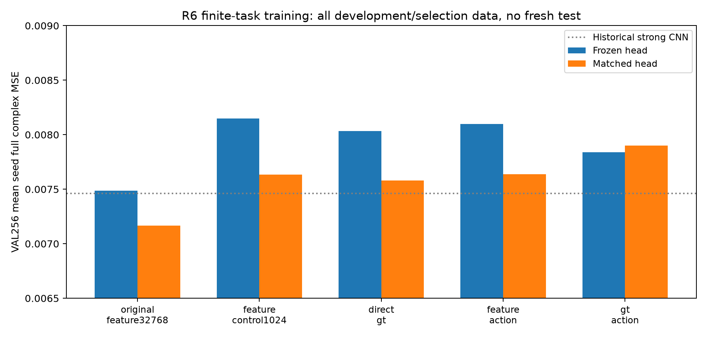

# Stage B：相同容量与数据规模下的功能学习

本轮实际完成**12个provider fit及12个matched-head fit**，保留原N32768 feature-distillation部署基准。四个新臂均为TRAIN1024、VAL256、3 seeds、相同512→128→128→1024学生（214272参数）和6418参数head，provider与head各4000更新、batch64、相同seed初始化和parent batch schedule。新四臂之间才是相同N/容量/更新的目标比较；历史N32768基准的数据覆盖与provider选择目标不同，不能把其差异全归因于teacher或GT。[冻结计划](track_b/PLAN_FROZEN.json)、[TRAIN/VAL来源](track_b/READINESS.json)与[逐job receipt](track_b/COST_LEDGER.json)给出实际配置。

feature_control只拟合teacher特征；direct_gt直接最小化固定历史head输出的GT材料误差；feature+action同时拟合特征和teacher action；GT+action同时拟合GT action和teacher action。所有action上下文仅来自同一TRAIN1024，teacher/y归一化统计沿用历史TRAIN32768并明确披露。学生始终只以y为输入，固定head阶段与随后matched head重训分开记录，u0纳入选择。direct_gt三个provider都在update200被选中，后续仍实跑到4000，训练曲线保留过拟合而没有删去后段。

matched-head三seed平均full complex MSE分别为feature_control .00763536、direct_gt .00758068、feature+action .00763846、GT+action .00790106；历史N32768为.00716774。对应固定head风险分别约.00814713、.00803447、.00809851、.00783942，不能将换表示与head再训练混为同一个增量。所有数字是**已有选择用VAL256**，不是新的locked确认；B6后来使用的历史VAL2048也不是新locked。[逐seed结果](track_b/SUMMARY.json)与[训练曲线](track_b/GT_ACTION_LEARNING_CURVES.png)保留原始证据。

本B训练fit+validation合计361.908秒，保守MPS整job wall369.690秒，新增物理RHS=0。进程peakRSS为1.052GB、采样MPS driver峰值.129GB，二者相加约1.181GB只作明确口径的保守记录，不声称连续全系统内存硬界。历史Gaussian teacher、joint数据、full anchor和旧训练均为沉没依赖，不记作免费。另行Track C matched fits有独立ledger；其训练ledger没有RSS字段，标为**RSS_NOT_RECORDED**，不能用本B的RSS替填。[B成本](track_b/COST_LEDGER.json)、[C独立训练ledger](track_c/MATCHED_TRAINING_LEDGER.jsonl)互不合并。

本轮没有新增Full MCMC，也没有把teacher四通道称为完整后验真值。冻结部署API、24份新checkpoint、选中update与所有失败/边界保留在[候选池](track_b/SELECTION_FROZEN.json)和[报告](track_b/REPORT_ZH.md)；本文件只整理实际开发结果，不给最终TAP/GO判断。

