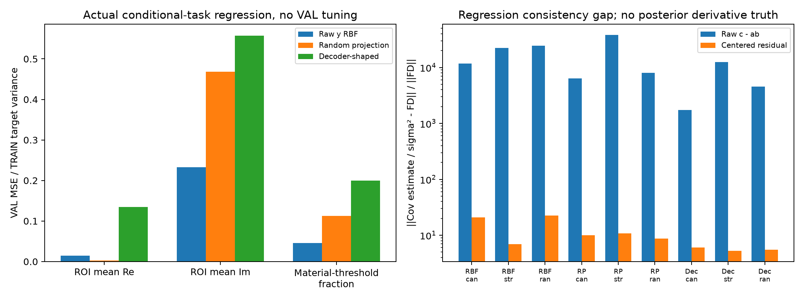

# Stage B：上下文消融、真实条件矩pilot与KKT候选

冻结模型在推断时依赖某个通道，并不证明该通道已经学到真实后验。历史学生matched风险.00716774；mean-only、variance-only、constant与parent-shuffle的平均风险约.00949898、.01027847、.01627606、.01176040。它们保留同一head、不重新训练，包含输入分布改变，因而只能说明这组固定系统对均值、variance通道及parent对齐敏感，不能把variance通道称为真实posterior uncertainty。[通道控制](track_b/CHANNEL_CONTROLS.json)保存逐seed结果，未用单次消融证明物理专属性。

B6实际读取全部34816个历史TRAIN32768/VAL2048 parent的complex128 noiseless Maxwell prediction、noise及q，逐值验证F+noise=observation、cached q=source q；没有重新生成物理或从量化y32伪造无噪响应。3个材料任务为ROI均值Re/Im及Re材料增量>.02单元比例，3组各4个固定响应投影；128特征ridge进行合法两折a0/moment交叉拟合，共12个线性fit、21.304 CPU秒、32.449 wall秒、0新增RHS。raw-y RBF的三个normalized task MSE为.01428/.23262/.04553。[资产receipt](track_b/b6_moments/ASSET_RECOVERY.json)与[proper MSE表](track_b/b6_moments/MOMENT_PROPER_MSE.csv)明确这是历史VAL，不是新locked。

B6中的decoder-only是随机measurement code经原C2/probit decoder形成的结构化随机特征，**未校准pseudo-latent，没有强anchor/J/Maxwell residual**，不能冒充真正Maxwell上下文。raw c−ab与同一个a的方向差分相对一致性gap为1745–37953；居中残差降到5.28–22.54，但仍很大，cres normalized MSE约1。sigma^-2约703658放大有限矩回归误差，而缓存roundoff经此放大仅约3.23e-11。真posterior下的Cov/sigma²恒等式不能自动赋予这些回归器资格；当前gap不是任一模型总体bias的直接测量，更没有Full66 covariance标签或认证。[B6报告与图](track_b/b6_moments/REPORT_ZH.md)保留这一有界失败。

另一个独立候选由主线程[理论§6](THEORY_AND_COUNTEREXAMPLES.md#6-新候选最优性闭合的材料反投影特征kkt-closure)定义：只把原冻结CNN的normalized residual-adjoint方向换为正号q闭合，其余anchor、decoder灵敏度、u2、Gaussian provider与head保持。它不是伪Jacobian，未收敛时只是新近似feature；已知新噪声比r按raw g=r*z再归一化。CDEV8配置×3seeds×q/zero/negativeq共72份预测先封存再评分，30.856 CPU秒、0 RHS/训练。q的24/64开发risk ratio upper为1.008195、wall saving lower为36.28%；zero/negativeq均未过原联合门，短probit配置也未普遍被修复。[API与来源](track_c/kkt_closure/CONTEXT_SOURCE.json)、[原权重身份](track_c/kkt_closure/SELECTED_WEIGHTS_IDENTITY.json)可供独立QA。

KKT结果仅作已暴露CDEV开发描述：同端点24/64的q−actual风险差约−7.48e-6，98.333%探索区间[-1.047e-4,8.998e-5]跨零；48/64原actual本已过门，q点风险反而略高。因此不能从“一个过NI、另一个未过”宣称KKT专属增益。512个缓存context的特征误差界诊断不是材料风险证书；本次稀疏CPU公式allclose最大2.861e-6与历史CPU/MPS的3e-6 FAIL是不同检查，没有覆盖旧FAIL。只读[开发结果与CSV](track_c/kkt_closure/REPORT_ZH.md)，不读取或预断D结果；C matched训练RSS缺项保持RSS_NOT_RECORDED，不补填。

