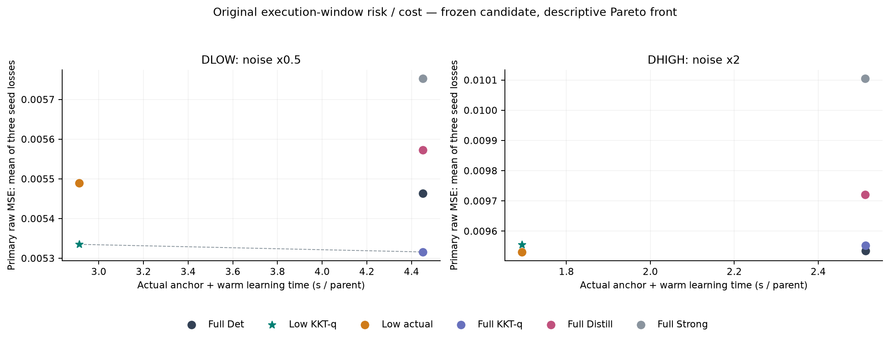
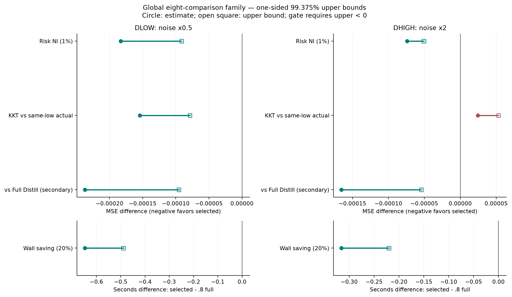
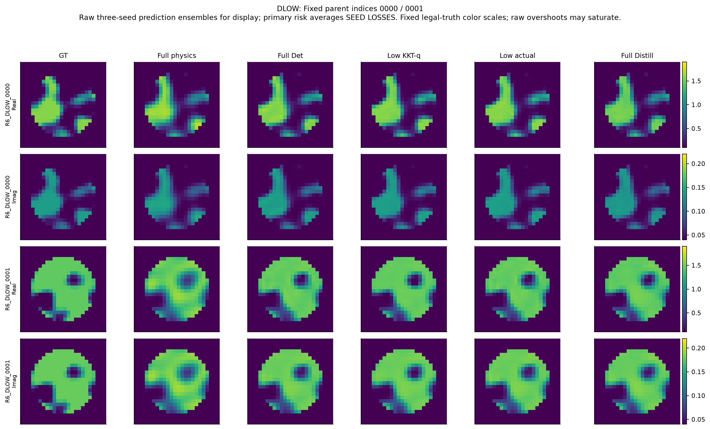
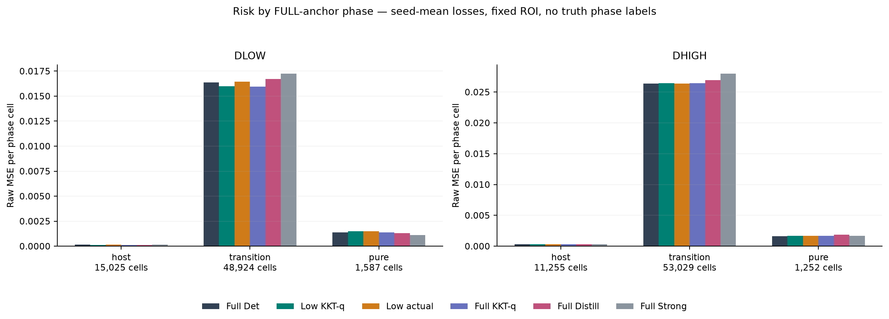

# R6 新噪声条件下的冻结独立确认

## 数据与冻结顺序

DLOW为256个新parent、sigma=.5×原sigma；DHIGH为另256个、sigma=2×原sigma。两组互不重叠，使用原完整P1 prior、24×24非线性Full Maxwell、8×32复观测。不同噪声组不合并风险。原R5-B512仅引用，未重跑、未再次计新数据。

模型、3seed、父对象、物理预算、24+64低成本方案、KKT倍率和统计在生成前冻结。原始D冻结后发生一次JSON序列化错误，物理结果完整；修复仅为报告恢复，原FAILED保留，零物理重放。所有512对象的六臂×三seed预测全部封存，随后又封存预先登记补充128预测，最后才由根线程写GT_UNLOCK评分。见[D冻结](track_d/D_FREEZE.json)、[全部封存](track_d/ALL_512_PREDICTIONS_SEALED.json)、[解锁](track_d/GT_UNLOCK.json)。

## 六个冻结动作

|方法|低噪256 MSE|高噪256 MSE|
|---|---:|---:|
|完整96+64、原确定性head|.0054635587|.0095343285|
|24+64、q闭合候选|.0053351069|.0095555002|
|24+64、原真实梯度特征|.0054892434|.0095312169|
|完整96+64、q闭合控制|.0053159395|.0095530700|
|完整96+64、历史Distill|.0055722776|.0097209775|
|完整96+64、历史Strong CNN|.0057527719|.0101050930|

表为每对象先平均三训练seed的loss，再平均独立parent；不是ensemble图像risk。主损失分母576。Full/ROI、MAE、固定passive clip、单seed及ensemble均独立保存，见逐对象CSV/NPZ。

物理点基线Full/Low低噪MSE=.0083308390/.0083327905；高噪=.0141010253/.0141019767。网络未重训，是权重zero-shot加公开已知噪声倍率的解析特征处理，不是噪声无关的新posterior。

## 主统计

20000次parent配对bootstrap；两条件×四contrast全局family=8，alpha=.05/8，单侧99.375%。主判据对每个条件分别为 selected−1.01Full risk<0、selected wall−.8Full wall<0。另检验同端点q对真实梯度的独立收益、及对Full Distill的secondary比较。所有抽样索引和contrast保存，不将seed当parent。

两条件的原成本/风险门均通过。候选完整系统耗时2.9131/1.6943秒，原完整基线4.4509/2.5127秒；原执行窗口节时34.551%/32.571%。这是实际单次交错物理路径加warm学习链，包含持久化/cleanup，非provider微秒速度的夸张外推。

KKT机制仅低噪通过：风险差−1.54137e−4，调整单侧上界−7.86476e−5。高噪风险差+2.42833e−5，上界+5.32040e−5，未建立独立收益。

## 更强控制与时长复测

同样q特征用于完整anchor后，低噪Full-q比原Full更好。候选对Full-q风险增加.3606%，对应1% NI上界+1.26745e−5，仍HOLD；高噪增加.0254%，该诊断通过。这项事后强化分析保留原确认结论但收窄算法优越性。[完整数据](track_d/FULL_Q_REFERENCE_POSTHOC.json)。

普通direct-prior Probit64/128先在已暴露CDEV竞争。依据CDEV、在D真值解锁前选q128，随后两条件各first64固定索引执行新物理和预测。其补充低噪MSE=.005249730，高噪=.009034797；对应子集原Full=.005464709/.009010083。它是64/条件的探索性补充，不是全512新确认或新风险冠军搜索。

由于补充与主实验计时窗口不同，又完整收费重放固定first16/条件×三算法，按循环顺序交错，所有q/材料/预测与旧封存端点完全一致。新窗口Full→Low节时27.65%/32.77%，Direct→Full29.31%/36.34%；Direct对Low的区间均跨零。低噪Full→Low95%下界16.82%，未确认跨窗口至少20%。[复测数组及收据](track_c/common_window_timing/RESULTS.json)、[独立审查](audit/r6_evidence/TIMING_DRIFT_REVIEW.md)。

## 失败、相区和输出身份

Full Probit的SciPy success低噪127/256、高噪180/256；Low为126/256、171/256。其余保留原优化器有限best point，未删除对象；有限返回不是证明达到全局MAP或驻点。流水线没有静默fallback，首个行政失败保留并恢复。

相区由完整anchor场定义；transition占ROI约74.65%/80.92%，不是只占很薄的边缘。低噪相区风险改善主要在transition，高噪轻微损失也主要在此。它不能单独证明Maxwell专属机制。图片为固定0000/0001，ensemble仅用于展示；事后失败案例另有明确标签。

所有学习图是材料风险点决策，未被称为decoder合法世界、posterior样本或可信区间。Phi约244不构成posterior predictive Gamma检验。采集/layout改版、adapted网络、完整posterior校准均NOT_RUN。
