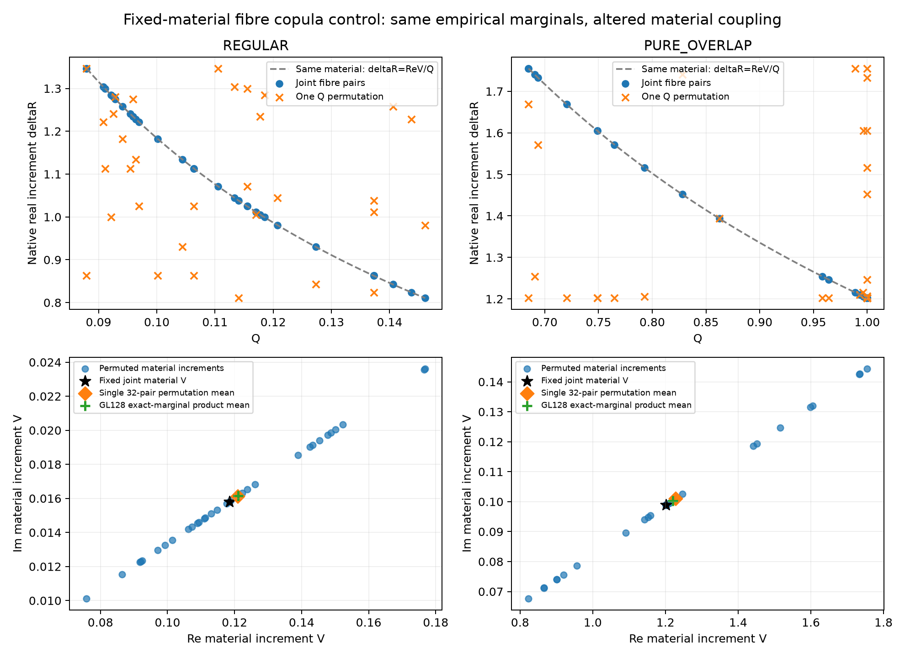
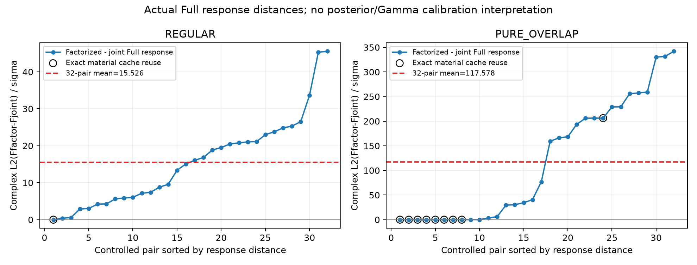

# Copula机制补充：精确边缘也不能代替正确联合

本次是**固定材料的条件prior-fibre copula控制**。两个V来自既有GH21 material likelihood mode，不是GT；每例按GL128 transition与pure质量取32个配对(Q,D=V/Q)，随后仅用冻结seed置乱一次Q相对于D。joint配对都解码为同一材料，置乱保留两个经验边缘但刻意改变联合关系；所有latent仍在原截断prior支持。它不是32个完整posterior样本，也不是32个独立物理世界的概率估计。条件推论由主线程定稿；这里不把标准Cauchy–Schwarz或decoder已有gauge称为新定理或Maxwell新零空间。[条件草稿](COPULA_COUNTEREXAMPLE_CONDITIONAL_PROOF_DRAFT.md)与[查询前协议](COPULA_COUNTEREXAMPLE_PROTOCOL.json)保持原版本。

真实root执行新增**448 RHS、56个forward states、0 adjoint**：两例各1个joint reference，factorized分别31与23个新状态，另有10个byte-identical decoded-material缓存复用，不能写成预算上限528已经全部发生。REGULAR单次32置乱材料均值偏移ROI RMS为0.002484924277、variance defect为0.000623462208，Full complex响应L2/σ均值15.526；PURE_OVERLAP对应0.02607845583、0.06614458342、117.578。这些响应差是无噪物理预测之间的控制距离，不是Gamma统计、PIT或校准通过率。[实际结果](COPULA_COUNTEREXAMPLE_RESULTS.json)、[receipt](../raw/jobs/fixedmaterial_fibre_copula_counterexample/CLOSED.json)及[图源CSV](copula_analysis/COPULA_SOURCE_SUMMARY.csv)保留完整费用和指标。

GL128条件纤维给出的精确边缘乘积实材料均值偏移是REGULAR .00263820、overlap .01802785；它与单次有限32置乱的均值不同，不能把一个经验置乱当成总体iid product distribution。独立GL64/128/256检查中，实均值偏移相对GL256的最大差约2.67e-16、product variance最大差约2.26e-15。这些是固定V上的float64数值refinement，仍只有Q1/Q2诊断，不提供global tail或Full66后验认证。[独立QA JSON](COPULA_FIBRE_REFINEMENT_QA.json)与[CSV](COPULA_FIBRE_REFINEMENT_QA.csv)由纯函数AST提取计算，没有import物理Book/Target。

A当前实际总费用为**158144 RHS**：原分层/局部参考157656、明确向量复测40、此copula补充448。旧analysis中的157656、后续posthoc时点的157696保留为各自阶段范围，不回写成仿佛当时已经发生后续查询。此补充实际wall 0.479577s、CPU 0.460211s，旧raw、协议、主阈值与模型不变。图由下面的分析脚本在计时空闲后统一生成；source manifest同时列出NPZ、Full reference current/field cache及CSV，不新增物理或fit。

