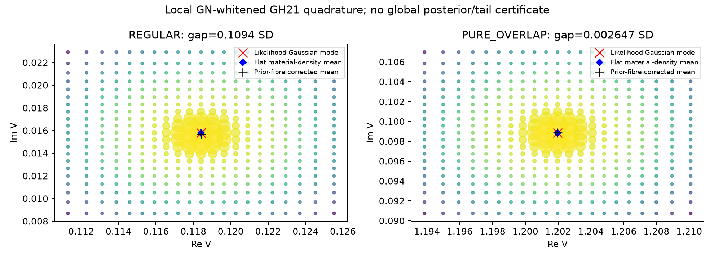

# Track A：条件子模型的材料商、任务积分与实际成本

本分析只读取已经付费并保存的response/积分节点和receipt，新增物理RHS=0，新增训练=0。实际A共157656/160000 RHS；全局网格146552、局部GN白化参考11104。研究对象是固定2D/3D、active Gaussian截断[-4,4]的条件子模型，**不是Full66边缘后验**。

## 主要可复核结果

host三个固定噪声尺度下，材料均值随噪声缩小，host源质量增加。S3 source finest的σ比例1/.5/.25对应的均值实部为8.06050e-6、3.18995e-6、1.26501e-6，nonhost质量为.0590994、.0471467、.0375571。三点受控斜率只说明这组三个条件观测，不是总体Bayes风险率。

全局网格的prior normalization准确，不保证窄likelihood被解析。四个S3 global规则对REGULAR/PURE_OVERLAP均未通过固定1%SD材料均值门。PURE_OVERLAP时它们几乎全分配给transition源标签，但独立局部GN+prior-fibre GH21积分为transition=.5688963452、pure=.4311036548；两个源标签可对应同一物理材料，不能称为两个已区分的材料世界。

局部GN白化GH15→21的REGULAR均值差3.93e-10、overlap约1e-15；材料均值、branch、latent/material事件均通过已冻结的1e-5绝对/1%SD/.002 refinement门。它们仍只有Q1/Q2数值收敛证据：高斯重要性网格的尾部和外部其他mode没有全局上界。没有定义或声称离散节点测度对连续密度的TV精度。

Likelihood-only Gaussian mode与保留prior fibre volume的积分均值之间，REGULAR相差.10936个材料SD，overlap相差.002647个SD。mode与积分均值的比较本身混合了似然非线性和prior fibre权重，不能将likelihoodmode等同于完整Laplace posterior均值。另对同一批已存GH21节点移除prior材料密度（没有新查询），REGULAR mode→flat-likelihood mean仅.002626SD，而flat-likelihood→prior-fibre mean为.111978SD；overlap对应.002565SD与.000617SD。该固定节点对照更直接显示REGULAR中的prior fibre volume作用，仍仅是局部条件模型结果。

上接缝未补偿response的log斜率接近3；两项属性补偿后的材料变化停留于1.48e-16 RMS、白化response约4.15e-13浮点底噪。对底噪拟合高阶斜率没有意义。只开放实属性时，投影后仍保留8.0983%的立方系数；实虚属性均开放时降至1.56e-15相对比例。这是同材料gauge消去源坐标系数，没有建立新的非平凡材料纤维。

## 冻结任务门与成本解释

逐任务门保留原值：材料均值绝对差≤1e-5且差/参考材料SD≤.01；source branch、latent phase、material事件概率差各≤.002。SD自身与logevidence差另报，不把它们换成更容易的成功标准。所有状态、失败和确切数值见TASK_QUALIFICATION.csv。

host粗网格在当前refinement比较中已同时满足均值与mass门，regular全局规则没有达到材料均值门；局部参考又增加mode/J/line-search开销。因此**材料均值比branch概率更便宜的成本分离没有建立**，不能把共享一次节点的多任务结果重复收费或从单一host示例推广。全局每规则actual增量RHS与uncached反事实分别保存；本轮没有扩展到4D以救结论。

within/between task-response covariance及observation导数使用现有同一节点规则重新加权计算。导数坐标为sqrt(2)×source-major pack(y)，所以导数矩阵为Cov(V,sqrt(2)pack(F))/sigma²。host层内材料固定仍可因host/transition权重迁移产生between项。中央差分只重新评价存储节点的likelihood，新增RHS为0；它验证有限规则的代数导数，不补足该规则的posterior reference资格。

## 文件与图

ANALYSIS_SUMMARY.json、TASK_QUALIFICATION.csv、GLOBAL_GRID_TASKS.csv、HOST_TRAJECTORIES.csv、WITHIN_BETWEEN_DERIVATIVES.csv、FIXED_NODE_FINITE_DIFFERENCES.csv、COVARIANCE_ARRAYS.npz、COST_AND_SCOPE.json及FIGURE_SOURCES.json给出所有数据和口径。

