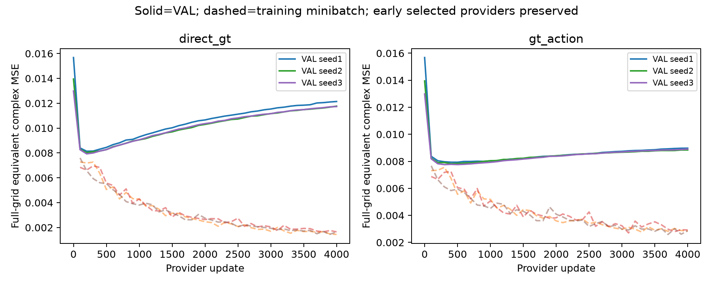

# R6 Track B：固定容量、有限训练集的任务功能学习

所有新学习只用历史 TRAIN1024 个完整 anchor，VAL256 已暴露并用于选择；**没有新的独立评价，也没有概率后验合格结论**。原始 N32768 蒸馏基线保留不可变。新模型和基线均为214272参数 provider、6418参数 head；provider 与匹配 head 各4000更新，3 seeds。

四个新臂都从相同 seed 初始化、使用相同 TRAIN1024 batch schedule、固定同一对应历史 head；归一化沿用 TRAIN32768 的 y/teacher 统计。feature_control1024 只拟合 teacher 特征；direct_gt 直接最小化固定 head 的 GT 材料误差；feature_action 同时拟合特征与 teacher action；gt_action 同时拟合 GT action 与 teacher action。teacher action 是有偏任务标签，不是完整 posterior 真值。

|臂|冻结 head 平均 full complex MSE|匹配 head 平均 full complex MSE|
|---|---:|---:|
|original_feature32768|0.0074874357|0.0071677379|
|feature_control1024|0.0081471292|0.0076353567|
|direct_gt|0.0080344683|0.0075806750|
|feature_action|0.0080985051|0.0076384596|
|gt_action|0.0078394210|0.0079010596|

原始 N32768 只作为历史部署基准；新四臂之间才是相同 N1024、容量、优化更新和局部输入的因果比较。原始基线按 teacher feature VAL 选择 provider；新四臂按冻结 head 材料 VAL 选择 provider，不能把这两者的差异都归因于目标函数。所有更新0都纳入选择，日志保留该点。

动作是 full-grid 原始复材料均方误差；表为三个 seed 的 risk 平均，不是 ensemble 图像误差。head provider交换矩阵记录所有3×3组合，finite ensemble prediction variance 使用有限已训练模型恒等式，不能作为总体学习方差估计。mean-only/variance-only/constant/parent-shuffle 为冻结推断消融，没有重新训练，因此变化包含输入分布改变。

`inference.py:Action(method, seed, head_mode="matched").predict(y, online)` 可直接部署；online 必须是原来的 observation/residual/q0/chi0/J，predict 不读取GT或物理求解器。允许方法 original_feature32768 / feature_control1024 / direct_gt / feature_action / gt_action。

证据：PLAN_FROZEN.json、READINESS.json、TRAINING_JOB.json、jobs/*.json、models/*/{RESULT.json,provider_losses.jsonl,head_losses.jsonl,PROVIDER.pt,HEAD.pt,validation.npz,frozen_validation.npz}、SUMMARY.json、SEED_COUPLING.json、CHANNEL_CONTROLS.json、FINITE_TASK_RISK_IDENTITIES.json、ACTION_REPLAY.json。

复现：在仓库根用现有 Gaussian/.venv_nn/bin/python 执行 track_b/run.py，再执行 track_b/diagnostics.py、track_b/report.py。已存在 RESULT 的拟合会跳过，历史输入完全只读。新增物理RHS=0；所有模型训练都在MPS，CPU线程1；实际资源详见jobs与TRAINING_JOB。训练上限为3500秒保守wall（低于1device-hour），进程RSS上限5GB。

交换 provider_i/head_j 的全部3×3 risk：对角与非对角的平均差（非对角−对角，正数表示配对有利）：
- original_feature32768: 0.000001025; provider/head/interaction 有限预测变动平方均值 = 0.00004012 / 0.00019175 / 0.00000997。
- feature_control1024: 0.000029274; provider/head/interaction 有限预测变动平方均值 = 0.00015521 / 0.00022462 / 0.00003441。
- direct_gt: 0.000245976; provider/head/interaction 有限预测变动平方均值 = 0.00014724 / 0.00024004 / 0.00007741。
- feature_action: 0.000007667; provider/head/interaction 有限预测变动平方均值 = 0.00013750 / 0.00021155 / 0.00003095。
- gt_action: 0.000343747; provider/head/interaction 有限预测变动平方均值 = 0.00023979 / 0.00026897 / 0.00011600。

这些数是有限9个已训练组合的正交分解；相同训练数据、seed配对和表征归一化使其不能当作总体 bias/variance 或机制因果证明。原始 N32768 配对差约1e-6；GT相关臂配对差较大，说明跨 seed 交换不等于独立复现实验。

CPU部署 Action 与已存 MPS 预测的最大绝对差 4.06461095e-06；仅报告float32设备漂移，没有新设或放宽接受阈值。

实际新训练24个stage：fit+validation合计 361.908s；保守MPS整job预留wall 369.690s。进程peakRSS 1.052GB，采样peakMPSdriver 0.129GB；二者相加约1.181GB，不是连续全系统内存硬界证明。

部署CPU单线程、batch64、20次实测median（provider / provider+feature+head，微秒/parent）：
- original_feature32768: 3.43 / 519.75
- feature_control1024: 3.39 / 373.36
- direct_gt: 7.94 / 682.39
- feature_action: 9.83 / 430.51
- gt_action: 4.67 / 412.73

计时与主线程物理任务同时运行，存在系统负载干扰；所有新provider架构相同，不能用这些差异声称某个loss目标具有推断速度优势。共同anchor生成仍未包含。原始逐次耗时与p10/p90均保留。

